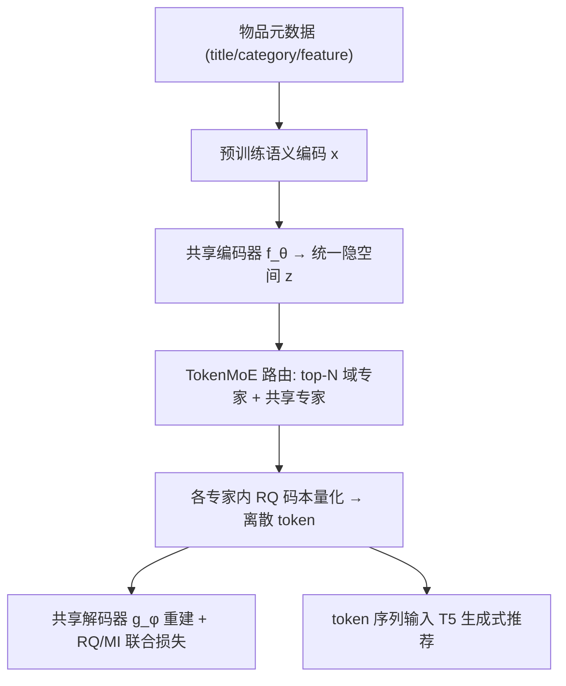
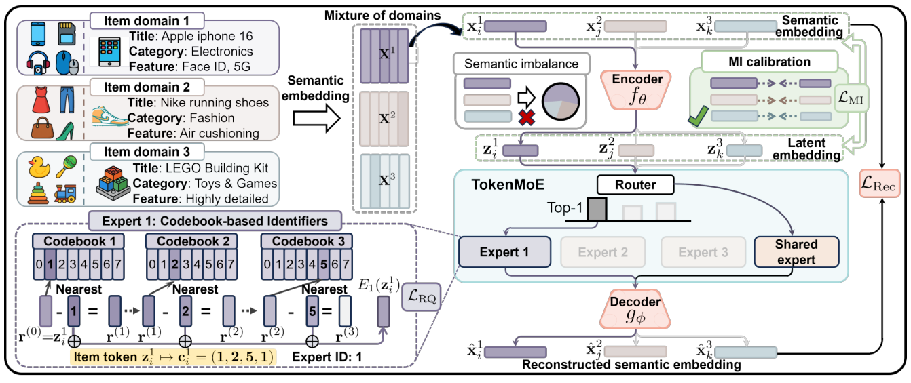

# Tokenize Once, Recommend Anywhere: Unified Item Tokenization for Multi-domain LLM-based Recommendation (一次分词，处处推荐：面向多域 LLM 推荐的统一物品分词)

- **会议/期刊**: AAAI 2026
- **作者与机构**: Yu Hou, Won-Yong Shin（延世大学 Yonsei University）
- **推荐链路定位**: 端到端生成式（物品分词器 + LLM 生成式检索）
- **研究方向**: 生成式推荐与离散语义 ID / 跨域与多场景推荐
- **论文原文**: [https://arxiv.org/abs/2511.12922v1](https://arxiv.org/abs/2511.12922v1)
- **开源代码**: [https://github.com/jackfrost168/UniTok](https://github.com/jackfrost168/UniTok)

## TL;DR (1分钟核心速览)

现有 LLM 生成式推荐的物品分词器（TIGER/LC-Rec/LETTER）都是**单域专用**：10 个域就要训 10 套码本，训练/部署/维护成本线性膨胀，且共享码本时跨域语义会混叠。UniTok 用「共享自编码器 + TokenMoE（域专家 + 常驻共享专家）+ RQ 码本 + 互信息校准」实现**一次训练、跨域通用**的分词器。在 10 个 Amazon/Yelp 域上按 Full-Ranking 协议评测，NDCG@10 最高提升 51.89%（Tools），可训练参数从 87.78M 降至 9.11M（9.63×），并在 3 个未见域上零样本迁移仍领先 17.87%。

## Background & Motivation (背景与核心矛盾)

- **主流范式**: LLM 生成式推荐先用 RQ-VAE 类码本把物品元数据量化为离散语义 ID（TIGER），再让 LLM 自回归预测下一物品 token；LC-Rec/LETTER 进一步引入协同语义与可学习分词。
- **前人局限**: ① 每个物品域单独训一套分词器，10 域即 10 份码本+自编码器，参数与运维成本随域数线性增长；② 若强行共享一套码本，不同域的分布与语义差异会导致**语义混叠与 token 分配偏置**（图 1b），简单域与复杂域学到的隐表征信息量严重不均。
- **核心洞察 (Key Insight)**: 多域分词的本质矛盾是「共享以省参数」与「分离以保域特性」的对立；MoE 的稀疏路由恰好提供了「参数共享 + 计算分离」的结构性解法，而域间信息量失衡可用互信息方差来显式度量与约束。
- **本文切入点**: 把 MoE 从 Transformer FFN 层搬到**分词模块内部**，并用 HSIC 代理互信息做跨域校准，使单一分词器同时具备域专精与全局迁移能力。

## Method (核心方法设计)

### 1. 整体框架 (Overall Architecture)

物品文本先经预训练语言模型编码为 2048 维语义向量 $x_i^k$，共享编码器$f_\theta$将其压到 32 维统一隐空间$z_i^k$；TokenMoE 的路由器按域打分，将$z_i^k$送入 top-$N$个域专家并**确定性叠加**常驻共享专家，每个专家内部用 4 级 RQ 码本量化，输出离散 token 序列（码本索引 + 专家 ID）；解码器$g_\phi$ 重建原语义向量，与 RQ 损失、MI 校准损失联合优化。训练完成后，物品 token 序列直接喂给 T5 做下一物品生成式预测。

<figure class="paper-figure" markdown="span">
  <figcaption>图2：所提出的UniTok框架的示意图概述。</figcaption>
</figure>

### 2. 关键设计拆解 (Key Designs)

1. **TokenMoE（域专精与知识共享的解耦）**：痛点是用单一码本处理多域会丢失域特性。路由器 $G_k=\mathrm{softmax}(h(z_i^k))_k$产生域分布，仅保留 top-$N$（$N\in\{1,2\}$）域专家，再无条件加上共享专家：
$\hat{z}_i^k=\sum_{k=1}^{K}G_k E_k(z_i^k)+E_{\text{share}}(z_i^k),\quad G_k=0 \text{ if } k\notin \mathrm{Top}_N$
各专家以对应域的平均特征初始化，无需显式域标签即形成域感知归纳偏置；稀疏激活使新增域只增一个专家而非整套模型，这是 9.63× 参数缩减的来源。

2. **RQ 码本量化（层级离散语义 ID）**：沿用残差量化，第 $\ell$级取最近码字$c_\ell=\arg\min_{c\in C_\ell}\|r^{(\ell-1)}-c\|^2$、$r^{(\ell)}=r^{(\ell-1)}-c_\ell$，最终 token 为$(z_1,\dots,z_L,e_1,\dots,e_N)$，即码本索引拼接专家 ID。RQ 损失$\mathcal{L}_{\text{RQ}}=\sum_\ell\|\mathrm{sg}[r^{(\ell)}]-c_\ell\|^2+\alpha\|r^{(\ell)}-\mathrm{sg}[c_\ell]\|^2$ 分别承担码本学习与承诺约束。

3. **MI 校准（抑制域间语义失衡）**：共享编码器易让简单域信息量过饱和、复杂域欠拟合。用非参数 HSIC 估计 $\hat{I}^{(k)}=\widehat{\mathrm{HSIC}}(X^k,Z^k)=\frac{1}{(|I^k|-1)^2}\mathrm{Tr}(UHVH)$，并最小化跨域方差、同时保底均值：
$\mathcal{L}_{\text{MI}}=\mathrm{Var}[\hat{I}^{(k)}]-\beta\,\mathbb{E}[\hat{I}^{(k)}]$总损失$\mathcal{L}_{\text{total}}=\mathcal{L}_{\text{Rec}}+\lambda_{\text{RQ}}\mathcal{L}_{\text{RQ}}+\lambda_{\text{MI}}\mathcal{L}_{\text{MI}}$。方差项压缩域间性能差（定理 3 给出$|L^{(i)}-L^{(j)}|\le C\sqrt{\mathrm{Var}[\hat{I}^{(k)}]}$ 的上界），均值项防止退化为「全部低信息量」的平凡解。

4. **训练与推理开销**：分词器训练**不依赖任何用户交互**，仅用物品内容，因此可离线一次性完成并跨业务复用；推理阶段与 TIGER 完全一致（T5 自回归生成 token），无额外在线延迟。

## Experimental Setup & Evaluation Protocol (实验设置与评估协议)

- **数据集与预处理**: 10 个 Amazon 品类 + Yelp 作为源域联合训练，Clothing/Health/Sports 作为零样本目标域。

| 数据集 | #Users | #Items | #Interactions | 说明 |
| :--- | :---: | :---: | :---: | :--- |
| Beauty | 22,363 | 12,101 | 198,502 | Amazon 源域 |
| Cellphones | 27,879 | 10,429 | 194,439 | Amazon 源域 |
| Grocery | 14,681 | 8,713 | 151,254 | Amazon 源域 |
| Tools | 16,638 | 10,217 | 134,476 | Amazon 源域 |
| Toys | 19,412 | 11,924 | 167,597 | Amazon 源域 |
| Yelp | 30,431 | 20,033 | 316,354 | 本地生活源域 |
| Clothing | 39,387 | 23,033 | 278,677 | 零样本目标域 |
| Health | 38,609 | 18,533 | 346,355 | 零样本目标域 |

- **数据划分与防穿越 (Splitting Strategy)**: 遵循 TIGER 的 `Leave-One-Out` 序列划分（末位交互为测试、倒数第二位为验证），用户历史按时间序构造 token 序列。
- **排名评测协议 (Ranking Protocol)**: 无偏 `Full-Ranking`，对每个用户全部未交互物品排序，报告 Recall@{5,10} 与 NDCG@{5,10}；5 次运行配对 t 检验，平均 $p=0.0219<0.05$。
- **对比基线与超参设置**: 4 个协同过滤基线（MF/SASRec/LightGCN/Bert4Rec）+ 5 个分词基线（P5-TID/P5-SemID/TIGER/LC-Rec/LETTER）；码本 4 级 × 256 码字、维度 32，$\lambda_{\text{RQ}}=1$、$\lambda_{\text{MI}}=0.03$、$\alpha=0.25$、$\beta=1$，T5 骨干，两张 RTX 3090。

## Key Experimental Results (实验关键数据)

### 1. 主实验对比 (Main Results)

NDCG@10（UniTok 为**单模型跨 10 域联合训练**，基线为各域单独训练）：

| 方法 | Beauty | Cellphones | Grocery | Instruments | Tools | Toys | Yelp |
| :--- | :---: | :---: | :---: | :---: | :---: | :---: | :---: |
| LightGCN | 0.0285 | 0.0456 | 0.0357 | 0.0781 | 0.0257 | 0.0287 | 0.0195 |
| SASRec | 0.0314 | 0.0446 | 0.0376 | 0.0609 | 0.0234 | 0.0239 | 0.0183 |
| P5-SemID | 0.0304 | 0.0406 | 0.0351 | 0.0730 | 0.0237 | 0.0231 | 0.0188 |
| TIGER | 0.0324 | 0.0446 | 0.0375 | 0.0788 | 0.0284 | 0.0268 | 0.0208 |
| LC-Rec | 0.0381 | 0.0458 | 0.0369 | 0.0802 | 0.0307 | 0.0279 | 0.0215 |
| LETTER | 0.0364 | 0.0473 | 0.0392 | 0.0831 | 0.0298 | 0.0291 | 0.0231 |
| **UniTok** | **0.0478** | **0.0647** | **0.0533** | **0.0884** | **0.0439** | **0.0442** | **0.0321** |
| Improv. | +25.46% | +36.78% | +35.97% | +6.38% | +42.99% | +51.89% | +38.96% |

**同参数预算下的统一训练对比（表 3）**：让 TIGER/LC-Rec/LETTER 也用单套共享分词器联合训练，性能全面崩塌（如 Cellphones 上 LETTER N@10 仅 0.0363），而 UniTok 达 0.0647，Recall@10 最高领先 84.51%——说明增益来自架构而非参数预算。

**零样本迁移（表 4）**：在 Clothing/Health/Sports 上不重训直接测试，UniTok N@10 分别为 0.0288/0.0442/0.0298，较 LETTER 提升 8.27%/17.87%/12.45%。

### 2. 消融实验 (Ablation Study)

| 变体 | Beauty N@10 | Cellphones N@10 | Grocery N@10 | Yelp N@10 |
| :--- | :---: | :---: | :---: | :---: |
| UniTok-1（去 TokenMoE + MI） | 0.0304 | 0.0371 | 0.0342 | 0.0177 |
| UniTok-2（去共享专家 + MI） | 0.0436 | 0.0606 | 0.0497 | 0.0281 |
| UniTok-3（仅去 MI 校准） | 0.0457 | 0.0622 | 0.0515 | 0.0303 |
| **UniTok（完整）** | **0.0478** | **0.0647** | **0.0533** | **0.0321** |

### 3. 关键实验发现 (Key Findings)

1. **TokenMoE 是最大贡献项**：UniTok-1→UniTok-2 在 Beauty 上 N@10 从 0.0304 跃至 0.0436（+43%），远超 MI 校准带来的 0.0457→0.0478（+4.6%），说明「域专家分离」解决语义混叠是主要矛盾，MI 校准是精细化补丁。
2. **参数效率与效果同向而非权衡**：总可训练参数 9.11M vs 基线累计 87.78M（自编码器 8.75M vs 87.45M），码本与路由器仅增 0.04M；即 UniTok 用约 1/10 参数取得全面领先，验证了「共享主干 + 稀疏专家」在多域分词上的结构性优势。
3. **理论主张有实测支撑**：路由器单独贡献 0.79 Hartley 的 token 空间熵增（9.63→10.42），RQ 损失曲线全程低于 LETTER，MI 方差与跨域性能差呈正相关——三条定理均被经验验证，而非纯装饰性推导。

## Highlights & Limitations (亮点、对比与审稿批判)

- **与代表作对比 (vs. Prior Work)**: TIGER 用单域 RQ 码本、无跨域概念；LETTER 引入对比对齐与多样性损失缓解码本偏置，但仍是 per-domain 训练；LC-Rec 需额外对齐任务微调。UniTok 的本质区别是把「域」显式建模为 MoE 路由维度，使分词器从「每域一模型」变为「一模型多专家」，且**完全不依赖用户交互数据**，这是它能零样本迁移的前提。
- **可迁移亮点**: ① 用 HSIC（非参数、无需额外网络）做跨域表征信息量均衡，可直接移植到多场景 CTR 的特征分桶或跨域序列建模；② 专家以域均值初始化即可免监督获得域感知路由，这一 trick 对任何无域标签的多源数据融合都适用。
- **审稿级局限批判**: ① 零样本目标域仍被路由到已训练的 10 个专家，缺乏「新域动态扩专家」机制，域数持续增长时路由器与专家 ID 空间如何扩展未讨论；② 评测仅用 T5 骨干与 Amazon/Yelp 内容特征，未验证在协同信号主导（内容稀疏）场景下是否仍优于 LightGCN 类方法，且 Full-Ranking 下绝对指标普遍偏低（N@10 多在 0.03–0.09），实际业务增益需线上 A/B 佐证。

## Rating (四维评分)

- **方法创新性 (Novelty)**: ⭐⭐⭐⭐ （把 MoE 下沉到分词模块并用 MI 方差约束域间均衡，思路清晰且有熵/量化误差/稳定性三条定理支撑，但各组件单独看均非全新）
- **评估协议与实验扎实度 (Protocol & Experiments)**: ⭐⭐⭐⭐ （10 源域 + 3 零样本域、Full-Ranking、5 次运行 t 检验、消融与超参敏感性齐全，扣分在于缺少线上验证与协同信号稀疏场景）
- **写作与数学规范度 (Clarity & Rigor)**: ⭐⭐⭐⭐ （公式与符号定义完整、定理证明置于附录且逻辑自洽，RQ/HSIC 表述规范；部分定理假设如 Lipschitz 连续性较强）
- **工业落地与复现价值 (Industrial & Practical Value)**: ⭐⭐⭐⭐⭐ （代码开源，分词器离线训练、不依赖用户数据、参数降近 10 倍且新增域仅增单专家，对多业务线共用一套语义 ID 体系有直接工程价值）

