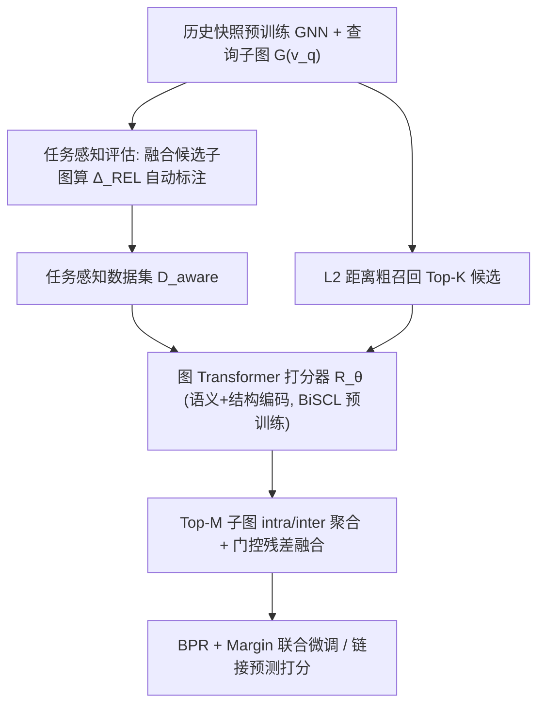

# Task-Aware Retrieval Augmentation for Dynamic Recommendation (面向动态推荐的任务感知检索增强)

- **会议/期刊**: AAAI 2026
- **作者与机构**: Zhen Tao, Xinke Jiang, Qingshuai Feng, Qingqiang Sun 等（大湾区大学、南京大学、香港城市大学、蚂蚁集团等）
- **推荐链路定位**: 召回（动态图快照上的链接预测式推荐）
- **研究方向**: 图神经网络与知识图谱推荐 / 序列与会话推荐
- **论文原文**: [https://arxiv.org/abs/2511.12495v1](https://arxiv.org/abs/2511.12495v1)
- **开源代码**: 暂未开源

## TL;DR (1分钟核心速览)

动态图推荐普遍采用「历史快照预训练 + 近期快照微调」范式，但预训练与微调之间存在时序分布漂移，微调后泛化性骤降。TarDGR 提出任务感知检索增强：先用「融合候选子图后与正样本相似度的变化量 $\Delta_{REL}$」自动标注历史子图是「有益/无关/有害」，无需人工标注即构建任务感知数据集；再用图 Transformer 融合语义与结构编码对候选子图打分，推理时检索 Top-$M$ 子图并门控残差融合进查询子图。在 Taobao/Koubei/Amazon 三个快照数据集上，Recall@20 与 nDCG@20 全面超越 RAGRAPH、PRODIGY、GraphPro 等 SOTA，Amazon 上较 PRODIGY 提升 14.5% Recall、16.6% nDCG。

## Background & Motivation (背景与核心矛盾)

- **主流范式**: 动态推荐以时序快照图 $\mathcal{G}=\{G^t\}_{t=1}^T$ 建模用户-物品演化，GraphPro 等采用「历史快照预训练 GNN + 近期快照微调」的迁移范式。
- **前人局限**: 其一，预训练与微调快照间存在时序分布漂移，微调后模型对演化偏好的泛化能力受限；其二，现有图 RAG（RAGRAPH、PRODIGY）仅按结构与特征相似度检索历史子图，忽略「语义任务相关性」——结构相似但语义不一致的子图可能带来负迁移。
- **核心洞察 (Key Insight)**: 一个历史子图是否有用，应由「把它融合进查询子图后，查询与正样本的相似度是否上升」来定义，这一信号可完全自动化生成，从而绕开图数据难以人工标注任务相关性的困境。
- **本文切入点**: 将「任务感知」引入图检索增强，先自动构造任务感知监督信号，再训练一个能同时感知语义与结构的打分器，在推理时只注入真正有益的子图。

## Method (核心方法设计)

### 1. 整体框架 (Overall Architecture)

TarDGR 分三段闭环：**离线标注**——用预训练 GNN 编码查询子图与候选历史子图，计算融合前后与正样本集的平均余弦相似度差 $\Delta_{REL}$，据此把候选划为有益/无关/有害，得到任务感知数据集$\mathcal{D}_{aware}=\{(G(v_q),G(v_r),C_r)\}$；**打分器预训练**——图 Transformer 任务感知模型$\mathcal{R}_\theta$以语义编码与结构编码拼接后的表示输出相关性分数，用 BiSCL 双级损失预训练；**在线推理**——先用 FAISS/L2 距离粗召回 Top-$K$候选，再由$\mathcal{R}_\theta$精排取 Top-$M$，经 intra/inter 聚合与门控残差融合得到增强查询表示$\tilde{h}_q$，最后以 BPR + margin 排序损失联合微调。

### 2. 关键设计拆解 (Key Designs)

1. **任务感知评估机制（自动生成监督信号）**：痛点是图数据无法像 NLP 那样人工构造任务数据集。做法是令 $\text{SIM}_{before}=\frac{1}{N^+}\sum_i \cos(\text{ENC}(G(v_q)),\text{ENC}(G(v_q)^+_i))$，将候选子图与查询子图通过中心节点连边融合后重编码得$\text{ENC}(\tilde{G}(v_q))$，再算$\text{SIM}_{after}$，定义$C_r=\Delta_{REL}=\text{SIM}_{after}-\text{SIM}_{before}$。$\Delta_{REL}>0$判为有益、$\approx 0$无关、$<0$ 有害。直觉：直接以「对下游推荐目标的边际贡献」定义相关性，比结构相似度更贴近任务本质。

2. **图 Transformer 任务感知打分器（语义 + 结构双编码）**：痛点是结构相似 ≠ 任务有用，需同时建模节点语义与子图拓扑。语义侧将查询与候选子图表示拼接加位置编码后过多头自注意力得 $h_{sem}$；结构侧对同一输入做多层注意力 + 残差 LayerNorm + FFN，再经归一化邻接传播$h_{str}=D^{-1}(A_s+I)h_{ffn}W$得结构表示。二者拼接为$h_{task}=[h_{sem}\|h_{str}]$，经$s_i=w^\top\text{ReLU}(Wh_{task}+b)$ 输出标量相关性。直觉：语义注意力捕捉「意图匹配」，邻接传播捕捉「拓扑兼容」，互补覆盖两类失效模式。

3. **BiSCL 预训练与推理融合**：仅拟合数值会丢失样本间序关系，故联合两级监督：数值拟合 $\mathcal{L}_{mtl}=\frac{1}{N}\sum(R_\theta(\cdot)-C)^2$与成对序约束$\mathcal{L}_{ocl}=\log\left[1+\sum_{C^{(k)}>C^{(l)}}\exp\frac{R_\theta(h^{(l)})-R_\theta(h^{(k)})}{\tau}\right]$，总损失$\mathcal{L}_{BiSCL}=\rho\mathcal{L}_{ocl}+(1-\rho)\mathcal{L}_{mtl}$。推理时 Top-$M$子图经软证据聚合$H_{rag}=\sum_i\alpha_i h^i_m$后门控残差融合$\tilde{h}_q=\beta h_q+(1-\beta)H_{rag}$。最终微调损失$\mathcal{L}_{total}=\mathcal{L}_{bpr}+\lambda\mathcal{L}_{mrl}+\mu\mathcal{L}_{reg}$，其中$\mathcal{L}_{mrl}$为 margin 排序损失，负采样采用训练三元组内随机负例 + 边 dropout（$r=0.5$）扰动，无额外难负采样挖掘。

## Experimental Setup & Evaluation Protocol (实验设置与评估协议)

- **数据集与预处理**: 三个公开动态图数据集，按时间粒度切分为快照，无 5-core 过滤描述：

| 数据集 | #Users | #Items | #Interactions | 密度 | 快照粒度/划分 |
| :--- | :---: | :---: | :---: | :---: | :--- |
| Taobao | 117,450 | 86,718 | 8,795,404 | 8.6e-4 | 日快照，前 5 天预训练 / 后 5 天微调测试 |
| Koubei | 119,962 | 101,404 | 3,986,609 | 3.3e-4 | 周快照，4 周预训练 / 5 周微调测试 |
| Amazon | 131,707 | 107,028 | 876,237 | 6.2e-5 | 周快照，4 周预训练 / 9 周微调测试 |

- **数据划分与防穿越 (Splitting Strategy)**: 全局时间戳切分（快照级），历史快照预训练、未来快照微调与评测；检索类方法微调时只检索资源图、测试时检索「训练+资源」合并图，防止信息泄漏。
- **排名评测协议 (Ranking Protocol)**: 边分类式链接预测，报告 Recall@20 与 nDCG@20 的时间平均；未明确说明是否 Full-Ranking，按 GraphPro/RAGRAPH 惯例应为全库候选排序。
- **对比基线与超参设置**: 四类基线——GNN 推荐（LightGCN、SGL、MixGCF、SimGCL）、动态 GNN（EvolveGCN-H/O、ROLAND、GraphPro）、图提示（GraphPrompt、GPF）、图 RAG（PRODIGY、RAGRAPH），并区分 NF（免微调即插即用）与 FT（微调）两种变体。隐藏维 $d=64$、GNN 3 层、$k$-hop$=2$、Top-$K=5$、Top-$M\in\{1,2,3\}$、$\rho\in\{0.3,0.6,0.9\}$、$\lambda\in[0.1,0.5]$、$\mu=1e^{-4}$、学习率$1e^{-3}$。

## Key Experimental Results (实验关键数据)

### 1. 主实验对比 (Main Results)

| 方法 | Taobao R@20 | Taobao N@20 | Koubei R@20 | Koubei N@20 | Amazon R@20 | Amazon N@20 |
| :--- | :---: | :---: | :---: | :---: | :---: | :---: |
| LightGCN | 22.47 | 21.89 | 30.21 | 22.24 | 15.07 | 06.53 |
| SimGCL | 22.18 | 23.15 | 33.07 | 23.08 | 16.10 | 07.58 |
| EvolveGCN-O | 23.64 | 23.24 | 33.01 | 23.98 | 17.48 | 08.68 |
| GPF | 22.46 | 22.12 | 33.70 | 24.39 | 17.67 | 08.94 |
| GraphPro/FT | 23.99 | 23.26 | 33.96 | 24.66 | 18.14 | 08.73 |
| PRODIGY/FT | 23.74 | 23.65 | 33.46 | 23.28 | 16.72 | 08.09 |
| RAGRAPH/FT | 24.78 | 24.35 | 34.27 | 24.82 | 18.69 | 09.09 |
| **TarDGR/FT** | **25.20** | **24.59** | **36.52** | **26.63** | **19.56** | **09.70** |
| Improv. vs 最强基线 | +1.7% | +1.0% | +6.6% | +7.3% | +4.7% | +6.7% |

### 2. 消融实验 (Ablation Study)

| 变体 | Taobao R@20 | Taobao N@20 | Koubei R@20 | Koubei N@20 | Amazon R@20 | Amazon N@20 |
| :--- | :---: | :---: | :---: | :---: | :---: | :---: |
| w/o all（去语义+结构编码） | 24.63 | 24.02 | 34.14 | 24.83 | 18.42 | 08.91 |
| w/o SEM（去语义编码） | 24.95 | 24.48 | 35.84 | 25.56 | 19.10 | 09.45 |
| w/o STR（去结构编码） | 25.14 | 24.52 | 36.30 | 26.12 | 19.42 | 09.57 |
| **TarDGR（完整）** | **25.20** | **24.59** | **36.52** | **26.63** | **19.56** | **09.70** |

BiSCL 消融（Koubei/Amazon）：去掉 BiSCL 预训练降至 35.62/25.98 与 19.28/09.53；仅保留 $\mathcal{L}_{mtl}$或仅保留$\mathcal{L}_{ocl}$ 均介于两者之间，完整版最优。

### 3. 关键实验发现 (Key Findings)

1. **任务感知检索优于结构检索，且增益随时序漂移放大**：Amazon 密度最低（6.2e-5）、快照最多（13 周），TarDGR 相对 RAGRAPH 的 nDCG 增益达 6.3%，而 Taobao 仅 1.0%——说明时序跨度越大、语义错配风险越高，任务感知过滤的价值越凸显。
2. **语义编码比结构编码更关键，但二者互补**：去掉语义编码在 Koubei 上掉 0.68 Recall，去掉结构编码仅掉 0.22，但两者全去后掉 2.38，远超单模块损失之和，证明语义注意力与邻接传播捕捉的是不同失效模式。
3. **检索数量存在「先升后降」的饱和拐点**：Top-$M$从 0 增至 2–3 时性能上升，继续增大则因噪声子图引入而下降；$k$-hop 同理，过大邻域导致子图膨胀、编码器被冗余信息淹没，验证了「精准少量」优于「粗放大量」的检索哲学。

## Highlights & Limitations (亮点、对比与审稿批判)

- **与代表作对比 (vs. Prior Work)**: 相较 RAGRAPH 仅按结构与特征相似度做即插即用检索，TarDGR 首次引入「任务相关性」作为检索准则，并用 $\Delta_{REL}$把这一抽象概念转化为可自动计算的监督信号；相较 GraphPro 的时序提示微调，TarDGR 不改参数而改「上下文」，从信息论角度（附录证明$I(X,RAG_{aware};Y)\ge I(X,RAG;Y)$）论证了任务感知过滤严格提升输入-标签互信息。
- **可迁移亮点**: 其一，「融合后相似度变化量」这一自动标注范式可迁移到任意「检索-融合」架构（如 LLM4Rec 的示例检索、跨域迁移的子图选择）；其二，BiSCL 的「数值拟合 + 成对序约束」双级预训练可直接用于任何需要输出连续相关性分数的打分器。
- **审稿级局限批判**: 其一，任务感知数据集构建需对每个查询采样 $R_{sample}$个候选并逐一做图融合与 GNN 前传，离线开销为$O(N_Q\cdot R_s\cdot L\cdot E_s\cdot d)$，大规模场景下标注成本可能成为瓶颈；其二，实验仅在三个快照式链接预测数据集上验证，未给出线上 A/B 或与序列模型（BERT4Rec/DCRec）的直接对比，且$\rho$、$\lambda$、Top-$M$等多个超参需网格搜索，敏感度分析仅覆盖$M$与$k$-hop。

## Rating (四维评分)

- **方法创新性 (Novelty)**: ⭐⭐⭐⭐ （首次将「任务感知」引入图检索增强推荐，$\Delta_{REL}$ 自动标注与互信息理论分析构成完整闭环，但图 Transformer 打分器本身为常规组件组合）
- **评估协议与实验扎实度 (Protocol & Experiments)**: ⭐⭐⭐⭐ （三数据集 + 四类 11 个基线 + NF/FT 双设定 + 逐时间步对比较完整，但缺少 Full-Ranking 协议明示与线上验证）
- **写作与数学规范度 (Clarity & Rigor)**: ⭐⭐⭐⭐ （公式与算法伪代码清晰，附录含互信息推导与复杂度分析，但部分符号在正文与附录间略有重复定义）
- **工业落地与复现价值 (Industrial & Practical Value)**: ⭐⭐⭐ （离线标注与 FAISS 检索链路工程可行，但代码未开源、离线标注开销与多超参调优增加落地门槛）

