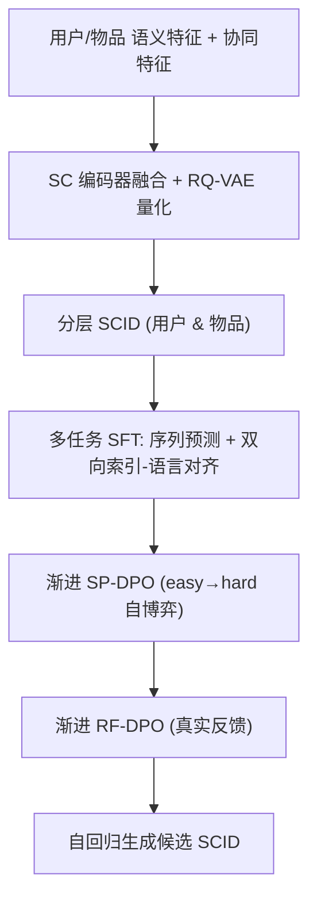
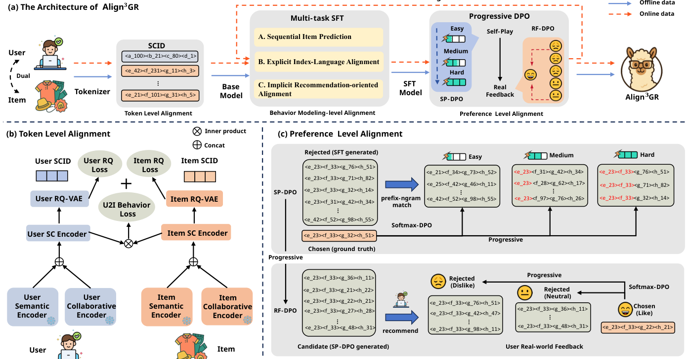

# Align$^3$GR: Unified Multi-Level Alignment for LLM-based Generative Recommendation (面向 LLM 生成式推荐的多级统一对齐框架)

- **会议/期刊**: AAAI 2026 (Oral)
- **作者与机构**: Wencai Ye, Mingjie Sun, Shuhang Chen, Wenjin Wu, Peng Jiang（快手科技）
- **推荐链路定位**: 召回（生成式端到端）
- **研究方向**: 大语言模型推荐 / 生成式推荐
- **论文原文**: [arXiv:2511.11255v2](https://arxiv.org/abs/2511.11255v2)
- **开源代码**: 暂未开源

## TL;DR (1分钟核心速览)

LLM 与推荐系统之间存在语义与行为的双重错位，现有生成式推荐（TIGER/LC-Rec/EAGER）只在单一环节做对齐：分词阶段用户与物品独立编码、SFT 阶段缺乏用户语义锚定、DPO 阶段依赖静态离线偏好对。Align$^3$GR 将 LLM→RS 的转化拆成 **token 级、行为建模级、偏好级** 三层统一对齐：双端语义-协同 SCID 分词、注入用户 SCID 与双向索引-语言对齐的多任务 SFT、以及 easy→hard 的渐进式 SP-DPO + RF-DPO。在 Instruments/Beauty/Yelp 的 Leave-One-Out 全库排序协议下，相对 SOTA（EAGER-LLM）Recall@10 提升 17.8%/19.8%/19.3%，工业 A/B 全量部署带来 +1.432% 广告收入。

## Background & Motivation (背景与核心矛盾)

- **主流范式**: 生成式推荐把召回重构为自回归 token 生成，用 RQ-VAE 将物品内容嵌入量化为分层语义 ID（TIGER），再以 LC-Rec 式多任务 SFT 让 LLM 学会"说"物品 ID。
- **前人局限一（分词）**: 现有分词几乎只编码物品侧，用户表征即便引入也极少与物品嵌入联合优化，导致用户-物品协同依赖被割裂，SCID 缺乏推荐所需的协同信号。
- **前人局限二（偏好）**: DPO 类方法（Softmax-DPO、cDPO）依赖一次性静态离线偏好对，而真实推荐偏好隐式、模糊且动态，静态优化很快触到"偏好天花板"，也无法对齐业务目标。
- **核心洞察 (Key Insight)**: 对齐不是单点问题而是**流水线问题**——分词决定 SFT 的输入空间，SFT 决定 DPO 的初始策略，任一层错位都会向下游放大；同时分层 SCID 的"前缀共享即语义相近"性质天然提供了课程学习的难度刻度。
- **本文切入点**: 用统一框架把三层对齐串成闭环，并借 SCID 前缀 n-gram 重叠度构造 easy/medium/hard 的渐进偏好数据。

## Method (核心方法设计)

### 1. 整体框架 (Overall Architecture)

输入侧，用户与物品各自抽取语义特征（profile/描述，T5 冻结编码）与协同特征（行为序列，DIN 冻结编码），拼接后经 SC 编码器融合为统一 SC 嵌入，再由 RQ-VAE 量化为分层 SCID 并扩充进 LLM 词表。行为建模级用多任务 SFT 在 SCID 空间内做序列预测与索引-语言双向对齐；偏好级在 SFT 模型上依次执行渐进式 SP-DPO（自博弈构造偏好对）与 RF-DPO（真实反馈构造偏好对），每阶段微调后的模型作为下一阶段的参考策略。推理时用户/物品分词模块分离部署，LLM 自回归 + beam search 生成候选 SCID。

<figure class="paper-figure" markdown="span">
  <figcaption>图2：(a) Align3GR 的架构，这是一个用于生成式推荐的统一多级对齐框架，集成了分层双 SCID、多任务 SFT 和渐进式 DPO。(b) 通过用户-物品双 SC 编码器和 RQ-VAE 实现 token 级对齐。(c) 通过渐进式 SP-DPO 和 RF-DPO 实现偏好级对齐。</figcaption>
</figure>

### 2. 关键设计拆解 (Key Designs)

1. **双端 SCID 分词与 U2I 联合优化**：痛点是用户/物品独立量化导致协同关系在 token 空间丢失。做法是把两侧 SC 嵌入拼进同一 batch，用 sampled-softmax 行为损失显式拉近交互对：
$\mathcal{L}_{U2I}=-\frac{1}{|\mathcal{B}|}\sum_{(u,i^+)\in\mathcal{B}}\log\frac{\exp(\boldsymbol{u}^\top\boldsymbol{v}_{i^+})}{\exp(\boldsymbol{u}^\top\boldsymbol{v}_{i^+})+\sum_{j\in\mathcal{N}_u}\exp(\boldsymbol{u}^\top\boldsymbol{v}_j)}$总损失$\mathcal{L}=\alpha\mathcal{L}_{U2I}+\gamma(\mathcal{L}^{User}_{RQ}+\mathcal{L}^{Item}_{RQ})$，并采用**两段式调度**：先$\alpha=1,\gamma=0$稳定行为对齐（以 AUC 监控），再切到$\alpha=0.1,\gamma=1$ 专注量化重建。直觉是让量化前的连续空间先具备推荐判别力，量化后才不丢协同信息。

2. **用户 SCID 注入 + 双向索引-语言对齐**：LC-Rec 的多任务 SFT 只用物品 SCID，用户信息仅以历史序列隐式表达。本文在所有任务 prompt 中显式插入 `[SCID-User]`，并新增 B.2 双向任务：profile 文本 → 用户 SCID（text→SCID）与 SCID → profile 文本（SCID→text）。这相当于给离散索引 token 加上语义锚点，缓解"ID 无意义、LLM 难泛化"的冷启与稀疏问题。

3. **渐进式 SP-DPO / RF-DPO**：基于 Softmax-DPO 的多负样本目标
$\mathcal{L}=-\mathbb{E}_{(x,y_w,\mathcal{Y}_l)\sim\mathcal{D}_i}\Big[\log\sigma\Big(-\log\!\!\sum_{y_l\in\mathcal{Y}_l}\exp\big(\beta\log\tfrac{\pi^i_\theta(y_l|x)}{\pi^i_{ref}(y_l|x)}-\beta\log\tfrac{\pi^i_\theta(y_w|x)}{\pi^i_{ref}(y_w|x)}\big)\Big)\Big]$SP-DPO 用前缀 n-gram 重叠度把偏好对分为 easy（无共享前缀）/medium/hard（前缀逐步重叠但非同一），RF-DPO 用真实反馈分 disliked/neutral/liked 三级，easy 阶段以强负例为 rejected、hard 阶段以中性未点击为 rejected。每阶段$\pi^i_\theta\to\pi^{i+1}_{ref}$，形成课程式平滑插值。训练负采样为 in-batch 随机负例（U2I 阶段）与每样本 1 chosen + 20 rejected（DPO 阶段），无额外 hard negative 挖掘开销。

## Experimental Setup & Evaluation Protocol (实验设置与评估协议)

- **数据集与预处理**: 三个公开序列推荐数据集，均按标准协议过滤交互数 <5 的用户与物品（`5-core`），历史长度截断至 20。

| 数据集 | 领域 | 过滤方式 | 划分 | 特征/场景说明 |
| :--- | :---: | :---: | :---: | :--- |
| Instruments | Amazon 乐器 | 5-core | Leave-One-Out | 含标题/描述文本，长尾明显 |
| Beauty | Amazon 美妆 | 5-core | Leave-One-Out | 评论情感可映射偏好等级 |
| Yelp | 本地生活 | 5-core | Leave-One-Out | 商户交互，稀疏度高 |
| 工业广告平台 | 广告推荐 | 内部清洗 | 线上流量切分 | 10% 流量、4000 万+ 用户 A/B |

- **数据划分与防穿越 (Splitting Strategy)**: 公开集采用 `Leave-One-Out`（最后一件测试、倒数第二件验证）；工业侧为线上真实流量时间切分。
- **排名评测协议 (Ranking Protocol)**: 生成式方法统一 beam width = 20 的生成式全库候选，报告 Recall@5/10 与 NDCG@5/10；工业侧报告 Recall@100 与收入指标。
- **对比基线与超参设置**: 覆盖 MF/LightGCN（传统）、Caser/HGN/BERT4Rec/SASRec（序列）、BigRec/P5-SemID/P5-CID/TIGER/LETTER/LC-Rec/EAGER-LLM（生成式）共 13 个基线；骨干为 Llama2-7B + LoRA，3 层 RQ-VAE、每码本 256×32 维，batch 1024、训练 20k 步，5 次随机种子均值，显著性 $p<0.05$。

## Key Experimental Results (实验关键数据)

### 1. 主实验对比 (Main Results)

| 模型 | Instr. R@10 | Instr. N@10 | Beauty R@10 | Beauty N@10 | Yelp R@10 | Yelp N@10 |
| :--- | :---: | :---: | :---: | :---: | :---: | :---: |
| SASRec | 0.0947 | 0.0690 | 0.0588 | 0.0313 | 0.0296 | 0.0152 |
| TIGER | 0.1058 | 0.0797 | 0.0610 | 0.0331 | 0.0407 | 0.0213 |
| LC-Rec | 0.1006 | 0.0772 | 0.0642 | 0.0374 | 0.0359 | 0.0199 |
| LETTER-LC-Rec | 0.1115 | 0.0854 | 0.0703 | 0.0418 | 0.0393 | 0.0211 |
| EAGER-LLM | 0.1224 | 0.0926 | 0.0830 | 0.0459 | 0.0569 | 0.0315 |
| **Align$^3$GR** | **0.1442** | **0.1113** | **0.0994** | **0.0529** | **0.0679** | **0.0403** |
| Improv. (vs EAGER) | +17.8% | +20.2% | +19.8% | +15.3% | +19.3% | +27.9% |

工业 A/B（10% 流量、数周）：Recall@100 由 TIGER 的 0.229 提升至 **0.242**，全量部署广告收入 **+1.432%**（TIGER 仅 +0.555%）。

### 2. 消融实验 (Ablation Study)

| 配置 | R@10 | N@10 | 说明 |
| :--- | :---: | :---: | :--- |
| Item 分词 + 无 CF + 无 U-I 对齐 | 0.1322 | 0.0978 | 单端基线 |
| Dual 分词 + 无 CF + 无 U-I 对齐 | 0.1390 | 0.1032 | 双端带来 +5.1% R@10 |
| Dual + CF + 无 U-I 对齐 | 0.1428 | 0.1091 | 协同特征增益显著 |
| Dual + CF + U-I 对齐 | **0.1442** | **0.1113** | 完整分词方案 |
| SFT: SEQ 仅序列 | 0.1329 | 0.0982 | 行为建模基线 |
| + User SCID | 0.1417 | 0.1051 | 用户 token 注入 +6.6% |
| + B2 双向对齐 | **0.1442** | **0.1113** | 单项增益最大 |
| Softmax-DPO（静态） | 0.1295 | 0.0972 | 偏好级基线 |
| SP-DPO（非渐进） | 0.1356 | 0.1033 | 自博弈 +4.7% |
| RF-DPO（渐进） | **0.1442** | **0.1113** | 完整偏好方案 |

### 3. 关键实验发现 (Key Findings)

1. **偏好级对齐是最大增益源**：图 4 的增量曲线显示，从 SFT 完成到 RF-DPO 完成，Recall@10 的跃升幅度超过 token 级与行为级之和，说明静态 DPO 的"偏好天花板"确实存在，渐进 + 真实反馈是破局关键（0.1295→0.1442，+11.4%）。
2. **双端分词与 U-I 联合优化互补而非冗余**：单端→双端带来 +5.1% R@10，叠加 CF 再 +2.7%，再叠加 U2I 损失再 +1.0%，三者单调递增，验证"先连续空间对齐、再量化"的两段式调度有效。
3. **用户侧语义锚定性价比最高**：SFT 阶段仅注入 `[SCID-User]` 即得 +6.6% R@10，而 B2 双向对齐单模块再贡献 +1.8% R@10 与 +5.9% N@10，说明离散索引 token 的语义 grounding 对 LLM 泛化至关重要，且几乎不增加推理开销。

## Highlights & Limitations (亮点、对比与审稿批判)

- **与代表作对比 (vs. Prior Work)**: 相比 TIGER（仅物品侧 RQ-VAE 语义 ID）与 EAGER-LLM（引入协同信号但仍单端、无偏好级对齐），本文把对齐从"分词一个点"扩展为"分词-SFT-DPO 三层闭环"；相比 LC-Rec（多任务 SFT 但无用户 SCID、无 DPO），本文补上了用户语义锚定与渐进偏好优化两块拼图。
- **可迁移亮点**: (1) 用分层 SCID 的前缀 n-gram 重叠度自动构造课程难度，可零成本迁移到任何层级量化 ID 的生成式推荐；(2) 两段式损失调度（先行为对齐后量化重建）是训练 RQ-VAE 类分词器的通用稳定技巧。
- **审稿级局限批判**: (1) 三级对齐串行叠加，每级都需独立训练/调参（$\alpha,\beta$、课程划分阈值），工程链路长且误差会逐级累积，论文未给出各阶段训练成本与端到端延迟数据；(2) 公开集评估仅用 Leave-One-Out + beam=20 生成式候选，未报告 Full-Ranking 全库无偏指标，且 RF-DPO 在公开集上依赖 LLM 情感模型打标，标签噪声对结论稳健性的影响缺乏敏感性分析。

## Rating (四维评分)

- **方法创新性 (Novelty)**: ⭐⭐⭐⭐ （把 LLM→RS 对齐系统化为三层闭环，双端 SCID 与 SCID 前缀课程 DPO 均有清晰增量，但单点技术多为已有模块的组合式创新）
- **评估协议与实验扎实度 (Protocol & Experiments)**: ⭐⭐⭐⭐ （三公开集 + 13 基线 + 逐级消融 + 工业 A/B 全量部署，证据链完整；扣分在缺少 Full-Ranking 无偏协议与训练开销报告）
- **写作与数学规范度 (Clarity & Rigor)**: ⭐⭐⭐⭐ （三级对齐叙事清晰、公式紧凑，Softmax-DPO 目标与两段式调度交代明确；部分符号如 $\mathcal{N}_u$ 与课程阈值定义略简）
- **工业落地与复现价值 (Industrial & Practical Value)**: ⭐⭐⭐⭐ （快手全量部署 +1.432% 收入验证真实价值，分词模块可离线预计算；但代码未开源、三级串行训练成本高，复现门槛偏高）
