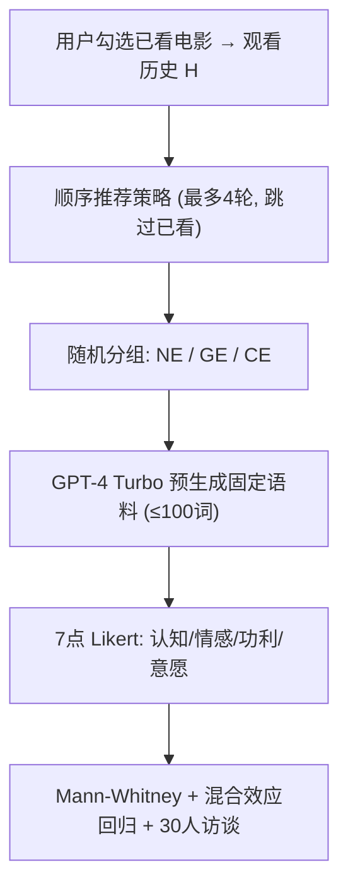
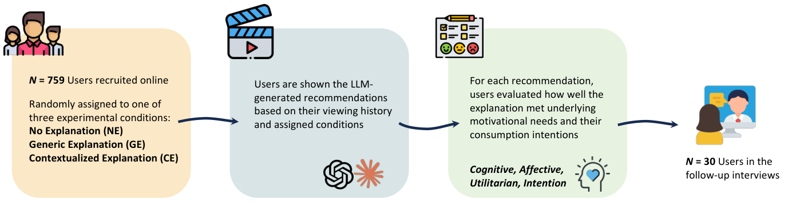

# Contextualizing Recommendation Explanations with LLMs: A User Study (用 LLM 情境化推荐解释：一项用户研究)

- **会议/期刊**: ICWSM 2026（AAAI 旗下社交媒体国际会议）
- **作者与机构**: Yuanjun Feng, Stefan Feuerriegel, Yash Raj Shrestha（洛桑大学；慕尼黑机器学习中心 & LMU）
- **推荐链路定位**: 重排/展示层（解释生成与用户感知），非打分模型
- **研究方向**: 大语言模型推荐 / 对话推荐与可解释性
- **论文原文**: [https://arxiv.org/abs/2501.12152v2](https://arxiv.org/abs/2501.12152v2)
- **开源代码**: [匿名仓库](https://anonymous.4open.science/r/Contextualizing-Recommendation-Explanations-With-LLMs-55D3)

## TL;DR (1分钟核心速览)

本文不做模型，而做**因果化的用户实验**：针对"LLM 生成的推荐解释到底满足用户哪类动机"这一空白，作者以 Uses & Gratifications (U&G) 框架把用户需求拆为认知/情感/功利三维，在预注册的组间在线实验（N=759，GPT-4 Turbo；补充 N=140，Claude 3.5 Sonnet）中对比无解释 (NE)、通用解释 (GE)、情境化解释 (CE) 三条件。核心结论：CE 在认知需求（5.38 vs 4.94/4.97）与观看意愿（4.85 vs 4.61/4.36）上显著胜出，但 GE 相对 NE 几乎无增益，甚至观看意愿显著更低（4.36 < 4.61）。

## Background & Motivation (背景与核心矛盾)

- **主流范式**: LLM 被广泛用于生成自然语言推荐解释，但工业与学术实践多停留在**通用模板式解释**（只描述物品本身：导演、剧情、相似影片），未利用用户历史。
- **前人局限**: ① 现有实证研究（Silva N=94、Lubos N=97、Sun N=341）样本小、维度零散，缺少对"认知/情感/功利"多维需求的统一测量；② 通用解释忽略用户上下文，浪费了 LLM 的推理与个性化能力，且无人检验"正向感知是否转化为消费意愿"。
- **核心洞察 (Key Insight)**: 用户对解释的诉求并非单一"透明度"，而是 U&G 框架下的三类主动动机；解释的价值取决于它是否**显式地把推荐与用户自身历史行为挂钩**，而非文本本身是否流畅。
- **本文切入点**: 用预注册组间实验 + 混合效应回归 + 30 人访谈，把"解释类型"作为唯一处理变量，隔离出情境化的净效应。

## Method (核心方法设计)

### 1. 整体框架 (Overall Architecture)

实验流程为：用户先从 IMDb Top 250 短名单中勾选**已看过的电影**建立观看历史（模拟冷启动，不采集显式评分/喜好）→ 系统按顺序推荐策略（最多 4 轮，跳过已看影片，已看推荐片回填历史）生成推荐 → 用户被随机分入 NE / GE / CE 三条件之一，看到对应解释 → 对 9 个感知维度 + 观看意愿打 7 点 Likert 分 → 事后随机邀请 30 人访谈。所有推荐与解释**预先生成为固定语料**，保证同一历史+同一条件得到完全相同的文本，消除 LLM 采样方差。

<figure class="paper-figure" markdown="span">
  <figcaption>图1：研究流程概览。</figcaption>
</figure>

### 2. 关键设计拆解 (Key Designs)

1. **三条件解释操纵（唯一处理变量）**：GE 与 CE 的差别被严格限定在"是否显式连接用户历史"——GE 只谈推荐片自身特征（相似性、流行度、剧情），CE 则把推荐片与用户看过的具体片名做类比（如"《头号玩家》兼具《饥饿游戏》的竞技感与《勇敢者游戏》的虚拟世界"）。两者长度均 ≤100 词、约 3 个关键特征，确保**文本质量与长度可比**，从而把差异归因于情境化本身而非文采。所有生成片名与 IMDb 数据集交叉核验以防幻觉，并由两位专家校验语料一致性。
2. **U&G 三维测量体系**：把 9 个既有解释评估维度（Balog & Radlinski 2020）映射到 U&G 框架——认知 = Scrutability/Transparency/Trust 均值，情感 = Persuasiveness/Satisfaction 均值，功利 = Effectiveness/Efficiency/Helpfulness 均值，行为结果 = UserIntent。这一映射使"解释好不好"从单一满意度拆成可分别检验的三条动机通路，是本文相对前人最实质的测量学增量。
3. **统计模型与稳健性**：因数据不满足正态性（Lilliefors 检验），主检验用 Mann-Whitney + Holm 校正；进一步用含**被试随机截距**的线性混合效应模型控制个体异质性，并纳入 DisplayOrder 控制重复测量的习惯化效应，核心回归式为
   $Y_{ij}=\beta_0+\beta_1\text{Treatment}_j+\sum_k\beta_k\text{Cov}_{kj}+\beta_{10}\text{HistoryNum}_j\times\text{MovieConsumption}_j+\beta_{11}\text{HistoryNum}_j\times\text{RecSysUtility}_j+u_{0j}+\epsilon_{ij}$其中$\text{HistoryNum}$ 为解释中引用的历史影片数（上限 4），交互项用于检验"情境化收益是否依赖用户既有参与度"。所有 VIF < 5，排除多重共线性。

## Experimental Setup & Evaluation Protocol (实验设置与评估协议)

- **样本与预处理**: 通过 Cint 在美国分层抽样招募，初始 1401 人，经两道注意力检查、自报随机作答、过快作答（<6 秒）三重剔除后保留 **759 人**（女 387/男 370/非二元 2，均值年龄 52.85，SD=16.01），超过 G*Power 功效分析所需 750 人（α=0.05, 1-β=0.95, 效应量 0.1）。共获得 **2716 条评分**（NE 904 / GE 911 / CE 901）。

| 实验批次 | 模型 | #Users | #Ratings | 说明 |
| :--- | :--- | :---: | :---: | :--- |
| 主实验 | GPT-4 Turbo | 759 | 2716 | 三条件组间设计 |
| 稳健性补充 | Claude 3.5 Sonnet | 140 | — | 复现主结论 |
| 访谈 | — | 30 | — | 质性解释 |

- **数据划分与防穿越**: 非机器学习任务，无训练/测试划分；采用**组间随机分配**保证条件独立，推荐语料预生成冻结以杜绝跨条件信息泄漏。
- **评测协议**: 主观 7 点 Likert 量表（1=极不同意，7=极同意），非排名指标；显著性采用 Holm 校正的 Mann-Whitney 检验（$p<0.05$），辅以混合效应回归系数与标准误报告。
- **对比基线与超参**: 三条件即三基线（NE/GE/CE）；解释长度统一 ≤100 词、约 3 个特征、历史引用上限 4 部，作为受控超参。

## Key Experimental Results (实验关键数据)

### 1. 主实验对比 (Main Results)

| 条件 | Cognitive | Affective | Utilitarian | UserIntent |
| :--- | :---: | :---: | :---: | :---: |
| NE（无解释） | 4.94 | 5.05 | 5.32 | 4.61 |
| GE（通用解释） | 4.97 | 4.99 | 5.34 | 4.36 |
| CE（情境化解释） | **5.38** | **5.19** | **5.44** | **4.85** |
| CE vs NE 提升 | +8.9% | +2.8% | +2.3% | +5.2% |
| CE vs GE 提升 | +8.2% | +4.0% | +1.9% | +11.2% |

CE 在四个维度上均显著优于 NE 与 GE（Holm 校正 $p<0.05$）；**GE 与 NE 在认知、情感、功利三维均无显著差异**，且 GE 的观看意愿显著低于 NE（4.36 vs 4.61,$p<0.05$）。

### 2. 消融/回归归因 (Regression Ablation)

| 自变量 | Cognitive | Affective | Utilitarian | UserIntent |
| :--- | :---: | :---: | :---: | :---: |
| Treatment (GE) | 0.010 | −0.032 | 0.064 | −0.232 |
| Treatment (CE) | **0.418\*\*\*** | 0.166 | 0.165 | **0.277\*** |
| RecSysUtility | 0.304\*\*\* | 0.295\*\*\* | 0.271\*\*\* | 0.292\*\*\* |
| MovieConsumption | 0.150\*\* | 0.175\*\*\* | 0.172\*\*\* | 0.125\* |
| HistoryNum | 0.048\*\* | 0.069\*\*\* | 0.044\*\* | 0.101\*\*\* |
| Age | −0.075 | −0.089\* | 0.013 | −0.147\* |
| Gender (Female) | 0.120 | 0.160 | 0.292\*\*\* | −0.181 |

### 3. 关键实验发现 (Key Findings)

1. **情境化的收益高度不对称**：CE 对认知需求的效应量最大（$\beta=0.418$,$p<0.001$），但对情感（$\beta=0.166$，不显著）与功利（$\beta=0.165$，不显著）的回归系数均未达显著——说明"引用历史"主要解决"我为什么信你"，而非"我想不想看"或"省不省事"，后者更多由推荐片本身是否合口味决定（访谈中大量用户明确表示"不是我的类型就不看"）。
2. **通用解释存在负向风险**：GE 的观看意愿显著低于完全不给解释（4.36 vs 4.61），访谈归因为"泛泛而谈的吹捧显得冗余甚至过度剧透"，提示无信息量的 LLM 解释不仅无效，还可能稀释推荐说服力。
3. **情境化收益随历史引用数与用户参与度单调增强，且交互项不显著**：HistoryNum 在四维度均显著为正（$\beta$从 0.044 到 0.101），而其与 MovieConsumption / RecSysUtility 的交互项基本不显著，意味着"多引用几部看过的片"对低频用户同样有效；但 RecSysUtility 与 MovieConsumption 本身是四维度最强的正向预测因子（$\beta\approx0.27$–$0.30$），即**本就信任系统、本就爱看电影的用户获益最大**，存在"强者恒强"的马太效应。

## Highlights & Limitations (亮点、对比与审稿批判)

- **与代表作对比 (vs. Prior Work)**: 相比 Silva et al. (N=94) 与 Lubos et al. (N=97) 的小样本二分类比较，本文以 N=759 预注册设计 + 混合效应模型 + 三条件对照，首次把"通用 vs 情境化"的差异拆解到 U&G 三维并给出效应量；相比 Sun et al. (N=341) 关注社交隐私，本文聚焦行为历史引用的解释策略，且额外用 Claude 3.5 Sonnet 做了跨模型稳健性验证。
- **可迁移亮点**: ① "预生成冻结语料 + 长度/特征数对齐"的实验控制手法，可直接迁移到任何 LLM 生成内容的 A/B 用户研究；② 把解释评估维度映射到 U&G 三维的测量模板，可复用于电商、短视频等场景的解释设计。
- **审稿级局限批判**: ① **生态效度不足**：单次会话、最多 4 轮推荐、无长期动态，无法回答"解释的新鲜感衰减"与长期留存影响；② **成本与偏差隐忧**：作者自估 Netflix 规模下 GPT-4o mini 每日 API 成本约 270 万美元，且语料明显偏西方中心叙事，跨文化泛化与偏见放大风险未被实验检验；③ 用户被限制在 IMDb Top 250 热门片内选择，无法表达小众偏好，可能低估情境化在长尾场景的价值。

## Rating (四维评分)

- **方法创新性 (Novelty)**: ⭐⭐⭐ （非模型创新，但 U&G 三维测量映射 + 预注册三条件设计在 LLM 解释研究中属实质性方法论增量）
- **评估协议与实验扎实度 (Protocol & Experiments)**: ⭐⭐⭐⭐⭐ （N=759 预注册、功效分析、双重注意力检查、Holm 校正、混合效应模型、跨模型复现与 30 人访谈三角验证，堪称用户研究范本）
- **写作与数学规范度 (Clarity & Rigor)**: ⭐⭐⭐⭐ （回归式与变量定义清晰、VIF 与随机效应交代完整；但部分访谈引文与定量结论的对应略显松散）
- **工业落地与复现价值 (Industrial & Practical Value)**: ⭐⭐⭐⭐ （匿名代码与语料可复现，结论对解释生成策略有直接指导；但 API 成本估算与单会话设计限制了直接线上部署的说服力）

