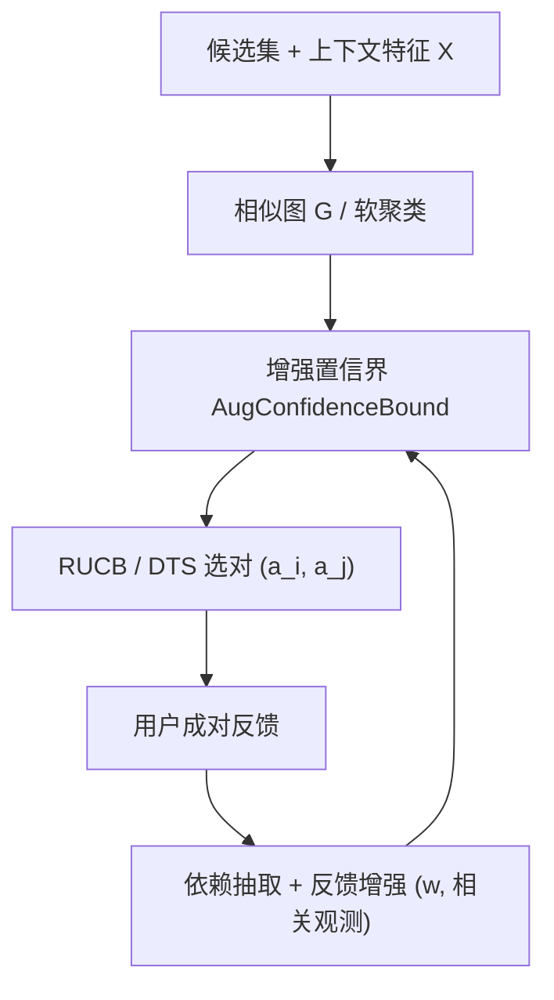

# Preference is More Than Comparisons: Rethinking Dueling Bandits with Augmented Human Feedback (偏好不止于比较：以增强人类反馈重思 Dueling Bandit)

- **会议/期刊**: AAAI 2026（扩展版）
- **作者与机构**: Shengbo Wang, Hong Sun, Ke Li（电子科技大学、University of Exeter）
- **推荐链路定位**: 召回（交互式偏好抽取 / 在线候选筛选）
- **研究方向**: 强化学习与动态探索推荐 / 冷启动与长尾推荐
- **论文原文**: [论文原文链接](https://arxiv.org/abs/2511.09047v1)
- **开源代码**: [开源代码仓库链接](https://github.com/COLA-Laboratory/IPEA-HF)

## TL;DR (1分钟核心速览)

交互式偏好抽取（IPE）中，Dueling Bandit（DB）在反馈稀疏时效率骤降；现有做法靠 Bradley–Terry 等参数化奖励模型补数据，却易受模型误设与非传递偏好拖累。本文提出无模型的 **IPEA-HF** 框架：把上下文相似/依赖产生的“相关观测”以权重 $w_{i,j}^r$ 注入置信界，得到增强置信界与广义集中不等式，并给出样本复杂度与遗憾的显式权衡。在 Sushi、Car Preference、DTLZ2/7 与 LLM 响应优化基准上，IPEA-RUCB/IPEA-DTS 的累积遗憾一致低于 RUCB、DTS、MaxInP、COLSTIM、VACDB。

## Background & Motivation (背景与核心矛盾)

- **主流范式**: DB 以成对比较为唯一信号，用 RUCB/DTS 维护胜率矩阵与置信界做“利用+探索”；带上下文时主流走参数化奖励估计（BT 模型）或候选划分（聚类/合并）。
- **前人局限**: ① 参数化 BT 假设刚性，特征混合、偏好非传递时误设严重，甚至出现 VACDB 式“过早收敛、遗憾持续上升”；② 划分法依赖“可区分性”强假设，真实 IPE 中候选往往无法干净分组（Sushi 的 MDS/层次聚类即显示无清晰子集）。
- **核心洞察 (Key Insight)**: 稀疏反馈的根因是 DB 把每次比较当作**独立**观测；而人类偏好还受上下文相似性与潜在依赖塑造。相关观测本质上是**不确定性的校准**——它既可能缩小置信区间，也可能在依赖弱时反而放大区间。
- **本文切入点**: 放弃参数化奖励，直接在无模型 DB 的置信界层面做“反馈增强”，用广义集中性质量化增强的收益与风险。

## Method (核心方法设计)

### 1. 整体框架 (Overall Architecture)

IPEA-HF 在标准 DB 循环中插入两个新环节：每轮先用**增强置信界**（融合直接观测 $n^d_{i,j}$与相关观测$n^r_{i,j}$）驱动 RUCB/DTS 选对；观测到胜负后，通过相似图$G$与额外标注（用户或 LLM）抽取依赖权重$w$，把高依赖的相关对作为“虚拟样本”回灌到胜率矩阵，形成闭环。相关观测的影响严格弱于直接观测，且随直接比较增多而衰减，因此初始噪声标注可被后续交互逐步纠正。

### 2. 关键设计拆解 (Key Designs)

1. **增强置信界（Augmented Confidence Bounds）**：痛点是无模型 DB 只用 $b_{i,j}$这一路直接计数。本文令总观测$n_{i,j}=n^d_{i,j}+n^r_{i,j}$，加权均值$\hat{p}_{i,j}=\frac{1}{\eta n_{i,j}}\big(b_{i,j}+\sum_{k=1}^{n^r_{i,j}}X^k_{i,j}\big)$，其中$\eta=\big(n^d_{i,j}+\sum_k w^k_{i,j}\big)/n_{i,j}$，置信界为
$$\hat{u}_{i,j}=\hat{p}_{i,j}+\frac{1}{\eta}\sqrt{\frac{\alpha\ln t}{n_{i,j}(t)}},\quad \hat{l}_{i,j}=\hat{p}_{i,j}-\frac{1}{\eta}\sqrt{\frac{\alpha\ln t}{n_{i,j}(t)}}.$$
直觉：$w^r_{i,j}=1$时相关观测等价于一次直接比较；$w^r_{i,j}=0$ 时区间反而比原始更宽——增强不是无条件有益，而是“按依赖强度校准不确定性”。

2. **校准阈值（Calibration Threshold）**：由区间收缩比可推出“好增强”的判据
$$w^r_{i,j}>\eta\, n_{i,j}(t)\Big(\sqrt{1+\tfrac{1}{n_{i,j}(t)}}-1\Big),$$
该式对任意 $n^r\ge 0$成立，说明相关观测的边际贡献随$w^r$ 单调增、随直接观测数递减。这直接回答了 RQ2：增强可能带来性能退化，必须**选择性**纳入强依赖观测。

3. **训练目标、依赖抽取与推理效率**：无显式损失函数，目标是最小化累积遗憾 $R(T)=\sum_{t=1}^{T}\frac{\Delta_i+\Delta_j}{2}$，$\Delta_k=p_{*,k}-\tfrac12$。依赖抽取分两步：先按上下文距离建相似图并做图划分/软聚类过滤弱依赖，再对局部对做额外标注得到$w$；同组内对不做增强。推理侧每轮仅需一次图查询与一次选对，无需拟合参数模型，故在 768 维 MPNet 特征的 LLM 场景下反而比参数化基线更省算力。

## Experimental Setup & Evaluation Protocol (实验设置与评估协议)

- **数据集与预处理**:

| 数据集 | #Candidates | #Contexts/场景 | #Rounds | 特征/场景说明 |
| :--- | :---: | :---: | :---: | :--- |
| Sushi | 10 | 5,000 订单聚合 | 2,000 | 8 维混合特征（二值/类别/数值），Gower 距离 |
| Car Preference | 10 | 60 用户 | 2,000 | 4 维特征（车身/变速箱/排量/油耗） |
| DTLZ2 / DTLZ7 | 100（100² 对） | 合成 | 200 | 13 维（10 决策+3 目标），NSGA-II 采样 |
| LLM Response | 20 响应/提示 | 5 个 H-H 提示 | 2,000 | GPT-3.5 生成，MPNet 768 维嵌入 |

- **数据划分与防穿越 (Splitting Strategy)**: 非传统训练/测试划分，而是**在线模拟**：由全排序或 BT 模型预生成固定偏好矩阵 $P$，算法在线查询并按$P$ 采样胜负，评估全程累积遗憾，无信息泄漏。
- **排名评测协议 (Ranking Protocol)**: 采用**累积遗憾（Cumulative Regret）**曲线而非 Top-K 指标；Condorcet winner 为最优臂，遗憾按 $\frac{\Delta_i+\Delta_j}{2}$ 计。无采样负例比例概念，属全候选在线比较协议。
- **对比基线与超参设置**: 无模型基线 RUCB、DTS；参数化基线 MaxInP、COLSTIM、VACDB。置信参数 $\alpha>0.5$，相似阈值$\tau$控制图边；DTLZ 偏好噪声$\tau=0.2$。

## Key Experimental Results (实验关键数据)

### 1. 主实验对比 (Main Results)

原文以遗憾轨迹图（图 5、图 6）呈现，下表为各基准在 $T$ 轮结束时的**终局累积遗憾**（数值为按图读取的近似值，越低越好）：

| 方法 | Sushi (T=2000) | Car (T=2000) | DTLZ7 (T=200) | LLM (T=2000) |
| :--- | :---: | :---: | :---: | :---: |
| RUCB | ~330 | ~300 | ~55 | ~600 |
| DTS | ~300 | ~280 | ~50 | ~420 |
| MaxInP | ~420 | ~400 | ~40 | ~700 |
| COLSTIM | ~400 | ~380 | ~35 | ~650 |
| VACDB | ~480（持续上升） | ~450 | ~30 | ~680 |
| **IPEA-RUCB** | **~250** | **~230** | **~22** | **~380** |
| **IPEA-DTS** | **~240** | **~220** | ~28 | **~350** |

### 2. 消融实验 (Ablation Study)

原文未给标准组件消融表，但通过“有/无增强”的成对对照（IPEA-* vs. 其无模型母体）与查询频率分析构成等价消融：

| 配置 | Sushi 终局遗憾 | DTLZ7 终局遗憾 | 查询多样性 |
| :--- | :---: | :---: | :---: |
| RUCB（无增强） | ~330 | ~55 | 高 |
| **IPEA-RUCB（+增强）** | **~250** | **~22** | 高 |
| DTS（无增强） | ~300 | ~50 | 中 |
| **IPEA-DTS（+增强）** | **~240** | ~28 | 中 |
| COLSTIM（参数化） | ~400 | ~35 | 低（少数对反复查询） |
| VACDB（参数化） | ~480 | ~30 | 低 |

### 3. 关键实验发现 (Key Findings)

1. **无模型 > 参数化（真实混合特征场景）**：Sushi/Car 上 RUCB、DTS 已全面优于 MaxInP/COLSTIM/VACDB，说明 BT 误设在混合类型特征下被放大；VACDB 遗憾单调上升，是“过早收敛、探索枯竭”的直接证据。
2. **增强带来稳定增益且不牺牲探索**：IPEA-RUCB 在 DTLZ7 上把终局遗憾从 ~55 压到 ~22（约 60% 降幅），同时图 7 的查询频率直方图显示其低频区分布更广，证明增益来自校准而非过度利用。
3. **策略类型与场景匹配**：稀疏大候选集（DTLZ7，100² 对、仅 200 轮）下确定性 IPEA-RUCB 更稳；LLM 响应优化中随机策略更优，IPEA-DTS 终局遗憾 ~350 优于 IPEA-RUCB ~380，与 DTS 在 LLM 主动探索中的既有经验一致。

## Highlights & Limitations (亮点、对比与审稿批判)

- **与代表作对比 (vs. Prior Work)**: 相比 RUCB/DTS，本文不改选对规则而改**置信界的信息源**，把相关观测作为虚拟样本；相比 MaxInP/COLSTIM/VACDB 的 BT 参数化路线，本文不设奖励结构假设，规避误设；相比聚类划分法（Huang et al. 2024），本文以软依赖替代“可区分性”硬假设，并把划分法收为 $w^r\equiv1$ 的特例。
- **可迁移亮点**: ① “相关观测 = 不确定性校准”的视角可直接迁移到 RLHF 偏好标注与冷启动 pairwise 排序；② 校准阈值公式可作为**数据增广准入规则**，避免弱相关信息污染训练。
- **审稿级局限批判**: ① 依赖权重 $w$ 依赖额外标注（用户或 LLM），标注成本与 LLM 标注偏差未被定量刻画，仅以“影响弱于直接观测”定性兜底；② 实验规模偏小（10–100 候选、5 个提示），缺少大规模真实推荐线上验证与高维候选下的计算开销分析。

## Rating (四维评分)

- **方法创新性 (Novelty)**: ⭐⭐⭐⭐ （以增强置信界统一无模型/参数化/划分三类 DB，广义集中不等式与遗憾界有理论支撑）
- **评估协议与实验扎实度 (Protocol & Experiments)**: ⭐⭐⭐ （四类基准覆盖推荐/多目标/LLM，但候选规模小、缺标准消融表与显著性检验）
- **写作与数学规范度 (Clarity & Rigor)**: ⭐⭐⭐⭐ （定理链条完整、阈值推导清晰，RQ1–RQ3 组织得当；部分符号与附录依赖较重）
- **工业落地与复现价值 (Industrial & Practical Value)**: ⭐⭐⭐⭐ （代码开源、无需拟合参数模型、每轮开销低，适合在线偏好抽取；标注环节是落地主要成本）

