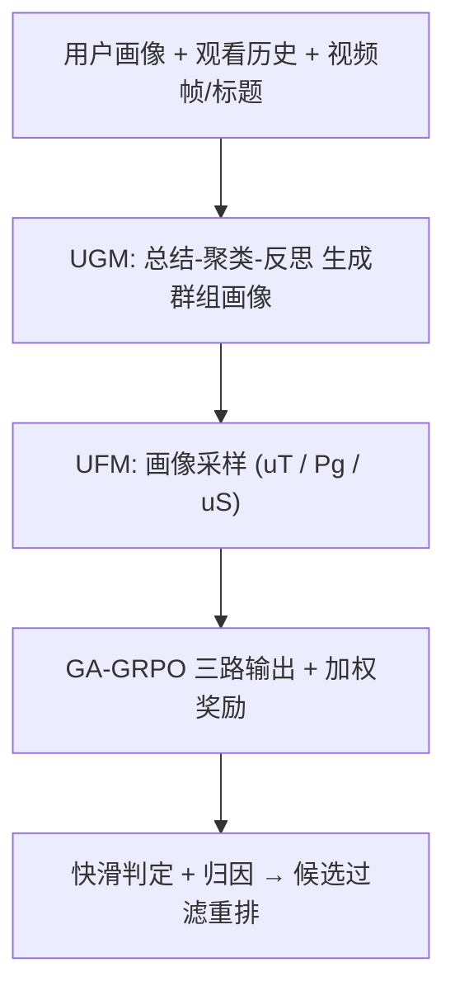
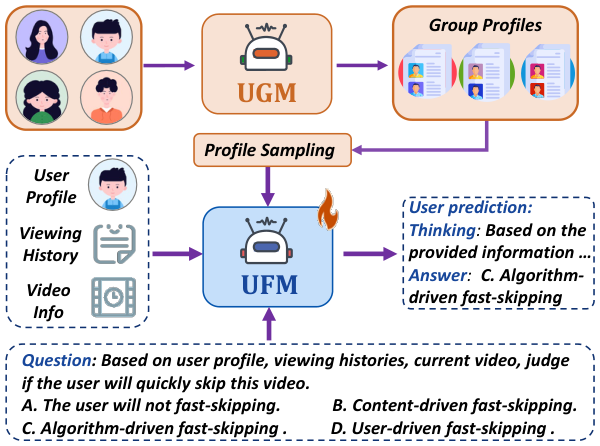

# G-UBS: Towards Robust Understanding of Implicit Feedback via Group-Aware User Behavior Simulation (群组感知用户行为模拟：面向隐式反馈的鲁棒理解)

- **会议/期刊**: AAAI 2026
- **作者与机构**: Boyu Chen, Siran Chen, Zhengrong Yue, Kainan Yan, Chenyun Yu, Beibei Kong, Cheng Lei, Chengxiang Zhuo, Zang Li, Yali Wang（中科院深圳先进院、腾讯 PCG、中山大学深圳、上海交大）
- **推荐链路定位**: 重排（对候选视频集做偏好过滤与快滑归因）
- **研究方向**: 自监督对比学习与交互去噪 / 大语言模型推荐
- **论文原文**: [https://arxiv.org/abs/2508.05709v2](https://arxiv.org/abs/2508.05709v2)
- **开源代码**: 暂未开源

## TL;DR (1分钟核心速览)

隐式反馈（快滑、不点击）噪声极大——一次快滑可能只是误触或环境干扰，而非真实不感兴趣，现有 LLM/MLLM 用户模拟器只看单模态文本、且无法区分噪声来源。本文提出 G-UBS 双智能体范式：UGM 用 LLM 的"总结-聚类-反思"流程生成群组画像，UFM 用群组感知 GRPO（GA-GRPO）把群组画像与相似用户画像作为奖励加权信号注入强化学习，从而为个体隐式反馈去噪。作者构建首个多模态隐式反馈视频推荐基准 IF-VR（15k 用户 / 25k 视频 / 933k 交互）。在 IF-VR 上，播放率 >30% 的视频占比相对提升 4.0%，快滑归因推理准确率提升 14.9%。

## Background & Motivation (背景与核心矛盾)

- **主流范式**: 挖掘隐式反馈分两派——Embedding 派（DFN、CDR 等）把反馈直接映射为特征向量喂入推荐模型；LLM 派（CoT 推理或 RL 微调）让大模型模拟用户行为、预测是否喜欢。
- **前人局限**: (1) Embedding 派完全无法解释"用户为什么不喜欢"，可解释性差；(2) LLM 派仅处理文本单模态，无法联合感知视频画面，且**把个体隐式反馈当作干净标签**，对误触、习惯性快滑等噪声毫无抵抗力。
- **核心洞察 (Key Insight)**: 个体层面的快滑信号噪声大，但**同一兴趣群组的集体行为模式是稳定的**——若某用户画像与"中老年养生群体"高度一致，则该群体对血腥/高空刺激画面的普遍排斥可作为该用户快滑的强先验，从而把"个体噪声"与"真实不感兴趣"区分开。
- **本文切入点**: 用 LLM 自动挖掘群组画像，并将其作为强化学习中的额外奖励信号源，让个体模拟器在群组共识的"锚点"下学习归因。

## Method (核心方法设计)

### 1. 整体框架 (Overall Architecture)

G-UBS 由两个 LLM 智能体协作构成。**UGM** 先对 1000+ 用户画像做"总结-聚类-反思"三阶段处理，产出至多 50 个群组画像 $P_g$（含群体特征、高/低兴趣区、降权标签、推荐改进建议）。**UFM** 以 Qwen2.5-VL-7B 为底座，先用人 GPT-4o 标注的 50K 显式"不喜欢"数据做 SFT 冷启动，再进入 GA-GRPO 强化学习：每一步采样三类画像（训练用户$u_T$、所属群组$P_g$、同群相似用户$u_S$），分别生成三路输出并计算加权奖励，用组内相对优势做策略优化。推理时对候选视频集逐条判定"是否快滑 + 快滑归因（内容/算法/用户驱动）"，过滤掉预测为不感兴趣的视频。

<figure class="paper-figure" markdown="span">
  <figcaption>图1：我们的 G-UBS 范式概览：为更好地可视化隐式反馈，我们将 UGM 生成的群组画像整合到 UFM 训练过程中。</figcaption>
</figure>

### 2. 关键设计拆解 (Key Designs)

1. **UGM 的"总结-聚类-反思"工作流（解决群组画像代表性不足）**：直接用 LLM 一次性分组会因上下文长度限制而丢失观看历史，导致兴趣标签与实际行为错位。UGM 分三步：先由 DeepSeek-R1 按兴趣模式把用户集 $\mathcal{U}$划为$k$组并给出典型用户$u_g$，即$(U_g, G) = S(\mathcal{U}, k, M)$；再按画像相似度取每组 top-60 用户$C_g = \{u \in \mathcal{U} \mid \mathrm{Sim}(u, u_g) \geq \tau_g\}$生成初始画像$\hat{P}_g$；最后**反思阶段**把观看历史$h$引入，用 GPT-4o 判定$C'_g = \{u \in C_g \mid \mathrm{Match}(u, \hat{P}_g, h) = \text{Yes}\}$，剔除标签与行为不符者后重生成最终$P_g$。直觉：反思步骤用"行为证据"校正"标签自述"，把群组画像的一致性从标签层拉到行为层。

2. **GA-GRPO 群组感知奖励加权（解决个体噪声淹没真实信号）**：标准 GRPO 只用单条样本的组内相对优势，个体噪声会直接污染梯度。本文对三路输出分别算奖励 $R_T = R(o_T)\cdot W_T$、$R_G = R(o_G)\cdot W_G$、$R_S = R(o_S)\cdot W_S$，其中单路奖励为格式、快滑判定、归因选择三项之和$R(o) = r_{\text{format}} + r_{\text{skip}} + r_{\text{choice}}$；再在$\{R_T, R_S, R_G\}$内部做标准化得优势$AR = (R - \mathrm{mean})/\mathrm{std}$，代入带 KL 约束的策略目标$\max_{\pi_\theta} \mathbb{E}\big[\sum_{o\in O}\frac{\pi_\theta(o)}{\pi_{\theta_{old}}(o)} AR - \beta D_{KL}(\pi_\theta \| \pi_{ref})\big]$。直觉：群组/相似用户输出充当"多数投票锚"，当个体输出与群组共识背离时其相对优势被压低，等价于对个体噪声做软过滤；权重取$W_T{=}0.7, W_G{=}W_S{=}0.15$ 时最优——群组信号需"有意义但不可喧宾夺主"。

3. **训练目标、负采样与推理效率**：总奖励即上式三项之和，无传统负采样（RL 以组内采样 6 条输出构造相对优势，其中 1 条群组、1 条相似用户、4 条训练用户）。SFT 1 epoch + RFT 200 步，学习率 1e-5，4×A100-80G。部署侧 FP16 量化后 UFM 达 5.3 QPS（约 45.8 万视频/天），UGM 异步调用 8 分钟可分析 1000 用户。

## Experimental Setup & Evaluation Protocol (实验设置与评估协议)

- **数据集与预处理**: 自建 IF-VR（腾讯视频 App，2025-05-19 至 05-25 共 7 天），过滤规则为：保留前后均有操作、间隔 <2 分钟、未退出 App 的快滑记录以剔除外力干扰；剔除观看数 <10 的视频；点击任务剔除曝光-点击记录 <30 的用户。

| 数据集 | #Users | #Items | #Interactions | 稀疏度/密度 | 特征/场景说明 |
| :--- | :---: | :---: | :---: | :---: | :--- |
| IF-VR（序列推荐） | 8,000 | 25,000 | 320K 观看 + 50K 显式不喜欢 + 72K 隐式标注 | — | 多模态（视频帧+标题），快滑归因四分类 |
| IF-VR（点击模拟） | 7,000 | 25,000 | 613K 曝光/点击 | — | 多视频页点击二分类 |
| MovieLens / Amazon Books | 1,000 | — | 每用户 20 物品（10 点 10 未点） | — | 公开集用户模拟验证 |

- **数据划分与防穿越 (Splitting Strategy)**: 序列任务取 1000 用户为测试集，其余为训练集；每个用户**前一半观看历史作上下文、后一半作测试**（时间序切分，天然防穿越）。点击任务取最后 10 条历史为测试、其余为交互历史。
- **排名评测协议 (Ranking Protocol)**: 非传统 Full-Ranking，而是**候选集过滤式评估**——用腾讯视频原生推荐系统生成候选，G-UBS 过滤掉预测为不感兴趣的视频后，在剩余集合上统计 Person/Total Play Rate、Play Rate>30%、Finish Rate、Click Rate，以及快滑判定的 Judge F1/Acc 与归因的 Reason F1/Acc。
- **对比基线与超参设置**: 对比原生推荐、SASRec、Llama3.3-70B、Qwen3-32B/235B、DeepSeek-R1-0528、Qwen2.5-VL-7B、Video-R1、VideoChat-R1、Doubao-1.5-pro、GPT-4o；底座 Qwen2.5-VL-7B，全参微调，bf16 + Zero2 + FlashAttention。

## Key Experimental Results (实验关键数据)

### 1. 主实验对比 (Main Results)

| 方法 | Person Play Rate | Total Play Rate | Play Rate>30% | Click Rate | Judge F1 | Reason F1 | Reason Acc |
| :--- | :---: | :---: | :---: | :---: | :---: | :---: | :---: |
| 原生推荐 | 46.5% | 48.3% | 76.3% | 21.4% | — | — | — |
| SASRec | 45.8% | 48.0% | 75.8% | 20.9% | — | — | — |
| Qwen3-235B | 48.3% | 51.6% | 83.8% | 21.9% | 44.3% | 38.6% | 42.3% |
| DeepSeek-R1-0528 | 49.6% | 53.0% | 83.8% | 22.7% | 43.0% | 41.3% | 48.0% |
| VideoChat-R1 | 48.4% | 52.5% | 84.5% | 22.1% | 42.4% | 42.0% | 41.6% |
| GPT-4o | 51.3% | 52.8% | 84.7% | 23.0% | 45.4% | 37.4% | 40.5% |
| **G-UBS** | **52.3%** | **55.3%** | **88.7%** | **25.7%** | **54.9%** | **55.6%** | **62.9%** |
| Improv. (vs 最优基线) | +1.0pt | +2.3pt | +4.0pt | +2.7pt | +9.5pt | +13.6pt | +14.9pt |

公开集用户模拟（MovieLens / Amazon Books，Acc）：G-UBS 79.9% / 80.1%，优于 SimUser 79.1% / 79.1%、GPT-4o 72.2% / 73.4%、Agent4Rec 69.1% / 68.9%。

### 2. 消融实验 (Ablation Study)

| 配置 | Person Play Rate | Play Rate>30% | Judge F1 | Reason F1 |
| :--- | :---: | :---: | :---: | :---: |
| 仅 SFT | 48.6% | 80.8% | 38.0% | 36.4% |
| SFT + RL | 49.6% | 84.7% | 45.3% | 46.0% |
| SFT + RL + 群组画像 | **52.3%** | **88.7%** | **54.9%** | **55.6%** |
| w/o 反思阶段 | 51.2% | 87.9% | 54.4% | 55.1% |
| w/o 视觉信息 | 50.9% | 87.4% | 53.5% | 54.1% |
| w/o skip 奖励 | 52.2% | 88.6% | 54.8% | 55.3% |
| 兴趣分组（vs 人口统计/混合） | 52.3% | 88.7% | 54.9% | 55.6% |
| TF-IDF 聚类（vs BERT/K-Means） | 52.3% | 88.7% | 54.9% | 55.6% |

### 3. 关键实验发现 (Key Findings)

1. **群组画像是最强增益源**：SFT→SFT+RL 仅把 Reason F1 从 36.4% 提到 46.0%，而叠加群组画像后跃升至 55.6%（+9.6pt），说明 RL 本身只教会模型"按格式推理"，真正的去噪能力来自群组共识锚点。
2. **反思阶段与视觉信息各自贡献约 1pt 量级**：去掉反思使 Person Play Rate 从 52.3% 降至 51.2%、Reason F1 降 0.5pt；去掉视觉信息降至 50.9%、Reason F1 降 1.5pt——行为证据校正与多模态感知缺一不可，且视觉对归因（而非判定）更关键。
3. **分组粒度存在甜点**：20 组时最优（52.3%），10 组因组内兴趣分歧大而降至 52.1%，30–40 组因每组用户过少、画像代表性不足而回落；兴趣分组显著优于人口统计分组（后者组内兴趣方差大），TF-IDF 聚类优于 BERT（用户画像是结构化词序列而非自然语句）。

## Highlights & Limitations (亮点、对比与审稿批判)

- **与代表作对比 (vs. Prior Work)**: 相比 DFN/CDR 等 Embedding 派，本文首次给出快滑的**三类归因**（内容/算法/用户驱动）而非仅预测"是否喜欢"；相比 SimUser、Agent4Rec 等用户模拟器，本文引入群组画像作为 RL 奖励的额外信号源，且是首个联合视觉-文本多模态的隐式反馈基准；相比 Video-R1/VideoChat-R1 等视频 MLLM，本文不做通用视频理解，而是把多模态感知锚定在"个体噪声 vs 群组共识"的判别上。
- **可迁移亮点**: (1) "群组画像作为 RL 奖励加权锚"可迁移到任何个体标签噪声大的场景（如点击去偏、假阴性过滤）；(2) "总结-聚类-反思"三阶段 LLM 聚类流程可复用于冷启动用户分群与画像补全。
- **审稿级局限批判**: (1) 评估为**候选集过滤式**而非全库排序，且过滤后重算播放率存在"选择性偏差"——被过滤视频若本会被看完则指标被高估；(2) 依赖 GPT-4o 生成 72K 归因标注（仅人工抽检），标注噪声与 LLM 偏见可能被 RL 放大；(3) UGM 需 DeepSeek-R1 + GPT-4o 多次调用，8 分钟/千人的离线成本与在线 5.3 QPS 对超大规模平台仍偏重，且群组画像需随兴趣漂移周期性重生成。

## Rating (四维评分)

- **方法创新性 (Novelty)**: ⭐⭐⭐⭐ （群组画像作 RL 奖励锚点的思路新颖，但 GA-GRPO 本质是 GRPO 的奖励加权变体，理论深度有限）
- **评估协议与实验扎实度 (Protocol & Experiments)**: ⭐⭐⭐⭐ （自建 933K 交互多模态基准 + 公开集交叉验证 + 完整消融与超参分析，但过滤式评估协议存在选择性偏差隐忧）
- **写作与数学规范度 (Clarity & Rigor)**: ⭐⭐⭐⭐ （双智能体流程与奖励公式清晰，但部分符号如 $W_T/W_G/W_S$ 的最优取值仅靠实验给出、缺乏理论解释）
- **工业落地与复现价值 (Industrial & Practical Value)**: ⭐⭐⭐ （来自腾讯视频真实场景、有部署效率数据，但代码与 IF-VR 数据集尚未开源，复现门槛高）
