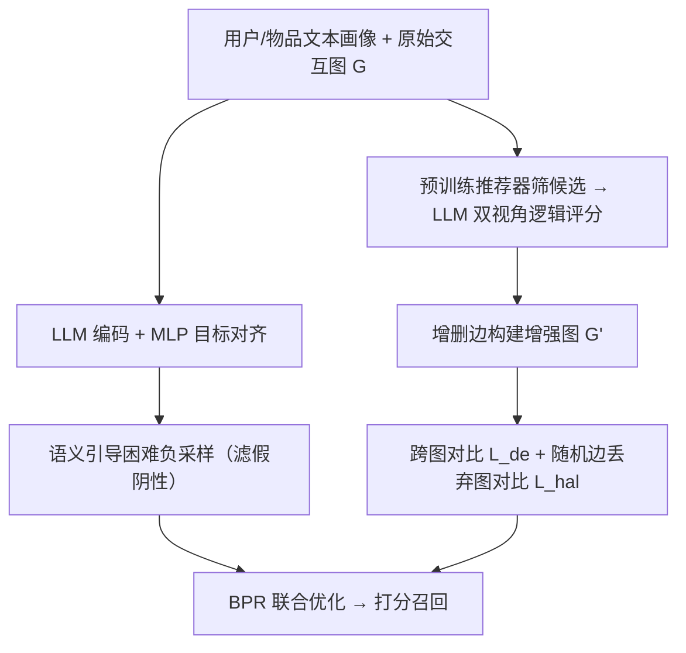
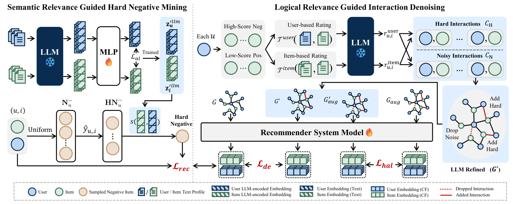

# Hard vs. Noise: Resolving Hard-Noisy Sample Confusion in Recommender Systems via Large Language Models (基于大语言模型破解推荐系统困难-噪声样本混淆)

- **会议/期刊**: AAAI 2026
- **作者与机构**: Tianrui Song, Wen-Shuo Chao, Hao Liu（香港科技大学（广州）/ 香港科技大学）
- **推荐链路定位**: 召回（图协同过滤训练阶段去噪 + 负采样）
- **研究方向**: 自监督对比学习与交互去噪 / 大语言模型推荐
- **论文原文**: [https://arxiv.org/abs/2511.07295v2](https://arxiv.org/abs/2511.07295v2)
- **开源代码**: [https://github.com/TianRui-Song717/LLMHNI](https://github.com/TianRui-Song717/LLMHNI)

## TL;DR (1分钟核心速览)

隐式反馈去噪的经典假设是"噪声样本损失高、预测分高"，但本文发现**困难样本与噪声样本在损失值和预测分数上分布高度重叠**（图1），导致基于数值模式的丢弃/重加权把宝贵的困难样本一并误杀。作者提出 LLMHNI，用 LLM 编码的**语义相关性**指导困难负采样并过滤假阴性，用 LLM 推理的**逻辑相关性**构建增强交互图做跨图对比去噪，并以目标对齐与随机边丢弃对比学习分别缓解"目标错配"与"幻觉边"。在 Amazon-books/Yelp/Steam 三数据集、NGCF 与 LightGCN 双骨干上，全库排序 Recall@20 相对最强基线 LLaRD 仍稳定领先，平均较原始骨干提升约 45%。

## Background & Motivation (背景与核心矛盾)

- **主流范式**: 以 BPR 为目标，将观测交互视为正、未观测视为负；去噪分两派——样本丢弃（T-CE 按高损失动态阈值剔除）与样本重加权（BOD 双层优化学权重），均依赖损失值/预测分/梯度等**协同数值模式**识别噪声。
- **前人局限**: ① 困难样本（如长尾但真实偏好）与噪声样本（误点击、位置偏置）在训练全程的损失与预测分分布几乎重合，单靠数值模式无法区分，误杀困难样本直接损害偏好建模；② 纯协同信号本身信息不足，缺少可判别"语义/逻辑上是否真的相关"的外部辅助信号。
- **核心洞察 (Key Insight)**: 困难样本与噪声样本的差异不在"模型有多不确定"，而在"用户与物品在语义与逻辑层面是否真的匹配"——这正是 LLM 的语义编码与推理能力可以提供、而协同数值模式无法提供的正交信号。
- **本文切入点**: 引入 LLM 的**语义相关性**（文本嵌入相似度）与**逻辑相关性**（LLM 推理评分）两类辅助信号，分别注入负采样与图去噪两个环节，并针对性解决嵌入目标错配与 LLM 幻觉两大副作用。

## Method (核心方法设计)

### 1. 整体框架 (Overall Architecture)

LLMHNI 在标准图协同过滤骨干（NGCF/LightGCN）之上并联两条 LLM 辅助支路。**语义支路**：用 LLM 编码用户/物品文本画像，经 MLP 投影到推荐表征空间做目标对齐，对齐后的嵌入用于在动态困难负样本池中挑选"预测分高但语义相似度最低"的负例，从而既采到困难负例又剔除假阴性。**逻辑支路**：先用预训练推荐器筛出高分负例与低分正例构成候选集，交由 LLM 做用户视角与物品视角双评分，仅双高者判为困难样本、其余判为噪声，据此增删边得到增强图 $G'$，通过跨图对比对齐一致交互、抑制不一致交互；再对$G$与$G'$ 各做随机边丢弃生成两视图做图对比，压制幻觉边。最终 BPR 损失与两项对比损失联合优化。

<figure class="paper-figure" markdown="span">
  <figcaption>图3：我们提出的LLMHNI框架概览。</figcaption>
</figure>

### 2. 关键设计拆解 (Key Designs)

1. **目标对齐的语义嵌入 + 语义引导困难负采样**：LLM 文本嵌入为通用语言任务训练，用户与物品向量在空间中各自成簇（图8a），直接算相似度会误导判别。作者以"既在文本相似度 Top-$N$又与用户有真实交互"构造可靠伪正例集$\mathcal{I}^{al+}_u$，用 InfoNCE 训练 MLP 投影器：
$\mathcal{L}_{al}=-\log\frac{\exp(\mathbf{z}_u\cdot\mathbf{z}_{i^{al+}}/\tau)}{\exp(\mathbf{z}_u\cdot\mathbf{z}_{i^{al+}}/\tau)+\sum_{k=1}^{N}\exp(\mathbf{z}_u\cdot\mathbf{z}_{i^{al-}_k}/\tau)}$对齐后用户/物品表征互相交织（图8b–d），相似度才具备推荐语义。采样时维护困难负例池，按预测分概率更新，再取池中语义相似度最低者作负例：$j=\arg\min_{k\in\mathcal{HN}^-_u}s(\mathbf{z}'^{llm}_u,\mathbf{z}'^{llm}_{j_k})$。直觉是：预测分高说明模型"困惑"，语义相似度低说明"确实不相关"，二者交集才是真困难负例，语义相似度高者则视为假阴性剔除。

2. **逻辑相关性推断与跨图对比去噪**：全量 pair 调 LLM 不可行，故用预训练推荐器按预测分采样高分负例与低分正例构成候选集 $\mathcal{C}$，LLM 分别以用户画像（$\mathcal{T}^{user}$）和用户高分公司集合（$\mathcal{T}^{item}$）为上下文给出 High/Mid/Low 评分。仅当双视角均为 High 判为困难样本$\mathcal{C}_H$，其余为噪声$\mathcal{C}_N$，据此构造$E'=E\setminus\{e_{u,i}|(u,i)\in\mathcal{C}_N\}\cup\{e_{u,i}|(u,i)\in\mathcal{C}_H\}$。跨图对比损失$\mathcal{L}_{de}$拉近$G$与$G'$上一致的$(u,i)$ 表征、压制不一致者——本质是让 LLM 判断只在"与原图共识"时才生效，避免单边错误标签直接污染训练。

3. **幻觉鲁棒对比学习与联合优化**：LLM 推断的边可能含幻觉，故对 $G$与$G'$各以概率$\rho$随机丢边得两视图，用$\mathcal{L}_{hal}$ 最大化同一节点两视图表征一致性：
$\mathcal{L}^{user}_{hal}=\sum_{u\in\mathcal{U}}-\log\frac{\exp(s(\mathbf{z}^{(1)}_u,\mathbf{z}^{(2)}_u)/\tau_{hal})}{\sum_{v\in\mathcal{U}}\exp(s(\mathbf{z}^{(1)}_u,\mathbf{z}^{(2)}_v)/\tau_{hal})}$随机丢边使幻觉边难以在两视图同时稳定存在，从而被对比目标自然抑制。总损失$\mathcal{L}_{total}=\mathcal{L}_{rec}+\lambda_1\mathcal{L}_{de}+\lambda_2\mathcal{L}_{hal}$；负采样为"均匀采样$M=30$更新池 + 语义挑选$K=10$"的混合策略，LLM 信号离线预生成，不进入每步训练开销。

## Experimental Setup & Evaluation Protocol (实验设置与评估协议)

- **数据集与预处理**: 沿用 RLMRec 提供的文本画像与预处理，Amazon-books/Yelp 过滤评分 <3，均做 k-core 过滤，按 3:1:1 划分训练/验证/测试。

| 数据集 | #Users | #Items | #Interactions | 稀疏度 | 特征/场景说明 |
| :--- | :---: | :---: | :---: | :---: | :--- |
| Amazon-books | 11,000 | 9,332 | 120,464 | 99.88% | 图书，含用户/物品文本画像 |
| Yelp | 11,091 | 11,010 | 166,620 | 99.86% | 本地商户签到 |
| Steam | 23,310 | 5,237 | 316,190 | 99.74% | 游戏平台，无评分过滤 |

- **数据划分与防穿越 (Splitting Strategy)**: 比例划分（3:1:1），非 Leave-One-Out；噪声鲁棒性实验在训练集注入 5%/10%/15%/20% 虚假交互、测试集保持不变。
- **排名评测协议 (Ranking Protocol)**: 报告 Recall@K 与 NDCG@K（K=10,20），遵循去噪推荐惯例的全库排序口径；显著性采用 $t$-test，$p<0.01$。
- **对比基线与超参设置**: 骨干 NGCF 与 LightGCN；基线含实例级（WBPR、T-CE、BOD）、表征级（SGL、SimGCL、XSimGCL）、LLM 增强级（RLMRec、LLaRD）。嵌入维度 $d=64$，batch 1024，学习率 1e-3，Adam；LLM 用 gpt-4o-2024-08-06，编码器 text-embedding-ada-002，$M=30$、$K=10$、$N=50$、$\tau=0.5$。

## Key Experimental Results (实验关键数据)

### 1. 主实验对比 (Main Results)

LightGCN 骨干（节选核心指标，完整见原文表1）：

| 方法 | Amz R@10 | Amz R@20 | Amz N@20 | Yelp R@20 | Yelp N@20 | Steam R@20 | Steam N@20 |
| :--- | :---: | :---: | :---: | :---: | :---: | :---: | :---: |
| Normal | 0.0950 | 0.1415 | 0.0893 | 0.1011 | 0.0659 | 0.1317 | 0.0858 |
| T-CE | 0.0990 | 0.1499 | 0.0939 | 0.1216 | 0.0779 | 0.1376 | 0.0893 |
| BOD | 0.1273 | 0.1792 | 0.1162 | 0.1355 | 0.0882 | 0.1484 | 0.0966 |
| SGL | 0.1091 | 0.1588 | 0.1030 | 0.1235 | 0.0803 | 0.1378 | 0.0903 |
| XSimGCL | 0.1153 | 0.1637 | 0.1084 | 0.1277 | 0.0830 | 0.1385 | 0.0903 |
| RLMRec | 0.1034 | 0.1601 | 0.0960 | 0.1275 | 0.0815 | 0.1452 | 0.0924 |
| LLaRD | 0.1408 | 0.2028 | 0.1326 | 0.1574 | 0.1008 | 0.1631 | 0.1059 |
| **LLMHNI** | **0.1423** | **0.2040** | **0.1369** | **0.1594** | **0.1047** | **0.1646** | **0.1087** |
| Improv. vs LLaRD | +1.07% | +0.59% | +3.24% | +1.27% | +3.87% | +0.92% | +2.64% |

NGCF 骨干上 LLMHNI 同样全面最优（如 Amazon R@20 0.1852 vs LLaRD 0.1834），平均较原始 NGCF 提升 46.55%、较原始 LightGCN 提升 45.31%；相对实例级/表征级去噪提升 11.78%–37.73%，相对 LLM 增强基线提升约 2.47%–33.86%。

### 2. 消融实验 (Ablation Study)

LightGCN + Amazon-books：

| 变体 | R@10 | R@20 | N@10 | N@20 |
| :--- | :---: | :---: | :---: | :---: |
| w/o SR lmns（语义困难负采样→均匀） | 0.1199 | 0.1799 | 0.0937 | 0.1112 |
| w/o SR al（去目标对齐） | 0.1248 | 0.1848 | 0.0982 | 0.1174 |
| w/o LR de（去跨图对比） | 0.1125 | 0.1772 | 0.0855 | 0.1060 |
| w/o LR hal（去幻觉鲁棒对比） | 0.1294 | 0.1854 | 0.1047 | 0.1230 |
| **LLMHNI 完整** | **0.1423** | **0.2040** | **0.1168** | **0.1369** |

### 3. 关键实验发现 (Key Findings)

1. **逻辑支路是主引擎，语义支路是增益器**：移除跨图对比 $\mathcal{L}_{de}$ 后 R@20 从 0.2040 跌至 0.1772（−13.1%），跌幅最大；移除语义困难负采样跌至 0.1799（−11.8%），说明"区分困难/噪声"的核心收益来自逻辑相关性，而语义信号主要改善负例质量。
2. **两个"防副作用"模块不可省**：去掉目标对齐（0.1848）与去掉幻觉鲁棒对比（0.1854）均显著掉点，验证了 LLM 嵌入目标错配与幻觉边若不处理会反噬去噪效果，而非可有可无的正则。
3. **噪声鲁棒性单调领先**：在 5%–20% 注入噪声下，LLMHNI 在 Amazon-books 与 Yelp 上 Recall@20 全程最高且下降斜率最平缓（图4），说明其判别依据不随噪声比例漂移；代价是每 epoch 训练时间最高（Amazon 6.97s vs BOD 5.75s、SGL 3.56s），但 LLM 调用离线完成，在线开销与骨干同阶。

## Highlights & Limitations (亮点、对比与审稿批判)

- **与代表作对比 (vs. Prior Work)**: T-CE/BOD 依赖损失与预测分的数值模式，天然无法拆解困难-噪声重叠；SGL/SimGCL/XSimGCL 只做表征增广，不判别样本真伪；RLMRec/LLaRD 虽引入 LLM 知识，但用于表征增强或知识互信息，**均未把 LLM 用于困难样本识别**——这正是本文的差异化定位。
- **可迁移亮点**: ① "预测分高 ∩ 语义相似度低"的困难负例判据可低成本移植到任意双塔/图召回负采样；② 用"原图 vs LLM 增强图"的跨图对比作为外部知识的软门控，可推广到任何引入外部信号增删边的场景。
- **审稿级局限批判**: ① 逻辑评分依赖 gpt-4o 离线批量推理，候选集规模、prompt 设计与 API 成本对工业部署是硬约束，论文未给出 LLM 调用总量与费用；② 困难/噪声的判定阈值（双 High、Top-$N$=50、$n_1/n_2$）为人工设定，图5显示温度参数$\tau$敏感、$\lambda$ 较稳，但缺少对评分阈值与候选采样比例的敏感性分析；③ 仅在两个 GNN 骨干与三个中等规模数据集验证，未覆盖序列/生成式骨干与超大规模工业场景。

## Rating (四维评分)

- **方法创新性 (Novelty)**: ⭐⭐⭐⭐ （首次系统提出并命名"困难-噪声混淆"问题，双 LLM 相关性信号 + 目标对齐 + 幻觉抑制的组合设计有清晰的问题驱动逻辑）
- **评估协议与实验扎实度 (Protocol & Experiments)**: ⭐⭐⭐⭐ （三数据集双骨干、8 个基线、$p<0.01$ 显著性、噪声注入与效率分析齐全，但划分与打分协议细节依赖前作、缺阈值敏感性）
- **写作与数学规范度 (Clarity & Rigor)**: ⭐⭐⭐⭐ （动机图与案例研究直观，公式与损失定义完整；部分符号在正文与附录间略有出入，复杂度分析较简）
- **工业落地与复现价值 (Industrial & Practical Value)**: ⭐⭐⭐⭐ （代码已开源、LLM 信号离线预生成不增在线延迟，但 LLM API 成本与 prompt 工程是落地门槛）
