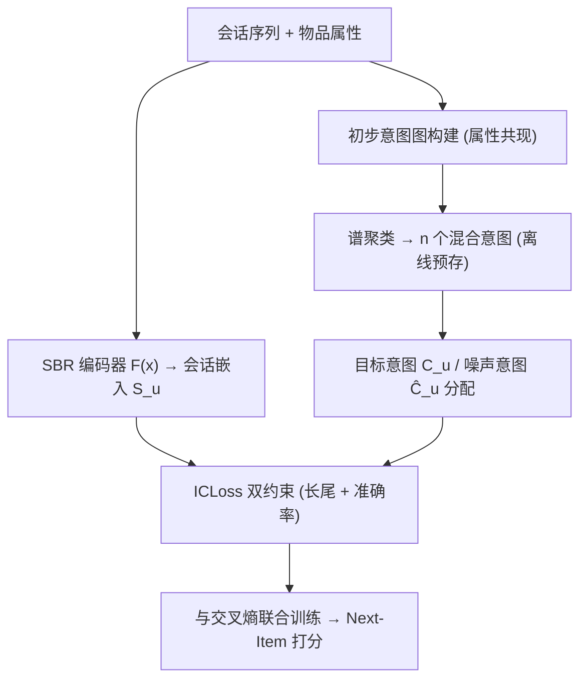
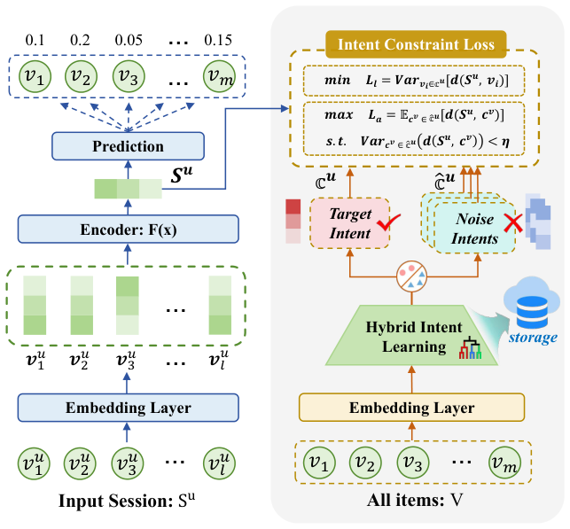

# Bid Farewell to Seesaw: Towards Accurate Long-tail Session-based Recommendation via Dual Constraints of Hybrid Intents (告别跷跷板：基于混合意图双约束的精准长尾会话推荐)

- **会议/期刊**: AAAI 2026 (Oral)
- **作者与机构**: Xiao Wang, Ke Qin, Dongyang Zhang, Xiurui Xie, Shuang Liang* (电子科技大学)
- **推荐链路定位**: 召回（会话级 Next-Item 预测）
- **研究方向**: 序列与会话推荐 / 冷启动与长尾推荐
- **论文原文**: [https://arxiv.org/abs/2511.08378v4](https://arxiv.org/abs/2511.08378v4)
- **开源代码**: [https://github.com/jarviswww/Code4HID](https://github.com/jarviswww/Code4HID)

## TL;DR (1分钟核心速览)

现有长尾 SBR 方法（增强式/重排式）无差别抬高所有尾物品，把与会话无关的噪声尾物品一并推入推荐列表，导致准确率与长尾覆盖呈"跷跷板"式互斥。本文提出即插即用框架 HID：先用属性感知谱聚类构造"混合意图"，为每个会话分配目标意图与噪声意图以甄别噪声；再推导出长尾约束（对齐会话与目标意图）与准确率约束（推离噪声意图），并统一为单一 ICLoss。在 Tmall/Diginetica/RetailRocket 上以 Full-Ranking 评估，SRGNN+HID 的 HR@20 提升 1.1–3.3 个点、tCov@20 提升 1.3–5.5 个点，实现准确率与长尾双赢。

## Background & Motivation (背景与核心矛盾)

- **主流范式**: 长尾 SBR 分两派——增强式（LOAM 的 Niche-Walk 增广、CSBR 的分布对齐）与重排式（TailNet 偏好调整、LAP-SR 后处理多样性），均以"尾物品即有价值"为隐含前提。
- **前人局限**: (i) 无差别强调尾物品会把与会话无关的噪声尾物品（如书籍会话中的"服装"）一并推入列表，直接损伤准确率；(ii) 长尾目标缺乏显式监督信号，只能借交叉熵间接优化，与增广/重排策略天然冲突，形成 see-saw。
- **核心洞察 (Key Insight)**: 图 1(b) 在 Tmall 上显示 GRU4Rec 叠加各长尾插件后 tCov@20 上升但 HR@20 普遍下滑；作者据此判断冲突根源不是"尾物品本身"，而是"尾物品中的会话无关噪声"未被识别与约束。
- **本文切入点**: 用跨会话的属性共现模式构造更可靠的"混合意图"，把长尾优化严格限制在目标意图内的相关尾物品上，同时显式推离噪声意图。

## Method (核心方法设计)

### 1. 整体框架 (Overall Architecture)

HID 作为插件挂在任意 SBR 编码器（STAMP/GRU4Rec/SRGNN/GCEGNN）之后。离线阶段：物品按属性归为 $k$个初步意图，统计全体会话中属性的 1-hop 共现构建初步意图图，谱聚类得$n$个混合意图并本地存储。训练阶段：对每个 batch，按会话真实下一项所属混合意图定义目标意图集$\mathcal{C}_u$，按同 batch 其他会话的下一项定义噪声意图集$\hat{\mathcal{C}}_u$；会话嵌入与意图嵌入经 L2 归一化后送入 ICLoss，与交叉熵多任务联合训练。推理阶段仅需按物品检索预存的意图映射，无额外在线开销。

<figure class="paper-figure" markdown="span">
  <figcaption>图 3：SBR 模型（左）+ HID（右）的整体架构。混合意图学习模块首先将物品分配给 k 个初步意图，然后根据初步意图图中的拓扑关系进一步将其划分为 n 个混合意图 C。在细化混合意图后，引入意图约束损失来规范会话嵌入 Su 的学习过程。</figcaption>
</figure>

### 2. 关键设计拆解 (Key Designs)

1. **混合意图学习（属性感知谱聚类）**：痛点在于仅靠会话内时序或单会话语义聚类提取意图不可靠、且忽略跨会话一致性。本文先以属性为初步意图节点、以全体会话中属性共现频次为边权构图，再对归一化拉普拉斯 $L=I-D^{-1/2}WD^{-1/2}$取前$q$个最小特征向量做 k-means，将属性重聚为$n$个混合意图，意图嵌入取所含物品均值$\boldsymbol{c}_i=\frac{1}{|\mathcal{c}_i|}\sum_{\boldsymbol{v}_j\in\mathcal{c}_i}\boldsymbol{v}_j$。直觉：属性共现把"食物+锅→烹饪"这类高频组合合并为高层意图，比单会话滑窗更抗噪且跨会话一致。

2. **双约束与 ICLoss（长尾 + 准确率的统一推导）**：长尾约束最小化会话到目标意图内所有物品距离的方差 $\min\mathcal{L}_l=\mathrm{Var}_{\boldsymbol{v}_i\in\mathcal{C}_u}[d(\boldsymbol{S}_u,\boldsymbol{v}_i)]$，定理 1 证明当物品围绕会话近似对称分布时，该式可等价近似为$\min d(\boldsymbol{S}_u,\boldsymbol{c}_u)$，复杂度从$O(Nd)$降到$O(d)$——即"对齐会话与目标意图质心"就等价于压平头尾相似度差异。准确率约束则最大化会话到噪声意图的均值距离并约束其方差上界$\eta$。二者合并为 softmax 形式，定理 2 证明其近似等价于固定 margin=2 的 (N-1)-triplet loss；因固定 margin 对意图分布差异大的场景不足，引入可学习温度$\sigma$与方差惩罚$p_u=\max(0,\mathrm{Var}-\eta)$，最终：

$$\mathcal{L}_c=-\sum_{\boldsymbol{S}_u\in\mathcal{B}}\log\frac{\exp(\cos(\boldsymbol{S}_u,\boldsymbol{c}_u)/\sigma)}{(1+\lambda p_u)\big[\exp(\cos(\boldsymbol{S}_u,\boldsymbol{c}_u)/\sigma)+\sum_{\boldsymbol{c}_v\in\hat{\mathcal{C}}_u}\exp(\cos(\boldsymbol{S}_u,\boldsymbol{c}_v)/\sigma)\big]}$$

3. **训练目标、负采样与推理效率**：总损失 $\mathcal{L}=\mathcal{L}_p+\epsilon\mathcal{L}_c$，$\mathcal{L}_p$为标准交叉熵；负样本即同 batch 其他会话的下一项所属混合意图（in-batch 免采样，且目标/噪声意图互斥保证两约束不冲突）。混合意图离线预计算，训练每 batch 复杂度$O(BKd)$，推理仅需一次查表，插件开销可忽略。

## Experimental Setup & Evaluation Protocol (实验设置与评估协议)

- **数据集与预处理**: 剔除长度 1 的会话与出现少于 5 次的物品（`5-core` 式过滤），会话切分增广生成多组 (前缀, 标签) 样本。

| 数据集 | 训练会话 | 测试会话 | #Items | 平均长度 | 场景 |
| :--- | :---: | :---: | :---: | :---: | :--- |
| Tmall | 351,268 | 25,898 | 40,728 | 6.69 | 电商购物 |
| Diginetica | 719,470 | 60,858 | 43,097 | 5.12 | 电商搜索 |
| RetailRocket | 433,643 | 15,132 | 36,968 | 5.43 | 电商浏览 |

- **数据划分与防穿越 (Splitting Strategy)**: 全局时间戳切分——最后一周数据作测试，其余历史数据训练；目标/噪声意图仅在训练期作监督信号，不参与推理，无泄漏风险。
- **排名评测协议 (Ranking Protocol)**: 无偏 `Full-Ranking`（全库未交互物品排序），$K=20$；准确率指标 HR/MRR，长尾指标 tHR/tMRR/tCov/Tail（仅统计真实下一项属尾物品的会话，尾物品按帕累托原则取频次后 80%）。
- **对比基线与超参设置**: 4 个基础 SBR 模型（STAMP、GRU4Rec、SRGNN、GCEGNN）× 4 个长尾插件（TailNet、CSBR、LOAM、LAP-SR）；$d=100$，batch=256，$\epsilon=0.2$，$\sigma=0.14$，$\eta=0.2$，$\lambda_p=0.3$，谱聚类簇数$n=300$；双侧 t 检验报告 p 值。

## Key Experimental Results (实验关键数据)

### 1. 主实验对比 (Main Results)

以最具代表性的 SRGNN 与 GRU4Rec 为底座（Tmall / Diginetica，K=20）：

| 底座 | 方法 | HR | MRR | tHR | tCov | Tail |
| :--- | :--- | :---: | :---: | :---: | :---: | :---: |
| SRGNN | base | 27.45 | 14.27 | 27.12 | 53.60 | 77.65 |
| SRGNN | + TailNet | 25.79 | 13.05 | 25.81 | 64.01 | 76.33 |
| SRGNN | + CSBR | 26.98 | 13.83 | 26.89 | 53.00 | 77.61 |
| SRGNN | + LOAM | 26.33 | 13.52 | 26.56 | 69.95 | 77.23 |
| SRGNN | + LAP-SR | 26.76 | 13.95 | 26.89 | 61.35 | 75.38 |
| SRGNN | **+ HID** | **28.38** | **14.66** | **28.13** | **66.40** | **78.12** |
| GRU4Rec | base | 19.69 | 9.58 | 19.53 | 49.60 | 71.80 |
| GRU4Rec | + LOAM | 18.40 | 9.14 | 18.65 | 58.76 | 79.57 |
| GRU4Rec | **+ HID** | **25.13** | **13.95** | **25.21** | **63.21** | **77.92** |

HID 在全部 4 个底座 × 3 个数据集上均取得 HR/MRR 与 tCov 双项最优；相对 base，SRGNN+HID 在 Tmall 上 HR@20 提升 3.4%、tCov@20 提升 23.9%，GRU4Rec+HID 的 HR@20 提升幅度高达 27.6%，且 p 值普遍 < 0.001。

### 2. 消融实验 (Ablation Study)

| 变体 | Tmall HR | Tmall tCov | Diginetica HR | Diginetica tCov |
| :--- | :---: | :---: | :---: | :---: |
| STAMP + HID | **28.26** | **73.65** | **50.39** | **93.05** |
| STAMP + HID w/o HI | 27.43 | 69.29 | 50.17 | 91.96 |
| STAMP + HID w/o FC | 26.77 | 70.20 | 49.76 | 92.15 |
| SRGNN + HID | **28.38** | **66.40** | **52.09** | **96.02** |
| SRGNN + HID w/o HI | 27.48 | 61.00 | 51.96 | 92.94 |
| SRGNN + HID w/o FC | 27.36 | 62.92 | 51.16 | 93.56 |

### 3. 关键实验发现 (Key Findings)

1. **HI 管多样性、FC 管准确率，分工明确**：去掉混合意图（改用末 3 项均值作意图）使 SRGNN 的 tCov@20 从 66.40 跌至 61.00（−5.4），而去掉柔性系数 $\sigma$ 使 HR@20 从 28.38 跌至 27.36（−1.0），与"HI 提供长尾监督、FC 调节判别边界"的设计意图吻合。
2. **长会话场景收益更大**：Tmall 平均会话长度 6.69 最长、意图漂移最频繁，HI 消融在该数据集上 tCov 跌幅（−4.36）显著大于 Diginetica（−3.08），说明目标意图建模对多意图切换会话尤为关键。
3. **超参存在明确最优区间**：$\epsilon$在 Tmall 上取 0.4 时 HR 与 tCov 同步上升，超过后准确率回落而长尾继续升，重现局部 see-saw；混合意图簇数$n$ 在 Tmall/RetailRocket 取 4、Diginetica 取 3 时 tCov 达峰，簇过多会使目标意图内尾物品过少反而损害覆盖。

## Highlights & Limitations (亮点、对比与审稿批判)

- **与代表作对比 (vs. Prior Work)**: 相较 LOAM 的增广式与 TailNet/LAP-SR 的重排式，HID 的本质差异是引入"噪声意图"这一显式负向监督，把长尾优化从"全体尾物品"收缩到"目标意图内尾物品"；相较 CSBR 的分布对齐，HID 的约束由定理 1/2 严格推导，且以单损失统一两目标而非多目标加权。
- **可迁移亮点**: (i) 用属性共现图 + 谱聚类构造跨会话稳定意图，可迁移至冷启动物品的语义分组；(ii) 定理 1 的"方差最小化 ≈ 质心对齐"近似把 $O(Nd)$降到$O(d)$，是插件式方法控制开销的通用技巧。
- **审稿级局限批判**: (i) 混合意图依赖物品属性标签，虽附录给出语义聚类替代方案且性能相当，但需每 epoch 重算语义簇，训练开销上升；(ii) 噪声意图取自同 batch 其他会话的下一项，batch 构成与 batch size 可能影响约束强度，论文未给出 batch size 敏感性分析；(iii) 仅在三个电商数据集验证，缺乏新闻/音乐等属性体系差异大的场景。

## Rating (四维评分)

- **方法创新性 (Novelty)**: ⭐⭐⭐⭐ （混合意图 + 双约束统一损失的组合新颖，定理 1/2 给出可解释的理论支撑，但谱聚类与 triplet 近似本身属成熟工具的重组）
- **评估协议与实验扎实度 (Protocol & Experiments)**: ⭐⭐⭐⭐ （4 底座 × 4 竞品 × 3 数据集的全矩阵实验扎实，Full-Ranking 与 t 检验规范，但缺 batch size 与属性缺失比例的敏感性分析）
- **写作与数学规范度 (Clarity & Rigor)**: ⭐⭐⭐⭐ （约束推导链条完整、附录证明清晰，公式 11–13 编号与正文略有错位，属排版瑕疵）
- **工业落地与复现价值 (Industrial & Practical Value)**: ⭐⭐⭐⭐⭐ （即插即用、意图离线预存、推理零额外开销，代码已开源，工程落地门槛极低）
