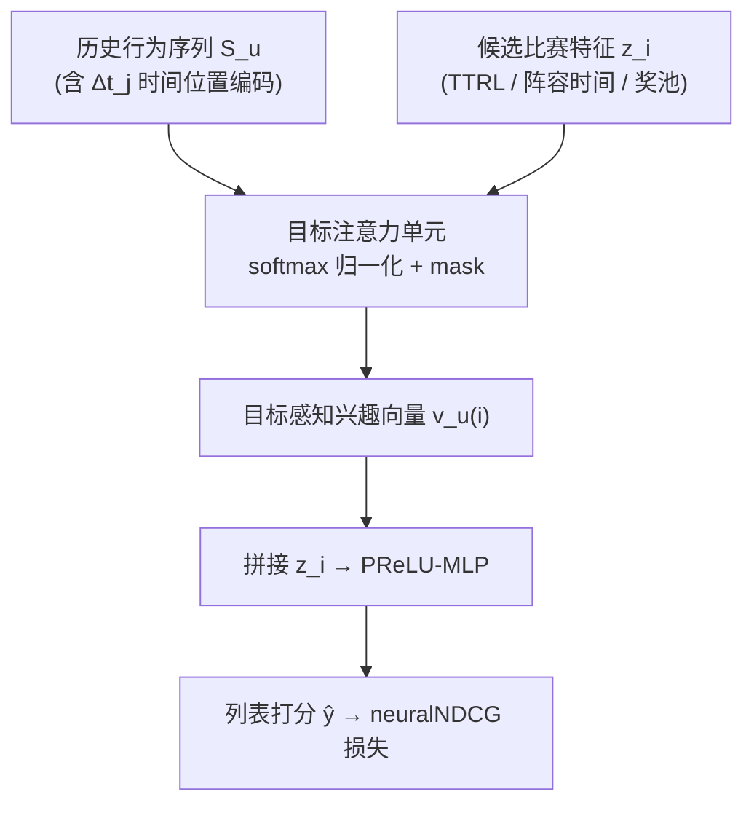
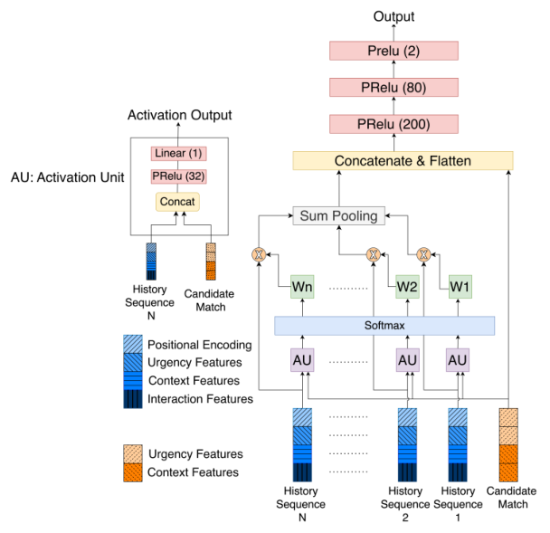

# Driving Engagement in Daily Fantasy Sports with a Scalable and Urgency-Aware Ranking Engine (面向每日梦幻体育的紧迫度感知可扩展排序引擎)

- **会议/期刊**: AAAI 2026 (Proceedings of the 40th AAAI Conference on Artificial Intelligence, pp. 40378-40385)
- **作者与机构**: Unmesh Padalkar（Dream11，印度头部梦幻体育平台）
- **推荐链路定位**: 精排（首页比赛列表排序，后续迁移至端上重排）
- **研究方向**: 序列与会话推荐 / 多任务学习与列表级重排
- **论文原文**: [https://arxiv.org/abs/2604.13796v1](https://arxiv.org/abs/2604.13796v1)
- **开源代码**: 暂未开源

## TL;DR (1分钟核心速览)

DFS 场景中比赛有硬性开赛截止（round lock），传统静态目录推荐无法平衡"用户相关性"与"时间紧迫性"，且比赛 ID 永不重复导致极端物品冷启动。本文改造 DIN：在候选物品侧注入实时紧迫度特征（Time-To-Round-Lock、阵容公布时间），在历史行为侧注入时间位置编码 $\Delta t_j = t_c - t_j$，并将点式 CTR 目标替换为 neuralNDCG 列表损失。在 65 万用户、超 100B 交互的工业数据上，nDCG@1 相对强调优 LightGBM 提升 +9%。

## Background & Motivation (背景与核心矛盾)

- **主流范式**: 首页比赛列表排序本质是 Learning-to-Rank 问题，工业界普遍用 LightGBM + lambdarank + 大量手工特征（紧迫度、奖池、阵容状态）做 GBDT 排序。
- **前人局限**: 其一，纯相关性排序会让"一周后开赛的热门比赛"压过"一小时后开赛的冷门比赛"，导致比赛开赛时奖池未满、平台直接亏损；纯紧迫度排序又会灌入无关内容，损害长期留存。其二，比赛是唯一且短暂的事件（ID 不复用），协同过滤完全失效；且训练用点击后行为（组队、报名）而推理在曝光前，存在样本选择偏差与数据稀疏。
- **核心洞察 (Key Insight)**: 用户在平台上的旅程天然是序列化的（浏览比赛 → 工资帽约束下组队 → 报名付费），DIN 的目标注意力恰好能按候选比赛动态激活历史行为的不同部分（如板球 vs 足球兴趣），比 SASRec 的全局统一用户向量更适合"候选敏感"的富特征排序。
- **本文切入点**: 把"时间"从手工特征升级为模型内生的两个注入点（物品侧紧迫度 + 行为侧时间间隔编码），并用列表级损失直接对齐 nDCG。

## Method (核心方法设计)

### 1. 整体框架 (Overall Architecture)

输入为用户历史行为序列 $S_u=[a_1,\dots,a_k]$（每次行为含比赛特征、交互类型、当时紧迫度与奖池）与候选集合$C(u,t_c)$（24 小时窗口内开赛的比赛，窗口长度是兼顾用户流动性、注意力聚焦与实时算力的生产启发式）。对每个候选$i$，DIN 的激活单元将历史行为向量与候选特征拼接后过前馈网络得到注意力权重，softmax 归一化（padding 位置先 mask）后加权求和得到目标感知兴趣向量$v_u(i)$，再与候选特征$z_i$拼接送入 PReLU-MLP 输出打分$\hat{y}_i$。整个候选列表的打分向量送入 neuralNDCG 损失端到端训练。

<figure class="paper-figure" markdown="span">
  <figcaption>图2：我们提出的 Urgency-Aware DIN 模型的整体架构。该模型通过注意力机制计算目标感知的用户兴趣向量，然后将其与物品特征结合并输入最终的 MLP 进行排序。</figcaption>
</figure>

### 2. 关键设计拆解 (Key Designs)

1. **双层时间注入（Urgency Features + Temporal Positional Encoding）**：痛点在于 GBDT 只能把时间当静态特征，无法让"最近行为"在注意力中自动获得更高权重。本文在候选侧加入 Time-To-Round-Lock、Time-Since-Lineups 等实时特征 $z_i$，在行为侧为每条历史$a_j$计算时间间隔$\Delta t_j = t_c - t_j$并编码进行为表示。直觉是：同一用户对"1 小时前点过的板球赛"与"3 天前点过的板球赛"应有不同权重，而$\Delta t_j$让注意力权重$\alpha_{ij}$ 显式依赖时间衰减。

2. **点式 DIN → 列表式排序（neuralNDCG）**：原 DIN 为 CTR 点式预测，与"整个列表的 nDCG"存在目标错位。本文用 NeuralSort 对打分向量 $\hat{y}$做可微松弛，得到软置换矩阵$P_{\hat{y}}$，进而计算期望 nDCG 并取负作为损失：
$$\mathcal{L}_{\text{rank}} = -\,\text{neuralNDCG}(\hat{y}, y)$$
其中 $y$ 为列表真实相关性标签。这样梯度直接作用于"把相关比赛排到前 5 张卡片内"，与首页最多展示 5 张卡的用户体验对齐。

3. **训练目标、负采样与推理效率**：每个正样本（被点击比赛）与同上下文候选集中其余比赛构成负样本，即**同请求内全候选列表**作为训练列表（in-slate 负采样，非全局均匀负采样），天然包含大量"高紧迫度但未被点击"的困难负例。推理时对 24 小时窗口内全部候选逐一打分排序，单请求候选规模可控。工程上用 Ray + PyTorch DDP 做多节点多 GPU 训练（80 GPU 作业），单 epoch 训练从数天压缩到约 1 小时。

## Experimental Setup & Evaluation Protocol (实验设置与评估协议)

- **数据集与预处理**: Dream11 真实工业数据，采用**严格不相交用户 + 时间外推**划分（验证/测试期在训练期之后），专门检验对未见用户的泛化：

| 数据集 | #Users | #Interactions | 时间跨度 | 用途 |
| :--- | :---: | :---: | :---: | :--- |
| Training | 200,000 | 92.5B | 12 个月 | 模型训练 |
| Validation | 200,000 | 10.5B | 4 个月 | 超参调优 |
| Test | 250,000 | 11.7B | 4 个月 | 最终评估 |

- **数据划分与防穿越 (Splitting Strategy)**: 用户级不相交 + 全局时间戳切分（out-of-time），验证与测试期顺序后置，杜绝未来信息泄漏。
- **排名评测协议 (Ranking Protocol)**: 对每个请求的 24 小时候选窗口做**全候选列表排序**（非采样排序），报告 Recall@1/3/5 与 nDCG@1/3/5；截断取 5 因首页最多可见 5 张比赛卡。
- **对比基线与超参设置**: 主基线为 User-Level LightGBM Ranker（SynapseML，lambdarank 目标，numLeaves=32、numIterations=500、metric=ndcg），次基线为按"高活跃 Power User / 休闲 Non-Power User"分群训练的 Segmented LightGBM。两者均使用与本文候选侧同源的手工紧迫度与上下文特征，唯一差别是不使用原始行为序列。DIN 侧 PyTorch 2.6.0 + Ray 2.37.0，A10G GPU。

## Key Experimental Results (实验关键数据)

### 1. 主实验对比 (Main Results)

原文主结果以柱状图（图 3、图 4）呈现，下表为文中明确给出的关键数值与趋势：

| 模型 | nDCG@1 | nDCG@3 | nDCG@5 | Recall@1/3/5 |
| :--- | :---: | :---: | :---: | :---: |
| User-Level LightGBM | 基线 | 基线 | 基线 | 基线 |
| Segmented LightGBM | 低于 User-Level | — | — | — |
| **Urgency-Aware DIN (本文)** | **0.6445** | **0.7920** | **0.8152** | 全面领先 |
| Improv. (vs. User-Level LGBM) | **+9%** | 正增益 | 正增益 | 正增益 |

### 2. 消融实验 (Ablation Study)

| 变体 | nDCG@1 | nDCG@3 | nDCG@5 | $\Delta$nDCG@1 |
| :--- | :---: | :---: | :---: | :---: |
| Full Model | **0.6445** | **0.7920** | **0.8152** | — |
| w/ Pointwise Loss | 0.6405 | 0.7893 | 0.8129 | −0.62% |
| w/o Pos. Encoding | 0.6288 | 0.7812 | 0.8058 | −2.44% |
| w/o Urgency Feats | 0.3832 | 0.5240 | 0.5676 | **−40.5%** |

### 3. 关键实验发现 (Key Findings)

1. **紧迫度特征是绝对命脉**：移除 Urgency Features 后 nDCG@1 从 0.6445 崩至 0.3832（−40.5%），远超其他消融项，说明在硬截止场景中"何时开赛"的信息量甚至压过用户兴趣建模本身，也解释了为何 GBDT 手工特征版本仍能作为强基线。
2. **时间位置编码贡献稳定且非冗余**：去掉 $\Delta t_j$ 编码损失 2.44% nDCG@1，证明"行为距今多久"必须进入注意力权重而非仅作为静态特征，否则模型无法区分新鲜与陈旧兴趣。
3. **列表损失收益小而方向正确**：点式损失替换后仅降 0.62%，说明 DIN 架构本身已捕获大部分排序信号，neuralNDCG 主要贡献在于 top 位置的精细校准；同时增益随 $k$ 增大而衰减，表明模型优势集中在头部曝光位，与首页 5 卡展示的业务形态高度契合。

## Highlights & Limitations (亮点、对比与审稿批判)

- **与代表作对比 (vs. Prior Work)**: 相比 DIN（Zhou et al. 2018）的点式 CTR 目标，本文完成"点式 → 列表式"的架构改造并注入双层时间信号；相比 TiSASRec 等序列模型，本文不追求 next-item 预测，而是保留 DIN 的候选敏感注意力以适配富特征、极端冷启动物品；相比 LightGBM+lambdarank 工业基线，核心差异是用原始行为序列替代固定手工特征集。
- **可迁移亮点**: (1) 把"硬截止/库存过期"类业务信号同时注入物品侧特征与行为侧时间间隔编码，可直接迁移到优惠券过期、直播开播、限时秒杀等场景；(2) 用 in-slate 全候选作负样本训练列表损失，天然获得困难负例，无需额外负采样工程。
- **审稿级局限批判**: (1) 全文**没有任何线上 A/B 结果**，仅离线 nDCG/Recall，且主表以柱状图呈现、缺少逐基线数值与显著性检验，工业收益（奖池填充率、收入）未被量化；(2) 方法本质是 DIN + 特征工程 + 现成 neuralNDCG 的组合，架构新颖度有限；端上部署与延迟开销仅有框图描述，缺少推理时延与模型压缩的实测数据。

## Rating (四维评分)

- **方法创新性 (Novelty)**: ⭐⭐⭐ （双层时间注入思路贴合业务且有效，但组件均为已有模块的组合，缺少理论或架构层面的新机制）
- **评估协议与实验扎实度 (Protocol & Experiments)**: ⭐⭐⭐ （用户不相交 + 时间外推划分严谨、数据规模惊人，但仅两个 GBDT 基线、无显著性检验、无线上验证）
- **写作与数学规范度 (Clarity & Rigor)**: ⭐⭐⭐⭐ （问题形式化与符号定义清晰，公式简洁；主结果以图代表、缺少精确数值是明显减分项）
- **工业落地与复现价值 (Industrial & Practical Value)**: ⭐⭐⭐⭐ （Ray+DDP 的 80 GPU 训练框架与端上排序路线图对工业界参考价值高，但无开源代码、数据不可获取，复现门槛极高）

