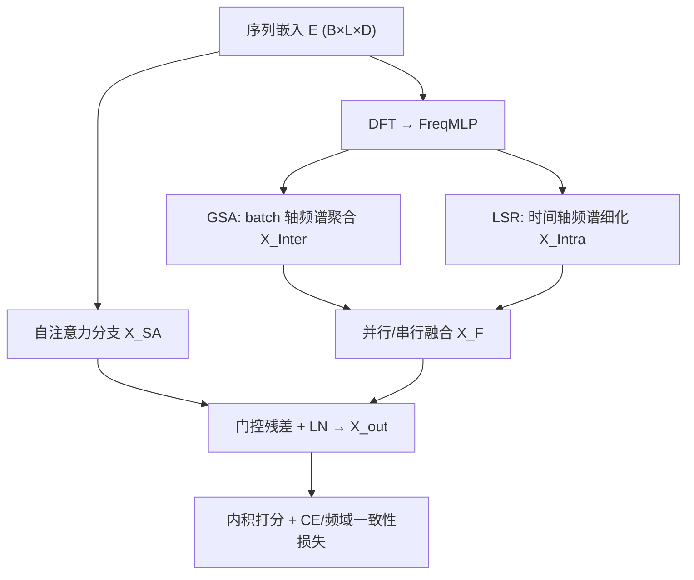
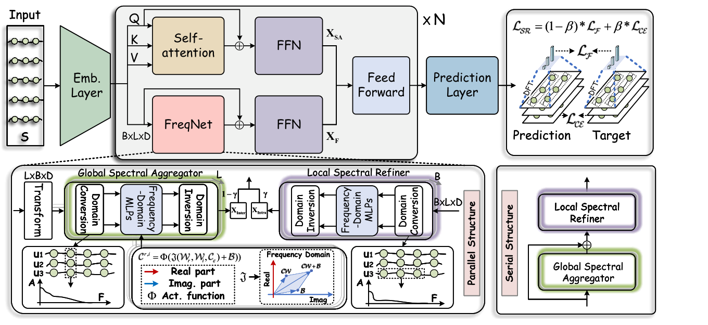

# Exploiting Inter-Session Information with Frequency-enhanced Dual-Path Networks for Sequential Recommendation (利用频域增强双路网络挖掘跨会话信息的序列推荐)

- **会议/期刊**: AAAI 2026 (Oral)
- **作者与机构**: Peng He, Yao Liu, Yanglei Gan, Run Lin, Tingting Dai, Qiao Liu, Xuexin Li（电子科技大学）
- **推荐链路定位**: 召回（Next-Item 序列召回）
- **研究方向**: 序列与会话推荐 / 自监督对比学习与交互去噪
- **论文原文**: [arXiv:2511.06285v3](https://arxiv.org/abs/2511.06285v3)
- **开源代码**: [AONE-NLP/FreqRec](https://github.com/AONE-NLP/FreqRec)

## TL;DR (1分钟核心速览)

现有频域序列推荐（FEARec/BSARec/FMLPRec）把每个会话孤立处理，且只用纯时域损失优化，导致跨会话频谱依赖被丢弃、预测频谱与真实频谱无对齐约束。FreqRec 提出双路频域网络：全局频谱聚合器（GSA）沿 batch 轴做 DFT 提取群体级节奏，局部频谱细化器（LSR）沿时间轴恢复用户高频细节，二者用可学习复数 FreqMLP 替代手工滤波；再叠加频域一致性损失 $\mathcal{L}_F$。在 Beauty/Sports/Toys 三个 Amazon 基准、全库排序协议下，NDCG@10 相对最强基线 BSARec 最高提升 7.38%，且稀疏与噪声场景更稳。

## Background & Motivation (背景与核心矛盾)

- **主流范式**: Transformer 序列推荐（SASRec/BERT4Rec）以自注意力建模长程依赖；频域派（FMLPRec、FEARec、BSARec、DIFF）在注意力旁挂 DFT 模块，补偿自注意力"低通滤波"造成的高频/周期信号衰减。
- **前人局限**: ① 频域模块逐会话独立运算，短会话下无法利用跨会话共享物品的强相关信号（图 1 显示共享物品会话的 Pearson 相关系数均值约 0.115/0.119，稀疏度 99.9%+）；② 损失全在时域（CE/BPR/对比），对频域结构无任何直接约束，周期与高频模式"学得到但没人管"。
- **核心洞察 (Key Insight)**: 会话间存在可统计的群体级频谱节律（cohort rhythm），而会话内存在用户特有的高频瞬变；二者是互补的两个频段视角，且应显式在频域施加监督。
- **本文切入点**: 用"batch 轴 DFT + 时间轴 DFT"两条可学习频域路径分别抽取跨会话与会话内信号，并新增频域一致性损失把预测频谱拉向真实频谱。

## Method (核心方法设计)

### 1. 整体框架 (Overall Architecture)

输入序列 $S_u$经物品嵌入 + 位置嵌入 + LN 得$\mathbf{E}\in\mathbb{R}^{B\times L\times D}$。随后分两路：自注意力分支得$\mathbf{X}_{SA}$；FreqNet 分支先做 DFT 得复数谱$\mathbf{C}_E$，由 GSA（batch 轴 DFT→FreqMLP→IDFT）产出跨会话表征$\mathbf{X}_{Inter}$，由 LSR（时间轴同流程）产出会话内表征$\mathbf{X}_{Intra}$，二者按并行（加权$\gamma$）或串行方式融合为$\mathbf{X}_F$，再与$\mathbf{X}_{SA}$做门控残差（权重$\alpha$）得$\mathbf{X}_{out}$，与物品矩阵内积打分。训练用 CE + 频域一致性损失的加权和。

<figure class="paper-figure" markdown="span">
  <figcaption>图 2：FreqRec 的整体框架。用户序列先被嵌入，然后由两条并行路径处理：自注意力分支和 FreqNet 分支。FreqNet 包含一个全局频谱聚合器，其执行 batch 轴 DFT → FreqMLPs → IDFT 以提取群体级信号；同时，一个局部频谱细化器沿时间轴应用相同流程以细化用户特定线索。两个频谱模块可以以并行或串行形式融合。训练最小化一个混合目标，该目标将标准交叉熵预测与频域一致性损失耦合。</figcaption>
</figure>

### 2. 关键设计拆解 (Key Designs)

1. **可学习复数频域 MLP（FreqMLP）替代手工滤波**：痛点是不想再手调低通/带通截止频率。做法是让实部与虚部通道交叉耦合，使网络能同时学习幅度与相位调整：
$\mathbf{C}'^r_E=\Phi(\mathbf{W}_r\mathrm{Real}(\mathbf{C}_E)-\mathbf{W}_i\mathrm{Imag}(\mathbf{C}_E)+\mathbf{B}_r),\quad \mathbf{C}'^i_E=\Phi(\mathbf{W}_i\mathrm{Real}(\mathbf{C}_E)+\mathbf{W}_r\mathrm{Imag}(\mathbf{C}_E)+\mathbf{B}_i)$交叉项$-\mathbf{W}_i\mathrm{Imag}$与$+\mathbf{W}_i\mathrm{Real}$ 正是复数乘法的实/虚展开，等价于对每个频率分量做可学习的复数增益，物理直觉是"逐频带自适应放大/抑制"。

2. **GSA + LSR 双路频谱分解**：GSA 把 mini-batch 的 $\mathbf{E}_{Inter}\in\mathbb{R}^{L\times B\times D}$视为沿 batch 轴的信号做 DFT，聚合跨用户共享的群体节奏，短会话时充当信息补全；LSR 沿时间轴$L$做同构变换，保留用户瞬态高频。并行融合为$\mathbf{X}_F=\mathrm{FFN}((1-\gamma)\mathbf{X}_{Inter}+\gamma\mathbf{X}_{Intra},\mathbf{E})$，串行则把$\mathbf{X}_{Inter}$ 先注入 LSR 输入。并行避免串行中"用户视角覆盖原始序列信号"的信息瓶颈。

3. **频域一致性损失与训练目标**：对预测 $\mathbf{P}$与目标$\mathbf{T}$ 分别做 DFT，在实部/虚部上算距离：
$\mathcal{L}_F=\mathcal{FD}(\mathrm{Real}(\mathcal{F}(\mathbf{P})),\mathrm{Real}(\mathcal{F}(\mathbf{T})))+\mathcal{FD}(\mathrm{Imag}(\mathcal{F}(\mathbf{P})),\mathrm{Imag}(\mathcal{F}(\mathbf{T})))$其中$\mathcal{FD}\in\{\mathcal{L}_{L1},\mathcal{L}_{L2},\mathcal{L}_{mix}\}$；总损失$\mathcal{L}_{SR}=(1-\beta)\mathcal{L}_F+\beta\mathcal{L}_{CE}$。该损失是 plug-and-play 的，可直接挂到任意序列模型上。训练采用标准下一物品 CE（全库 softmax，无额外负采样），推理为全库内积排序，无额外解码开销。

## Experimental Setup & Evaluation Protocol (实验设置与评估协议)

- **数据集与预处理**: 三个 Amazon 基准，沿用 BSARec/DIFF 的预处理（迭代式 5-core 过滤 + 序列截断）：

| 数据集 | #Users | #Items | #Interactions | 稀疏度 | 场景说明 |
| :--- | :---: | :---: | :---: | :---: | :--- |
| Beauty | 22,363 | 12,101 | 198,502 | 99.93% | 美妆评论 |
| Sports & Outdoors | 35,598 | 18,357 | 296,337 | 99.95% | 户外运动 |
| Toys & Games | 19,412 | 11,924 | 167,597 | 99.93% | 玩具 |

- **数据划分与防穿越**: `Leave-One-Out`（末位为测试、倒数第二位验证，其余训练），序列长度 $L=50$，嵌入维度$D=64$。
- **排名评测协议**: 无偏 `Full-Ranking`（对全物品库未交互项排序），指标 HR@{10,20}、NDCG@{10,20}。
- **对比基线与超参设置**: 14 个基线，含 RNN/Transformer 派（GRU4Rec、Caser、SASRec、BERT4Rec、DuoRec、ICLRec、CL4SRec、MAERec、SASRecF、MSSR）与频域派（FMLPRec、FEARec、BSARec、DIFF）；$\gamma,\alpha\in\{0.1,\dots,0.9\}$、$\beta\in\{0.1,\dots,0.9\}$、batch$B\in\{32,\dots,512\}$网格搜索；显著性$p<0.05$。

## Key Experimental Results (实验关键数据)

### 1. 主实验对比 (Main Results)

| 模型 | Beauty HR@10 | Beauty NDCG@10 | Sports HR@10 | Sports NDCG@10 | Toys HR@10 | Toys NDCG@10 |
| :--- | :---: | :---: | :---: | :---: | :---: | :---: |
| SASRec | 0.0531 | 0.0283 | 0.0298 | 0.0159 | 0.0652 | 0.0366 |
| BERT4Rec | 0.0705 | 0.0387 | 0.0428 | 0.0229 | 0.0635 | 0.0353 |
| DuoRec | 0.0800 | 0.0483 | 0.0446 | 0.0263 | 0.0816 | 0.0515 |
| MSSR | 0.0897 | 0.0448 | 0.0540 | 0.0255 | 0.0982 | 0.0608 |
| FEARec | 0.0927 | 0.0555 | 0.0539 | 0.0315 | 0.1005 | 0.0606 |
| BSARec | 0.0944 | 0.0574 | **0.0581** | 0.0333 | 0.1023 | 0.0610 |
| DIFF | 0.0940 | 0.0526 | 0.0580 | 0.0310 | 0.0969 | 0.0607 |
| **FreqRec (P)** | **0.0989** | **0.0601** | 0.0583 | **0.0342** | **0.1044** | **0.0653** |
| Improv. | +4.77% | +4.70% | +0.34% | +2.70% | +2.25% | +7.38% |

### 2. 消融实验 (Ablation Study)

| 变体 | Beauty HR@10 | Beauty NDCG@10 | Toys HR@10 | Toys NDCG@10 |
| :--- | :---: | :---: | :---: | :---: |
| w/o SA | 0.0959 | 0.0587 | 0.1034 | 0.0644 |
| w/o GSA | 0.0881 | 0.0537 | 0.0954 | 0.0568 |
| w/o LSR | 0.0888 | 0.0533 | 0.0961 | 0.0606 |
| w/o GSA+LSR | 0.0787 | 0.0481 | 0.0719 | 0.0436 |
| w/o $\mathcal{L}_F$ | 0.0969 | 0.0582 | 0.0990 | 0.0619 |
| w/o $\mathcal{L}_{CE}$ | 0.0807 | 0.0477 | 0.0714 | 0.0434 |
| **FreqRec** | **0.0989** | **0.0601** | **0.1044** | **0.0653** |

### 3. 关键实验发现 (Key Findings)

1. **双路缺一不可且互补**：单独去掉 GSA 或 LSR 性能下降幅度相近（Beauty HR@10 分别降至 0.0881/0.0888），但同时去掉两者跌至 0.0787（相对完整模型降约 20%），说明群体节奏去噪与用户高频恢复是正交增益；GSA 略更重要，印证跨会话信息在短会话下的补全价值。
2. **频域损失是即插即用的通用增益**：把 $\mathcal{L}_F$ 挂到 SASRec/DuoRec/FMLPRec/BSARec 上，HR@10 平均提升 3.72%–10.17%，NDCG@10 最高提升 19.46%；其中本就含频域模块的 FMLPRec（HR@10 +15.21%）与 BSARec（NDCG@10 +46.45%）获益最大，说明时域 CE 与频域对齐信号高度互补。
3. **稀疏与噪声鲁棒性**：在交互数 5–6 的极稀疏用户桶上，FreqRec 在 Sports 的 HR@5 为 0.0190，显著高于 BSARec 的 0.0170；跨域噪声迁移实验中（Automotive/CDs/Grocery 混合日志训练、目标域零微调），FreqRec 在 Grocery 上 NDCG@10 达 0.1242，优于 BSARec 的 0.1215，验证 GSA 抑制普遍噪声、LSR 恢复个体信号的协同去噪机制。

## Highlights & Limitations (亮点、对比与审稿批判)

- **与代表作对比 (vs. Prior Work)**: 相比 FEARec/BSARec 仅"会话内 DFT + 时域损失"，FreqRec 首次把 DFT 扩展到 batch 轴以建模跨会话频谱依赖，并用可学习复数 MLP 取代手工频带裁剪；相比图方法（如跨会话构图），它无需手工边规则，天然对稀疏/噪声更鲁棒。
- **可迁移亮点**: ① 频域一致性损失 $\mathcal{L}_F$ 与模型结构解耦，可直接作为辅助正则挂到任意序列推荐器；② "batch 轴 DFT 聚合群体信号"的思路可迁移到冷启动或跨域场景做隐式信息补全。
- **审稿级局限批判**: ① GSA 依赖 mini-batch 组成，batch 大小对性能敏感（$B=32$明显掉点），在线 serving 时 batch 内用户分布漂移可能削弱群体节奏的稳定性；② 频域损失需对预测与目标各做一次 DFT，序列长$L$增大时$O(L\log L)$ 开销与显存占用上升，论文未给出延迟对比；③ 评测仅限 Amazon 三域与离线全库排序，缺少工业级线上 A/B 与更大规模验证。

## Rating (四维评分)

- **方法创新性 (Novelty)**: ⭐⭐⭐⭐ （batch 轴频谱聚合 + 可学习复数 MLP + 频域一致性损失三点组合新颖，但单点均可追溯到频域信号处理既有思想）
- **评估协议与实验扎实度 (Protocol & Experiments)**: ⭐⭐⭐⭐ （三数据集全库排序、14 基线、消融/稀疏/噪声/超参齐全，但缺线上验证与延迟分析）
- **写作与数学规范度 (Clarity & Rigor)**: ⭐⭐⭐⭐ （复数 MLP 公式与融合策略表述清晰，$\mathcal{L}_F$定义完整，部分符号如$\mathcal{FD}$ 的选取依据略简）
- **工业落地与复现价值 (Industrial & Practical Value)**: ⭐⭐⭐⭐ （代码已开源，$\mathcal{L}_F$ 即插即用，但 batch 轴 DFT 对在线 serving 的 batch 组织有工程约束）
