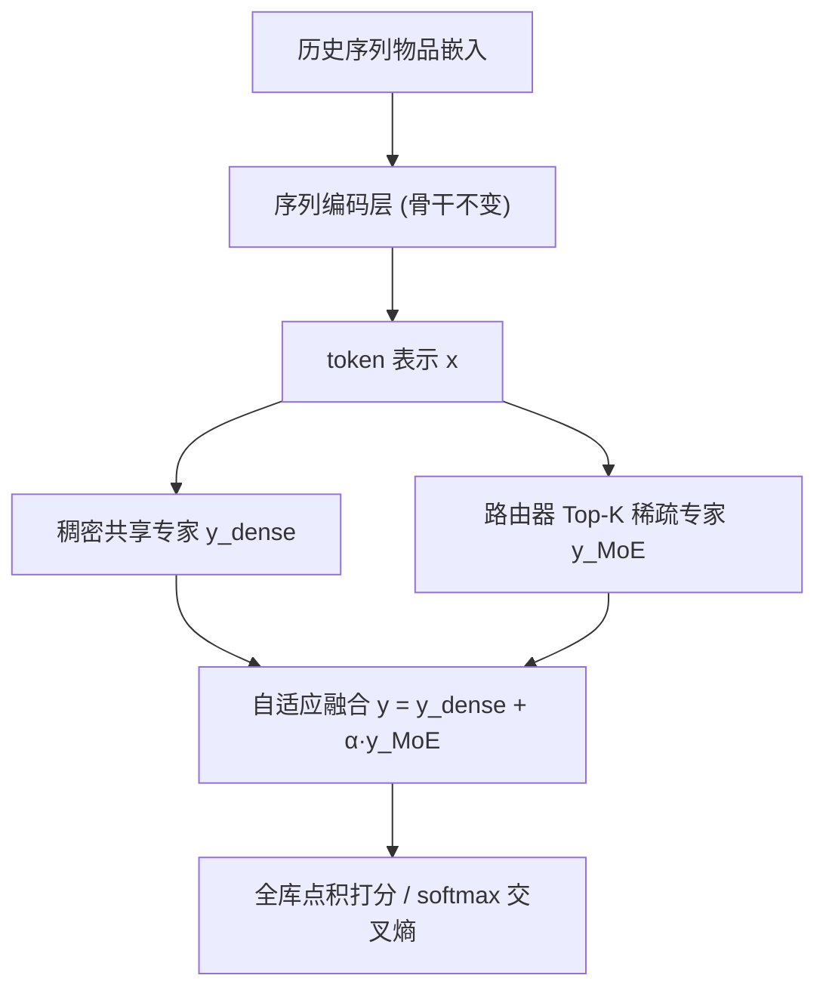
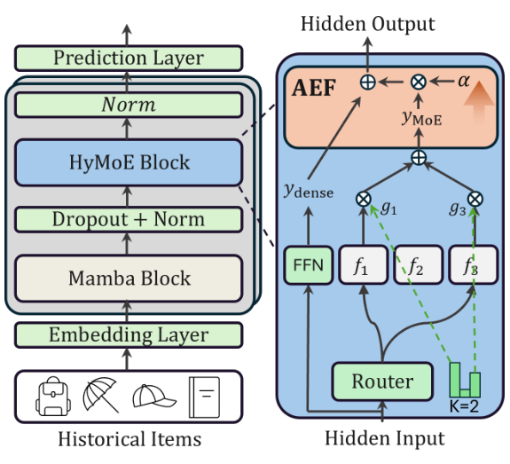

# HyMoERec: Hybrid Mixture-of-Experts for Sequential Recommendation (面向序列推荐的混合专家网络)

- **会议/期刊**: AAAI 2026 (Student Abstract)
- **作者与机构**: Kunrong Li, Zhu Sun, Kwan Hui Lim (Singapore University of Technology and Design)
- **推荐链路定位**: 精排 / Next-Item 预测
- **研究方向**: 序列与会话推荐 / 生成式与架构创新（MoE 结构改造）
- **论文原文**: [https://arxiv.org/abs/2511.06388v1](https://arxiv.org/abs/2511.06388v1)
- **开源代码**: 暂未开源

## TL;DR (1分钟核心速览)

现有序列推荐模型（GRU4Rec/BERT4Rec/Mamba4Rec）的 Position-wise Feed-Forward Network (PFFN) 对所有 token 施加同一套非线性变换，无法区分"简单依赖即可预测的交互"与"需要复杂推理的交互"，也忽视热门/长尾物品的表征复杂度差异。HyMoERec 将 PFFN 替换为"1 个稠密共享专家 + Top-K 稀疏专家"的混合分支，并用带 warm-up 的可学习门控 $\alpha$ 自适应融合两路输出，辅以负载均衡正则防止专家坍缩。在 ML-1M 与 Beauty 上采用全库排序评测，相对最强基线 Mamba4Rec 在 ML-1M 上 HR@5 提升 2.4%、NDCG@5 提升 2.7%。

## Background & Motivation (背景与核心矛盾)

- **主流范式**: 序列推荐从 RNN（GRU4Rec）、注意力（NARM/BERT4Rec）演进到状态空间模型（Mamba4Rec），但骨干中的 PFFN 始终是"逐 token 同参数"的稠密变换。
- **前人局限**: 其一，用户行为异质性——同一序列内不同位置的交互，有的只需一阶转移即可命中，有的依赖长程复杂推理，统一 FFN 无法按需分配容量；其二，物品复杂度多样性——热门物品可由粗粒度共现模式预测，长尾物品却需要专门化的表征通路，同构计算路径对后者明显欠拟合。
- **核心洞察 (Key Insight)**: 常规 MoE 的纯稀疏路由虽能扩容，但在序列推荐这种 token 量少、监督信号稀疏的场景下极易出现专家坍缩与训练震荡；因此"稠密兜底 + 稀疏增益"的双分支结构比纯稀疏路由更适合本任务。
- **本文切入点**: 保留一条始终激活的共享专家保证每个 token 都有稳定梯度，再叠加 Top-K 稀疏专家提供条件化容量，并用渐进式门控把两者平滑缝合。

## Method (核心方法设计)

### 1. 整体框架 (Overall Architecture)

输入为用户历史交互序列的物品嵌入，经序列编码层（论文沿用现有骨干，创新集中在 FFN 子层）得到每个位置的 token 表示 $\mathbf{x}\in\mathbb{R}^{D}$。该表示同时送入两条通路：稠密共享专家$y_{\text{dense}}=\mathrm{FFN}(\mathbf{x})$与由轻量两层线性路由器$\pi(\cdot)$驱动的稀疏专家集合，两路输出经自适应融合参数$\alpha$ 加权合并后回写残差流，最终以点积对全库物品打分、softmax 交叉熵训练。整个改造是"即插即用"的：只替换 PFFN 子层，不改变骨干的序列建模方式与推理接口。

<figure class="paper-figure" markdown="span">
  <figcaption>图1：HyMoERec的整体框架。</figcaption>
</figure>

### 2. 关键设计拆解 (Key Designs)

1. **混合专家块 HyMoE（稠密兜底 + 稀疏扩容）**：痛点是纯稀疏 MoE 在稀疏监督下专家坍缩、训练不稳。路由器对 token 产生 logit $\pi(\mathbf{x})\in\mathbb{R}^{E}$，仅保留 Top-K 并在这 K 个上做 softmax 得门控权重，聚合式为$y_{\text{MoE}}=\sum_{i=1}^{K}g_{i}f_{i}(\mathbf{x})$，其中$g=\mathrm{Softmax}(\mathrm{TopK}(\pi(\mathbf{x})))$。直觉上，稠密分支为每个 token 提供恒定梯度通路，稀疏分支只在"该 token 确实需要额外推理"时才被激活，从而在不牺牲稳定性的前提下提升有效容量。

2. **自适应专家融合 AEF（渐进式门控）**：痛点是固定权重融合无法随训练进程调整两路贡献，早期稀疏专家尚未学好时会污染表征。作者令 $\alpha=\sigma(\alpha_{\text{param}})\cdot w(t)$，$w(t)=\min(1.0,\,t/T_{\text{warmup}})$，融合输出为$y=y_{\text{dense}}+\alpha\cdot y_{\text{MoE}}$。物理直觉是"先学通用、后学专精"：warm-up 阶段$\alpha\approx 0$，模型退化为标准 PFFN，待共享专家收敛后再逐步放开专家知识，避免早期路由噪声。

3. **训练目标、负载均衡与推理开销**：总损失为 $\mathcal{L}=\mathcal{L}_{\text{ce}}+\lambda_{lb}\sum_{e}\bar{g}_{e}\log\bar{g}_{e}$，其中$\bar{g}_{e}$为专家$e$在序列全部物品上的平均门控概率，$\mathcal{L}_{\text{ce}}=-\log\frac{\exp(\mathbf{y}^{\top}\mathbf{r}^{+})}{\sum_{j}\exp(\mathbf{y}^{\top}\mathbf{r}_{j})}$为全库 softmax 交叉熵（$\mathbf{r}^{+}$为目标物品嵌入，$\mathbf{r}_{j}$遍历全部物品嵌入）。该熵式正则最大化专家使用分布的熵，抑制少数专家垄断。训练采用全库 softmax，即隐式地在全物品上做负采样，无需额外构造负样本；推理时仅激活$K=2$ 个专家，额外开销为一次两层线性路由与 2 个 FFN 前向，相对骨干可忽略。

## Experimental Setup & Evaluation Protocol (实验设置与评估协议)

- **数据集与预处理**: 论文正文未给出用户/物品/交互量统计与过滤细节（Student Abstract 篇幅所限），仅说明使用两个公开基准：

| 数据集 | #Users | #Items | #Interactions | 稀疏度/密度 | 特征/场景说明 |
| :--- | :---: | :---: | :---: | :---: | :--- |
| MovieLens-1M | 未报告 | 未报告 | 未报告 | 未报告 | 电影评分，序列推荐标准基准 |
| Amazon Beauty | 未报告 | 未报告 | 未报告 | 未报告 | 电商评论，长尾分布显著 |

- **数据划分与防穿越 (Splitting Strategy)**: 原文未明确标注划分方式（未说明是 Leave-One-Out 还是比例划分），这是该摘要的主要可复现性缺口。
- **排名评测协议 (Ranking Protocol)**: 从损失函数采用全库 softmax 交叉熵、指标报告 HR/NDCG 的形式推断为全库排序（Full-Ranking）评测，但原文未显式声明候选集规模与是否过滤已交互物品。
- **对比基线与超参设置**: 基线覆盖四类序列建模范式——NARM（注意力+RNN）、GRU4Rec（纯 RNN）、BERT4Rec（双向 Transformer）、Mamba4Rec（状态空间模型）。超参：专家数 $E=4$、Top-$K=2$、warm-up 步数$T_{\text{warmup}}=500$、均衡系数$\lambda_{lb}=0.02$；嵌入维度$d$ 与显著性检验未报告。

## Key Experimental Results (实验关键数据)

### 1. 主实验对比 (Main Results)

| 数据集 | 方法 | HR@5 | HR@10 | NDCG@5 | NDCG@10 |
| :--- | :--- | :---: | :---: | :---: | :---: |
| ML-1M | NARM | 0.1727 | 0.2565 | 0.1135 | 0.1404 |
| ML-1M | GRU4Rec | 0.1998 | 0.2815 | 0.1364 | 0.1628 |
| ML-1M | BERT4Rec | 0.1879 | 0.2868 | 0.1249 | 0.1568 |
| ML-1M | Mamba4Rec | 0.2106 | 0.3065 | 0.1447 | 0.1756 |
| ML-1M | **HyMoERec** | **0.2157** | **0.3103** | **0.1486** | **0.1790** |
| ML-1M | Improv. vs Mamba4Rec | +2.4% | +1.2% | +2.7% | +1.9% |
| Beauty | NARM | 0.0418 | 0.0630 | 0.0285 | 0.0352 |
| Beauty | GRU4Rec | 0.0402 | 0.0635 | 0.0274 | 0.0349 |
| Beauty | BERT4Rec | 0.0243 | 0.0402 | 0.0151 | 0.0202 |
| Beauty | Mamba4Rec | 0.0511 | 0.0731 | 0.0362 | 0.0432 |
| Beauty | **HyMoERec** | **0.0518** | **0.0756** | **0.0365** | **0.0442** |
| Beauty | Improv. vs Mamba4Rec | +1.4% | +3.4% | +0.8% | +2.3% |

### 2. 消融实验 (Ablation Study)

原文（Student Abstract）**未提供消融实验表**，仅以文字论证 HyMoE 与 AEF 的必要性。按摘要描述可推断的缺失组件为：`w/o HyMoE`（退化为标准 PFFN）、`w/o AEF`（固定 $\alpha$或直接相加）、`w/o load-balance loss`（$\lambda_{lb}=0$）。这三组对照的定量结果缺失，是本笔记无法补齐的关键空白。

### 3. 关键实验发现 (Key Findings)

1. **增益在强骨干上依然成立，但幅度收窄**：相对 Mamba4Rec 的 HR@5 提升仅 2.4%（ML-1M）与 1.4%（Beauty），而相对 NARM 的 HR@5 提升达 24.8%、相对 GRU4Rec 为 7.9%——说明收益主要来自"补足弱骨干的表达力"，而非在已充分调优的 SSM 骨干上带来质变。
2. **长尾更重的 Beauty 上 HR@10 增益最大（+3.4%）**：与"稀疏专家专门服务长尾/复杂物品"的设计动机一致，说明 Top-K 条件化通路在物品复杂度分布更偏斜的电商场景中价值更高，而 ML-1M 这类头部集中的电影数据上增益主要体现在头部指标 HR@5。
3. **BERT4Rec 在两个数据集上均显著落后（Beauty HR@5 仅 0.0243）**：双向掩码目标与 next-item 单向预测的错配在该设定下代价极大，提示本文的对比基线集合中真正有竞争力的只有 Mamba4Rec 一支，SOTA 声明的强度应据此打折看待。

## Highlights & Limitations (亮点、对比与审稿批判)

- **与代表作对比 (vs. Prior Work)**: 与 BERT4Rec/Mamba4Rec 的本质区别在于改造位置——后者优化的是 token 间的序列混合算子（注意力或 SSM 扫描），本文则把矛头指向被长期视为"标配"的逐位置 FFN，属于正交维度的容量再分配；与标准 MoE（如 DeepSeekMoE 式纯稀疏路由）的区别在于保留稠密共享分支并引入 warm-up 门控，用稳定性换取了部分稀疏性收益。
- **可迁移亮点**: (1) "稠密兜底 + 稀疏增益 + 渐进门控"这一组合可直接移植到任何 Transformer/SSM 序列推荐骨干的 FFN 子层，改造成本极低；(2) 用平均门控概率的熵做负载均衡，是缓解小样本序列场景专家坍缩的轻量手段，可复用到多任务/多场景共享底层。
- **审稿级局限批判**: (1) 实验规模严重不足——仅两个数据集、无消融表、无显著性检验、无数据集统计与划分协议说明，2.4% 量级的提升在缺少方差报告时难以判定是否显著；(2) 推理侧虽只激活 $K=2$ 个专家，但路由与多专家参数带来的显存占用与 batch 内负载不均（routing 不均衡导致设备空转）未做任何延迟/吞吐分析，工业部署价值存疑。

## Rating (四维评分)

- **方法创新性 (Novelty)**: ⭐⭐⭐ （把 MoE 从"稀疏路由"改为"稠密+稀疏双分支并配 warm-up 门控"是针对序列推荐小样本特性的合理微调，但整体属已有 MoE 思路的工程化迁移，缺少理论或谱分析支撑）
- **评估协议与实验扎实度 (Protocol & Experiments)**: ⭐⭐ （仅两数据集、四基线，划分方式与候选集协议均未声明，完全缺失消融实验与显著性检验，Student Abstract 篇幅不能完全免责）
- **写作与数学规范度 (Clarity & Rigor)**: ⭐⭐⭐ （HyMoE/AEF/损失三处公式定义干净、符号自洽，但数据集统计、嵌入维度、复杂度分析均缺位，实验章节近乎只有一张表）
- **工业落地与复现价值 (Industrial & Practical Value)**: ⭐⭐⭐ （即插即用替换 PFFN、超参极少、无需额外负采样，落地门槛低；但无开源代码、无延迟与显存实测，实际部署收益需自行验证）

