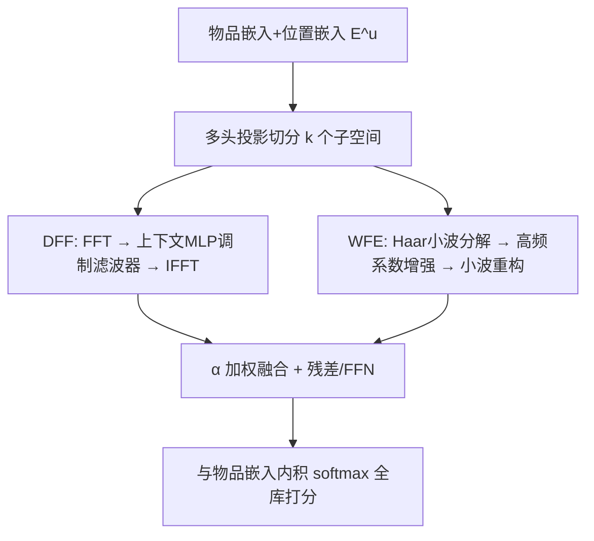
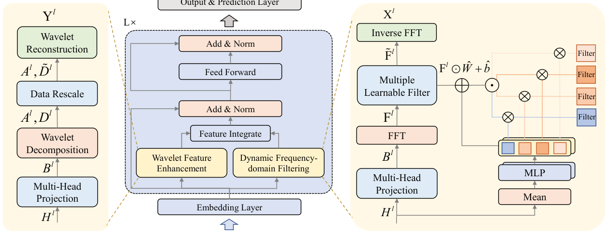

# Wavelet Enhanced Adaptive Frequency Filter for Sequential Recommendation (小波增强自适应频率滤波的序列推荐)

- **会议/期刊**: AAAI 2026
- **作者与机构**: Huayang Xu, Huanhuan Yuan, Guanfeng Liu, Junhua Fang, Lei Zhao, Pengpeng Zhao（苏州大学计算机学院；麦考瑞大学）
- **推荐链路定位**: 召回（Next-Item 序列编码器）
- **研究方向**: 序列与会话推荐 / 频域信号处理
- **论文原文**: [https://arxiv.org/abs/2511.07028v2](https://arxiv.org/abs/2511.07028v2)
- **开源代码**: [https://github.com/xhy963319431/WEARec](https://github.com/xhy963319431/WEARec)

## TL;DR (1分钟核心速览)

现有频域序列推荐（FMLPRec/SLIME4Rec/BSARec）存在两大硬伤：滤波器对所有用户**静态共享**，且全局 DFT 本质是低通、会抹平非平稳短期波动。WEARec 用「上下文 MLP 生成缩放/偏置来调制滤波器权重」实现个性化频域滤波，再用 Haar 小波分解只对高频细节系数做可学习增强后重构，两路特征按 $\alpha$融合。在 Beauty/Sports/LastFM/ML-1M 四个数据集上采用 Leave-One-Out + Full-Ranking 协议，HR@20 相对最优基线提升 1.31%–11.40%，且$N=200$ 长序列下每 epoch 训练时间显著低于 BSARec 与 SLIME4Rec。

## Background & Motivation (背景与核心矛盾)

- **主流范式**: 以 FMLPRec 为代表用可学习频域滤波器替代自注意力，SLIME4Rec/FEARec 引入分层频带与对比学习，BSARec 把频域重调作为自注意力的归纳偏置。
- **前人局限一（静态滤波）**: 所有用户共享同一组固定频响的滤波器，被数据集中主导用户群体带偏，无法刻画个体差异；作者用 FMLPRec 替换为固定带通滤波器的探针实验（图 1）证明不同用户被**不同频率分量**唯一驱动，个性化滤波是刚需。
- **前人局限二（低通偏置）**: DFT 是全局变换，FMLPRec 已被证明实质等价于低通滤波器，SLIME4Rec 的分层结构仍倾向学习低频，导致非平稳信号与短期兴趣波动被模糊。
- **核心洞察 (Key Insight)**: 全局周期结构适合用 DFT 建模，而局部瞬态/非平稳突变适合用**时频局部化**的小波建模——二者是互补而非替代关系。
- **本文切入点**: 用「动态调制 DFT 滤波器」管全局个性化，用「小波高频增强」补局部细节，双路融合。

## Method (核心方法设计)

### 1. 整体框架 (Overall Architecture)

输入为用户定长序列 $s_u$的物品嵌入加位置嵌入，经 LayerNorm/Dropout 得$E^u\in\mathbb{R}^{N\times d}$。每层沿嵌入维切分为$k$个子空间（多头投影），子空间并行送入两条支路：DFF 支路做 FFT→个性化滤波→IFFT 得全局特征$X^l$；WFE 支路做 Haar 小波分解→高频系数增强→小波重构得局部特征$Y^l$。两路按$\hat{H}^l=\alpha\odot X^l+(1-\alpha)\odot Y^l$融合，接残差、LayerNorm 与 FFN，堆叠$L$ 层后与物品嵌入内积 softmax 输出全库打分。

<figure class="paper-figure" markdown="span">
  <figcaption>图 2：WEARec 的模型架构与 transformer 编码器类似。首先通过嵌入层生成带有位置嵌入的物品嵌入，然后通过用小波特征增强模块和动态频域滤波模块替换自注意力模块，从频域中提取用户偏好。两侧展示了这些模块的细节。最后，预测层为所有候选物品计算推荐分数。</figcaption>
</figure>

### 2. 关键设计拆解 (Key Designs)

1. **动态频域滤波 DFF（上下文条件化的滤波器调制）**：痛点是静态滤波器无法因人而异。做法是对时域特征沿物品维取均值得上下文 $c^l=\frac{1}{N}\sum_{i=1}^{N}H^l_i$，用两个三层 MLP 生成缩放因子与偏置，再线性调制基础滤波器：
$\hat{W}^l=W^l\odot(1+\Delta s^l),\quad \hat{b}^l=b^l+\Delta b^l,\quad \tilde{F}^l_i=F^l_i\odot\hat{W}^l+\hat{b}^l$直觉上$\Delta s^l$重塑整体频响包络、$\Delta b^l$ 微调特定频带权重，使同一套参数能对不同用户"变形"出不同滤波器，且调制是乘性轻量操作，不引入注意力开销。

2. **小波特征增强 WFE（只增强高频细节系数）**：痛点是 DFT 抹平非平稳突变。对子空间做 Haar 小波分解得近似系数 $A^l_i$与细节系数$D^l_i$，**仅对高频细节**乘可学习增强矩阵$T^l$：$\tilde{D}^l_i=D^l_i\odot T^l$，再与未改动的$A^l_i$一起小波重构$Y^l_i=\mathcal{W}^{-1}(A^l_i,\tilde{D}^l_i)$。保留低频原貌避免破坏主趋势，只让模型自适应放大/抑制瞬态点（附录可视化显示$T$ 对非平稳点赋高权、对噪声点赋负权）。

3. **训练目标、负采样与推理效率**：损失为标准全库 softmax 交叉熵 $\mathcal{L}_{Rec}=-\sum_{i=1}^{|\mathcal{V}|}y_i\log\hat{y}_i$，**不使用负采样、不使用对比学习**。复杂度上自注意力为$O(n^2d+nd^2)$，而 FFT+Haar 使特征混合层降至$O(nd\log n+nd)$，加两个 MLP 的$O(2nd^2)$与 FFN 的$O(nd^2)$，总体$O(nd\log n+3nd^2)$，对大$n$由$O(nd\log n)$主导，长序列下优于$O(n^2)$ 的 BSARec。

## Experimental Setup & Evaluation Protocol (实验设置与评估协议)

- **数据集与预处理**: 四个公开数据集均采用 `5-core` 过滤（剔除交互少于 5 的用户）：

| 数据集 | #Users | #Items | #Interactions | 稀疏度 | 特征/场景说明 |
| :--- | :---: | :---: | :---: | :---: | :--- |
| Beauty | 22,363 | 12,101 | 198,502 | 99.93% | Amazon 美妆，短序列（均长 8.9） |
| Sports | 25,598 | 18,357 | 296,337 | 99.95% | Amazon 运动户外，短序列（均长 8.3） |
| LastFM | 1,090 | 3,646 | 52,551 | 98.68% | 音乐艺人收听，长序列（均长 48.2） |
| ML-1M | 6,041 | 3,417 | 999,611 | 95.16% | 电影评分，长序列（均长 165.5） |

- **数据划分与防穿越**: `Leave-One-Out`（每用户最后一项为测试、倒数第二项为验证，其余训练）。
- **排名评测协议**: 无偏 `Full-Ranking`（对全物品集排序，**不做负采样**），指标 HR@{10,20} 与 NDCG@{10,20}。
- **对比基线与超参设置**: 时域基线 GRU4Rec/Caser/SASRec/DuoRec，频域基线 FMLPRec/FamouSRec/FEARec/SLIME4Rec/BSARec；嵌入维度 $d=64$、层数$L=2$、默认$N=50$、batch 256、Adam（lr∈{5e-4,1e-3}）、小波分解 1 层、$\alpha\in[0.1,0.9]$、$k\in\{1,2,4,8\}$；各模型取最优超参报告。

## Key Experimental Results (实验关键数据)

### 1. 主实验对比 (Main Results)

| 数据集 | 指标 | SASRec | DuoRec | FMLPRec | FEARec | SLIME4Rec | BSARec | **WEARec** | Improv. |
| :--- | :--- | :---: | :---: | :---: | :---: | :---: | :---: | :---: | :---: |
| Beauty | HR@20 | 0.0823 | 0.1313 | 0.0869 | 0.1352 | 0.1381 | 0.1373 | **0.1391** | 1.31% |
| Beauty | NG@20 | 0.0356 | 0.0671 | 0.0369 | 0.0694 | 0.0696 | 0.0703 | **0.0703** | 0.00% |
| Sports | HR@20 | 0.0459 | 0.0791 | 0.0525 | 0.0836 | 0.0869 | 0.0858 | **0.0895** | 2.99% |
| Sports | NG@20 | 0.0200 | 0.0387 | 0.0231 | 0.0405 | 0.0421 | 0.0422 | **0.0433** | 2.60% |
| LastFM | HR@20 | 0.0927 | 0.0963 | 0.0826 | 0.0826 | 0.0927 | 0.1174 | **0.1202** | 2.38% |
| LastFM | NG@20 | 0.0429 | 0.0446 | 0.0372 | 0.0414 | 0.0433 | 0.0526 | **0.0543** | 3.23% |
| ML-1M | HR@20 | 0.3245 | 0.3738 | 0.3137 | 0.3714 | 0.3950 | 0.3884 | **0.4031** | 2.05% |
| ML-1M | NG@20 | 0.1395 | 0.1790 | 0.1356 | 0.1771 | 0.1939 | 0.1851 | **0.1968** | 1.49% |

长序列效率对比（$N=200$，ML-1M / LastFM 每 epoch 秒数）：WEARec 66.46 / 5.23，BSARec 109.26 / 10.84，SLIME4Rec 120.43 / 13.77，FMLPRec 36.93 / 4.91——WEARec 参数略多但训练时间约为 BSARec 的 60%、SLIME4Rec 的 55%。

### 2. 消融实验 (Ablation Study)

| 变体 | Beauty HR@20 | Sports HR@20 | LastFM HR@20 | ML-1M HR@20 | 说明 |
| :--- | :---: | :---: | :---: | :---: | :--- |
| w/o W（去 WFE） | 下降 | 下降 | 下降 | 下降 | 失去高频/非平稳增强 |
| w/o F（去 DFF） | 下降 | 下降 | 下降 | 下降 | 退化为静态滤波 |
| w/o M（去多头投影） | 下降 | 下降 | 下降 | 下降 | 子空间多样性丧失 |
| **WEARec** | **最优** | **最优** | **最优** | **最优** | 四数据集全胜 |

（原文图 4 以柱状图给出具体数值，四个数据集上完整模型均高于三个变体，NG@20 趋势一致。）

### 3. 关键实验发现 (Key Findings)

1. **个性化滤波是主要增益来源**：LastFM 上 HR@10 相对 BSARec 提升 11.40%（0.0807→0.0899），远超 Beauty 的 3.27%，说明序列越长、用户行为越分散时，静态滤波的"主导用户偏置"危害越大，动态调制收益越显著。
2. **长序列场景优势扩大且不牺牲效率**：$N$ 从 50 增至 200 时 WEARec 在 ML-1M 上 HR@20 由 0.4031 升至 0.4421、LastFM 由 0.1202 升至 0.1477，而 SLIME4Rec 在 LastFM 上反而从 0.0936 跌至 0.1064 附近波动收敛，体现基线在长序列下易过拟合。
3. **频响可视化佐证设计动机**：图 6 显示 FMLPRec 与 SLIME4Rec 学到的频响集中在低频段，而 WEARec 覆盖全频段；图 8 的 case study 中 WEARec 在低频与部分高频区间正确捕获的用户数均最多，验证"全局 DFT + 局部小波"互补假设。

## Highlights & Limitations (亮点、对比与审稿批判)

- **与代表作对比 (vs. Prior Work)**: 相比 FMLPRec 的单一静态可学习滤波器，WEARec 引入上下文条件化调制，把"一套滤波器"变成"每用户一套"；相比 SLIME4Rec 靠分层频带+对比学习强行平衡高低频，WEARec 用 Haar 小波在时频局部化层面直接补高频，且**完全不用对比学习**，训练开销更低；相比 BSARec 把频域当自注意力归纳偏置（仍保留 $O(n^2)$注意力），WEARec 是彻底 attention-free 的$O(n\log n)$ 架构。
- **可迁移亮点**: (i) "均值上下文 → 双 MLP → 乘性缩放+加性偏置"的轻量滤波器调制范式，可直接移植到任何频域/卷积核需要个性化的场景；(ii) 小波分解后**只改高频细节系数、冻结低频近似系数**的保守增强策略，是避免破坏主趋势的通用技巧。
- **审稿级局限批判**: (i) 主实验提升幅度偏小（Beauty NG@20 提升 0.00%、ML-1M NG@10 仅 1.37%），且未报告多次运行的方差与显著性检验，增益是否稳定存疑；(ii) 参数量反而高于所有基线（ML-1M 426K vs BSARec 332K），"效率优势"仅体现在训练时间而非显存/推理 FLOPs，且 Haar 小波仅 1 层分解，对更长周期结构的表达能力未充分验证。

## Rating (四维评分)

- **方法创新性 (Novelty)**: ⭐⭐⭐⭐ （动态调制 DFT 滤波器 + 小波高频增强的双域互补思路清晰，但两个模块各自均为已有技术的组合式创新，缺乏理论层面的收敛或谱分析支撑）
- **评估协议与实验扎实度 (Protocol & Experiments)**: ⭐⭐⭐⭐ （四数据集 + Full-Ranking 无偏协议 + 9 个强基线 + 长序列与效率分析齐全，但缺显著性检验与方差报告，消融仅以柱状图呈现未给数值表）
- **写作与数学规范度 (Clarity & Rigor)**: ⭐⭐⭐⭐ （DFT/DWT 预备知识与复杂度推导完整，公式符号统一；但 DFF 中 $k$与子空间索引、$M=\lceil N/2\rceil+1$ 的维度对齐说明略简，部分符号上下标混用）
- **工业落地与复现价值 (Industrial & Practical Value)**: ⭐⭐⭐⭐ （代码已开源，attention-free + 无对比学习使长序列训练成本低，适合长行为序列召回；但参数量增加与频域变换的工程实现细节对线上部署仍有适配成本）
