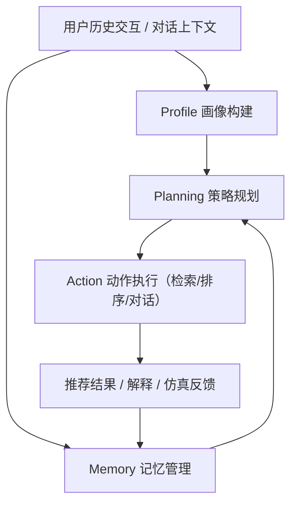
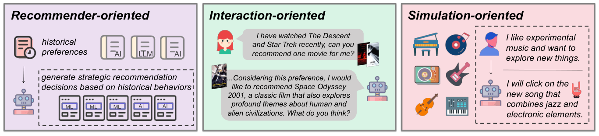

# A Survey on LLM-powered Agents for Recommender Systems (LLM 智能体推荐系统综述)

- **会议/期刊**: ACL 2025
- **作者与机构**: Qiyao Peng, Hongtao Liu, Hua Huang, Qing Yang, Minglai Shao（天津大学新媒体与传播学院；度小满金融科技）
- **推荐链路定位**: 端到端生成式（覆盖召回/重排/对话交互/仿真评测全链路）
- **研究方向**: 对话推荐与智能体仿真 / 大语言模型推荐
- **论文原文**: [论文原文链接](https://arxiv.org/abs/2502.10050v1)
- **开源代码**: 暂未开源

## TL;DR (1分钟核心速览)

传统推荐难以理解复杂意图、缺乏交互能力且不可解释，LLM Agent 以自然语言推理与多轮对话成为破局方向。本文是**综述而非新模型**：提出「推荐导向 / 交互导向 / 仿真导向」三范式分类，并以「Profile–Memory–Planning–Action」四模块统一架构横向拆解 20+ 篇代表作，同时汇总 Amazon/MovieLens/Steam/ReDial 等数据集与 NDCG/Recall/HR、BLEU/ROUGE、RL 奖励、对话效率四类评测指标，指出统一评测标准与安全鲁棒性是核心缺口。

## Background & Motivation (背景与核心矛盾)

- **主流范式**: 传统推荐以交互矩阵 $\mathcal{D}\in\mathbb{R}^{m\times n}$上学偏好函数$p_\theta(u,i)$ 为核心，从矩阵分解到神经协同过滤均属此列。
- **前人局限**: 其一，仅凭数值交互无法刻画复杂用户意图；其二，缺乏主动追问与解释能力，推荐呈"黑箱"；其三，无法模拟真实用户行为以支撑离线评估。
- **核心洞察 (Key Insight)**: LLM Agent 的推理、自然语言交互与预训练知识迁移三项能力，恰好分别对应上述三个缺口，且可统一为"模块化能力组合"的闭环框架 $\hat{y}_u=f(F_k(X_u))$。
- **本文切入点**: 不做单点方法创新，而是以**目标范式 × 组件架构**双轴建立可对照的分类坐标系，把散落工作归位并暴露评测断层。

## Method (核心方法设计)

### 1. 整体框架 (Overall Architecture)

综述的组织逻辑是"先按目标分范式、再按组件拆架构"。三范式为：**推荐导向**（Agent 直接输出推荐决策，如 RecMind 统一能力、MACRec 多 Agent 协作）、**交互导向**（以对话与解释为核心，如 AutoConcierge 餐厅推荐、RAH 的 ResSys-Assistant-Human 三方交互与 Learn-Act-Critic 循环）、**仿真导向**（以 Agent 模拟用户/物品，如 Agent4Rec 用户模拟器、AgentCF 将用户与物品双双建模为 Agent 互相学习）。四模块则刻画每个方法的实现细节，形成"交互数据→画像/记忆更新→规划→动作执行→反馈回流"的闭环。

<figure class="paper-figure" markdown="span">
  <figcaption>图1：不同方法目标的示意图。我们将现有方法分为以下三类：（1）面向推荐的方法；（2）面向交互的方法；（3）面向模拟的方法。</figcaption>
</figure>

### 2. 关键设计拆解 (Key Designs)

1. **三范式目标分类（回答"Agent 用来干什么"）**：痛点在于既有工作目标混杂、难以横向比较。本文以 Agent 输出物的性质切分——直接给物品列表（推荐导向）、给对话与理由（交互导向）、给模拟行为（仿真导向）。这一划分的物理直觉是：三者的**监督信号来源不同**（真实交互标签 / 对话语料 / 生成式行为），因而评测指标必然分化，为后文"评测不可比"的论断埋下伏笔。
2. **四模块统一架构（回答"Agent 由什么构成"）**：将 Profile、Memory、Planning、Action 作为正交能力维度，逐篇标注"有/无"，得到表 1 的能力矩阵。其价值在于揭示**能力覆盖的不均衡**：Planning 模块在仿真导向方法中几乎全线缺失（KGLA、CSHI、SUBER、LUSIM、Agent4Rec、AgentCF 均为 ×），说明现有仿真器多为"反应式"而非"策略式"，难以建模长期目标权衡。
3. **评测体系四分层与资源约束讨论**：本文将指标归为标准推荐指标（NDCG@K、Recall@K、HR@K、MRR、MAP）、语言生成质量（BLEU、ROUGE）、强化学习奖励（轨迹长度、单轮/累计奖励）、对话效率（平均轮次 AT、成功率 SR）及自定义指标（主动性、经济性、可解释性等六维）。同时点明工程现实：因频繁调用 LLM/API 成本高，AgentCF 仅采样 100 用户（稠密/稀疏各一子集）、DRDT 每数据集采样 200 用户并以"1 正 + 19 随机负"构造候选集——这实质上把评测从 Full-Ranking 降级为 Sampled Ranking，跨论文数值不可直接比较。

## Experimental Setup & Evaluation Protocol (实验设置与评估协议)

作为综述，本文无自建实验，其"实验设置"体现为对既有基准的统计归纳：

| 数据集类别 | 代表数据集 | #Users | #Items | #Interactions | 使用方举例 |
| :--- | :--- | :---: | :---: | :---: | :--- |
| 电商评论 | Amazon Books | 10.3M | 4.4M | 29.5M | Agent4Rec, BiLLP, RAH |
| 电商评论 | Amazon Video Games | 2.8M | 137.2K | 4.6M | DRDT, RAH, LUSIM |
| 电商评论 | Amazon Beauty | 632.0K | 112.6K | 701.5K | InteRecAgent, DRDT, RecMind |
| 电影评分 | MovieLens-1M | 6K | 3.7K | 1.0M | Agent4Rec, RecAgent, DRDT |
| 电影评分 | MovieLens-20M | 138.5K | 27.3K | 20M | MACRS, UserSimulator |
| 游戏 | Steam | 334.7K | 13K | 3.7M | Agent4Rec, BiLLP, FLOW |
| 音乐 | Lastfm | 1.2K | 4.6K | 73.5K | FLOW |
| 本地生活 | Yelp | 30.4K | 20.4K | 316.3K | RecMind, ToolRec, LUSIM |
| 对话推荐 | ReDial | 0.9K | 51.6K | 10K 对话 | UserSimulator, CSHI |
| 对话推荐 | Reddit | 36.2K | 51.2K | 634.4K 对话 / 1.6M 轮 | UserSimulator |

- **数据划分与防穿越**: 综述未统一规定；各方法多沿用原始数据集的划分，部分工作（AgentCF、DRDT）因 LLM 调用成本而**随机采样子集**，存在用户级泄漏风险且未做时间戳切分说明。
- **排名评测协议**: 主流为 `Sampled Ranking`（DRDT 采用 1:19 正负比候选集），少数报告 HR@K/NDCG@K 的工作未明确是否全库排序，**缺乏统一的 Full-Ranking 报告规范**。
- **对比基线与超参设置**: 无统一基线池；LLM 主干涵盖 GPT 系列与 Llama-2-7b（LlamaRec 微调）等，温度、提示模板、记忆容量等超参各文自定，横向可比性弱。

## Key Experimental Results (实验关键数据)

### 1. 主实验对比 (Main Results)

综述不提供统一主实验表，其"结果"是**方法能力覆盖矩阵**（表 1 精简版，✓ 表示具备该模块）：

| 范式 | 方法 | Profile | Memory | Planning | Action |
| :--- | :--- | :---: | :---: | :---: | :---: |
| 推荐导向 | RecMind | × | ✓ | ✓ | ✓ |
| 推荐导向 | MACRec | ✓ | × | ✓ | ✓ |
| 推荐导向 | ToolRec | × | ✓ | × | ✓ |
| 推荐导向 | DRDT | × | × | ✓ | × |
| 交互导向 | InteRecAgent | ✓ | ✓ | ✓ | ✓ |
| 交互导向 | MACRS | ✓ | ✓ | ✓ | ✓ |
| 交互导向 | RecLLM | ✓ | ✓ | × | ✓ |
| 仿真导向 | Agent4Rec | ✓ | ✓ | × | ✓ |
| 仿真导向 | AgentCF | ✓ | ✓ | × | ✓ |
| 仿真导向 | UserSimulator | ✓ | × | × | ✓ |

### 2. 消融实验 (Ablation Study)

综述本身无消融实验；可视为"组件消融"的替代证据是上表的能力缺失统计：

| 组件缺失情形 | 涉及方法数（表 1 中） | 观察 |
| :--- | :---: | :--- |
| 缺 Planning | 8 / 20 | 仿真导向几乎全缺，长期策略建模薄弱 |
| 缺 Profile | 5 / 20 | 推荐导向居多，依赖隐式历史而非显式画像 |
| 缺 Memory | 4 / 20 | 集中在早期工具调用型方法 |
| 四模块齐全 | 3 / 20（InteRecAgent, MACRS, MAS） | 仅交互导向实现完整闭环 |

### 3. 关键实验发现 (Key Findings)

1. **范式与组件强相关**：仿真导向方法 9 篇中 6 篇缺 Planning，说明当前用户模拟器多为"刺激-反应"式，无法表达"先推热门建立兴趣、再引入小众优质内容"这类多步策略，长期留存（LTV）建模能力受限。
2. **评测碎片化导致结论不可比**：AgentCF 仅用 100 用户子集、DRDT 用 200 用户 + 1:19 采样候选，与全库排序的 NDCG 不在同一量纲；同时指标横跨 NDCG、BLEU、累计奖励、平均轮次四类，缺乏任何工作同时报告准确性与交互效率。
3. **对话数据集规模远小于传统基准**：ReDial 仅 10K 对话、0.9K 用户，而 Amazon Books 达 29.5M 交互，量级差三个数量级，交互导向方法的统计显著性天然弱于推荐导向方法。

## Highlights & Limitations (亮点、对比与审稿批判)

- **与代表作对比 (vs. Prior Work)**: 相较既有 LLM4Rec 综述多按"预训练/微调/提示"技术路线划分，本文改以**Agent 目标**切分，更贴合智能体的决策本质；相较 CRS 综述（如 Jannach 等）仅覆盖对话推荐，本文将仿真与工具调用纳入同一坐标系，覆盖面更广；与 RecMind、InteRecAgent 等单点系统相比，本文的价值在于提供可对照的能力矩阵而非性能数字。
- **可迁移亮点**: 其一，"Profile–Memory–Planning–Action"四模块可作为新 Agent 系统的**设计检查清单**，快速定位能力短板；其二，将评测指标按"准确性/生成质量/长期奖励/交互效率"四分层，可直接迁移为工业界 Agent 推荐的 A/B 指标看板设计。
- **审稿级局限批判**: 其一，**缺乏定量元分析**——全文未对任何方法做统一复现或归一化对比，能力矩阵的 ✓/× 二值标注丢失了实现强度差异（如 Memory 是向量检索还是全上下文拼接）；其二，**文献覆盖偏窄且时效受限**（截至 2024 年底，20 篇核心方法），对 2025 年涌现的生成式检索、语义 ID 与 Agent 强化学习微调路线几乎未涉及；其三，对成本、延迟、隐私等部署约束仅一笔带过，未给出可操作的工程折中建议。

## Rating (四维评分)

- **方法创新性 (Novelty)**: ⭐⭐⭐ （分类体系清晰但属归纳性贡献，三范式与四模块均为对既有工作的重组，无新理论或新算法）
- **评估协议与实验扎实度 (Protocol & Experiments)**: ⭐⭐ （无自建实验与统一复现，仅汇总他人指标，且明确指出各文采样/候选集不一致却未做归一化处理）
- **写作与数学规范度 (Clarity & Rigor)**: ⭐⭐⭐⭐ （形式化定义简洁、表 1–3 信息密度高、三范式边界交代清楚，公式仅作框架性刻画而无冗余推导）
- **工业落地与复现价值 (Industrial & Practical Value)**: ⭐⭐⭐ （四模块清单与评测分层对工程团队有直接参考价值，但无开源代码、无成本/延迟量化，落地指导偏原则性）

