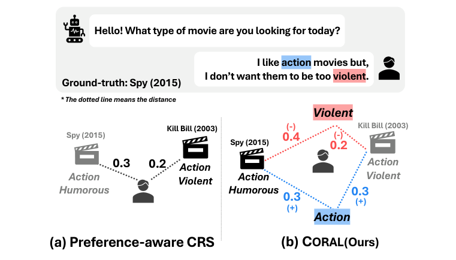
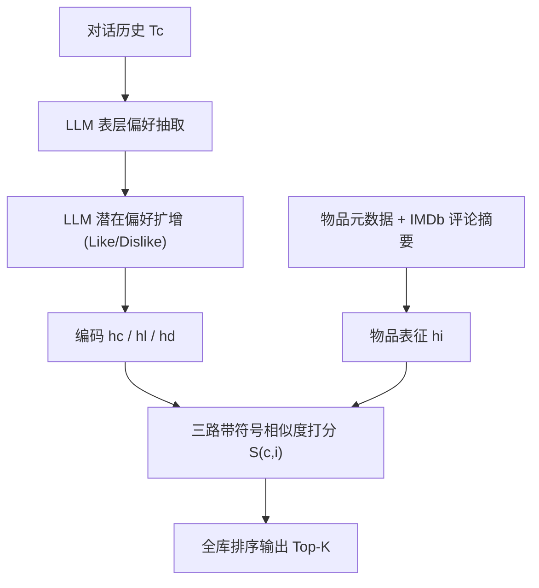
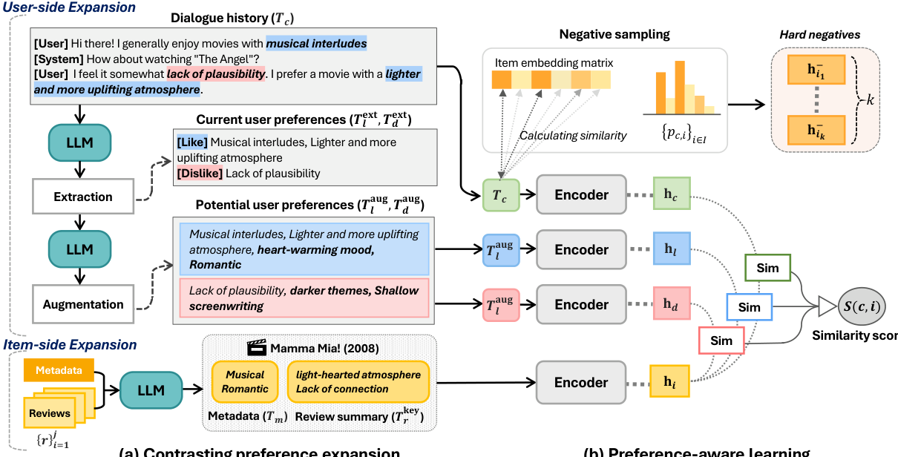

# Empowering Retrieval-based Conversational Recommendation with Contrasting User Preferences (以对比用户偏好增强检索式对话推荐)

- **会议/期刊**: NAACL 2025
- **作者与机构**: Heejin Kook*, Junyoung Kim*, Seongmin Park, Jongwuk Lee†（成均馆大学）
- **推荐链路定位**: 召回（检索式对话推荐，对话即 query、物品即 document）
- **研究方向**: 对话推荐与智能体仿真 / 大语言模型推荐
- **论文原文**: [https://arxiv.org/abs/2503.22005v1](https://arxiv.org/abs/2503.22005v1)
- **开源代码**: [https://github.com/kookeej/CORAL](https://github.com/kookeej/CORAL)

## TL;DR (1分钟核心速览)

现有偏好感知对话推荐（如 ECR）把 like/dislike 等多种情感压进**单一用户向量**，无法区分"喜欢动作片但不喜欢太暴力"这类对立意图，导致把与负面偏好高度相似的物品（Kill Bill）误推给用户。CORAL 用 LLM 先抽取表层 like/dislike 关键短语、再自反馈式扩增潜在偏好，并把对话、like、dislike 三路表征与物品做**带符号的线性相似度打分** $S=\text{sim}(h_c,h_i)+\alpha\,\text{sim}(h_l,h_i)-\beta\,\text{sim}(h_d,h_i)$，配合难负采样训练。在 PEARL/INSPIRED/ReDial 三个基准上以全库排序评测，Recall@10 最高相对提升 99.72%。

## Background & Motivation (背景与核心矛盾)

- **主流范式**: 检索式 CRS 把对话历史 $T_c$与物品元数据$T_m$分别编码，用$\text{sim}(\text{Enc}(T_c),\text{Enc}(T_m))$ 做全库检索排序；偏好感知路线（RevCore、ECR）额外引入情感/情绪标签增强用户表达。
- **前人局限**: ① RevCore 在实体级、ECR 在单句级做情感分类，长对话（PEARL 平均对话更长）下难以把握全局语境；② 二者最终仍把九类情感或正负情感**融合为单一用户表征**，无法表达"喜欢 A 但讨厌 A 的某个侧面"这种对立结构。
- **核心洞察 (Key Insight)**: 对话中的偏好天然成对出现且方向相反（like vs. dislike），真正决定排序的不是"用户离物品多近"，而是"物品更靠近 like 一侧还是 dislike 一侧"——图 1 中 Kill Bill 与对话语义很近却贴近 dislike，Spy 语义稍远但远离 dislike，才是正确答案。
- **本文切入点**: 把对比偏好**显式拆成独立向量**并直接进入打分函数，用减号把 dislike 变成排斥项。

<figure class="paper-figure" markdown="span">
  <figcaption>图 1：传统偏好建模与对比偏好感知建模的对比。</figcaption>
</figure>

## Method (核心方法设计)

### 1. 整体框架 (Overall Architecture)

CORAL 分两阶段。**离线扩增阶段**：LLM（gpt-4o-mini）先对对话做表层偏好抽取得到 $T_l^{ext},T_d^{ext}$，再以自反馈方式扩增出潜在偏好$T_l^{aug},T_d^{aug}$；物品侧则爬取 IMDb 高赞评论、LLM 摘要后抽关键短语$T_r^{key}$，与元数据拼接缓解"对话无偏好、元数据无偏好"的语义鸿沟。**在线检索阶段**：同一文本编码器（NV-Embed，$d=4096$，LoRA 微调）分别编码$T_c,T_l^{aug},T_d^{aug},T_m\oplus T_r^{key}$得到$h_c,h_l,h_d,h_i$，经三路加权相似度打分后全库排序。训练时每 epoch 预计算物品向量表，用对话-物品相似度分布采样难负例。

<figure class="paper-figure" markdown="span">
  <figcaption>图 2：CORAL 的整体架构。它包含两个组件：（i）对比偏好扩展，用于提取表层用户偏好并隐式增强对话中潜在的偏好（第 3.1 节）；（ii）偏好感知学习，直接建模用户、对比偏好与物品之间的关系（第 3.2 节）。</figcaption>
</figure>

### 2. 关键设计拆解 (Key Designs)

1. **对比偏好扩增（Contrasting Preference Expansion）**：痛点在于对话里大量偏好是隐含的（用户只说"不喜欢缺乏合理性"，未说"喜欢烧脑悬疑"）。做法是两步 LLM 提示：先抽取表层 like/dislike 关键短语，再把这些短语作为 rationale 让 LLM 推断潜在偏好，即 $T_l^{aug},T_d^{aug}=f_{\text{LLM}}(P_{aug},T_c,T_l^{ext},T_d^{ext})$。直觉上这是把"检索 query"从稀疏对话文本扩写成稠密的偏好画像，且扩增内容天然带正负极性，为后续带符号打分提供素材。

2. **偏好感知学习（Preference-aware Learning）**：核心是把单一内积换成三路带符号聚合：
$$S(c,i)=\text{sim}(h_c,h_i)+\alpha\cdot\text{sim}(h_l,h_i)-\beta\cdot\text{sim}(h_d,h_i)$$
其中 $\alpha=0.5$，$\beta$ 按数据集取 0.1–0.3。该式**零新增参数**，却把"排斥 dislike"变成可解释的显式项：推荐理由可回溯到具体 like/dislike 短语，同时避免 ECR 式融合造成的极性抵消。

3. **难负采样与训练目标**：先用 $p_{c,i}=\text{softmax}(\text{sim}(h_c,h_i))$在全库上构造分布，按该分布采样$k$个"仅凭对话难以区分"的难负例$I_c^-$（PEARL 取 24，其余 16），再最小化
$$\mathcal{L}=-\log\frac{\exp(S(c,i^+)/\tau)}{\sum_{i\in I_c^-}\exp(S(c,i)/\tau)},\quad \tau=0.05$$
难负例迫使 dislike 分支学会区分"语义相近但极性相反"的物品；每 epoch 预计算物品向量表则把重复编码开销摊掉。

## Experimental Setup & Evaluation Protocol (实验设置与评估协议)

- **数据集与预处理**: 三个电影域基准，均沿用原始划分，无额外 k-core 过滤：

| 数据集 | #Dialogues | #Items | 平均 Like 数 | 平均 Dislike 数 | 场景说明 |
| :--- | :---: | :---: | :---: | :---: | :--- |
| PEARL | 57,159 | 9,685 | 9.59 | 5.97 | 基于影评构建、带用户 persona，对话最长 |
| INSPIRED | 1,997 | 1,058 | 11.09 | 5.65 | AMT 众包，物品数最少 |
| ReDial | 31,089 | 5,896 | 10.99 | 1.00 | AMT 众包，负面偏好极稀疏 |

- **数据划分与防穿越 (Splitting Strategy)**: 沿用各数据集原始 train/valid/test 划分；关键防泄漏处理是**从 ground-truth 集合中剔除对话历史里已出现过的物品**，避免"复述片名"式捷径（沿用 He et al. 2023 协议）。
- **排名评测协议 (Ranking Protocol)**: 无偏 **Full-Ranking**（全库未交互物品排序），指标为 Recall@{10,50} 与 NDCG@{10,50}；显著性用 5 次重复实验的 paired t-test，$p<0.01$。
- **对比基线与超参设置**: 7 个基线覆盖三类——传统 CRS（RevCore、UniCRS、ECR）、LLM 直接推荐（Zero-shot、ChatCRS）、检索式（BM25、DPR）。编码器 NV-Embed（$d=4096$）+ LoRA，batch 8–10，学习率 5e-5/1e-4，$\tau=0.05$，序列长度 512（对话/物品）、256（偏好）。

## Key Experimental Results (实验关键数据)

### 1. 主实验对比 (Main Results)

| 数据集 | 指标 | ECR | UniCRS | ChatCRS | DPR | **CORAL** | Improv. |
| :--- | :--- | :---: | :---: | :---: | :---: | :---: | :---: |
| PEARL | R@10 | 0.0957 | 0.1156 | 0.0763 | 0.0940 | **0.1851*** | +60.07% |
| PEARL | N@10 | 0.0501 | 0.0642 | 0.0462 | 0.0502 | **0.1125*** | +75.17% |
| INSPIRED | R@10 | 0.1711 | 0.1113 | 0.1410 | 0.1019 | **0.3417*** | +99.72% |
| INSPIRED | N@50 | 0.1417 | 0.0952 | 0.1071 | 0.0872 | **0.2255*** | +59.07% |
| ReDial | R@10 | 0.1685 | 0.1549 | 0.1666 | 0.0774 | **0.2182*** | +25.48% |
| ReDial | N@50 | 0.1293 | 0.1215 | 0.1191 | 0.0713 | **0.1724*** | +28.96% |

（BM25 全面垫底，如 INSPIRED R@10 仅 0.0429，故略去；CORAL 平均在 R@50 / N@50 上相对最优基线提升 43.87% / 48.59%。）

### 2. 消融实验 (Ablation Study)

| 变体 (INSPIRED) | R@10 | R@50 | N@10 | N@50 |
| :--- | :---: | :---: | :---: | :---: |
| CORAL 完整 | **0.3481** | 0.5667 | **0.1827** | **0.2297** |
| w/o L, D（去掉扩增偏好） | 0.3248 | **0.5767** | 0.1668 | 0.2226 |
| w/o R（去掉评论摘要） | 0.3167 | 0.5348 | 0.1710 | 0.2193 |
| w/o Aug.（仅表层抽取） | 0.3016 | 0.5379 | 0.1663 | 0.2202 |
| w/o Neg.（in-batch 负采样） | 0.2974 | 0.5692 | 0.1520 | 0.2115 |
| w/o PL（单表征拼接） | 0.1847 | 0.3616 | 0.1107 | 0.1491 |

### 3. 关键实验发现 (Key Findings)

1. **"拆开"比"融合"重要得多**：w/o PL 把 $T_c,T_l^{aug},T_d^{aug}$ 拼成单一表征后，R@10 从 0.3481 崩到 0.1847（-46.9%），N@10 近乎腰斩，直接证明 ECR 式单表征是性能瓶颈而非情感信息本身不足。
2. **潜在偏好扩增贡献最大**：w/o Aug. 仅保留表层抽取时 R@10 掉 15.41%，说明对话中隐含偏好才是排序信号主体；而 w/o L,D 在 R@50 上反而略高于完整模型（0.5767 vs 0.5667），暗示扩增偏好主要提升头部精度、对长尾召回略有挤压。
3. **难负采样与模型规模双重有效**：换成 in-batch 负采样后 N@10 从 0.1827 降至 0.1520；同时零样本下加入 like/dislike 扩增使 NV-Emb 检索器 R@10 从 0.1648 升至 0.2276（+38%），且 CORAL(BERT-base) 相比同骨干 DPR 在 N@50 上提升 39%，说明收益来自框架而非单纯堆模型。

## Highlights & Limitations (亮点、对比与审稿批判)

- **与代表作对比 (vs. Prior Work)**: 相比 ECR（九类情感融合为单向量）与 RevCore（实体级正负情感 + 评论检索），CORAL 的本质差异是**极性不融合、直接进打分函数**；相比 DPR/BM25 这类纯检索基线，它把 query 从对话文本升级为"对话 + 双向偏好画像"，因而在长对话的 PEARL 上优势最大（R@10 +60%）。
- **可迁移亮点**: ① "LLM 抽取 → 自反馈扩增 → 带符号线性打分"这套零参数打分范式可平移到电商/短视频对话推荐，只需替换偏好维度；② 物品侧用高赞评论摘要弥合对话-元数据语义鸿沟，是低成本高回报的工程技巧。
- **审稿级局限批判**: ① 偏好抽取与扩增完全依赖 LLM，其规模、偏见与知识边界直接决定上限，且离线扩增 + 7B 编码器（LoRA 仅训 10M 参数）的训练/推理成本偏高，论文自认此为局限；② 评测仅限电影单一域，ReDial 的 dislike 平均仅 1.00 条，负偏好监督极稀疏，跨域（如商品、POI）泛化性未验证；③ $\beta$ 需按数据集在 0.1–0.3 间调参，对负偏好密度敏感。

## Rating (四维评分)

- **方法创新性 (Novelty)**: ⭐⭐⭐⭐ （"对比偏好显式拆分 + 带符号零参数打分"思路简洁且直击单表征痛点，但 LLM 扩增本身属已有范式组合）
- **评估协议与实验扎实度 (Protocol & Experiments)**: ⭐⭐⭐⭐ （三数据集 Full-Ranking + 剔除历史物品防捷径 + paired t-test，消融与零样本分析完整；缺跨域与线上验证）
- **写作与数学规范度 (Clarity & Rigor)**: ⭐⭐⭐⭐ （打分公式与训练流程清晰、符号统一，但偏好扩增的提示工程细节大量下沉附录，主文可复现性略打折）
- **工业落地与复现价值 (Industrial & Practical Value)**: ⭐⭐⭐⭐ （代码开源、打分零新增参数易上线；但依赖 LLM 离线扩增与 7B 编码器，实时性与算力成本是落地门槛）

