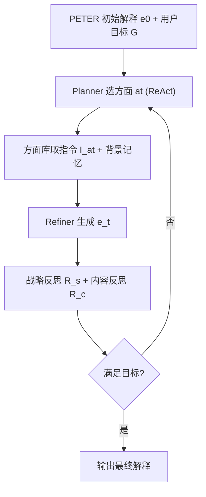
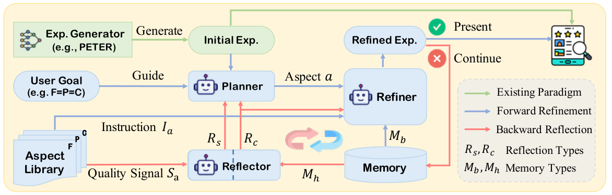

# Enhancing Recommendation Explanations through User-Centric Refinement (面向用户中心需求的可解释推荐精炼)

- **会议/期刊**: ACL 2025
- **作者与机构**: Jingsen Zhang, Zihang Tian, Xueyang Feng, Xu Chen（中国人民大学）
- **推荐链路定位**: 重排（推理期后处理精炼，post-hoc refinement）
- **研究方向**: 对话推荐与智能体仿真 / 大语言模型推荐
- **论文原文**: [https://arxiv.org/abs/2502.11721v1](https://arxiv.org/abs/2502.11721v1)
- **开源代码**: 暂未开源

## TL;DR (1分钟核心速览)

现有自然语言可解释推荐（NLER）把用户评论当解释金标准、只优化 BLEU/ROUGE 式复述精度，导致解释在事实性、个性化、情感连贯性上对用户无用。本文不改模型架构，而是在**推理阶段**用 LLM 多智能体对 PETER 生成的初始解释做"计划—精炼—反思"迭代修正。在 Yelp/Beauty/Games 三数据集、Leave-One-Out 划分、200 用户采样评估下，RefineX 相对 PETER 将 Entail 从 0.295 提至 0.835（Yelp）、CoR 从 0.455 提至 0.770，全面超越模型导向与模型无关基线。

## Background & Motivation (背景与核心矛盾)

- **主流范式**: NETE/PETER/PEPLER 等以用户评论为解释 ground truth，通过改进生成架构（Transformer 桥接 ID 与文本、prompt learning）提升评论预测相似度。
- **前人局限**: ① 数据规模与模型能力受限，生成解释常与评论事实矛盾（如评论说"偏咸"却生成"food is good"）；② 解释过于泛化、缺乏物品/用户具体特征，且情感极性与预测评分不一致，用户中心有用性差。
- **核心洞察 (Key Insight)**: 解释质量缺陷是**多维度、可事后诊断**的——事实性可对照评论验证、个性化可查特征覆盖、连贯性可比对预测评分，因此无需重训模型，只需在推理期做定向修正。
- **本文切入点**: 借鉴 o1 的推理期逐步思考与推荐系统 Reranking 思想，提出首个"解释精炼 (Refinement)"范式，用多智能体协作把弱解释迭代进化为强解释。

## Method (核心方法设计)

### 1. 整体框架 (Overall Architecture)

输入为 PETER 生成的初始解释 $e^0$、用户目标$G=\{a_1,\dots,a_n\}$（如 F=P=C 表示三维度等权）与背景记忆（物品属性、用户评分评论）。每轮先进入**前向精炼**：Planner 依据 ReAct 的 thought-action-observation 模式选定本轮待改方面$a_t$并调用方面库取指令，Refiner 据此改写解释；再进入**后向反思**：战略反思器评估轨迹对齐性、内容反思器调用外部指标评估内容质量，反馈写入精炼记忆供下一轮使用，直至 Planner 判定满足目标或达最大轮数$N=6$。

<figure class="paper-figure" markdown="span">
  <figcaption>图2：我们的RefineX框架概览，其中“Exp”表示“Explanation”。</figcaption>
</figure>

### 2. 关键设计拆解 (Key Designs)

1. **Plan-then-Refine 定向精炼**：痛点是一次性生成无法对齐多维用户需求。Planner 以历史轨迹与上轮反思为条件决策方面：$a_t=\text{Planner}(e^{t-1},G,\mathcal{T}^{1:t-1},R_s^{t-1},R_c^{t-1})$；Refiner 仅针对该方面改写：$e^t=\text{Refiner}(e^{t-1},a_t,I_{a_t},\tilde{R}_c^{1:t-1})$，其中$\tilde{R}_c$为按方面$a_t$ 摘要后的历史内容反思。直觉：把"多目标同时优化"降维成"单方面串行修正"，避免指令冲突与改写漂移。
2. **分层反思机制（战略 + 内容）**：战略反思器按准确性/完整性/优先级三准则评估轨迹是否跑偏或漏项，$R_s^t=\text{S\_Reflector}(G,\mathcal{M}_h^{1:t},C_s)$；内容反思器结合外部方面指标信号$S_{a_t}$判断是否遵循指令、覆盖细节，$R_c^t=\text{C\_Reflector}(e^t,a_t,I_{a_t},S_{a_t},C_c)$。宏观反馈管"改哪个"，微观反馈管"改得对不对"，类比深度学习前向推理与梯度回传的闭环。
3. **训练目标、负采样与推理效率**：本框架**无参数训练、无负采样**，全部依赖 GPT-3.5-turbo-0125 的 in-context 提示；优化目标即式 (1) 的逐方面质量单调提升 $Q_a(e^t)>Q_a(e^0),\forall a\in G$。代价是每样本需多轮 LLM 调用（平均轨迹长约 4 轮），推理开销显著高于单次生成。

## Experimental Setup & Evaluation Protocol (实验设置与评估协议)

- **数据集与预处理**: 三领域真实数据，按用户交互时间排序，未做 5-core 过滤（原文仅给统计于附录表 4）：

| 数据集 | 领域 | 划分方式 | 评估采样 | 说明 |
| :--- | :---: | :---: | :---: | :--- |
| Yelp | 餐饮评论 | Leave-One-Out | 随机 200 用户 | 规模最大、特征最丰富 |
| Amazon-Beauty | 美妆电商 | Leave-One-Out | 随机 200 用户 | 评论较短 |
| Amazon-Video Games | 游戏电商 | Leave-One-Out | 随机 200 用户 | 稀疏、领域术语多 |

- **数据划分与防穿越 (Splitting Strategy)**: 按用户交互时间序列 `Leave-One-Out`，最后一条交互作测试；受预算限制从测试集随机抽 200 用户评估。
- **排名评测协议 (Ranking Protocol)**: 非排序任务，采用**生成质量指标**：Entail（解释被真实评论蕴含的比例，事实性）、FCR（特征覆盖率，个性化）、ENTR（n-gram 熵，个性化多样性）、CoR（解释情感与预测偏好一致比例，连贯性），均为越高越好。
- **对比基线与超参设置**: 基座 PETER；模型导向基线 CLIFF（事实性）、ERRA（个性化）、CER（连贯性）；模型无关基线 LLMX（LLM 直接改写）。RefineX 与 LLMX 均用 GPT-3.5，默认目标 F=P=C，最大轮数 6。

## Key Experimental Results (实验关键数据)

### 1. 主实验对比 (Main Results)

| 方法 | Yelp Entail | Yelp FCR | Yelp CoR | Beauty Entail | Beauty FCR | Beauty CoR | Games Entail | Games FCR | Games CoR |
| :--- | :---: | :---: | :---: | :---: | :---: | :---: | :---: | :---: | :---: |
| PETER | 0.295 | 0.0166 | 0.455 | 0.265 | 0.0286 | 0.605 | 0.380 | 0.0078 | 0.555 |
| CLIFF | 0.450 | 0.0091 | 0.445 | 0.430 | 0.0233 | 0.745 | 0.395 | 0.0132 | 0.665 |
| CER | 0.195 | 0.0155 | 0.530 | 0.450 | 0.0318 | 0.840 | 0.300 | 0.0102 | 0.625 |
| ERRA | 0.185 | 0.0178 | 0.470 | 0.220 | 0.0424 | 0.790 | 0.325 | 0.0112 | 0.520 |
| LLMX | 0.555 | 0.0299 | 0.530 | 0.575 | 0.1081 | 0.765 | 0.670 | 0.0351 | 0.635 |
| **RefineX** | **0.835** | **0.0424** | **0.770** | **0.800** | **0.1441** | **0.885** | **0.835** | **0.0473** | **0.750** |
| Improv. vs PETER | +183% | +155% | +69% | +202% | +404% | +46% | +120% | +506% | +35% |

### 2. 消融实验 (Ablation Study)

| 数据集 | 配置 | Entail | FCR | ENTR | CoR |
| :--- | :--- | :---: | :---: | :---: | :---: |
| Yelp | RefineX 完整 | **0.835** | **0.0424** | **10.082** | **0.770** |
| Yelp | w/o 战略反思 | 0.845 | 0.0393 | 10.080 | 0.715 |
| Yelp | w/o 内容反思 | 0.820 | 0.0392 | 10.041 | 0.755 |
| Yelp | w/o 双反思 | 0.760 | 0.0363 | 10.011 | 0.700 |
| Beauty | RefineX 完整 | **0.800** | **0.1441** | **10.160** | **0.885** |
| Beauty | w/o 战略反思 | 0.755 | 0.1292 | 10.111 | 0.855 |
| Beauty | w/o 内容反思 | 0.710 | 0.1250 | 10.041 | 0.830 |
| Beauty | w/o 双反思 | 0.760 | 0.1239 | 10.093 | 0.820 |

### 3. 关键实验发现 (Key Findings)

1. **模型无关范式系统性优于模型导向**：LLMX 已在三数据集全面超过 CLIFF/ERRA/CER，而 RefineX 又在 LLMX 基础上把 Beauty 的 FCR 从 0.1081 拉到 0.1441、Games 的 Entail 从 0.670 拉到 0.835，说明"保留推荐模型偏好识别 + 借 LLM 语言能力"的组合优于单点改架构。
2. **内容反思比战略反思更关键**：Beauty 上去掉内容反思使 Entail 掉 0.090（0.800→0.710），而去掉战略反思仅掉 0.045；双反思全去后 CoR 跌至 0.820，验证微观内容反馈直接决定解释质量、宏观反馈主要提升规划效率。
3. **目标权重可驱动轨迹自适应**：Yelp 上 F>P>C 目标下事实性方面精炼占比升至 46%、Entail 达 0.855；P>F>C 下个性化占比达 73%、代表轨迹出现 `[P,P,P,F,P,C]` 的多次重复精炼，且平均轨迹长度仅约 4 轮（最大 6 轮），说明 Planner 能高效收敛而非盲目堆轮数。

## Highlights & Limitations (亮点、对比与审稿批判)

- **与代表作对比 (vs. Prior Work)**: 相比 PETER/PEPLER 等"改架构提评论预测精度"，本文首次把解释质量优化搬到推理期；相比 LLMX 的单次 LLM 改写，RefineX 引入方面级规划与双层反思，把 Games 的 Entail 再提 0.165；相比 Qin et al. 的通用回复精炼，本文面向推荐解释的多维用户中心需求定制方面库与指标。
- **可迁移亮点**: ① "方面库 + 外部指标作为反思信号"的工具增强反思模式，可直接迁移到对话推荐的理由生成与多目标重排；② 用预测评分作为情感连贯性锚点校验生成文本，是低成本的事实一致性约束技巧。
- **审稿级局限批判**: ① 每样本平均 4 轮、最多 6 轮的多智能体 LLM 调用，线上延迟与成本远高于单次生成，且仅用 GPT-3.5 未验证更强模型下的收益边界；② 评估仅采样 200 用户、指标依赖 Entail/FCR 等自动代理且人工评估仅 5 名专家 30 样本，统计效力有限；③ 方面仅覆盖三维度，信息量、可比性等未纳入，且未报告与 BLEU/ROUGE 类传统指标的权衡。

## Rating (四维评分)

- **方法创新性 (Novelty)**: ⭐⭐⭐⭐ （首个将推理期 Refinement 范式引入可解释推荐，plan-then-refine + 分层反思设计完整，但多智能体编排本身属已有组件的巧妙组合）
- **评估协议与实验扎实度 (Protocol & Experiments)**: ⭐⭐⭐ （三领域数据集 + 消融 + 适应性 + 人工评估较全面，但仅采样 200 用户、缺显著性检验与方差报告）
- **写作与数学规范度 (Clarity & Rigor)**: ⭐⭐⭐⭐ （框架图与算法伪码清晰、任务形式化简洁，但公式多为智能体调用示意而非可推导数学，理论深度有限）
- **工业落地与复现价值 (Industrial & Practical Value)**: ⭐⭐⭐ （作为即插即用后处理模块易集成，但多轮 LLM 调用成本高、代码未开源、方面库构建依赖人工设计）

