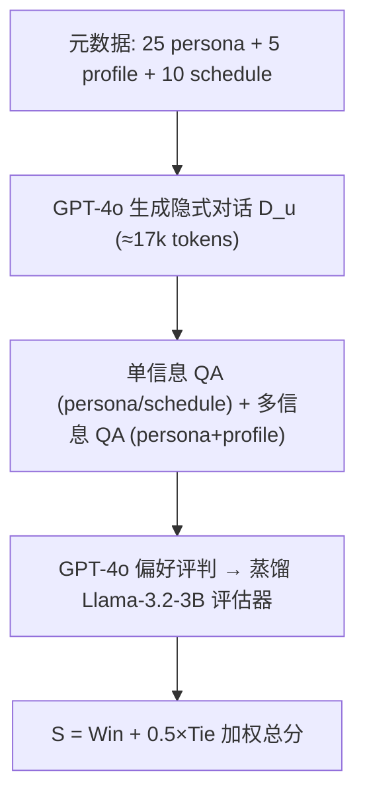
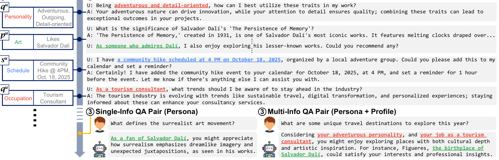

# Exploring the Potential of LLMs as Personalized Assistants: Dataset, Evaluation, and Analysis (探究 LLM 作为个性化助手的潜力：数据集、评估与分析)

- **会议/期刊**: ACL 2025
- **作者与机构**: Jisoo Mok, Ik-hwan Kim, Sangkwon Park, Sungroh Yoon（首尔大学电气与计算机工程系 / AIIS、ASRI、INMC、ISRC）
- **推荐链路定位**: 端到端生成式（对话式个性化助手）
- **研究方向**: 对话推荐与智能体仿真 / 大语言模型推荐
- **论文原文**: [https://arxiv.org/abs/2506.01262v1](https://arxiv.org/abs/2506.01262v1)
- **开源代码**: [https://github.com/12kimih/HiCUPID](https://github.com/12kimih/HiCUPID)

## TL;DR (1分钟核心速览)

现有 LLM 个性化研究缺乏面向"对话式个性化助手"的公开基准：已有数据集多局限于个性化文本分类或短对话，无法同时考察用户信息遵循、隐式信息理解、多信息推理、长上下文建模与主动性五项能力。本文提出 HiCUPID——1,500 个合成用户、平均 17k token 对话历史、单跳/多跳 QA 的 GPT-4o 生成基准，并蒸馏 Llama-3.2-3B 作为与人类偏好高度一致的自动评估器。在 Seen/Unseen User 两种划分下，SFT+DPO 在 Llama-3.1-8B 上取得 Total $S_{\text{Llama}}$=44.6，而纯 DPO 全面崩溃（23.1），暴露当前个性化训练范式的深层缺陷。

## Background & Motivation (背景与核心矛盾)

- **主流范式**: LLM 个性化分为推理时方法（zero/few-shot 提示、BM25/Contriever 检索增强、画像摘要增强）与训练时方法（SFT、DPO、每用户 LoRA），但均以"通用能力"为导向，缺乏统一评测。
- **前人局限**: ① 现有数据集（PersonaChat、LaMP、PChatbot）只覆盖"赋予模型人格"或短对话，无法检验多信息推理与长上下文；② BLEU/ROUGE-L 等 n-gram 指标与人类偏好严重背离——Mistral 在 BLEU 上领先却在人类评估中大幅落后于 Llama。
- **核心洞察 (Key Insight)**: 个性化助手的本质是"以用户信息为条件生成"，而非"给模型装人格"；用户信息在真实对话中是**隐式、分散、跨轮次**出现的，因此必须用长对话 + 多跳 QA 才能探测模型是否真正"记住并推理"了用户画像。
- **本文切入点**: 用 GPT-4o 合成"元数据 → 隐式对话 → 单/多跳 QA"三段式数据管线，把五项能力需求（AUI/UII/MI/LC/PR）逐一映射为可量化评测项，并用蒸馏小模型替代昂贵的人类/GPT-4o 评估。

## Method (核心方法设计)

### 1. 整体框架 (Overall Architecture)

HiCUPID 的构造分三层：**元数据层**为每个用户采样 25 条 persona（覆盖 25 个维度，每维 150 种"关系×实体"组合）、5 条 profile（年龄/性别/性格/职业/收入，源自 PersonaHub 采样后由 GPT-4o 外推）、10 条 schedule（事件+时间戳，依 profile 生成以保证可行）；**对话层**将每条 persona 展开为 10 轮隐式暗示对话（同一 persona 由 10 个用户共享但对话版本不同），profile/schedule 各生成单轮问答，聚合为平均 17k token 的对话历史 $D^u$；**评测层**为每条 persona/schedule 配一个单信息 QA，并将 profile 与强相关 persona 配对生成多信息 QA，元数据仅用于评测、绝不进入对话。评估侧先用 GPT-4o 做人类偏好代理打分，再以 40 万条 GPT-4o 评判样本 LoRA 微调 Llama-3.2-3B 得到离线评估器。

<figure class="paper-figure" markdown="span">
  <figcaption>图1：HiCUPID 的配置。(1) 用户 u 由一组元数据或个人信息（Pu ∪Qu ∪Su）刻画，仅用于评估。(2) 对每条个人信息，我们创建一个隐含提示该信息的对话。所有对话汇总为 Du。(3) 为探测 LLM 是否捕捉到某条个人信息，我们为每个人设或日程创建一个单信息问答对。为研究 LLM 的多跳推理能力，我们通过将用户画像与密切相关的 persona 配对来创建多信息问答对。</figcaption>
</figure>

### 2. 关键设计拆解 (Key Designs)

1. **五项能力需求到评测项的映射（Desiderata-to-Probe）**：痛点是"个性化"定义模糊、无法度量。本文将 AUI（遵循用户信息）、UII（理解隐式信息）、MI（多信息推理）、LC（长上下文）、PR（主动性）分别落到：评估提示中的 "Personalization" 判据、对话中不显式出现元数据、多信息 QA 强制联合 persona+profile、17k token 历史、以及 QA 本身要求主动建议。其有效性来自"评测提示即能力定义"的闭环设计——模型只有真正完成对应认知操作才能拿到分。

2. **人类对齐的蒸馏评估器（Distilled Proxy Evaluator）**：痛点是 GPT-4o 评估成本高（单次 Llama-3.1-8B SFT+DPO 评估耗 641 万 prompt token、约 \$26）。本文以 GPT-4o 在全部三类 QA 上的评判结果为监督信号，LoRA 微调 Llama-3.2-3B，损失即标准下一 token 交叉熵：

$$\mathcal{L}_{\text{eval}}=-\sum_{t}\log p_{\theta}\left(y_t \mid y_{<t}, x_{\text{eval}}\right)$$

其中 $x_{\text{eval}}$含问题、GT 个性化答案、模型回答与评判指令。蒸馏后评估器与 GPT-4o 的 Cohen's$\kappa$ 在四组代表性配置上达 0.703–0.747，说明"评判偏好"这一隐式能力可被 3B 模型低成本继承。

3. **总分聚合与训练目标**：三类 QA 量纲不同（persona/multi-info 为 Win+Tie 制、schedule 为 Yes/No 制），故总分按样本数加权并对 schedule 折半：

$$S_{\text{total}}=S_{\text{persona}}\cdot\tfrac{25}{40}+\tfrac{S_{\text{schedule}}}{2}\cdot\tfrac{10}{40}+S_{\text{multi}}\cdot\tfrac{5}{40}$$

训练侧 SFT 以 $(D^u, q)\to y_{\text{personalized}}$做 LoRA 监督微调（$r$=256, lr=1e-4）；DPO 以个性化答案为$y_{\text{chosen}}$、通用答案为$y_{\text{rejected}}$（因显存限制剔除 15 条无关 persona 对话）；SFT+DPO 先合并 SFT 适配器再做偏好优化（lr=3e-6,$r$=256）。推理侧无额外开销，RAG 方法仅需检索 top-5 utterance。

## Experimental Setup & Evaluation Protocol (实验设置与评估协议)

- **数据集与预处理**: HiCUPID 为全合成数据，无 5-core 过滤；对话与 QA 长度以 GPT-2 Tokenizer 计。

| 数据集 | #Users | #Items(QA) | #Interactions | 稀疏度/密度 | 特征/场景说明 |
| :--- | :---: | :---: | :---: | :---: | :--- |
| Train Set | 1,250 | 40,000 | 50,000 对话 | 对话均长 17,256 token | 25 persona+5 profile+10 schedule |
| Test Set 1 | 1,250（同训练用户） | 10,000 | — | — | Seen User / Unseen QA |
| Test Set 2 | 250（全新用户） | 10,000 | — | — | Unseen User / Unseen QA |

- **数据划分与防穿越 (Splitting Strategy)**: 1,500 用户中 250 人整体留出为 Test Set 2（严格冷启动用户划分）；其余 1,250 用户的 QA 按 4:1 切分为 Train / Test Set 1。元数据仅用于评测，不进入任何训练输入，杜绝标签泄漏。
- **排名评测协议 (Ranking Protocol)**: 非检索式排序，而是**成对偏好判别**——模型回答与 GT 个性化答案二选一（含 Tie），指标 $S$ = Model Win Rate + 0.5×Tie Rate；schedule QA 因对错分明取消 Tie，直接统计 Yes 比例。辅以 BLEU/ROUGE-L 作为对照，用以证明 n-gram 指标失效。
- **对比基线与超参设置**: 4 个基座（GPT-4o-mini、Llama-3.1-8B、Mistral-7B、Qwen-2.5-7B）× 7 种方法（0-shot、3-shot、BM25、Contriever、SFT、DPO、SFT+DPO）；LoRA 秩搜索 {8…256}，学习率 {1e-6…3e-4}，batch 256，cosine 调度，warmup 0.03；评估器训练用 40 万样本、lr=1e-4、$r$=128。

## Key Experimental Results (实验关键数据)

### 1. 主实验对比 (Main Results)

Test Set 1（Seen User / Unseen QA），指标为 $S_{\text{GPT}}$/$S_{\text{Llama}}$ 总分：

| 模型 | 方法 | BLEU | ROUGE-L | $S_{\text{GPT}}$|$S_{\text{Llama}}$ |
| :--- | :--- | :---: | :---: | :---: | :---: |
| GPT-4o-mini | 3-shot | 16.1 | 30.0 | 37.5 | 37.5 |
| Llama-3.1-8B | 0-shot | 8.2 | 19.2 | 28.0 | 27.0 |
| Llama-3.1-8B | Contriever | 9.5 | 22.1 | 36.6 | 36.6 |
| Llama-3.1-8B | SFT | 24.9 | 38.5 | 35.7 | 35.7 |
| Llama-3.1-8B | DPO | 7.6 | 17.9 | 16.4 | 23.1 |
| Llama-3.1-8B | **SFT+DPO** | **27.6** | **42.7** | **44.6** | **44.6** |
| Mistral-7B | SFT+DPO | 32.4 | 46.7 | 43.0 | 43.0 |
| Qwen-2.5-7B | SFT+DPO | 31.8 | 45.3 | 44.2 | 44.2 |

Test Set 2（Unseen User）趋势一致：Llama-3.1-8B SFT+DPO 达 44.4，Qwen-2.5-7B SFT+DPO 达 44.0，说明 LoRA 冻结主干带来的泛化性可迁移至全新用户。

### 2. 消融实验 (Ablation Study)

| 消融项 | 设置 | Llama-3.1-8B $S_{\text{Llama}}$ (Test 1) | 说明 |
| :--- | :--- | :---: | :--- |
| 上下文长度 | 全对话历史 0-shot | 27.0 | 默认设置 |
| 上下文长度 | 仅金标对话 0-shot | **50.3** | 缩短上下文带来 +23.3 |
| 上下文长度 | 全对话历史 3-shot | 31.8 | — |
| 上下文长度 | 仅金标对话 3-shot | **54.0** | +22.2 |
| 提示位置 | 指令置于 system（3-shot） | 31.8 | 默认 |
| 提示位置 | 指令置于 user（3-shot） | 20.0 | Mistral/Qwen 上更差 |
| Few-shot 数量 | 1 / 3 / 5-shot | 30.2 / 31.8 / 26.6 | 3-shot 后饱和甚至退化 |
| 检索粒度 | utterance-5 / dialogue-5 | 32.5 / 31.6 | utterance 级略优 |

### 3. 关键实验发现 (Key Findings)

1. **长上下文是当前个性化助手的头号瓶颈**：把 17k token 全历史替换为单条金标对话后，Llama-3.1-8B 0-shot 从 27.0 跃升至 50.3（+86% 相对提升），证明模型并非"不会个性化"，而是"读不完、找不准"用户信息，这直接指向检索式个性化（RAG）的工程价值。
2. **DPO 单独使用会灾难性崩溃，SFT 是其必要地基**：纯 DPO 在 Llama 上仅 23.1、Mistral 上 4.2（几乎全输给 GT），而 SFT+DPO 达 44.6/43.0。作者归因于 DPO 的对比损失缺乏显式 grounding 信号，难以把三类异构对话对齐到 QA；SFT 先建立"用户信息→回答"的映射后，DPO 才能在其邻域内做偏好微调。
3. **多信息推理是未被任何方法攻克的硬骨头**：即便最优的 SFT+DPO，multi-info 子项也仅 18.4（Llama）/17.6（Mistral），远低于 persona 的 48.1 与 schedule 的 98.1；而 schedule 任务因信息显式、答案唯一，SFT 即可逼近 100，说明"信息显式度"而非"模型规模"才是决定个性化难度的关键变量。

## Highlights & Limitations (亮点、对比与审稿批判)

- **与代表作对比 (vs. Prior Work)**: 相比 LaMP（仅文本分类/生成、非对话）与 PChatbot/Synthetic-Persona-Chat（对话短于现代 LLM 上下文、只考察人格而非用户信息遵循），HiCUPID 是首个同时满足五项 desiderata 的对话式个性化基准；相比 PERSE/PEARL 等 RAG 个性化工作，本文不提出新模型而是提供**可复现的评测标尺 + 蒸馏评估器**，定位互补而非竞争。
- **可迁移亮点**: ① "GPT-4o 评判 → 3B 小模型蒸馏"的评估器范式（$\kappa$>0.7）可直接迁移到任何开放式生成推荐/对话推荐的自动评测，成本降低一个数量级；② "元数据仅用于评测、对话隐式暗示"的数据构造原则，是构建无泄漏个性化基准的通用模板。
- **审稿级局限批判**: ① 全合成数据由 GPT-4o 生成，persona 分布与真实用户行为存在域偏移，且 GPT-4o 对否定式 persona（dislike/not interested）会系统性省略，可能低估模型真实能力；② 评估器本身是 GPT-4o 偏好的蒸馏，继承了其位置偏差与长度偏好，且 schedule 任务取消 Tie 的设计使总分对任务配比敏感；③ 未提供 reward model，DPO 失败后缺乏 RLHF 路线的进一步探索。

## Rating (四维评分)

- **方法创新性 (Novelty)**: ⭐⭐⭐⭐ （基准与评估器双贡献，"五项 desiderata→可探测 QA"的映射设计有巧思，但方法层面无新模型）
- **评估协议与实验扎实度 (Protocol & Experiments)**: ⭐⭐⭐⭐ （Seen/Unseen 双划分 + 4 基座 × 7 方法 + 人类/GPT-4o/蒸馏三方对齐验证，消融覆盖上下文、提示位置、shot 数与检索粒度）
- **写作与数学规范度 (Clarity & Rigor)**: ⭐⭐⭐⭐ （总分加权公式与 $S$ 指标定义清晰，数据统计表完整；但部分超参搜索细节下沉附录，正文公式偏少）
- **工业落地与复现价值 (Industrial & Practical Value)**: ⭐⭐⭐⭐⭐ （数据、代码、评估器全部开源，蒸馏评估器可直接用于线上个性化助手 A/B 前置筛选，17k token 长上下文结论对 RAG 架构选型有直接指导）

