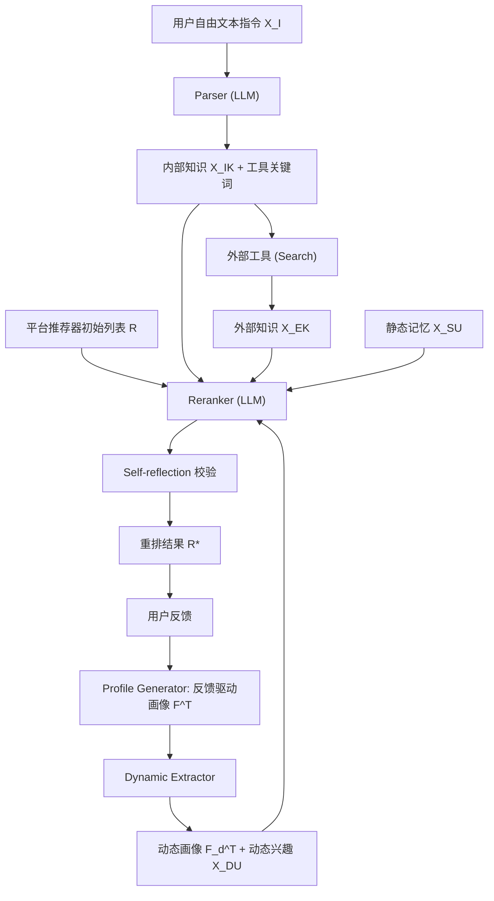

# iAgent: LLM Agent as a Shield between User and Recommender Systems (LLM 智能体作为用户与推荐系统之间的护盾)

- **会议/期刊**: Findings of ACL 2025 (also WWW 2025 @HCRS)
- **作者与机构**: Wujiang Xu, Yunxiao Shi, Zujie Liang, Xuying Ning, Kai Mei, Kun Wang, Xi Zhu, Min Xu, Yongfeng Zhang (Rutgers University / UTS / UIUC / NTU)
- **推荐链路定位**: 重排 (Reranking，用户侧后置干预)
- **研究方向**: 对话推荐与智能体仿真 / 大语言模型推荐
- **论文原文**: [https://arxiv.org/abs/2502.14662v4](https://arxiv.org/abs/2502.14662v4)
- **开源代码**: [https://github.com/agiresearch/iAgent](https://github.com/agiresearch/iAgent)

## TL;DR (1分钟核心速览)

传统 user-platform 直连范式下，用户被动暴露于平台算法，面临商业目标绑架、个体偏好被全体用户数据淹没、回声室与低活跃用户欠个性化四大痛点。本文提出 user-agent-platform 新范式：为每个用户配置一个 LLM Agent 作为"护盾"，先由 Parser 解析自由文本指令并调用外部工具补充知识，再由 Reranker 对平台候选列表做个性化重排，并以自反思机制抑制幻觉；进阶版 i2Agent 引入由个体反馈驱动的动态记忆（Profile Generator + Dynamic Extractor）。在自建的四个 INSTRUCTREC 数据集、1 正 9 负采样排序协议下，i2Agent 相对 SOTA 基线 EasyRec 平均提升 16.6%，同时显著降低回声室效应并保护低活跃用户。

## Background & Motivation (背景与核心矛盾)

- **主流范式**: 现有推荐（GRU4Rec/SASRec/BERT4Rec 及各类 LLM 增强模型）均属 user-platform 直连，模型以平台商业指标（点击、转化）为优化目标，用户对结果无控制权。
- **前人局限**: 其一，模型在全量用户数据上联合优化，个体偏好被活跃用户主导的协同信号稀释，低活跃用户几乎得不到个性化；其二，近期 RecAgent（ToolRec、AgentCF）虽引入 LLM，但目标是**模拟用户行为以优化平台侧性能**，并未改变用户被动暴露的结构性缺陷。
- **核心洞察 (Key Insight)**: 用户其实有能力用自然语言主动表达"我此刻想要什么"（如"想找一本轻松、可预测、带运动时尚元素的逃离现实小说"），这类高阶意图无法被物品 ID 序列或固定槽位对话捕捉；而 LLM 恰好能把自由文本指令翻译成对候选列表的干预。
- **本文切入点**: 把 Agent 插到用户与平台之间，形成"平台出候选 → Agent 按个体指令重排 → 用户反馈回灌个体记忆"的间接暴露闭环，使记忆只被单个用户影响，从结构上切断跨用户偏见传播。

## Method (核心方法设计)

### 1. 整体框架 (Overall Architecture)

平台推荐器先产出初始排序列表 $R$；Agent 侧 Parser 读取用户指令$X_I$，生成内部知识$X_{IK}$并判断是否调用外部工具（如 Google Search）获取$X_{EK}$；Reranker 将指令知识、用户静态历史记忆$X_{SU}$、候选物品文本$X_{Item}$一并输入 LLM 输出重排列表$R^*$；Self-reflection 模块比对重排前后列表，若不一致则带修正提示$P_{sr}$重新生成以压制幻觉。i2Agent 在此基础上增加动态记忆：Profile Generator 用"正样本 vs 随机负样本"的二选一模拟训练，结合真实反馈迭代更新用户画像$F^T$；Dynamic Extractor 仿注意力机制，按当前指令从静态记忆与画像中抽取动态画像$F_d^T$与动态兴趣$X_{DU}$，再送入 Reranker。

### 2. 关键设计拆解 (Key Designs)

1. **指令解析与工具增强的 Parser（把模糊意图翻译成可检索知识）**：痛点在于用户指令常含"轻松""像某导演风格"这类高阶偏好，超出物品属性词表。Parser 先让 LLM 输出内部知识并决定是否调用工具：$O_T, X_{KW} \leftarrow M_p(X_I \| P_{tp})$，$X_{EK} \leftarrow M_p(O_T \| X_{KW})$。直觉是让 Agent 先"成为领域专家"再排序，避免 LLM 仅凭参数记忆对长尾品类瞎猜。

2. **个体反馈驱动的动态记忆（i2Agent 的核心增量）**：iAgent 只用静态历史，无法随反馈演化。Profile Generator 把画像更新建模为"模拟训练"：先让模型在正负样本二选一中预测 $X_G^T \leftarrow M_{ge}(X_{SU}\|X_i^+\|X_i^-\|F^{T-1}\|P_{pr1})$，再注入真实交互与评论更新画像$F^T \leftarrow M_{ge}(F^{T-1}\|X_i^{+*}\|X_G^T\|P_{pr2})$；Dynamic Extractor 则按指令做"注意力式"抽取：$F_d^T, X_{DU} \leftarrow M_e(F^T\|X_{SU}\|X_I\|X_{IK}\|X_{EK}\|P_e)$。关键在于画像只由该用户自身反馈更新，天然免疫活跃用户主导的协同偏差。

3. **自反思重排与推理开销**：Reranker 输出 $R^* \leftarrow M_r(X_{IK}\|X_{EK}\|X_{SU}\|X_{Item}\|P_{tr})$；若$R^*$与$R$存在差异则触发二次生成，用$P_{sr}$ 强制对齐原列表。该机制无训练损失、纯推理期约束，把幻觉率从 7.77% 压到 0.03%（Amazon Books）。代价是每用户每轮需 3–5 次 LLM 调用，且静态记忆 token 长度可达 2827（Goodreads），是主要延迟瓶颈。

## Experimental Setup & Evaluation Protocol (实验设置与评估协议)

- **数据集与预处理**: 基于 Amazon、Goodreads、Yelp 构建 INSTRUCTREC，过滤少于 5 次交互的用户与物品（正文 5-core，附录提及采样用 10-core），并用 GPT-4o-mini 结合 Persona Hub 生成指令、经"指令清洗器"剔除可反推 ground-truth 的泄漏样本：

| 数据集 | #Users | #Items | #Interactions | 密度 | 指令均长 | 静态记忆均长 |
| :--- | :---: | :---: | :---: | :---: | :---: | :---: |
| Amazon Book | 7,377 | 120,925 | 207,759 | 0.023% | 164 | 1276 |
| Amazon Movietv | 5,649 | 28,987 | 79,737 | 0.049% | 40 | 726 |
| Goodreads | 11,734 | 57,364 | 618,330 | 0.092% | 41 | 2827 |
| Yelp | 2,950 | 31,636 | 63,142 | 0.068% | 40 | 1976 |

- **数据划分与防穿越**: 沿用 SASRec 的 `Leave-One-Out`，最近一次交互作测试；Agent 类方法用除最近一次外的全部交互构建记忆，避免未来信息泄漏。
- **排名评测协议**: `Sampled Ranking`，1 个正样本 + 随机 9 个负样本构成候选列表；指标 HR@{1,3}、NDCG@3、MRR。另设护盾专项指标：广告过滤率 FR@k（跨域注入 Ads 物品，随机插位以缓解 LLM 位置偏置）与流行度加权 P-HR@3 / P-MRR，其中 $\text{P-Rank}=(1-\sigma(\text{freq}_i))\cdot\text{Rank}$。
- **对比基线与超参**: 三类基线——序列模型（GRU4Rec、BERT4Rec、SASRec）、指令感知模型（BM25、BGE-Rerank、EasyRec）、推荐 Agent（ToolRec、AgentCF，均加装本文自反思机制且 AgentCF 记忆轮数对齐为 1 以保证公平）。

## Key Experimental Results (实验关键数据)

### 1. 主实验对比 (Main Results)

| Model | Book HR@1 | Book NDCG@3 | Book MRR | Movietv HR@1 | Movietv MRR | Goodreads HR@1 | Goodreads MRR | Yelp HR@1 | Yelp MRR |
| :--- | :---: | :---: | :---: | :---: | :---: | :---: | :---: | :---: | :---: |
| SASRec | 11.08 | 22.42 | 30.15 | 34.52 | 48.06 | 18.52 | 37.60 | 12.59 | 30.15 |
| BGE-Rerank | 25.36 | 37.11 | 42.84 | 25.44 | 43.28 | 17.26 | 36.97 | 33.05 | 49.90 |
| EasyRec | 30.70 | 41.09 | 46.14 | 34.96 | 52.98 | 13.94 | 33.27 | 32.41 | 49.86 |
| AgentCF | 14.24 | 25.55 | 32.77 | 25.90 | 44.23 | 21.61 | 40.96 | 13.36 | 32.61 |
| ToolRec | 10.56 | 21.88 | 29.77 | 13.84 | 33.21 | 19.06 | 38.44 | 12.07 | 30.21 |
| iAgent | 31.89 | 41.69 | 47.23 | 38.19 | 53.04 | 23.56 | 42.19 | 37.40 | 52.42 |
| **i2Agent** | **35.11** | **45.64** | **50.28** | **46.43** | **60.43** | **30.97** | **49.14** | **39.22** | **53.78** |
| Improv. vs EasyRec | +14.4% | +11.1% | +9.0% | +32.8% | +14.1% | +122.2% | +47.7% | +21.0% | +7.9% |

护盾专项（表 4）：i2Agent 在 Amazon Book 上 FR@1 达 77.15（EasyRec 68.41）、P-MRR 60.87（EasyRec 56.09）；Yelp 上 FR@1 87.69 vs. 76.45，P-HR@3 64.48 vs. 61.05。

### 2. 消融实验 (Ablation Study)

| 配置 | Book HR@1 | Book MRR | Yelp HR@1 | 幻觉率 (Book) |
| :--- | :---: | :---: | :---: | :---: |
| iAgent (无动态记忆) | 31.89 | 47.23 | 37.40 | 7.77% |
| iAgent + Self-reflection | 31.89 | 47.23 | 37.40 | 0.03% |
| **i2Agent (完整)** | **35.11** | **50.28** | **39.22** | 0.40% |
| i2Agent w/o Self-reflection | — | — | — | 12.21% |

### 3. 关键实验发现 (Key Findings)

1. **动态记忆是主要增益来源，且对弱基线场景放大最明显**：iAgent→i2Agent 在 Goodreads 上 HR@1 从 23.56 跳到 30.97（+31.4%），远超 Book 的 +10.1%；说明当平台侧协同信号本身很弱（EasyRec 在 Goodreads 仅 13.94）时，个体反馈记忆的边际价值最大。
2. **自反思机制以零训练成本换取数量级幻觉抑制**：幻觉率从 7.77% 降至 0.03%（约 250 倍），但 i2Agent 自身幻觉率反而最高（12.21%→0.40%），原因是动态记忆使输入序列更长、LLM 更易丢失原列表信息——这暴露了"记忆越丰富、上下文越易失真"的内在张力。
3. **护盾效应对低活跃用户同样成立**：Amazon Book 上低活跃用户 HR@1 从 EasyRec 的 32.93 提升至 37.92，活跃用户从 28.71 提升至 33.27；且活跃用户整体表现反而低于低活跃用户，作者归因于长历史文本触发 LLM 长上下文性能衰减，侧面印证"个体记忆隔离"确实阻断了活跃用户对协同信号的垄断。

## Highlights & Limitations (亮点、对比与审稿批判)

- **与代表作对比 (vs. Prior Work)**: 与 ToolRec、AgentCF 的本质区别在于**优化对象换边**——后两者用 LLM 模拟用户以提升平台排序，本文把 Agent 放在用户侧做重排，目标函数从平台收益转为个体指令满足度；与 EasyRec 等指令感知检索模型相比，本文多了工具调用与反馈闭环，因而在 Goodreads 这类文本丰富但协同稀疏的数据上优势被急剧放大（+122% HR@1）。
- **可迁移亮点**: ①"正负二选一模拟训练 + 真实反馈注入"的画像迭代范式，可低成本迁移到任何需要用户建模的冷启动场景；②自反思校验（比对前后列表差异再重生成）是一种与模型无关的幻觉抑制插件，可直接套用到其他 LLM 重排/生成式推荐管线。
- **审稿级局限批判**: ①评估仅用 1:9 采样排序而非 Full-Ranking，且候选列表仅 10 项，Agent 的重排空间被严重压缩，真实全库场景下的收益与延迟均未验证；②每轮需多次 LLM 调用、静态记忆长达数千 token，工业级 QPS 下成本不可接受；③指令由 GPT-4o-mini 合成而非真实用户主动输入，存在分布偏移，且仅覆盖英文场景。

## Rating (四维评分)

- **方法创新性 (Novelty)**: ⭐⭐⭐⭐ （"user-agent-platform"范式转换具有结构性新意，但 Parser/Reranker/记忆模块均为成熟 LLM 组件的工程化组合，缺少理论刻画）
- **评估协议与实验扎实度 (Protocol & Experiments)**: ⭐⭐⭐ （四数据集 + 护盾专项指标设计用心，但 1:9 采样排序、合成指令与缺失 Full-Ranking 削弱了结论强度）
- **写作与数学规范度 (Clarity & Rigor)**: ⭐⭐⭐⭐ （流程与公式编号清晰、Prompt 模板完整公开，但核心模块均为 prompt 级描述，缺少复杂度与收敛性分析）
- **工业落地与复现价值 (Industrial & Practical Value)**: ⭐⭐⭐ （代码与数据全开源、自反思插件易复用，但多轮 LLM 调用与长上下文开销使其短期内难以承载线上流量）

