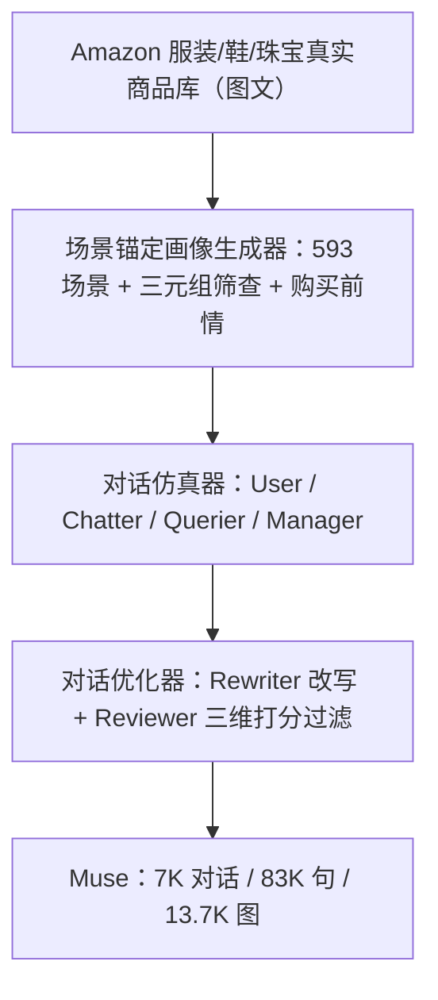
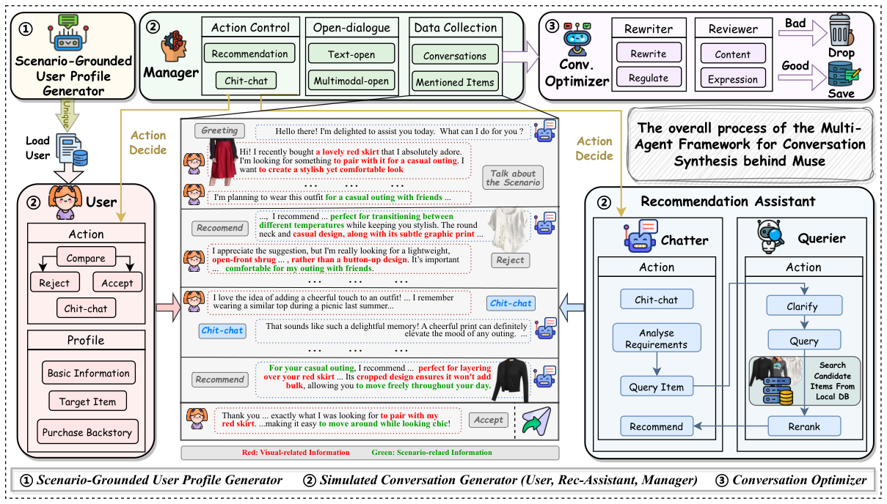

# Muse: A Multimodal Conversational Recommendation Dataset with Scenario-Grounded User Profiles (场景锚定的多模态对话推荐数据集)

- **会议/期刊**: ACL 2025
- **作者与机构**: Zihan Wang, Xiaocui Yang, Yongkang Liu, Shi Feng, Daling Wang, Yifei Zhang（东北大学计算机科学与工程学院）
- **推荐链路定位**: 端到端生成式（对话式推荐数据基座与 MLLM 微调基准）
- **研究方向**: 对话推荐与智能体仿真 / 多模态推荐
- **论文原文**: [https://arxiv.org/abs/2412.18416v2](https://arxiv.org/abs/2412.18416v2)
- **开源代码**: [https://anonymous.4open.science/r/Muse-0086](https://anonymous.4open.science/r/Muse-0086)

## TL;DR (1分钟核心速览)

现有对话推荐（CR）数据集几乎全是纯文本，无法模拟真实购物中"看图选款"的多感官决策；而 Pearl、LLM-Redial 等 LLM 合成方案又因强依赖历史交互数据，用户/物品覆盖被锁死在历史分布内。Muse 提出首个多模态对话推荐数据集：以**真实世界场景**（而非历史行为）为锚点反向生成用户画像与目标商品，再用多智能体框架合成 7,000 段、83,148 句图文对话。在 LLM 与人工双重评测中，Muse 在自然度（1.85）、逻辑性（1.88）、图文一致性（1.91）上全面领先 Redial/Pearl/MMCONV；三种 MLLM 微调后 Recall@10 从 0.15–0.20 提升至 0.25–0.34（Qwen2-VL 相对提升 70%）。

## Background & Motivation (背景与核心矛盾)

- **主流范式**: CR 数据长期依赖众包（Redial、TG-Redial）或 LLM 模拟（Pearl、LLM-Redial），任务形态为"多轮自然语言交互 + 商品推荐"，但模态单一、且用户画像多由人工设计或历史数据反推。
- **前人局限**: ① **模态缺失**——服装、食品等视觉驱动领域的决策高度依赖图像，纯文本无法承载"这件蓝色衬衫配什么项链"式的多模态推理；② **可扩展性受限**——Pearl/LLM-Redial 从历史交互中采样用户与物品，覆盖范围被历史数据封顶，且面临隐私合规与冷启动约束。
- **核心洞察 (Key Insight)**: 真实购买决策由**场景**驱动（"参加艺术工作坊要搭配什么"），而任一商品也总能回溯到适配的场景与人群。因此"场景"可作为用户与物品之间的天然桥梁，绕开历史数据实现双向可扩展。
- **本文切入点**: 用 MLLM 从种子场景自扩展出 593 个真实场景，将用户置于场景中匹配目标商品并生成"购买前情"，从而合成场景锚定的用户画像，再驱动多智能体对话仿真。

## Method (核心方法设计)

### 1. 整体框架 (Overall Architecture)

框架以 `gpt-4o-mini` 为骨干，分三模块闭环：① **场景锚定画像生成器**——自种子场景经 Self-Instruct 扩展并用 BLEU 去重得 593 个基础场景，再为每个（用户, 场景, 商品）三元组做"用户-商品匹配 + 场景-商品匹配"双视角合理性筛查，通过者生成购买前情，构成含基本信息、目标商品、前情的完整画像；② **对话仿真器**——User Simulator 依据画像扮演用户（接受/拒绝/闲聊），Rec-assistant 拆为 Chatter（沟通与卖点陈述）与 Querier（需求澄清→本地库粗检索→LLM 重排），Manager 控制开场白（文本开场/多模态开场）与动作节奏（对话越长闲聊越少）并结构化落盘；③ **对话优化器**——Rewriter 在保持商品属性不变的前提下改写句式与口语化表达，Reviewer 按内容质量、逻辑流畅、用户一致性三维打分过滤。最终产出 7,000 段对话。

<figure class="paper-figure" markdown="span">
  <figcaption>图2：用于在 MUSE 中合成 MCR 数据的多智能体框架。</figcaption>
</figure>

### 2. 关键设计拆解 (Key Designs)

1. **场景锚定用户画像（Scenario-Grounded Profile）**：痛点是从历史数据采样导致覆盖封闭。本文改为"场景→需求→商品"的正向生成：先由 LLM 扩展场景集 $\mathcal{S}$，再对候选三元组$(u, s, i)$施加双视角合理性判别$\mathbb{I}[\text{Match}(u,i)\wedge\text{Match}(s,i)]=1$才保留，最后生成购买前情$b$使画像$p_u=(u_{\text{basic}}, i^{*}, b)$ 自带动机解释。直觉上，场景空间近乎无限，故用户与物品覆盖随之解耦于历史分布，天然缓解冷启动与隐私约束。
2. **双角色解耦的 Rec-assistant（Chatter + Querier）**：单一智能体难以同时兼顾"聊得好"与"推得准"。本文拆分为 Chatter（负责推荐话术与闲聊共情）与 Querier（负责把模糊需求澄清为属性描述，如"速干衣"→"聚酯/莫代尔材质"，再粗检索 + LLM 重排）。这种分工让推荐质量与对话质量分别可优化，也解释了后续实验中"推荐轮"与"普通轮"需采用双模式微调协议。
3. **训练目标、负采样与推理效率**：本文为数据集工作，无自建训练损失；下游采用 LoRA 微调，推荐轮以真实 query 为金标准做生成式召回（无显式负采样，靠全库检索计算 Recall@n / MRR@n），响应轮以 BLEU-4/ROUGE 监督。合成侧成本瓶颈在图像 API 调用，故规模（7K）小于纯文本的 Pearl（57.2K）。

## Experimental Setup & Evaluation Protocol (实验设置与评估协议)

- **数据集与预处理**: 基于 Amazon Clothing, Shoes & Jewelry 真实商品构建本地图文库，每商品含主图 + 文本描述；场景经 Self-Instruct 扩展后 BLEU 去重；画像与前情亦做 BLEU 去重保证唯一性。

| 数据集 | #Users | #Items | #Interactions(Utter.) | Distinct-4 | 特征/场景说明 |
| :--- | :---: | :---: | :---: | :---: | :--- |
| MMCONV | — | — | 39.7K | 0.38 | 图文，旅行对话搜索 |
| Redial | 1.0K | 51.7K | 182K | 0.48 | 纯文本，电影 |
| INSPIRED | 1.0K | 1.7K | 35K | 0.76 | 纯文本，电影 |
| Pearl | 4.7K | 9.4K | 482K | 0.18 | 纯文本，LLM 合成 |
| **Muse** | **7.0K** | **13.7K** | **83K** | **0.54** | **图文，服装/鞋/珠宝，13.7K 图** |

- **数据划分与防穿越 (Splitting Strategy)**: 未采用 Leave-One-Out；下游微调取 200 段对话作训练集（沿用 LLM-Redial 设置），评测在其余对话上进行，属**小样本比例划分**。
- **排名评测协议 (Ranking Protocol)**: 生成式召回——模型依多模态上下文生成 query，在本地商品库中检索，报告 `Recall@10/20` 与 `MRR@10/20`；未声明采样负例比，实质为**全库检索式评估**。
- **对比基线与超参设置**: 对话质量对比 MMCONV/Redial/INSPIRED/Pearl（LLM 打分 0–2，每集随机 200 段）；下游模型为 LlaVA-Next-Llama3-8B、Yi-VL-6B、Qwen2-VL-7B，LoRA 微调，zero-shot 与 fine-tune 双设置对照。

## Key Experimental Results (实验关键数据)

### 1. 主实验对比 (Main Results)

对话级质量（LLM 打分，0–2）：

| 指标 | MMCONV | Redial | INSPIRED | Pearl | **Muse** |
| :--- | :---: | :---: | :---: | :---: | :---: |
| Natural | 1.41 | 1.57 | 1.71 | 1.66 | **1.85** |
| Logical | 1.41 | 1.60 | 1.62 | 1.78 | **1.88** |
| Informative | 1.37 | 1.53 | 1.51 | 1.67 | **1.80** |
| P-C Correlation | 1.68 | 1.92 | 1.83 | 1.50 | **1.98** |
| I-T Correspondence | 1.35 | — | — | — | **1.91** |

推荐任务（生成式召回）：

| 模型 | 设置 | Recall@10 | Recall@20 | MRR@10 | MRR@20 |
| :--- | :--- | :---: | :---: | :---: | :---: |
| LlaVA-Next-Llama3-8B | Zero-Shot | 0.16 | 0.25 | 0.07 | 0.09 |
| LlaVA-Next-Llama3-8B | Finetune | 0.25 | 0.37 | 0.13 | 0.16 |
| Yi-VL-6B | Zero-Shot | 0.15 | 0.23 | 0.07 | 0.08 |
| Yi-VL-6B | Finetune | 0.25 | 0.35 | 0.12 | 0.14 |
| Qwen2-VL-7B | Zero-Shot | 0.20 | 0.33 | 0.12 | 0.13 |
| **Qwen2-VL-7B** | **Finetune** | **0.34** | **0.45** | **0.22** | **0.24** |

响应生成（Qwen2-VL-7B）：BLEU-4 由 41.1 → **46.8**，ROUGE-L 由 23.5 → **31.5**；人工匿名 1:1 对比中微调回复胜率 **0.88** vs. zero-shot 0.12。

### 2. 消融实验 (Ablation Study)

原文未做组件级消融，但提供了等价的功能性对照（移除 Rewriter 的 Pearl 与完整 Muse 对比、zero-shot vs. fine-tune 对照）：

| 对照设置 | Natural | Logical | Distinct-4 | Recall@10 |
| :--- | :---: | :---: | :---: | :---: |
| w/o Rewriter（Pearl 式固定句式） | 1.66 | 1.78 | 0.18 | — |
| w/o 场景锚定（历史数据采样） | — | — | — | 覆盖受限于历史 |
| w/o 微调（zero-shot Qwen2-VL） | — | — | — | 0.20 |
| **完整 Muse + Finetune** | **1.85** | **1.88** | **0.54** | **0.34** |

### 3. 关键实验发现 (Key Findings)

1. **Rewriter 是多样性的关键开关**：Pearl 虽信息量高（Informative 1.67），但 Distinct-4 仅 0.18，句式僵化严重；Muse 经改写后 Distinct-4 达 0.54，同时 Natural 反超 0.19，说明"低温保稳定 + 后置改写"的两段式策略能同时兼顾逻辑与表达多样性。
2. **推荐能力必须靠微调激活**：三种 MLLM 的 zero-shot Recall@10 仅 0.15–0.20，LoRA 微调后统一跃升至 0.25–0.34（Qwen2-VL 相对提升 70%），且三模型微调后的相对排序与 MMBench 排名一致，侧面验证了数据内部推荐逻辑的自洽性与判别力。
3. **多模态一致性是 Muse 的差异化优势**：I-T Correspondence 达 1.91，显著高于 MMCONV 的 1.35；元素分布分析显示视觉与场景相关元素在双方话语中均占相当比例，证明图文交互不是装饰而是贯穿对话主线。

## Highlights & Limitations (亮点、对比与审稿批判)

- **与代表作对比 (vs. Prior Work)**: 相比 Redial/TG-Redial 的众包纯文本，Muse 引入图文双模态；相比 Pearl/LLM-Redial 依赖历史交互采样，Muse 以场景为锚实现用户/物品覆盖与历史分布解耦；相比 MMCONV 等任务型多模态对话，Muse 面向开放式推荐且带可解释推荐理由。
- **可迁移亮点**: ① "场景→需求→商品"的反向画像生成范式可迁移至食品、家居等视觉驱动品类的数据冷启动；② Chatter/Querier 解耦 + 双模式微调协议，可直接复用于任意 MLLM 的对话推荐指令微调。
- **审稿级局限批判**: ① 规模受图像 API 成本制约，仅 7K 对话，远小于纯文本合成集（Pearl 57.2K），统计功效与长尾覆盖存疑；② 数据质量强依赖 `gpt-4o-mini`，存在模型固有偏见与幻觉传导风险，且缺乏与真实人类对话分布的定量分布对齐检验（仅有胜率式主观评测）。

## Rating (四维评分)

- **方法创新性 (Novelty)**: ⭐⭐⭐⭐ （首个多模态 CR 数据集，场景锚定画像生成绕开历史数据依赖，思路新颖但技术组件多为已有 agent 编排）
- **评估协议与实验扎实度 (Protocol & Experiments)**: ⭐⭐⭐ （LLM + 人工双层评测较完整，但缺组件级消融、无采样负例说明、微调仅 200 段偏小）
- **写作与数学规范度 (Clarity & Rigor)**: ⭐⭐⭐⭐ （框架图与流程描述清晰，三模块职责边界明确；但全文几乎无公式化建模，理论刻画偏弱）
- **工业落地与复现价值 (Industrial & Practical Value)**: ⭐⭐⭐⭐ （代码匿名开源、框架可扩展至新品类，但图像 API 成本与 MLLM 依赖限制大规模工业复制）

