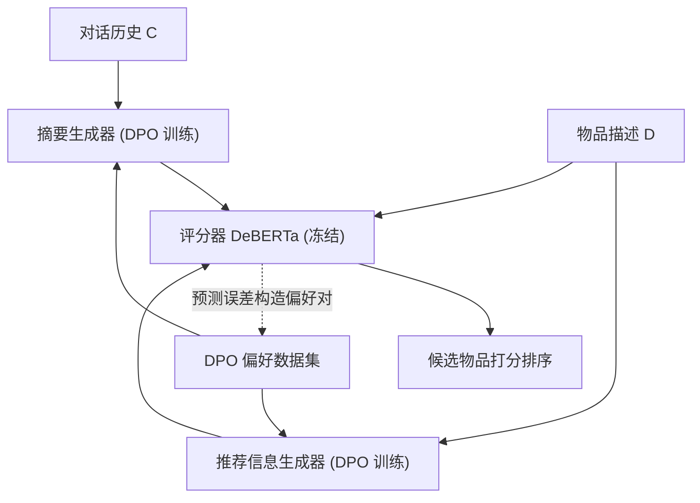
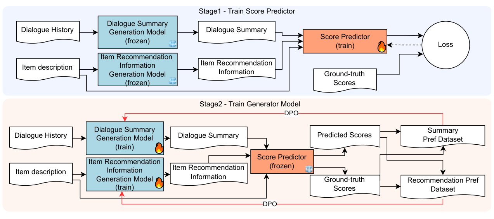

# Refining Text Generation for Realistic Conversational Recommendation via Direct Preference Optimization (基于直接偏好优化精炼文本生成以实现真实对话推荐)

- **会议/期刊**: EMNLP 2025 Main Conference
- **作者与机构**: Manato Tajiri, Michimasa Inaba (The University of Electro-Communications, 日本电气通信大学)
- **推荐链路定位**: 精排（候选物品打分排序）
- **研究方向**: 对话推荐与智能体仿真 / 大语言模型推荐
- **论文原文**: [https://arxiv.org/abs/2508.19918v3](https://arxiv.org/abs/2508.19918v3)
- **开源代码**: [https://github.com/UEC-InabaLab/Refining-LLM-Text](https://github.com/UEC-InabaLab/Refining-LLM-Text)

## TL;DR (1分钟核心速览)

现有对话推荐系统（CRS）普遍在极短会话中"秒推"物品，与真人导购先充分挖掘偏好再推荐的流程严重脱节；SumRec 虽用 LLM 生成对话摘要与物品推荐信息来桥接，但仅靠 Prompt 工程产出的文本常缺失打分所需的关键信息。本文用 DPO 以"评分器预测误差"为偏好信号，分别微调摘要生成器与推荐信息生成器，使生成文本"恰好包含打分所需信息"。在 Tabidachi 与 ChatRec 两个日文数据集上，HR@1 分别达 0.2474（较 SumRec +21.3%）与 0.8591（+4.1%），MRR 全面最优。

## Background & Motivation (背景与核心矛盾)

- **主流范式**: 以 REDIAL 为代表的 CRS 数据集与模型（KBRD、CR-Walker、LLM-REDIAL 等）均在十余轮短对话内快速推荐，模型直接以即时用户反馈驱动下一轮推荐。
- **前人局限**: ① 真实导购对话（如 Tabidachi，平均 175 句）冗长且偏好隐晦，短会话范式无法迁移；② SumRec 虽引入 LLM 生成摘要与推荐信息，但纯 Prompt 无法让 LLM "选择性"保留对打分真正关键的信息，常输出抽象、泛化的文本，导致评分器误判（如漏掉"东京巨蛋人流密集"这一关键事实）。
- **核心洞察 (Key Insight)**: 生成文本的"好坏"不应由 n-gram 相似度或人工可读性定义，而应由**下游评分器能否据此准确打分**来定义——这天然构成一个可自动构造偏好对的优化目标。
- **本文切入点**: 把评分器的预测误差当作奖励信号，用 DPO 直接优化两个生成器，让"更接近真值的文本"成为 winner、"偏离真值的文本"成为 loser。

## Method (核心方法设计)

### 1. 整体框架 (Overall Architecture)

模型沿用 SumRec 的三件套：对话摘要生成器（LLM，长对话先按 30 句分块生成局部摘要再汇总）、物品推荐信息生成器（LLM，从物品描述生成"适合什么样的用户"的说明）、评分器（DeBERTa-v3-japanese-large，将摘要 $s$、推荐信息$r$、物品描述$d$以 `[SEP]` 拼接后回归打分）。本文的增量在于**两阶段训练**：阶段 1 冻结两个生成器、用真实标签训练评分器；阶段 2 冻结评分器，用其打分自动构造偏好对，分别对两个生成器做 DPO。推理时对每个候选物品计算$\hat{y}=\text{DeBERTa}(s,r,d)$ 并排序。

<figure class="paper-figure" markdown="span">
  <figcaption>图3：所提方法在训练过程中的流程。该方法采用两阶段训练过程。阶段1训练评分预测器。阶段2使用DPO训练对话摘要生成模型和物品推荐信息生成模型。</figcaption>
</figure>

### 2. 关键设计拆解 (Key Designs)

1. **基于评分误差的摘要偏好构造**：对同一对话历史采样 $K$个摘要$\{s_k^n\}$，固定推荐信息与物品描述，取与真值$y_m^n$ 误差最小者为 winner、最大者为 loser：
$s_m^{n,+}=\arg\min_{s_k^n}|y_m^n-\hat{y}_{k,m}^n|,\quad s_m^{n,-}=\arg\max_{s_k^n}|y_m^n-\hat{y}_{k,m}^n|$
直觉：DPO 无需人工标注偏好，评分器即"隐式奖励模型"，把优化目标直接对齐到推荐精度而非文本流畅度。

2. **推荐信息生成器的 DPO（仅用正样本物品）**：对真值 $y=1$的物品描述采样$J$条推荐信息，同样按误差选正负对；刻意**不使用$y=0$ 的物品**构造偏好，避免模型把"缺失推荐信息的句子"学成好输出。损失为标准的 DPO 形式：
$\mathcal{L}_{\text{DPO}}=-\mathbb{E}\left[\log\sigma\left(\beta\log\frac{\pi_\phi(s^+|PS)}{\pi_{\phi_{\text{ref}}}(s^+|PS)}-\beta\log\frac{\pi_\phi(s^-|PS)}{\pi_{\phi_{\text{ref}}}(s^-|PS)}\right)\right]$其中$\pi_{\phi_{\text{ref}}}$为训练前快照，$\beta$ 为温度（Tabidachi 上摘要/推荐信息分别取 0.1768 / 0.0611）。

3. **训练目标与开销**：两阶段解耦使评分器与生成器互不干扰；DPO 为离线偏好学习，无需在线 RL 采样。推理时仅需一次 LLM 生成 + 一次 DeBERTa 前向，但需对**每个候选物品**生成推荐信息，候选集大时是主要延迟瓶颈（作者亦在局限中承认 8B 模型的显存与延迟代价）。

## Experimental Setup & Evaluation Protocol (实验设置与评估协议)

- **数据集与预处理**: 两个日文数据集，均按对话级划分训练/验证/测试：

| 数据集 | #Dialogues (Train/Val/Test) | #Utterances | 场景说明 |
| :--- | :---: | :---: | :--- |
| Tabidachi Corpus | 165 (126/15/24) | 42,663 | 真实旅行社电话式长对话，仅用无屏幕共享子集，候选为 3,290 个日本景点 |
| ChatRec (T/E/N/ALL) | 1,005 (803/53/149) | 21,982 | 众包"候诊室陌生人"闲聊，含 Travel / Except-Travel / No-Restriction 三主题 |

- **数据划分与防穿越 (Splitting Strategy)**: 对话级比例划分（约 76%/9%/15%），测试集对话完全未参与训练。
- **排名评测协议 (Ranking Protocol)**: 候选集为当轮全部候选物品（Tabidachi 为 3,290 景点全库），报告 HR@{1,3,5} 与 MRR@{1,3,5}，属全候选排序；ChatRec 中人工兴趣分 ≤2 记为 0、≥3 记为 1。
- **对比基线与超参设置**: 仅两个基线——Baseline（仅摘要 + 描述，无推荐信息）与 SumRec（摘要 + 推荐信息，均不微调）。生成器为 Llama-3.1-Swallow-8B-v0.1，评分器 DeBERTa-v3-japanese-large (352M)；超参经 Optuna 在验证集上搜索，每个配置训练 5 次取均值；4×A100 80GB，单轮 DPO 约 24 小时。

## Key Experimental Results (实验关键数据)

### 1. 主实验对比 (Main Results)

| 数据集 | 方法 | HR@1 | HR@3 | HR@5 | MRR@1 | MRR@3 | MRR@5 |
| :--- | :--- | :---: | :---: | :---: | :---: | :---: | :---: |
| Tabidachi | Baseline | 0.2439 | 0.5056 | 0.7146 | 0.2439 | 0.3587 | 0.4057 |
| Tabidachi | SumRec | 0.2040 | 0.5376 | **0.7574** | 0.2040 | 0.3527 | 0.4032 |
| Tabidachi | **Ours** | **0.2474** | **0.5525** | 0.7231 | **0.2474** | **0.3796** | **0.4181** |
| ChatRec | Baseline | 0.8423 | 0.9799 | 0.9933 | 0.8423 | 0.9049 | 0.9081 |
| ChatRec | SumRec | 0.8255 | 0.9698 | **1.000** | 0.8255 | 0.8915 | 0.8984 |
| ChatRec | **Ours** | **0.8591** | **0.9832** | 0.9933 | **0.8591** | **0.9172** | **0.9196** |

相对 SumRec：Tabidachi 上 HR@1 +21.3%、MRR@3 +7.6%；ChatRec 上 HR@1 +4.1%、MRR@5 +2.4%。

### 2. 消融实验 (Ablation Study)

| 方法 (Tabidachi) | HR@1 | HR@3 | HR@5 | MRR@5 |
| :--- | :---: | :---: | :---: | :---: |
| Ours (双 DPO) | **0.2474** | 0.5525 | 0.7231 | 0.4181 |
| w/o Rec-DPO (仅摘要 DPO) | 0.2393 | **0.5560** | **0.7402** | **0.4195** |
| w/o Sum-DPO (仅推荐信息 DPO) | 0.2341 | 0.5176 | 0.7363 | 0.4051 |

### 3. 关键实验发现 (Key Findings)

1. **摘要 DPO 是性能主引擎**：仅摘要 DPO（w/o Rec-DPO）即把 HR@1 从 SumRec 的 0.2040 拉回 0.2393，而仅推荐信息 DPO 只有 0.2341 且 HR@3 跌至 0.5176，说明"用户偏好表征"比"物品侧说明"更决定排序上限。
2. **双 DPO 存在边际递减**：双 DPO 的 HR@1 最高（0.2474），但 HR@5 反被单摘要 DPO 反超（0.7231 vs 0.7402），提示两路优化在长尾候选上可能引入轻微过拟合，收益集中在头部位置。
3. **文本变长、多样性下降但更"有用"**：DPO 后摘要平均长度 118.6→151.2、推荐信息 149.7→247.2，Distinct-1 从 0.251 降至 0.187；推荐信息对原描述的 BLEU 从 3.608 跌至 1.455——即模型主动放弃字面复述，转向补充"适合谁"的解释性内容；人工评测中摘要的 Usefulness 胜率 51.5%，但推荐信息四项指标全面落后于 SumRec（Usefulness 仅 36.1% 胜），作者以"推荐信息仅供内部打分、不直接展示给用户"作为辩护。

## Highlights & Limitations (亮点、对比与审稿批判)

- **与代表作对比 (vs. Prior Work)**: 相比 SumRec（纯 Prompt、无微调），本文把"生成质量"重新定义为"下游打分可用性"并用 DPO 闭环优化；相比 LLM-REDIAL / LLM-Rec 等依赖历史行为或外部评论检索的方案，本文仅用当前对话历史 + 物品描述即可工作，更贴合冷启动场景；相比 UCEpic 的词表约束生成，本文不施加硬约束而是用偏好学习软性引导。
- **可迁移亮点**: ① "冻结下游判别器、以其预测误差构造偏好对"的范式可迁移到任何"生成文本 → 判别模型"的级联推荐管线（如解释生成、query 改写）；② 长对话分块摘要 + 汇总的两级策略对长会话场景直接可用。
- **审稿级局限批判**: ① 基线仅 2 个且未与任何 DPO/RLHF 微调的 CRS 或强 LLM 零样本推荐器对比，SOTA 说服力偏弱；② 仅在两个日文旅游域数据集验证，跨语言跨域泛化未知；③ 推荐信息生成存在幻觉（案例中出现描述里没有的"店内装潢时尚"），且需对每个候选物品生成文本，候选规模大时推理成本不可忽视。

## Rating (四维评分)

- **方法创新性 (Novelty)**: ⭐⭐⭐⭐ （用评分器误差自动构造 DPO 偏好对，思路简洁且自洽，但本质是 SumRec + 现成 DPO 的组合式创新）
- **评估协议与实验扎实度 (Protocol & Experiments)**: ⭐⭐⭐ （全候选排序协议规范、5 次重复取均值，但基线仅 2 个、缺显著性检验与跨域验证）
- **写作与数学规范度 (Clarity & Rigor)**: ⭐⭐⭐⭐ （两阶段流程与 DPO 公式定义清晰，偏好对构造的动机交代充分，符号略冗但可读）
- **工业落地与复现价值 (Industrial & Practical Value)**: ⭐⭐⭐⭐ （代码与数据许可齐全、超参完整公开，但 8B 生成器 + 逐候选生成带来较高线上延迟）

