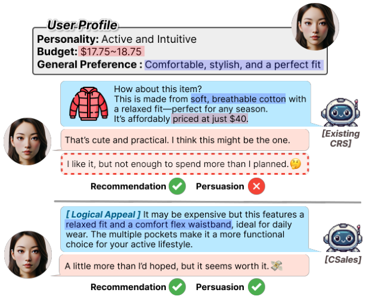
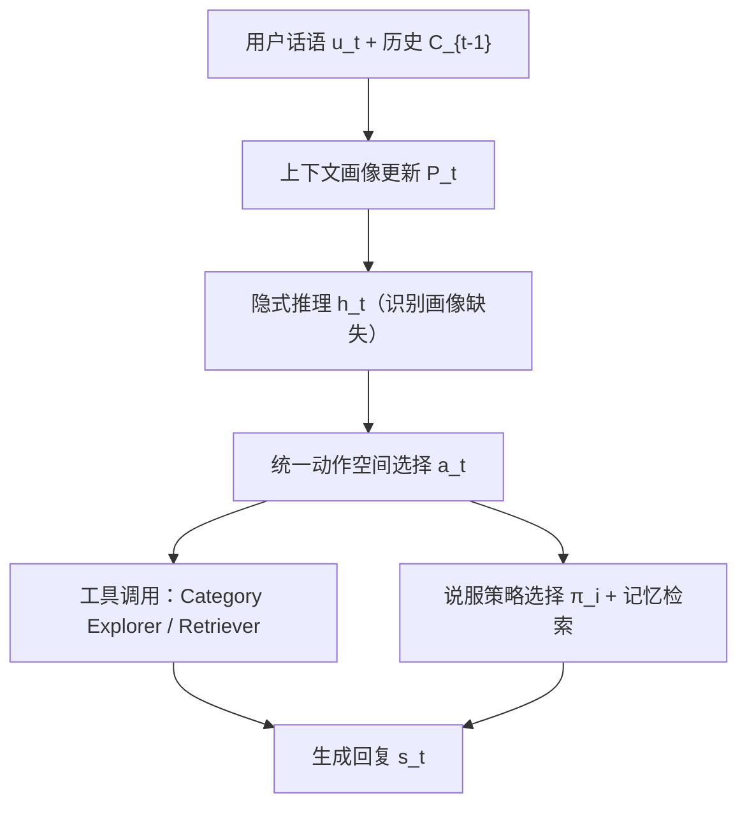
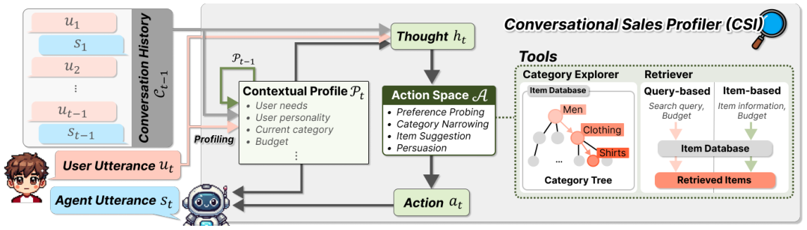

# Towards Personalized Conversational Sales Agents: Contextual User Profiling for Strategic Action (面向个性化对话销售智能体：基于上下文用户画像的策略性动作选择)

- **会议/期刊**: ACL 2025
- **作者与机构**: Tongyoung Kim, Jeongeun Lee, Soojin Yoon, Sunghwan Kim, Dongha Lee (Yonsei University)
- **推荐链路定位**: 端到端生成式（多轮对话交互）
- **研究方向**: 对话推荐与智能体仿真 / 大语言模型推荐
- **论文原文**: [https://arxiv.org/abs/2504.08754v5](https://arxiv.org/abs/2504.08754v5)
- **开源代码**: 暂未开源

## TL;DR (1分钟核心速览)

传统 CRS 只做"偏好诱导 + 物品推荐"，无法覆盖真实电商中"说服用户下单"这一关键环节。本文提出 **CSALES** 对话销售任务，将偏好诱导、推荐、说服统一到单一对话框架；配套 **CSUSER** 用户模拟器，从 Amazon Reviews 2023 真实行为数据构建细粒度画像（人格、决策风格、预算、购买动机）；并提出 **CSI** 智能体，通过持续更新的上下文画像驱动统一动作空间（探询/类目收窄/推荐/说服）。在 Clothing 与 Electronics 两域上，CSI 的 SR 达 0.478/0.503、SWR 达 0.849/0.791，较最强基线 PC-CRS 的 SR 提升约 20pt，且与真人判断一致率超 90%。

## Background & Motivation (背景与核心矛盾)

- **主流范式**: LLM-based CRS 以多轮对话诱导偏好并检索物品，代表工作如 ChatCRS、MACRS、PC-CRS，动作空间通常只覆盖"提问 + 推荐"或单独"说服"。
- **前人局限**: (1) 仅匹配偏好不足以促成购买——用户决策受长期偏好、即时意图、预算约束、购买动机多重因素影响；(2) 现有用户模拟器（iEvaLM、PEPPER、CONCEPT）依赖合成 persona 或固定目标物品属性，缺乏真实行为根基，无法刻画决策多样性。
- **核心洞察 (Key Insight)**: 图 1 的示例表明，同一推荐在"仅成功推荐"下用户不买，而加入个性化说服性解释后用户接受——**说服是独立于推荐精度的第二增长维度**，且高度依赖对用户画像的细粒度推断。
- **本文切入点**: 用真实评论数据构建画像驱动的用户模拟器做可扩展评估，并让智能体在对话中**动态推断画像**、据此在统一动作空间中选择"继续探询还是转入说服"。

<figure class="paper-figure" markdown="span">
  <figcaption>图1：一个说明为何需要 CSALES 的示例。仅成功推荐并不能促成购买，但加入个性化说服性解释后，用户接受了推荐。</figcaption>
</figure>

## Method (核心方法设计)

### 1. 整体框架 (Overall Architecture)

CSI 在每一轮 $t$维护一个结构化上下文画像$P_t$：先根据最新用户话语$u_t$与历史$C_{t-1}$选择性更新画像（保留相关、丢弃冗余），再生成隐式推理$h_t$识别画像缺失项，据此从统一动作空间$\mathcal{A}$中选择动作$a_t$（语言类：偏好探询/类目收窄/推荐/说服；工具类：Category Explorer 与 Retriever），最后条件生成回复$s_t$。说服环节额外从策略集$\pi$（Framing/Logical/Emotional/Evidence/Social Proof）中选择策略，并可检索记忆模块中相似画像的成功说服案例作为支撑。

<figure class="paper-figure" markdown="span">
  <figcaption>图3：我们的 CSI 智能体概览。在每一轮 t，它根据用户话语 ut 更新上一轮画像 Pt−1，然后通过由上下文画像 Pt 和对话历史 Ct−1 ⊕ut 生成的推理（即思考 ht）选择下一动作。为完成每个动作，它利用外部工具 category explorer 和 retriever，从而与物品数据库通信。</figcaption>
</figure>

### 2. 关键设计拆解 (Key Designs)

1. **上下文画像的滚动更新与推理（Contextual Profiling）**：痛点在于传统 CRS 只用对话历史做检索查询，无法区分"已知什么、还缺什么"。CSI 将画像更新与推理拆为两步：$P_t \sim P_{LLM}(P_{t-1}, C_{t-1}, u_t)$选择性保留相关信息，$h_t \sim P_{LLM}(P_t, C_{t-1}, u_t)$ 作为内部反思定位缺失画像分量。直觉是"先维护状态、再诊断缺口"，使动作选择有明确的信息论依据，而非盲目提问。

2. **统一动作空间与对比式说服（Unified Action Space + Comparative Persuasion）**：前人将探询、推荐、说服割裂为独立任务，无法在单轮内权衡"继续问 vs. 直接推 vs. 转说服"。CSI 定义 $\mathcal{A}$同时容纳四类动作，并引入**对比式说服**——以用户已选的低价物品为参照，突出候选高价物品的相对优势，配合策略$\pi_i$ 按画像个性化选择。物理直觉：说服的本质是"相对优势论证"，参照物使论证可验证、可落地。

3. **训练目标、负采样与推理效率**：本文为免训练的 LLM Agent 范式，无显式损失函数；核心"训练信号"来自记忆模块 $\mathcal{M}$——仅当用户接受超预算推荐（SWR=1）时，将画像嵌入作为 key、交互作为 value 存入，说服时按$I = \arg\min_{i \in \mathcal{M}, |I|=k} \|e_p - e_i\|_2^2$检索 top-$k$ 相似画像的成功案例。推理开销主要来自每轮 2 次 LLM 调用（画像更新 + 动作规划）加工具检索，记忆用 Faiss 加速。

## Experimental Setup & Evaluation Protocol (实验设置与评估协议)

- **数据集与预处理**: Amazon Reviews 2023，采用 `10-core` 过滤，剔除缺失 title/description/category/price 的物品；按时间排序，最近同类别物品为目标，其余为历史。

| 数据集 | #Users | #Items | #Interactions | 特征/场景说明 |
| :--- | :---: | :---: | :---: | :--- |
| Clothing | 2,195 | 4,328 | 29,426 | 592 类目，服饰鞋饰 |
| Electronics | 7,568 | 11,893 | 108,518 | 720 类目，电子产品 |

- **数据划分与防穿越**: 按用户时间序切分历史/目标物品（时序防穿越）；每种人格类型随机采样 150 用户，覆盖对话开放度（Active/Neutral/Passive）与决策风格（Rational/Dependent/Intuitive）。
- **排名评测协议**: 非传统 Full-Ranking，而是**对话级接受判定**——SR 衡量推荐物品被接受比例，SWR 衡量接受物品中超出预算的比例：$\text{SWR} = \frac{\sum_{n=1}^{N} \mathbb{I}(a_n \in \mathcal{I}^{out}_n)}{\sum_{n=1}^{N} \mathbb{I}(a_n \in \mathcal{I}^{in}_n \cup \mathcal{I}^{out}_n)}$。
- **对比基线与超参**: ChatCRS（检索-推荐）、MACRS（反思式动作选择）、PC-CRS（纯说服）、CSI w/o Profile（ReAct 无画像消融）；主实验用 gpt-3.5-turbo，补充 gpt-4o-mini 与 R1-Distill-Qwen 验证鲁棒性。

## Key Experimental Results (实验关键数据)

### 1. 主实验对比 (Main Results)

| 方法 | Clothing SR | Clothing SWR | Electronics SR | Electronics SWR |
| :--- | :---: | :---: | :---: | :---: |
| ChatCRS | 0.286 | 0.154 | 0.152 | 0.136 |
| MACRS | 0.334 | 0.364 | 0.249 | 0.170 |
| PC-CRS | 0.280 | 0.719 | 0.168 | 0.737 |
| CSI w/o Profile | 0.347 | 0.627 | 0.501 | 0.500 |
| **CSI (Ours)** | **0.478** | **0.849** | **0.503** | **0.791** |
| Improv. (vs 最强基线) | +43.1% | +18.1% | +0.4% | +7.3% |

> 注：Electronics 上 CSI w/o Profile 的 SR 已接近 CSI，但 SWR 差距显著（0.500 vs 0.791），说明画像对**说服**的增益远大于对**推荐**的增益。

### 2. 消融实验 (Ablation Study)

| 配置 | 关键结论 |
| :--- | :--- |
| CSI w/o Profile | Clothing SR 0.347→0.478、SWR 0.627→0.849；Electronics SWR 0.500→0.791 |
| w/o General Pref. | 接受物品与目标物品相似度胜率 62.5% vs. CSI 87.5% |
| w/o General Pref. & Personality | 68.8% vs. 87.5% |
| w/o Target Needs & Personality | 75.0% vs. 87.5% |
| w/o General Pref. & Reason to Purchase | 62.5% vs. 87.5%（降幅最大） |

### 3. 关键实验发现 (Key Findings)

1. **画像对说服的边际收益远高于推荐**：Electronics 上 CSI w/o Profile 的 SR 已达 0.501，但 SWR 仅 0.500，加入画像后 SWR 跃升至 0.791（+58%），说明"推荐准"与"说服成"是两个解耦能力，画像主要作用于后者。
2. **纯说服基线 PC-CRS 的 SR 崩塌**：PC-CRS 在 Clothing 上 SWR 高达 0.719 但 SR 仅 0.280，低于 ChatCRS 的 0.286，证明脱离偏好诱导的强行说服会损害推荐接受率，统一动作空间的"先探询后说服"调度是必要的。
3. **画像分量中"购买动机 + 通用偏好"最关键**：同时移除二者时相似度胜率降至 62.5%（全画像 87.5%），而单独移除 Target Needs 影响较小，说明长期偏好与动机比短期属性需求更能决定说服成败；此外 CSUSER 与真人判断一致率在 SR/SWR 上均超 90%（93.0%/96.4%），验证模拟器可信度。

## Highlights & Limitations (亮点、对比与审稿批判)

- **与代表作对比 (vs. Prior Work)**: 相比 ChatCRS（无动作建模、无说服）与 MACRS（有反思但无画像），CSI 的核心差异是**画像驱动的动作调度**；相比 PC-CRS（纯说服、无探询），CSI 通过统一动作空间避免了"说服伤推荐"的跷跷板效应。与 PEPPER/CONCEPT 等模拟器相比，CSUSER 的画像来自真实评论而非合成 persona。
- **可迁移亮点**: (1) "画像更新 + 缺口推理"两步式状态维护可迁移到任意多轮 Agent 任务；(2) 以"超预算接受率 SWR"作为说服力代理指标，为对话推荐提供了推荐精度之外的第二评估轴。
- **审稿级局限批判**: (1) 主实验依赖 gpt-3.5-turbo 闭源模型，虽补充了 gpt-4o-mini/R1-Distill-Qwen，但每轮 2 次 LLM 调用 + 工具检索的推理成本在真实电商高并发场景下难以承受；(2) 画像由 GPT-4 从评论推断，存在平台与人口统计偏差，且 SWR 作为"说服成功"代理可能奖励过度推销（over-persuasion），缺乏对用户长期满意度的约束。

## Rating (四维评分)

- **方法创新性 (Novelty)**: ⭐⭐⭐⭐ （任务定义 CSALES 与画像驱动统一动作空间有实质增量，但 Agent 架构本身是 ReAct 式组合，理论新颖度中等）
- **评估协议与实验扎实度 (Protocol & Experiments)**: ⭐⭐⭐⭐ （双域 + 人格分桶 + 真人一致率验证较完整，但缺传统排名指标与线上验证）
- **写作与数学规范度 (Clarity & Rigor)**: ⭐⭐⭐⭐ （任务与指标定义清晰，SWR 公式简洁；但方法部分公式较少，偏工程描述）
- **工业落地与复现价值 (Industrial & Practical Value)**: ⭐⭐⭐ （思路可直接用于电商导购 Agent，但闭源 LLM 依赖、无开源代码、推理成本高制约落地）

