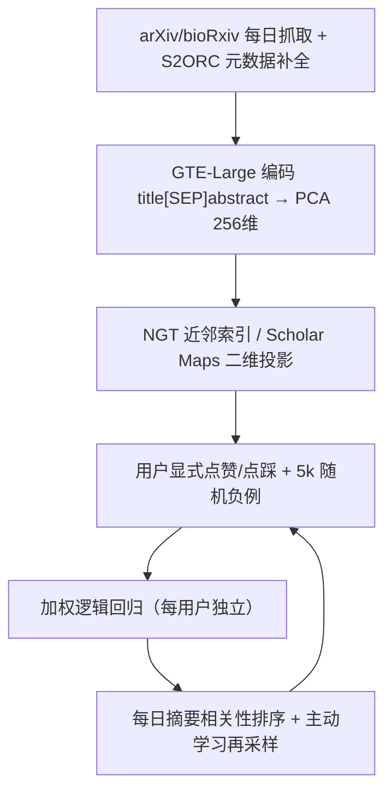

# Scholar Inbox: Personalized Paper Recommendations for Scientists (面向科研人员的个性化论文推荐系统)

- **会议/期刊**: ACL/EMNLP 2025 (System Demonstration)
- **作者与机构**: Markus Flicke, Glenn Angrabeit, Madhav Iyengar, ..., Andreas Geiger (University of Tübingen, Tübingen AI Center)
- **推荐链路定位**: 召回（内容基语义召回 + 每日摘要排序）
- **研究方向**: 冷启动与长尾推荐 / 大语言模型推荐（LLM 辅助主题标注）
- **论文原文**: [https://arxiv.org/abs/2504.08385v2](https://arxiv.org/abs/2504.08385v2)
- **开源代码**: 暂未开源（数据集已公开：github.com/avg-dev/scholar_inbox_datasets）

## TL;DR (1分钟核心速览)

针对科研文献爆炸式增长下"社交媒体推荐被马太效应绑架、主题粒度粗导致兴趣刻画失真"两大痛点，Scholar Inbox 构建了一个开放获取的论文推荐平台：以 GTE-Large 稠密语义嵌入 + 每用户独立训练的加权逻辑回归实现内容基个性化排序，并用 Scholar Maps 二维科学地图与分层采样主动学习破解新用户冷启动。在自建的 80 万显式评分数据集上，GTE-Large 在含硬负例的二分类上取得 AUC 86.75、Balanced Acc 78.31，显著优于 TF-IDF 与 SPECTER2；1,233 人用户研究显示满意度高度正面，23k 注册用户中 35% 月活。

## Background & Motivation (背景与核心矛盾)

- **主流范式**: 学术推荐长期以内容基过滤（TF-IDF 稀疏向量 + 逻辑回归/相似度）为主，辅以协同过滤与双塔/图混合模型；工业平台多依赖关键词检索或社交信号。
- **前人局限**: 其一，X/ResearchGate/LinkedIn 类平台通过作者与机构信号隐式引入马太效应，热门实验室论文被过度曝光；其二，现有推荐多基于粗粒度主题标签，无法刻画研究者多面化、快速演化的兴趣，导致推荐精度次优。
- **核心洞察 (Key Insight)**: 论文的标题+摘要经对比学习编码后的稠密语义向量，比稀疏词袋更能区分"正例 vs 硬负例"；而冷启动的本质是决策边界未知，可用"边界附近分层采样 + 逐条即时重训"快速逼近。
- **本文切入点**: 用显式点赞/点踩替代隐式反馈，把推荐问题转化为每用户一个可在线微调的二分类器，并以可视化科学地图降低新用户标注成本。

## Method (核心方法设计)

### 1. 整体框架 (Overall Architecture)

系统从 arXiv/bioRxiv/chemRxiv/medRxiv 与会议 proceedings 每日抓取论文，经 S2ORC 补全元数据后，将 `title [SEP] abstract` 送入 GTE-Large 编码为 1024 维向量（PCA 压至 256 维），存入 NGT 近邻索引供语义检索与 Scholar Maps 使用。推荐侧为每个用户维护一个加权逻辑回归分类器，输入即论文嵌入，输出线性缩放至 $[-100,100]$ 作为相关性分数用于每日摘要排序。冷启动阶段用户通过作者搜索或二维科学地图选定兴趣论文，系统随即以分层采样主动请求评分，每提交一次评分即触发增量重训。

### 2. 关键设计拆解 (Key Designs)

1. **加权逻辑回归与三重负例权重平衡**：用户平均仅 78 条正例而负例稀缺，类别极度不平衡。作者设计正例权重 $w_P$、显式负例权重$w_N$、随机采样负例权重$w_R$，以约束$n_P w_P = S(n_N w_N + n_R w_R)$平衡两类总权重，并用超参$V\in[0,1]$在显式负例与随机负例间分配重要性：$\tilde{w}_N = \frac{SV}{Vn_N+(1-V)n_R}$，$\tilde{w}_R = \frac{S(1-V)}{Vn_N+(1-V)n_R}$。直觉是：用户点踩越多，随机负例的话语权应自动衰减，使分类器真正"听用户的话"。

2. **损失偏置修正**：上述归一化会使加权 CE 的期望值退化为 $\mathcal{L} = \frac{1}{n_T}(n_P\tilde{w}_P+n_N\tilde{w}_N+n_R\tilde{w}_R) = S + \frac{1}{n_T}$，即损失量级依赖训练集大小$n_T$，导致正则强度$C$在不同活跃度用户间不可比。作者将全部权重乘以$n_T$得到$w = n_T\tilde{w}$，使损失与$n_T$解耦，从而让同一组$(C,V,S)$ 超参可跨用户复用。

3. **冷启动：科学地图 + 分层主动学习**：新用户无历史，系统提供 t-SNE 投影的 300 万论文二维地图（Qwen 生成 field/subfield/subsubfield/method 四级标签，遵循"先概览、再缩放过滤、按需细节"），用户圈选兴趣论文即获得初始正例；随后主动学习按分层采样优先挑选决策边界附近及以上的论文请求评分，每次评分后即时重训，实现少样本快速收敛。

4. **训练目标与推理开销**：总损失为加权二元交叉熵 $\mathcal{L}=-\frac{1}{n_T}\sum_i w_i[y_i\log\hat{y}_i+(1-y_i)\log(1-\hat{y}_i)]$，负例由"用户显式点踩 + 5k 随机未交互论文"混合构成，无需批内负采样。推理侧仅需一次 256 维内积，单用户模型训练为线性复杂度，可在线逐条更新。

## Experimental Setup & Evaluation Protocol (实验设置与评估协议)

- **数据集与预处理**: 自建匿名化用户评分数据集，含 14.3k+ 用户、80 万条显式正/负评分；论文库约 300 万篇，覆盖多学科预印本与会议论文。

| 数据集 | #Users | #Items | #Interactions | 稀疏度/密度 | 特征/场景说明 |
| :--- | :---: | :---: | :---: | :---: | :--- |
| Scholar Inbox Ratings | 14.3k+ | ~3M 论文 | 800k 显式评分 | 极稀疏 | 点赞/点踩二值反馈，平均 78 正例/用户 |

- **数据划分与防穿越 (Splitting Strategy)**: 采用 `Leave-One-Out`——对每个用户的正向评分验证论文留一，其余正例入训练。
- **排名评测协议 (Ranking Protocol)**: 双轨制。其一为 `Sampled Ranking`：每个正例配 100 个随机采样负例，计算 F1 与 nDCG（沿用无显式负例推荐的惯例）；其二为含显式硬负例的 `Balanced Accuracy` 与 `AUC` 二分类评估，用以暴露随机负例协议掩盖的硬负例区分能力。
- **对比基线与超参设置**: 对比 TF-IDF(10k 稀疏 / 256 维)、SPECTER2(256)、GTE-Base(256)、GTE-Large(256)，稠密模型统一 PCA 降至 256 维；标准超参 $C=0.1, V=0.8, S=5.0$；报告跨用户 ±1 标准差。

## Key Experimental Results (实验关键数据)

### 1. 主实验对比 (Main Results)

| 模型 | 维度 | F1 | nDCG | Balanced Acc. | AUC |
| :--- | :---: | :---: | :---: | :---: | :---: |
| TF-IDF | 10k | 83.60 | **88.67** | 75.74 | 84.41 |
| TF-IDF | 256 | 81.03 | 83.37 | 74.52 | 82.28 |
| SPECTER2 | 256 | 83.22 | 84.21 | 78.16 | 86.36 |
| GTE-Base | 256 | 84.16 | 85.42 | 77.92 | 86.24 |
| **GTE-Large** | 256 | **84.51** | 85.83 | **78.31** | **86.75** |
| Improv. (vs TF-IDF 10k) | — | +0.91 | −2.84 | +2.57 | +2.34 |

### 2. 消融实验 (Ablation Study)

| 配置 | 关键指标变化 | 说明 |
| :--- | :--- | :--- |
| 嵌入维度 1024→256 | Balanced Acc / nDCG 基本持平 | 原始表征存在冗余 |
| 嵌入维度 <256 | 两指标明显下降 | 过度压缩丢失判别信息 |
| $V$: 0→0.9 | 显式负例特异度 68%→78%，Balanced Acc 77.2%→78.6% | 但 F1/nDCG 单调下降 |
| $S=1$ | 召回 94%，显式负例特异度仅 55% | 负权重过小导致边界过松 |
| $S>5$ | 召回显著下滑 | 负权重过大压制正例 logit |

### 3. 关键实验发现 (Key Findings)

1. **随机负例协议会系统性高估稀疏模型**：TF-IDF 在 10k 维下 nDCG 达 88.67 反超 GTE-Large，但一旦引入用户真实点踩的硬负例，其 Balanced Acc 落后 2.57 个点、AUC 落后 2.34 个点——说明稠密语义嵌入的优势恰恰体现在"难分样本"上，这也是线上摘要排序真正面对的场景。
2. **稠密嵌入存在显著维度冗余**：GTE-Large 从 1024 维压到 256 维性能几乎无损，低于 256 才断崖下跌，为线上存储与内积检索节省约 4 倍开销；而 TF-IDF 则随维度单调受益，反映稀疏表征的信息分布截然不同。
3. **超参 $V$与$S$存在"精度-可控性"权衡**：提高$V$至 0.8 虽牺牲部分 F1/nDCG，却把显式负例特异度从 68% 提升到 78%，让用户点踩真正生效；$S=5$ 是召回与特异度的最佳折中，超过后正例 logit 被过度压制。

## Highlights & Limitations (亮点、对比与审稿批判)

- **与代表作对比 (vs. Prior Work)**: 相比 CiteULike 类隐式反馈数据集（仅 205k 交互、正例语义不明），本文释放 80 万条显式正负评分，监督信号质量本质不同；相比 Connected Papers / Research Rabbit 仅做引用图可视化，本文把科学地图直接接入冷启动标注闭环；相比传统 CB 推荐器用 TF-IDF，本文用对比学习稠密嵌入并在硬负例上验证其优势。
- **可迁移亮点**: 其一，"损失量级随 $n_T$ 漂移"的偏置修正技巧可迁移到任何按用户独立建模、样本量差异巨大的个性化分类器；其二，用可视化地图 + 边界分层采样做冷启动标注，是低成本获取高质量初始正例的通用范式。
- **审稿级局限批判**: 其一，模型为线性逻辑回归，无法建模特征交互与跨用户协同信号，且每用户独立训练意味着完全放弃协同过滤的群体智慧，冷门领域用户难以受益；其二，评估以离线采样排序与自报告满意度为主，缺少与协同/混合基线的在线 A/B 对照，nDCG 协议下甚至不敌 TF-IDF，说服力受限；此外论文自承尚不支持多研究兴趣的显式切换。

## Rating (四维评分)

- **方法创新性 (Novelty)**: ⭐⭐⭐ （加权损失偏置修正与主动学习冷启动设计务实但偏工程，缺乏理论或谱分析支撑）
- **评估协议与实验扎实度 (Protocol & Experiments)**: ⭐⭐⭐⭐ （80 万显式评分数据集 + 1,233 人用户研究 + 双轨评测协议较完整，但缺在线 A/B 与协同基线）
- **写作与数学规范度 (Clarity & Rigor)**: ⭐⭐⭐⭐ （权重推导与偏置修正链条清晰，超参消融详尽，系统架构描述完整）
- **工业落地与复现价值 (Industrial & Practical Value)**: ⭐⭐⭐⭐ （系统已上线服务 23k 用户、35% 月活，数据集开源，但代码未开源且线性模型扩展性有限）

