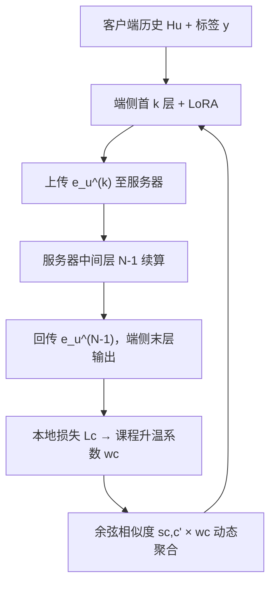
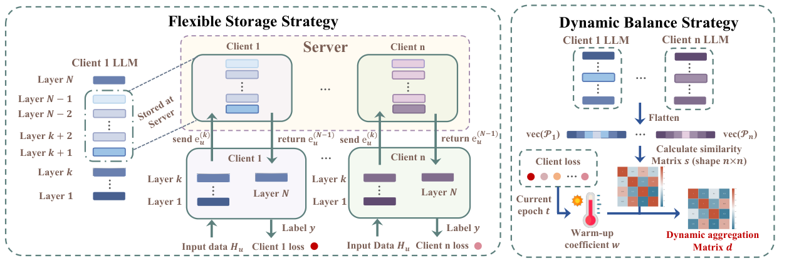

# A Federated Framework for LLM-based Recommendation (面向 LLM 推荐的联邦框架)

- **会议/期刊**: NAACL 2025 Findings
- **作者与机构**: Jujia Zhao, Wenjie Wang, Chen Xu, See-Kiong Ng, Tat-Seng Chua（Leiden University / NUS NExT++ / 人大高瓴）
- **推荐链路定位**: 端到端生成式（LLM 生成式检索 + 联邦训练）
- **研究方向**: 去偏公平、可信隐私与工业架构 / 大语言模型推荐
- **论文原文**: [https://arxiv.org/abs/2402.09959v3](https://arxiv.org/abs/2402.09959v3)
- **开源代码**: [https://github.com/westlake-repl/MicroLens](https://github.com/westlake-repl/MicroLens)（论文自述代码在 Polaris-JZ/FELLRec）

## TL;DR (1分钟核心速览)

把 Fed4Rec 直接套到 LLM 生成式推荐上会暴露两个新问题：LLM 快速适配使客户端收敛速度分化，客户端间性能失衡被显著放大（MicroLens 上 FedAvg 失衡度高达 46.0）；同时端侧难以承担 7B 级模型的存储与推理。FELLRec 提出**动态平衡策略**（余弦相似度注意力聚合 + 基于本地损失的课程升温学习速度）与**灵活存储策略**（敏感首尾层留端、中间层卸载到服务器）。在 Games/MicroLens/Book 三数据集、Full-Ranking 协议下，RecFormer 后端上 Recall@10 相对 FedAvg 提升约 44%，失衡度从 1.76 降至 0.55。

## Background & Motivation (背景与核心矛盾)

- **主流范式**: Fed4Rec 以 client-server 框架交换参数保护隐私，LLM 推荐则以 BIGRec/RecFormer 等微调后做 embedding 最近邻检索。
- **前人局限**: ① 客户端数据异构导致优化目标冲突，FedAvg 的等权聚合牺牲弱势客户端；② LLM 微调收敛极快（图 1(b)），客户端学习状态差异被放大，失衡比传统 MF 更严重；③ 端侧无法承担 LLM 全量训练与推理。
- **核心洞察 (Key Insight)**: 失衡源于"数据分布差异"与"学习难度差异"两个可分离因素，应分别用聚合权重与学习速度来矫正；而隐私敏感性集中在输入/输出层，中间层可安全外置。
- **本文切入点**: 在 client-server 框架内同时做"聚合个性化"与"层級存储切分"，一举兼顾公平性与端侧成本。

## Method (核心方法设计)

### 1. 整体框架 (Overall Architecture)

每个客户端仅保留 LoRA 参数 $R^c$与 LLM 的首$k$层及末层$T^{(N)}$，中间层驻留服务器。前向时客户端算出第$k$层隐表示$e_u^{(k)}$上传服务器，服务器续算至$e_u^{(N-1)}$回传，客户端完成末层并本地算损失；反向梯度沿"端→服→端"回传。每轮结束后客户端上传保留层参数，服务器按动态权重$d_{c,c'}=w_c\cdot s_{c,c'}$ 聚合后回发。推理时物品 embedding 离线预存于端侧，用户表示经同样切分计算后做最近邻排序。

<figure class="paper-figure" markdown="span">
  <figcaption>图 2：FELLRec 结构。左侧部分为灵活存储策略，将非敏感 LLM 层卸载到服务器以节省资源。右侧部分为动态平衡策略，确保各客户端之间性能相对均衡。</figcaption>
</figure>

### 2. 关键设计拆解 (Key Designs)

1. **注意力式动态参数聚合**：等权 FedAvg 在数据异构下产生目标冲突。FELLRec 以扁平化 LoRA 参数的余弦相似度作为聚合权重，让客户端优先吸收分布相近者的知识：
$$s_{c,c'}=\frac{\mathrm{vec}(R^c)^\top \mathrm{vec}(R^{c'})}{\|\mathrm{vec}(R^c)\|_2\|\mathrm{vec}(R^{c'})\|_2},\quad R^c=\frac{\sum_{c'} s_{c,c'}R^{c'}}{\sum_{c'} s_{c,c'}}$$
直觉上这是把"参数空间近邻"当作数据分布相似性的代理，避免无关客户端污染本地模型。

2. **课程升温动态学习速度**：学习难度不同的客户端不应同步吸收全局知识。以本地损失 $L_c$ 的 softmax 占比驱动升温系数：
$$w_c=\tanh\!\Big(\alpha\Big[\frac{\exp(L_c)}{\sum_{i=1}^{N}\exp(L_i)}\Big]^{t/\beta}\Big)$$
高损失客户端 $w_c$小、先"预热"自身分布，低损失客户端快速收敛；$\alpha$控节奏、$\beta$控时间衰减。最终$d_{c,c'}=w_c s_{c,c'}$ 同时编码"跟谁学"与"学多快"。

3. **灵活存储与训练目标**：客户端仅保留 $\{T^{(i)}\}_{i=1}^{k}$与$T^{(N)}$，其余$N-1-k$层在服务器，端侧存储/推理开销由$O(N)$降为$O(k+1)$。总损失即各客户端本地推荐损失$\mathcal{L}=\sum_c \sum_{(H_u,y)\in\mathcal{D}^c} l(f(H_u;R^c),y)$，无额外负采样（全库 embedding 最近邻检索）；通信量$O((k+1)b+2c)$，在$c<(N-k-1)b/2$时优于 FedAvg 的$O(Nb)$。

## Experimental Setup & Evaluation Protocol (实验设置与评估协议)

- **数据集与预处理**: Games / Book 来自 Amazon Review，MicroLens 为短视频数据集；均按时间戳排序后 8:1:1 划分训练/验证/测试。

| 数据集 | 领域 | 特征 | 划分方式 |
| :--- | :---: | :---: | :---: |
| Games | 视频游戏 | 标题、类目文本 | 时间序 8:1:1 |
| MicroLens | 短视频 | 标题/封面/音频/视频 | 时间序 8:1:1 |
| Book | 图书 | 多体裁文本 | 时间序 8:1:1 |

- **数据划分与防穿越 (Splitting Strategy)**: 按时间戳排序后比例划分（8:1:1），非 Leave-One-Out。
- **排名评测协议 (Ranking Protocol)**: 无偏 `Full-Ranking`（全库未交互物品排序），指标 Recall@10/20、NDCG@10/20。
- **对比基线与超参设置**: LLM 后端 BIGRec 与 RecFormer；隐私基线 FedAvg / FedProx / Ditto / RoLoRA；传统基线 MF、LightGCN 及 FedMF / LightFR / FedPerGNN；显著性 $t$-test，$p<0.01$；含 1024-shot 与全量微调两种设定。

## Key Experimental Results (实验关键数据)

### 1. 主实验对比 (Main Results)

RecFormer 后端、Games/MicroLens 两数据集（隐私保护方法内部比较）：

| 方法 | Games R@10 | Games N@10 | MicroLens R@10 | MicroLens N@10 | Book R@10 |
| :--- | :---: | :---: | :---: | :---: | :---: |
| RecFormer (集中式) | 0.0193 | 0.0117 | 0.0190 | 0.0104 | 0.0318 |
| +FedAvg | 0.0149 | 0.0089 | 0.0086 | 0.0045 | 0.0078 |
| +FedProx | 0.0150 | 0.0086 | 0.0086 | 0.0041 | 0.0071 |
| +Ditto | 0.0162 | 0.0091 | 0.0091 | 0.0046 | 0.0102 |
| +RoLoRA | 0.0132 | 0.0081 | 0.0084 | 0.0029 | 0.0071 |
| **+FELLRec (Ours)** | **0.0215** | **0.0122** | **0.0141** | **0.0065** | **0.0274** |
| Improv. vs FedAvg | +44.3% | +37.1% | +64.0% | +44.4% | +251% |

BIGRec 后端上 FELLRec 亦全面领先（Games R@10 0.0158 vs FedAvg 0.0145；MicroLens 0.0088 vs 0.0021），且与集中式 BIGRec（0.0194）差距明显收窄。

### 2. 消融与客户端均衡实验 (Ablation & Balance)

| 配置 | Games 失衡度 | MicroLens 失衡度 | 说明 |
| :--- | :---: | :---: | :---: |
| BIGRec 集中式 | 1.35 | 4.50 | 无联邦 |
| +FedAvg | 1.76 | 46.00 | 失衡被放大 |
| +FELLRec | **0.55** | **3.04** | 失衡显著缓解 |

（消融细节见附录 A.4：移除动态聚合或课程升温均导致整体与均衡指标下降。）

### 3. 关键实验发现 (Key Findings)

1. **失衡是 LLM 联邦推荐的首要矛盾**：MicroLens 上 FedAvg 失衡度 46.0，是集中式 4.50 的十倍以上，而 FELLRec 将其压到 3.04，说明动态权重确实在"救弱势客户端"。
2. **均衡与整体性能不冲突反而互促**：FELLRec 在降低失衡度的同时把 RecFormer 后端 MicroLens R@10 从 0.0086 提到 0.0141，验证了"避免弱势客户端拖累全局"的假设。
3. **卸载层数 $k$是隐私-成本旋钮**：线性/MLP 探针攻击显示中间层重建相似度随层号上升而下降、末层因对齐目标物品而回升，故建议$k\ge 21$；此时端侧存储与推理开销由$O(N)$降至$O(k+1)$，而 LoRA 上传仅约 16 MB（100 Mbps 下约 1.28 s），相对单 batch 约 110 s 训练可忽略。

## Highlights & Limitations (亮点、对比与审稿批判)

- **与代表作对比 (vs. Prior Work)**: 相较 FedAvg/FedProx/Ditto 的等权或正则化聚合，FELLRec 首次把"聚合权重"与"学习速度"解耦为两个可解释因子；相较 RoLoRA 等 LoRA 联邦方案，额外引入层级存储切分，把端侧成本从模型级降到层級。
- **可迁移亮点**: ① 用参数余弦相似度作数据分布代理，可迁移到任意异构联邦微调场景；② 以本地损失驱动课程升温的 warm-up 系数，是低成本缓解"强者恒强"的通用技巧。
- **审稿级局限批判**: ① 最大模型仅 LLaMA-7B，更大模型与更多攻击类型（仅 BIGRec 单案例、两类白盒探针）未验证；② 服务器承担中间层计算，引入新的信任假设与端-服往返延迟，且 $k$ 的选取依赖攻击模拟，缺乏自适应机制。

## Rating (四维评分)

- **方法创新性 (Novelty)**: ⭐⭐⭐⭐ （把联邦失衡拆为分布差异与学习难度两因子并分别用余弦注意力与课程升温建模，思路清晰但组件本身较常规）
- **评估协议与实验扎实度 (Protocol & Experiments)**: ⭐⭐⭐⭐ （三数据集、双 LLM 后端、Full-Ranking、$p<0.01$ 显著性、含攻击模拟与成本分析，但消融置于附录且缺线上验证）
- **写作与数学规范度 (Clarity & Rigor)**: ⭐⭐⭐⭐ （公式与算法伪代码完整、成本复杂度有闭式对比，个别符号如 $n$/$N$ 混用略欠统一）
- **工业落地与复现价值 (Industrial & Practical Value)**: ⭐⭐⭐⭐ （层級卸载直接对应端侧算力约束，通信量有量化估算，代码开源，但依赖服务器协同推理的工程改造）

