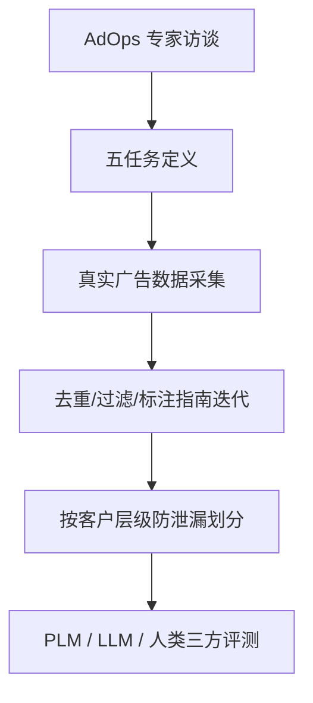

# AdTEC: A Unified Benchmark for Evaluating Text Quality in Search Engine Advertising (搜索广告文案质量统一评测基准)

- **会议/期刊**: NAACL 2025
- **作者与机构**: Peinan Zhang, Yusuke Sakai, Masato Mita, Hiroki Ouchi, Taro Watanabe (CyberAgent / 奈良先端科学技术大学院大学)
- **推荐链路定位**: 广告创意生成后的质量审核环节（AdOps Step 3），服务于召回/精排前的创意准入
- **研究方向**: 去偏公平、可信隐私与工业架构 / 大语言模型推荐
- **论文原文**: [https://arxiv.org/abs/2408.05906v2](https://arxiv.org/abs/2408.05906v2)
- **开源代码**: 暂未开源（数据集已公开于 [https://cyberagentailab.github.io/AdTEC](https://cyberagentailab.github.io/AdTEC)）

## TL;DR (1分钟核心速览)

搜索广告文案由 NLG 模型批量生成后，缺乏公开、多维度的质量评测基准——广告数据因法律与合同约束几乎全部留在企业内部。本文提出 AdTEC，基于真实广告运营（AdOps）流程定义五个评测任务（可接受性、落地页一致性、效果预估、A3 诉求识别、文案相似度），构建首个公开的日文广告文案评测数据集（约 3.7 万条可接受性样本、3 万条一致性样本等）。实验表明：微调编码器模型在多数任务上已达实用水平，但在可接受性与一致性两个二分类任务上人类仍显著领先（F1 0.79 vs. 0.69、0.81 vs. 0.55），揭示语义级判断与类别不平衡鲁棒性仍是核心瓶颈。

## Background & Motivation (背景与核心矛盾)

- **主流范式**: 广告文案生成（AdOps Step 2）已有大量 NLG 研究，但生成后的质量审核（Step 3）长期依赖人工，自动化质量估计器缺乏统一评测标准。
- **前人局限**: (1) 现有广告文案生成基准（Mita et al., 2024）依赖 BLEU/ROUGE 等参考文本重叠指标与关键词插入率等简单启发式，无法评估无参考的新文案，也无法保证投放合规性；(2) CTR 等粗粒度行为反馈无法定位"该改哪里"，且广告工作流与数据因法律合同义务几乎全部内部留存，学术界无法复现验证。
- **核心洞察 (Key Insight)**: 广告文案质量是多维的——措辞合规、诉求有效、与产品信息一致、预测效果高——这些维度必须被拆解为可独立评测的任务，且任务定义应直接源自真实 AdOps 工作流而非学术臆想。
- **本文切入点**: 通过与广告代理公司运营专家访谈，将 Step 3 质量审核泛化为 3 个直接评估任务 + 2 个间接评估任务，并公开日文数据集。

## Method (核心方法设计)

### 1. 整体框架 (Overall Architecture)

AdTEC 并非一个模型，而是一套"任务定义 + 数据构建 + 评测协议"的基准框架。整体流程为：先通过专家访谈将广义 AdOps 工作流（图 2）中的质量审核环节拆解为五个任务；再针对每个任务从真实广告创建与投放数据中采集样本，经过去重、语言过滤、多轮标注指南迭代与试点标注后完成主标注；最后在统一划分（按客户层级防泄漏）下评测微调编码器、零/少样本 LLM 与人类评估者三类评估器。

### 2. 关键设计拆解 (Key Designs)

1. **五任务体系（直接 + 间接评估）**：直接评估任务用于设定投放准入门槛——AD ACCEPTABILITY（文案整体可接受性，二分类，区别于 CoLA 的语法可接受性，涵盖符号崩塌、无意义重复、语义矛盾等）、AD CONSISTENCY（文案与落地页 LP 的事实一致性，二分类，规避《不当赠品及不当表示防止法》风险）、AD PERFORMANCE ESTIMATION（基于文案/关键词/行业回归 [0,100] 效果分）；间接评估任务服务于人工审核辅助与下游衔接——A3 RECOGNITION（从 21 类广告诉求标签中多标签识别）与 AD SIMILARITY（文案对相似度回归 [1,5]，用于广告疲劳下的创意轮换决策）。任务划分的物理直觉是：直接任务对应"能不能投"，间接任务对应"怎么改、何时换"。

2. **防泄漏的层级化数据划分**：广告账户呈 Client→Account→Campaign→AdGroup→Keyword 的层级结构（图 4），同一客户下文案表达高度相似，随机划分会导致训练/测试泄漏。因此 AD ACCEPTABILITY 与 AD CONSISTENCY 按 **Client 不重叠**划分，AD PERFORMANCE ESTIMATION 按 **Campaign 不重叠**划分，确保模型泛化到未见客户而非记忆特定表达。AD SIMILARITY 则利用 AdGroup 内采样构造伪相似对、跨 Client 采样构造伪不相似对（9:1 比例平衡标签），再随机划分以保持分布一致。

3. **训练目标、负采样与推理效率**：本文不涉及新模型训练，评测器均为标准范式——编码器模型取 `[CLS]` 向量经 MLP 输出：二分类用 $\hat{y}=\mathrm{MLP}(\mathbf{h}_{[\mathrm{CLS}]})$，多标签用$\mathbf{m}=\mathrm{Sigmoid}(\mathrm{MLP}(\mathbf{h}_{[\mathrm{CLS}]}))\in\mathbb{R}^{21}$，回归直接输出标量；一致性任务输入为文案与 LP 经 `[SEP]` 拼接。LLM 采用零/少样本提示（AD SIMILARITY 与效果预估 3-shot、A3 识别 2-shot、其余零样本），每实例 5 次采样取平均（温度 0.8）。微调编码器学习率搜索 {2e-5, 5.5e-5, 2e-6}，30 epoch 早停。

## Experimental Setup & Evaluation Protocol (实验设置与评估协议)

- **数据集与预处理**: 日文搜索广告数据，2021–2022 年投放记录；效果预估任务对专有名词做掩码、原始 CTR 经非线性变换至 [0,100] 以保留分布。

| 数据集(任务) | #Train | #Dev | #Test | 标签分布说明 |
| :--- | :---: | :---: | :---: | :--- |
| AD ACCEPTABILITY | 13,265 | 970 | 980 | 可接受/不可接受约 43:57 |
| AD CONSISTENCY | 10,635 | 945 | 970 | 一致/不一致约 30:70（不平衡） |
| AD PERFORMANCE EST. | 125,087 | 965 | 965 | 连续 [0,100] 回归 |
| A3 RECOGNITION | 1,856 | 465 | 410 | 21 类多标签，均值约 1.4 标签/文档 |
| AD SIMILARITY | 4,980 | 623 | 629 | [1,5] 回归，集中于 3–4 区间 |

- **数据划分与防泄漏 (Splitting Strategy)**: 非随机划分——可接受性与一致性按 **Client 不重叠**、效果预估按 **Campaign 不重叠**划分；相似度任务随机划分。这是本文评测协议最关键的工业对齐设计。
- **排名评测协议 (Ranking Protocol)**: 非排序任务，采用分类指标（Accuracy / F1）与回归指标（Pearson / Spearman 相关系数）；A3 识别用 F1-micro / F1-macro。显著性检验为 t-test，$p<0.05$ 标星。
- **对比基线与超参设置**: 微调编码器（Tohoku BERT、Waseda RoBERTa、XLM-RoBERTa，均 LARGE 规模）；零/少样本 LLM（CALM2-7b、ELYZA-7b、GPT-3.5、GPT-4）；补充 QLoRA 微调 ELYZA-7b；人类评估者 3 名（非 AdOps 背景），二分类任务多数投票、回归任务取均值。

## Key Experimental Results (实验关键数据)

### 1. 主实验对比 (Main Results)

| 评估器 | ACCEPT. Acc/F1 | CONSIST. Acc/F1 | PERF.EST. Pearson/Spearman | A3 F1-micro/macro | SIMILARITY Pearson/Spearman |
| :--- | :---: | :---: | :---: | :---: | :---: |
| Tohoku BERT-L | 0.711/0.688 | 0.767/0.552 | **0.480\***/**0.497\*** | 0.774/0.694* | 0.773/0.807 |
| Waseda RoBERTa-L | 0.598/0.637 | 0.755/0.474 | 0.445/0.457 | 0.663/0.517 | 0.740/0.800 |
| XLM-RoBERTa-L | 0.705/0.690 | 0.758/0.519 | 0.453/0.457 | **0.778**/0.677 | **0.878\***/**0.878\*** |
| CALM2-7b (0-shot) | 0.520/0.115 | 0.381/0.472 | 0.006/0.013 | 0.154/0.042 | 0.036/0.036 |
| ELYZA-7b (0-shot) | 0.352/0.520 | 0.628/0.771 | 0.003/0.046 | 0.196/0.044 | 0.015/-0.004 |
| GPT-4 (few-shot) | 0.325/0.433 | 0.583/0.612 | 0.028/0.073 | 0.417/0.113 | 0.776/0.811 |
| Human | **0.732\*/0.790\*** | 0.703/**0.807\*** | — | 0.564/0.538 | 0.699/0.765 |

（注：加粗为跨方法最优；`*` 表示与次优结果差异在 $p<0.05$ 下显著。人类未参与效果预估任务。）

### 2. 消融实验 (Ablation Study)

本文为基准论文，无传统模块消融，但提供了"评估器配置"的对照分析：

| 配置对比 | ACCEPT. F1 | CONSIST. F1 | SIMILARITY Pearson |
| :--- | :---: | :---: | :---: |
| ELYZA-7b 零样本 | 0.520 | 0.771 | 0.015 |
| ELYZA-7b QLoRA 微调 | 0.638 | 0.694 | 0.684 |
| Tohoku BERT-L 全量微调 | 0.688 | 0.552 | 0.773 |
| XLM-R-L 全量微调 | 0.690 | 0.519 | **0.878** |

### 3. 关键实验发现 (Key Findings)

1. **人类在语义级二分类上仍显著领先，但优势来源不同**：可接受性任务人类 F1 0.790 vs. 最佳模型 0.690，一致性任务人类 0.807 vs. 最佳模型 0.552。误差分析（表 7）显示模型呈"高精度低召回"——倾向于预测多数类（False），而人类在两类错误中都更倾向给出 True，即人类更"宽容"、模型更"保守"，在类别不平衡下模型 F1 崩塌。
2. **微调编码器全面压制零/少样本 LLM，但 GPT-4 在语义相似度上追平**：效果预估与 A3 识别上 LLM 相关系数/F1 接近 0（CALM2 仅 0.006/0.154），说明数值回归与 21 类多标签选择超出少样本能力；而 AD SIMILARITY 上 GPT-4 达 0.776/0.811，与微调模型同档并超越人类（0.699/0.765），是唯一 LLM 胜人且胜微调的任务。
3. **微调能显著激活 LLM 的潜在能力但任务间差异巨大**：ELYZA-7b 经 QLoRA 微调后相似度 Pearson 从 0.015 跃升至 0.684（提升 45 倍），但一致性任务准确率仅提升 0.064——说明预训练网络爬取知识对一致性判断天然有用，而相似度任务需要任务特定映射；可接受性与 A3 识别即使微调后仍偏低，反映训练数据量不足以覆盖细粒度判断知识。

## Highlights & Limitations (亮点、对比与审稿批判)

- **与代表作对比 (vs. Prior Work)**: 相比 Mita et al. (2024) 的广告文案**生成**基准（依赖参考文本与 BLEU/ROUGE 启发式），AdTEC 转向**质量评估**且无需参考文本；相比 CTR 预估类工作（Robinson 2007、McMahan 2013 等）只给粗粒度行为反馈，AdTEC 提供可定位修改点的细粒度多维诊断；相比 Murakami et al. (2022) 仅做 A3 诉求分析，本文将其扩展为五任务统一基准。
- **可迁移亮点**: (1) 按业务层级（Client/Campaign）做防泄漏划分的思路可直接迁移到电商、本地生活等存在强实体聚类的推荐评测；(2) "直接评估（准入门槛）+ 间接评估（审核辅助）"的任务二分法为工业界构建创意/内容质量基准提供了可复用模板。
- **审稿级局限批判**: (1) 仅日文单语种，且日本广告文化偏好"信息密集"设计，跨语言/跨文化泛化性未验证，作者亦在 Limitations 中承认；(2) 效果预估标签经非线性变换且掩码专有名词，信息不完整可能影响任务可用性；人类评估者仅 3 名且非 AdOps 专家，人类上界估计可能偏低；数据集仅覆盖签约客户行业，存在选择偏差。

## Rating (四维评分)

- **方法创新性 (Novelty)**: ⭐⭐⭐ （非模型创新，但首次将 AdOps 质量审核系统化为五任务公开基准，任务定义本身具领域开创性）
- **评估协议与实验扎实度 (Protocol & Experiments)**: ⭐⭐⭐⭐ （按 Client/Campaign 防泄漏划分 + 三方评估器对比 + 误差类型细分 + 显著性检验，协议设计严谨；扣分在人类评估者规模小）
- **写作与数学规范度 (Clarity & Rigor)**: ⭐⭐⭐⭐ （任务动机与工业流程映射清晰，标注指南与提示模板完整公开；数学部分较浅，属基准论文常态）
- **工业落地与复现价值 (Industrial & Practical Value)**: ⭐⭐⭐⭐ （数据集公开且直接源自真实运营，可即插即用于广告创意准入流水线；但仅日文、无开源模型代码，跨行业迁移需重新标注）

