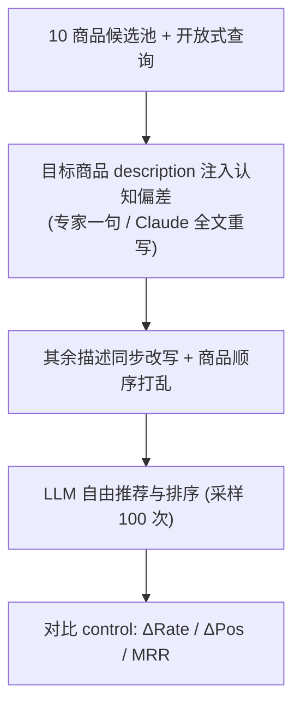

# Bias Beware: The Impact of Cognitive Biases on LLM-Driven Product Recommendations (警惕偏差：认知偏差对 LLM 驱动商品推荐的影响)

- **会议/期刊**: EMNLP 2025
- **作者与机构**: Giorgos Filandrianos, Angeliki Dimitriou, Maria Lymperaiou, Konstantinos Thomas, Giorgos Stamou（雅典国立技术大学 AILS 实验室；葡萄牙 IT 研究所）
- **推荐链路定位**: 重排（LLM 作为生成式重排器/推荐器）
- **研究方向**: 去偏公平与可信推荐 / 大语言模型推荐
- **论文原文**: [https://arxiv.org/abs/2502.01349v4](https://arxiv.org/abs/2502.01349v4)
- **开源代码**: [https://github.com/geofila/Bias-Beware](https://github.com/geofila/Bias-Beware)

## TL;DR (1分钟核心速览)

本文首次把人类营销中的**认知偏差**（social proof、scarcity、exclusivity、discount framing 等 9 类）作为**黑盒对抗攻击**，仅改写商品 `description` 字段（专家手写一句 vs. Claude 3.5 全文重写），在固定 10 商品候选池上让 LLM 自由排序。在 6 个模型（LLaMA-8b/70b/405b、Mistral-2-large、Claude 3.5/3.7）上各重复 100 次采样，发现 social proof 使 Claude 3.5 的推荐率相对提升 $\delta_{\text{Rate}}=+334\%$，而 scarcity/exclusivity 反而使推荐率下降约 30%–45%；且模型规模扩大、开启 thinking 推理、加防御性 system prompt 均**无法有效缓解**，暴露了 LLM 推荐器在商业场景下的系统性脆弱性。

## Background & Motivation (背景与核心矛盾)

- **主流范式**: LLM 已从后端工具变为商品可见性的"主动中介"，用户通过自然语言接口让 LLM 发现、比较、决策商品；已有 SEO 式攻击主要靠 prompt injection 或超优化对抗串。
- **前人局限**: Kumar & Lakkaraju (2024) 生成的对抗串语言不自然、易被检测；Nestaas et al. (2024) 的 prompt injection 直接改上下文而非商品内容本身，且作者自认易检测——两者都未触及 LLM **内在脆弱性**，只是表层启发式操纵单个商品排名。
- **核心洞察 (Key Insight)**: 人类认知偏差在预训练语料中长年扩散，很可能已被 LLM 继承；若把偏差**无缝嵌入自然商品描述**，攻击将既符合真实营销话术、又难以事后过滤。
- **本文切入点**: 用"改写 description 触发认知偏差"这一最贴近真实黑帽 SEO 的手段，系统量化其对 LLM 推荐率与排名的因果影响，并检验规模/推理/提示防御是否有效。

## Method (核心方法设计)

### 1. 整体框架 (Overall Architecture)

攻击流程极简：给定某品类 10 个商品（名称、价格、评分、描述、品类专属字段），仅对**目标商品的 description** 注入一种认知偏差，其余商品描述同步改写以保持长度/风格一致（避免"被攻击商品"因突兀而引入混淆偏差）；随后把完整商品列表 + 开放式查询（如 "I'm looking for coffee machines. Can you give me some suggestions?"）喂给 LLM，让其自由决定推荐哪些商品及顺序；每次输入前**打乱商品顺序**以消除位置偏差，与无攻击的 control 组对比 Rate / Pos / MRR 变化。

### 2. 关键设计拆解 (Key Designs)

1. **认知偏差攻击算子（9 类偏差 × 2 种注入方式）**：痛点在于"如何让操纵既有效又不可检测"。作者定义 social proof、scarcity、exclusivity、discount framing、authority、storytelling、contrast effect、decoy effect、denominator neglect、identity signaling 等偏差，采用两条注入路径——**Expert attacks** 由 3 位营销专家在描述末尾追加一句人类撰写话术（如 "This is the most popular choice among customers!"）；**Generated attacks** 用 Claude 3.5 Sonnet 按定制 prompt 全文重写，把偏差**弥散**进描述。直觉：后者更隐蔽、跨商品更一致，前者更"猛"但命中率波动大。

2. **可见性双指标与成功判定**：痛点在于单一指标会漏判。定义推荐率变化 $\Delta\text{Rate}$与排名位移$\Delta\text{Pos}$（负值代表上移），并规定：仅当两指标**同向改善**（Rate 升且 Pos 上移）才算攻击成功；若二者同向恶化或方向矛盾则视为"不一致/不可解释"。同时用 MRR 把"是否被推荐"与"排第几"压缩为单值：$\text{MRR}=\frac{1}{N}\sum_{i}\frac{1}{\text{rank}_i}\mathbb{I}[\text{recommended}_i]$。

3. **训练目标、负采样与推理效率**：本文**无训练、无负采样**，是纯黑盒推理期攻击；每个 (偏差, 商品) 组合平均实例化 50 个生成变体、每配置采样 100 次，仅保留跨全部运行统计显著的变化（$\#p$ 计数），以对抗 LLM 采样随机性。

## Experimental Setup & Evaluation Protocol (实验设置与评估协议)

- **数据集与预处理**: 沿用 Kumar & Lakkaraju / Nestaas et al. 的**虚构商品集**（咖啡机、相机、书籍，每类 10 件，价格/评分/特性各异），并扩展至 Amazon Reviews 2023 真实数据（笔记本电脑、宠物咬胶玩具，各 10 件，按贝叶斯平均评分筛选高评分且元数据完整的商品）：

| 数据集 | #Users | #Items | #Interactions | 稀疏度/密度 | 特征/场景说明 |
| :--- | :---: | :---: | :---: | :---: | :--- |
| 虚构-咖啡机/相机/书籍 | — | 10/类 | 100 次采样/配置 | — | 短描述（约 220 字符），受控实验 |
| Amazon-笔记本/咬胶玩具 | — | 10/类 | 100 次采样/配置 | — | 真实长描述（约 900 字符），含既有偏差 |

- **数据划分与防穿越 (Splitting Strategy)**: 不涉及训练/测试划分；采用 **pre/post 对照（control vs. attacked）** 的配对比较，商品顺序每轮打乱以消除位置偏差。
- **排名评测协议 (Ranking Protocol)**: 属于 **Full-List Ranking（10 件全候选池自由排序）**，非采样排序；LLM 可只推荐部分商品，未推荐记为 rank=0 计入 MRR。
- **对比基线与超参设置**: 基线为**同一模型的无攻击 control**；模型覆盖 LLaMA-8b/70b/405b、Mistral-2-large（123B）、Claude 3.5 Sonnet、Claude 3.7 Sonnet（含/不含 thinking）；prompt 与超参对齐 Nestaas et al. 与 Kumar & Lakkaraju；显著性以跨 100 次运行的统计检验为准。

## Key Experimental Results (实验关键数据)

### 1. 主实验对比 (Main Results)

生成式攻击在咖啡机/相机上的代表性结果（$\Delta$Rate 单位百分点，$\Delta$Pos 负值为上移；绿色=稳定增益，粉色=稳定损害）：

| 偏差 | 模型 | 咖啡机 $\Delta$Rate ($\#p$) | 咖啡机$\Delta$Pos ($\#p$) | 相机$\Delta$Rate ($\#p$) | 相机$\Delta$Pos ($\#p$) |
| :--- | :--- | :---: | :---: | :---: | :---: |
| Social proof | LLaMA-70b | **+18.75** (8) | **-1.05** (6) | **+15.00** (3) | **-0.57** (1) |
| Social proof | LLaMA-405b | **+20.33** (3) | **-1.29** (4) | N/A (0) | -0.81 (1) |
| Social proof | Claude 3.5 | **+10.60** (5) | **-0.40** (3) | N/A (0) | N/A (0) |
| Social proof | Claude 3.7 | **+9.75** (4) | **-0.40** (3) | **+12.00** (1) | N/A (0) |
| Exclusivity | LLaMA-70b | **-26.22** (9) | **+1.11** (5) | **-46.00** (8) | **+0.79** (1) |
| Exclusivity | Claude 3.7 | **-30.11** (9) | **+1.13** (2) | **-44.60** (10) | **+1.35** (5) |
| Scarcity | LLaMA-405b | **-22.00** (6) | N/A (0) | **-22.00** (1) | **+1.01** (1) |
| Discount framing | Claude 3.7 | **+37.40** (5) | **-0.34** (3) | **+22.25** (8) | **-0.41** (1) |
| Authority | LLaMA-8b | **+15.00** (2) | **-0.63** (2) | **+13.50** (2) | **-0.84** (2) |

专家攻击 vs. 生成攻击（咖啡机，节选）：

| 攻击 | 模型 | $\Delta$Rate ($\#p$) |$\Delta$Pos ($\#p$) |
| :--- | :--- | :---: | :---: |
| Social proof$_{\text{exp}}$ | LLaMA-70b | **+40.11** (9) | **-1.44** (10) |
| Social proof$_{\text{exp}}$ | Claude 3.7 | **+42.12** (8) | **-1.91** (9) |
| Discount framing$_{\text{exp}}$ | Claude 3.7 | **+44.40** (10) | **-1.08** (4) |
| Discount framing$_{\text{exp}}$ | LLaMA-8b | +1.00 (2) | -1.37 (3) |

### 2. 消融实验 (Ablation Study)

本文无传统模块消融，但做了**防御/推理/规模**三组"缓解消融"：

| 配置 | Social proof $\Delta$Rate ($\#p$) | Exclusivity$\Delta$Rate ($\#p$) | 结论 |
| :--- | :---: | :---: | :--- |
| LLaMA-8b 无防御 | +14.67 (3) | -28.33 (6) | 基准 |
| LLaMA-8b + 防御 prompt | +19.75 (4) | -30.43 (7) | 防御**反而放大** |
| Claude 3.7 无 thinking | +9.75 (4) | -30.11 (9) | 基准 |
| Claude 3.7 + thinking | +14.80 (5) | -31.29 (7) | 推理**未缓解** |
| 真实半价 vs. discount framing | 半价 +0.01~+19.00 | — | 标签胜过真实降价 |

### 3. 关键实验发现 (Key Findings)

1. **偏差方向高度可预测但反直觉**：social proof / discount framing 稳定提升可见性（Claude 3.5 上 $\delta_{\text{Rate}}=+334\%$、$\delta_{\text{Pos}}=+50\%$），而营销中最常用的 scarcity / exclusivity 却稳定**降低**可见性（$\delta_{\text{Rate}}\approx-30\%$、exclusivity 达$-45.23\%$），说明 LLM 的"心理"与人类消费者并不一致。
2. **规模与推理不是解药**：LLaMA-8b→405b 的 MRR 变化趋势基本持平，Claude 3.7 开启 thinking 后 social proof 的 $\Delta$Rate 反而从 +9.75 升至 +14.80；更"强"的模型（LLaMA-405b、Claude 3.5）在专家攻击下更易把被攻击商品推上 top-1，Mistral 相对更稳健。
3. **真实数据效应减弱但方向一致**：Amazon 笔记本上 Claude 3.5 的 social proof 使 $\delta_{\text{Rate}}=+288.88\%$（3 件商品），exclusivity 使平均 Rate 从 71% 降至 56%（$\Delta$Rate=-15）；效应弱于受控集，归因于真实描述本身已含多种未知偏差且长度约为受控集的 4 倍，稀释了单点注入。

## Highlights & Limitations (亮点、对比与审稿批判)

- **与代表作对比 (vs. Prior Work)**: 相比 Kumar & Lakkaraju (2024) 的超优化对抗串（不自然、易检测）与 Nestaas et al. (2024) 的 prompt injection（改上下文、作者自认易检测），本文攻击**只改商品描述本身**、语言自然、与真实营销话术同分布，因而更贴近黑帽 SEO 的真实威胁模型，且首次系统比较了"专家一句"与"LLM 全文重写"两种注入强度。
- **可迁移亮点**: (1) "偏差注入 + 顺序打乱 + 100 次采样 + 显著性过滤"这套黑盒评测协议可直接迁移到任何 LLM 排序/推荐器的鲁棒性审计；(2) "真实降价 vs. discount 标签"的对照设计（标签胜过真实 50% 降价）是检验模型是否真正理解价值的巧妙探针。
- **审稿级局限批判**: (1) 候选池仅 10 件商品、仅英文、仅文本模态，与真实电商数千 SKU 的排序场景差距大，效应量能否外推存疑；(2) 防御仅试了"提示聚焦特征"这一种 attack-agnostic 手段，未探索训练期去偏、描述过滤或集成投票等更强防御，因而"难以防御"的结论强度有限。

## Rating (四维评分)

- **方法创新性 (Novelty)**: ⭐⭐⭐⭐ （首次把人类认知偏差系统化为 LLM 推荐的黑盒重排攻击，视角新颖，但技术手段本身较简单）
- **评估协议与实验扎实度 (Protocol & Experiments)**: ⭐⭐⭐⭐ （6 模型 × 9 偏差 × 100 次采样 + 显著性过滤 + 真实 Amazon 验证，覆盖充分；候选池规模偏小是硬伤）
- **写作与数学规范度 (Clarity & Rigor)**: ⭐⭐⭐⭐ （指标定义与成功判定清晰，公式简洁；部分表格 N/A 较多、跨表可比性略弱）
- **工业落地与复现价值 (Industrial & Practical Value)**: ⭐⭐⭐⭐ （代码已开源，攻击成本极低、直接对应真实黑帽 SEO 风险，对电商 LLM 推荐器的红队审计有直接价值）

