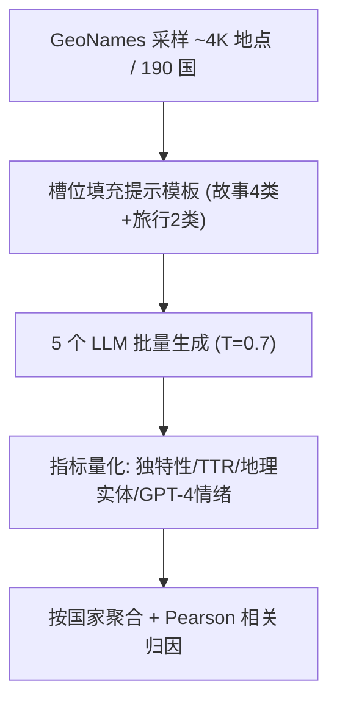

# Richer Output for Richer Countries: Uncovering Geographical Disparities in Generated Stories and Travel Recommendations (富国得富答：生成故事与旅行推荐中的地理差异)

- **会议/期刊**: Findings of NAACL 2025
- **作者与机构**: Kirti Bhagat, Kinshuk Vasisht, Danish Pruthi（印度理工学院班加罗尔分校 IISc）
- **推荐链路定位**: 端到端生成式（LLM 直接生成旅行推荐/故事）
- **研究方向**: 去偏公平与可信推荐 / 大语言模型推荐
- **论文原文**: [https://arxiv.org/abs/2411.07320v2](https://arxiv.org/abs/2411.07320v2)
- **开源代码**: [https://github.com/FLAIR-IISc/richer-countries-have-richer-output](https://github.com/FLAIR-IISc/richer-countries-have-richer-output)

## TL;DR (1分钟核心速览)

本文不做模型改进，而是一篇**审计型实证研究**：针对 LLM 在"旅行推荐"与"地理锚定故事生成"两类真实场景中的地理公平性空白，作者用 GeoNames 采样约 4,000 个地点（覆盖 190 国、含村镇级粒度），向 GPT-4、Mistral 7B、Mixtral 8×7B、LLaMa3 8B/70B 发起约 10 万次旅行请求与 20 万次故事生成，提出**独特性（IDF 加权稀有词）**、**地理实体计数**、**TTR**、**GPT-4 情绪标注**四类可量化指标，发现输出质量与人均 GDP 显著正相关（故事地理实体数 $r=0.49$，苦难情绪$r=-0.54$），撒哈拉以南非洲的推荐独特性比北美低约 40%。

## Background & Motivation (背景与核心矛盾)

- **主流范式**: 已有地理偏见研究多停留在"事实召回"层面（WorldBench、Global-Liar 等基准测试模型对各国人口/降雨等事实的预测误差），或让模型对国家按"道德/吸引力"排序来暴露偏见。
- **前人局限**: 其一，这些工作只测**知识编码本身**，未触及知识缺陷在**真实下游应用**（旅行规划、叙事生成）中的后果；其二，多数研究仅用**国家级粗粒度**信息，掩盖了城市/村镇层面的差异。
- **核心洞察 (Key Insight)**: 模型输出中的"信息丰富度"与"情绪基调"可能系统性地镜像现实世界的经济不平等——穷国不仅被"答得少"，还被"答得苦"。
- **本文切入点**: 把地理公平性审计从"事实准确性"推进到"生成内容质量"，用可量化代理指标（独特性/实体数/情绪）与人均 GDP、PILE 语料提及频率做相关性归因。

## Method (核心方法设计)

### 1. 整体框架 (Overall Architecture)

本文无训练模块，整体是一条**受控提示—批量生成—指标量化—相关性归因**的审计流水线：从 GeoNames 抽取居民数 >1000 的地点，按国最多 25 个随机采样（3 个随机种子取平均）；对每个地点用槽位填充模板（故事 4 类×各选 1、旅行 2 类×各选 1）构造提示，温度固定 0.7 调 5 个模型；随后对响应计算独特性、地理实体数、TTR、情绪占比，按国家聚合后与人均 GDP 及 PILE 提及频率做 Pearson 相关（$p<0.05$ 显著性）。

### 2. 关键设计拆解 (Key Designs)

1. **IDF 加权独特性指标（Uniqueness）**：痛点在于"推荐是否有地方特色"难以自动评判，且人工本地评审难以规模化。作者改造 TF-IDF，用响应集合内的逆文档频率衡量每个词在**跨地点**意义上的稀有度，再对响应内词与地点内响应双重平均：

$$U(l,\mathcal{R}_a)=\frac{1}{|\mathcal{R}_{a,l}|}\sum_{r\in\mathcal{R}_{a,l}}\frac{1}{|r|}\sum_{w\in r}\mathrm{idf}(w,\mathcal{R}_a),\quad \mathrm{idf}(w,\mathcal{R}_a)=\frac{|\mathcal{R}_a|}{f_{w,\mathcal{R}_a}}$$

直觉是：若某地响应大量出现"dosa"这类区域特有词，则其独特性高；若全是通用套话（"visit the old town"），则独特性低。该指标把"文化特异性"转成了可批量计算的标量。

2. **多维代理指标组合（信息量 + 情绪）**：单一指标易被长度混淆，故并行引入 Spacy NER 抽取 GPE/LOC/FAC 实体数作为**信息量代理**、TTR 作为**词汇多样性**、GPT-4 作为**情绪标注器**统计 joy/hardship/sadness 占比。选择 GPT-4 标注的依据是已有研究显示其情绪标注常优于人类标注者，从而在无本地评审的条件下获得可扩展的情绪信号。

3. **训练目标、负采样与推理效率**：本文**无训练损失、无负采样**；推理侧每个地点 6 次调用、5 个模型、3 个种子，总计约 30 万条响应，成本主要来自 API 调用与 NER/情绪标注，属于离线审计开销而非在线服务开销。

## Experimental Setup & Evaluation Protocol (实验设置与评估协议)

- **数据集与预处理**: 无传统交互数据集，审计语料由 GeoNames 采样生成：

| 数据源 | 地点/国家数 | 请求/响应规模 | 粒度 | 说明 |
| :--- | :---: | :---: | :---: | :--- |
| GeoNames | ~4,000 地点 / 190 国 | ~100K 旅行请求 + ~200K 故事 | 城市/镇/村（居民>1000） | 每国最多 25 地点，3 种子平均 |
| The PILE | 国家级 | — | 国家提及频率 | 经 infini-gram API 统计，作训练数据代表性代理 |

- **数据划分与防穿越 (Splitting Strategy)**: 不适用（无监督训练）；采用**随机采样 + 3 个随机种子重复**以稳定国家层面均值，属于审计式重复采样而非训练/测试划分。
- **排名评测协议 (Ranking Protocol)**: 不适用 Full-Ranking / Sampled Ranking；改为**国家聚合后的 Pearson 相关系数**（对 GDP per capita 与 PILE 频率），并以 $p<0.05$ 标注显著性。
- **对比基线与超参设置**: 横向对比 5 个模型（GPT-4、Mistral 7B、Mixtral 8×7B、LLaMa3 8B、LLaMa3 70B），覆盖不同规模与训练路线；温度 0.7；无嵌入维度等超参。

## Key Experimental Results (实验关键数据)

### 1. 主实验对比 (Main Results)

下表摘取各属性与国家人均 GDP 的 Pearson 相关（Table 1 精选，$^*$表示$p<0.05$）：

| 场景 / 属性 | GPT-4 | Mistral 7B | Mixtral 8×7B | LLaMa3 8B | LLaMa3 70B |
| :--- | :---: | :---: | :---: | :---: | :---: |
| 旅行-独特性 | **0.39*** | 0.32* | 0.35* | 0.27* | 0.31* |
| 旅行-地理实体数 | 0.20* | **0.30*** | 0.16* | 0.12 | 0.42* |
| 旅行-信息缺失率 | **−0.37*** | −0.09 | −0.25* | — | — |
| 故事-独特性 | 0.25* | 0.08 | 0.15* | **0.28*** | 0.26* |
| 故事-地理实体数 | **0.49*** | 0.35* | 0.48* | 0.46* | 0.49* |
| 故事-苦难情绪 | **−0.54*** | −0.38* | −0.50* | −0.42* | −0.46* |
| 故事-悲伤情绪 | **−0.45*** | −0.28* | −0.34* | −0.32* | −0.30* |

区域对比：旅行推荐独特性上，撒哈拉以南非洲比北美低 **43%(GPT-4)、42%(LLaMa3 8B)、39%(LLaMa3 70B)、37%(Mistral 7B)、38%(Mixtral)**；故事中北美地理实体提及数约为撒哈拉以南非洲的 **2 倍**；苦难情绪占比北美 **20%** vs. 撒哈拉以南非洲 **47%**。

### 2. 消融实验 (Ablation Study)

本文为审计研究，无模块消融，但做了**归因性对照分析**（等价于"替换解释变量"）：

| 对照维度 | 设置 | 关键观察 |
| :--- | :--- | :--- |
| 解释变量替换 | GDP per capita → PILE 国家提及频率 | 故事独特性与频率相关升至 0.27–0.41*，支持"训练数据代表性不足"假说 |
| 模型规模 | LLaMa3 8B vs. 70B；Mistral 7B vs. Mixtral | 更大模型相关性**未减弱**，规模不自动消除地理差异 |
| 模型家族 | 闭源 GPT-4 vs. 开源 4 款 | 趋势跨家族一致，非单一模型缺陷 |
| 情绪基线 | joy 占比 | 约 **99%** 故事含 joy，存在整体 positivity bias，说明苦难差异非"情绪缺失"所致 |

### 3. 关键实验发现 (Key Findings)

1. **"穷国答得浅"是跨模型稳定现象**：旅行独特性与 GDP 的相关在 5 个模型上全部显著为正（0.27–0.39），且撒哈拉以南非洲与北美差距高达 37%–43%，说明这不是某个模型的偶发缺陷，而是当前 LLM 生态的共性。
2. **情绪偏见比信息偏见更强**：故事苦难情绪与 GDP 的相关达 $-0.54$（GPT-4），远高于独特性相关（0.25），且高收入国家苦难叙事仅 20% 而低收入国家达 47%——模型不仅"说得少"，还系统性地把贫困地区叙事"苦难化"。
3. **规模与数据频率是解释线索而非解药**：LLaMa3 70B 的相关性与 8B 几乎持平（故事实体 0.49 vs. 0.46），而 PILE 提及频率与独特性相关达 0.41，指向训练语料代表性不足是主因而非参数量问题。

## Highlights & Limitations (亮点、对比与审稿批判)

- **与代表作对比 (vs. Prior Work)**: 相较 Manvi et al. (2024) 让模型对国家按道德/吸引力排序、Moayeri et al. (2024) 的 WorldBench 事实召回评测，本文首次把地理偏见测量下沉到**真实生成式应用**并细化到**村镇粒度**；相较一般故事生成/旅行规划工作（Zhao et al. 2023; Xie et al. 2024），本文首次引入地理公平性视角。
- **可迁移亮点**: ① IDF 加权独特性指标可直接迁移到任何"本地化内容生成"质量审计（如本地生活 POI 文案、跨域推荐解释生成）；② 用"下游生成属性 vs. 社会经济指标"的相关性框架，可作为推荐系统公平性审计的通用模板。
- **审稿级局限批判**: ① 未验证生成地理实体的**相关性与真实性**（如喜马拉雅这类大范围实体难以计算邻近度、同名地点易错配），因此"实体多"未必等于"推荐对"；② 情绪标注依赖 GPT-4 自评，存在同源模型偏置风险，且仅覆盖两个任务、缺少本地用户定性验证。

## Rating (四维评分)

- **方法创新性 (Novelty)**: ⭐⭐⭐ （非模型创新，但将地理公平审计从事实层推进到生成应用层，IDF 独特性指标设计巧妙且可扩展）
- **评估协议与实验扎实度 (Protocol & Experiments)**: ⭐⭐⭐⭐ （30 万响应、190 国、5 模型、3 种子、显著性检验与 PILE 归因对照齐全，唯缺真实性验证）
- **写作与数学规范度 (Clarity & Rigor)**: ⭐⭐⭐⭐ （指标定义与公式清晰、附录给出完整提示模板与独特性计算，相关性解读谨慎）
- **工业落地与复现价值 (Industrial & Practical Value)**: ⭐⭐⭐⭐ （代码与数据开源，审计流水线可直接复用于推荐/生成产品的公平性回归测试，但属离线审计、无在线部署开销）

