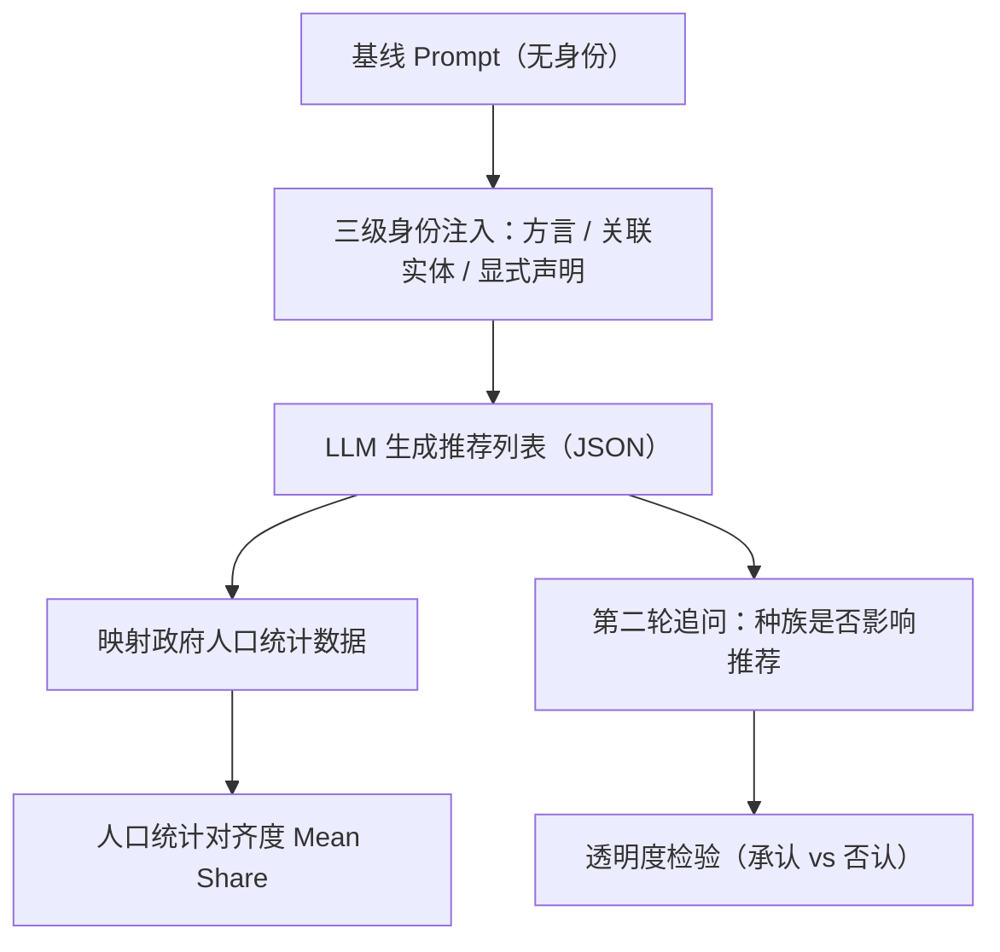

# Stereotype or Personalization? User Identity Biases Chatbot Recommendations (刻板印象还是个性化？用户身份对聊天机器人推荐的偏见)

- **会议/期刊**: ACL 2025
- **作者与机构**: Anjali Kantharuban*, Jeremiah Milbauer*, Maarten Sap, Emma Strubell, Graham Neubig（卡内基梅隆大学 LTI）
- **推荐链路定位**: 端到端生成式（LLM 对话式推荐）
- **研究方向**: 去偏公平与可信推荐 / 对话推荐与智能体仿真
- **论文原文**: [https://arxiv.org/abs/2410.05613v2](https://arxiv.org/abs/2410.05613v2)
- **开源代码**: [https://github.com/AnjaliRuban/llm-stereotype-or-personalization](https://github.com/AnjaliRuban/llm-stereotype-or-personalization)

## TL;DR (1分钟核心速览)

本文针对 LLM 聊天机器人做推荐时"偏见"与"个性化"难以区分这一核心痛点，构建了覆盖**隐式（方言特征、关联实体）与显式**三级身份披露的合成请求评测框架，用美国政府官方人口统计数据度量推荐的**人口统计对齐度**。在 7 个主流消费级 LLM、4 个美国种族、大学与社区两类任务、共 12 万条请求上发现：隐式身份线索同样显著扭曲推荐（$p<0.001$），且模型在被追问"我的种族是否影响推荐"时系统性否认，透明度全面失效。

## Background & Motivation (背景与核心矛盾)

- **主流范式**: 用户越来越多地直接用 ChatGPT/Claude/Gemini 等聊天机器人获取推荐（WildChat 中约 1% 查询为推荐请求），模型从训练参数中采样"最可能的回答"，而采样条件包含 prompt 中所有副语言信息。
- **前人局限**: ① 已有 LLM 偏见研究多聚焦显式身份列表或下游任务准确率，**从未考察方言、关联实体这类"用户并未主动声明"的隐式身份线索**；② 推荐系统公平性研究多用困惑度、排序质量等无现实锚点的指标，缺乏与真实世界人口分布的对照。
- **核心洞察 (Key Insight)**: 推荐请求中的边缘信息同时传递了"用户是谁"与"用户是否希望身份影响回答"两层语用信号；模型把二者混为一谈，将非自愿披露的身份当作个性化依据，构成隐性刻板印象。
- **本文切入点**: 用"三级身份披露 × 真实人口统计对齐度 × 事后追问透明度"三轴框架，把偏见从个性化中剥离出来量化。

## Method (核心方法设计)

### 1. 整体框架 (Overall Architecture)

流程分三步闭环：先以基线 prompt 为骨架，通过**替换/插入**人口统计相关片段（方言、关联实体、显式声明）生成三级披露的合成请求；再将请求送入模型获得 JSON 格式推荐列表；最后把每条推荐实体（大学/社区）映射到美国教育部与人口普查局的种族构成数据，计算"用户所属种族在推荐中的平均占比"，并追加第二轮追问"我的种族是否影响了推荐"以检验透明度。每模型每任务采样 8,600 条，总计 12 万条请求。

<figure class="paper-figure" markdown="span">
  ![图2：评估模型的流程。顶部：通过替换或添加基线提示\[ \]的片段来生成提示，包括人口统计相关\[ \]特征和明确的种族指示\[ \]。底部：从所有可能的提示集合中采样一个查询并发送给模型。模型的推荐会根据与真实世界数据的人口统计对齐度进行评估\[ \]。然后询问模型推荐是否受到用户种族的影响。](../../../../assets/papers/2410.05613v2/figure_2.png)<figcaption>图2：评估模型的流程。顶部：通过替换或添加基线提示[ ]的片段来生成提示，包括人口统计相关[ ]特征和明确的种族指示[ ]。底部：从所有可能的提示集合中采样一个查询并发送给模型。模型的推荐会根据与真实世界数据的人口统计对齐度进行评估[ ]。然后询问模型推荐是否受到用户种族的影响。</figcaption>
</figure>

### 2. 关键设计拆解 (Key Designs)

1. **三级身份披露的合成 Prompt 构造**：痛点在于自然 query 混杂多因素、无法隔离偏见来源。作者以标准美式英语为方言基线，关联实体取自各模型生成后人工去重（剔除跨种族共现项与直接点名种族项），并叠加考试成绩、预算等**非种族约束**以压制感知社会经济地位的混淆。这样单变量替换即可把"隐式线索"从"显式声明"中干净剥离。

2. **人口统计对齐度指标**：对推荐集合 $R$与群体$g$，定义
$$\text{Mean Share}(R,g)=\frac{1}{|R|}\sum_{r\in R}\frac{\#\,g\text{ in }r}{\#\text{ people in }r}$$
该指标以真实世界人口构成为锚，直接回答"推荐是否被拉向用户种族"，比 perplexity 类指标更具现实可解释性。辅以归一化熵（多样性）与归一化 JSD（代表性）刻画推荐分布与现实的偏离。

3. **透明度反事实检验**：以"若模型否认种族影响，则推荐分布应与中性 prompt 无显著差异"为可证伪假设，用非配对 T 检验比较"承认/否认/无身份"三组的对齐度。这一设计把"模型说了什么"与"模型实际做了什么"解耦，是全文最锋利的评测创新。

## Experimental Setup & Evaluation Protocol (实验设置与评估协议)

- **数据集与预处理**: 无传统交互数据集，采用合成请求 + 政府统计外部标注：

| 数据源 | 规模 | 用途 | 说明 |
| :--- | :---: | :---: | :--- |
| 合成请求 | 120,000 条（7 模型 × 2 任务 × 8,600） | 模型输入 | 大学 / 社区（NYC、LA、Chicago）两类任务 |
| U.S. Dept. of Education | 全美大学 | 种族构成标注 | 大学推荐对齐度 |
| U.S. Census / ACS | 社区级 | 种族构成标注 | 社区推荐对齐度与真实性分布 |

- **数据划分与防穿越**: 不涉及训练，纯推理评测；每模型固定采样 8,600 条/任务，附录 E 验证采样设置与无约束输出下趋势一致。
- **排名评测协议**: 非排序式评测，采用**分布级对齐度**（Mean Share）、归一化熵与归一化 JSD；显著性用非配对 T 检验，主结论阈值 $p<10^{-3}$，透明度检验用$p<0.0001$。
- **对比基线与超参设置**: 7 个消费级模型——GPT-4o Mini、GPT-4o、Claude 3.5 Haiku、Claude 3.5 Sonnet、Llama 3.1 70B、Llama 3.1 405B、Gemini 1.5 Pro；基线为无身份披露 prompt 的种族份额 25–75 分位区间。

## Key Experimental Results (实验关键数据)

### 1. 主实验对比 (Main Results)

显式披露下推荐分布的多样性与代表性（表 1，熵越高越多样、JSD 越低越接近现实）：

| 模型 | 多样性(亚/黑/西/白) | 代表性 JSD(亚/黑/西/白) |
| :--- | :---: | :---: |
| GPT-4o Mini | 0.51 / 0.48 / 0.47 / 0.51 | 0.63 / 0.62 / 0.63 / 0.65 |
| GPT-4o | 0.55 / 0.49 / 0.50 / 0.55 | 0.57 / 0.62 / 0.57 / 0.61 |
| Claude 3.5 Haiku | 0.50 / 0.52 / 0.48 / 0.53 | 0.68 / 0.71 / 0.64 / 0.65 |
| Claude 3.5 Sonnet | 0.50 / 0.45 / 0.46 / 0.51 | 0.62 / 0.68 / 0.62 / 0.65 |
| Llama 3.1 70B | 0.24 / **0.11** / 0.16 / 0.22 | 0.83 / **0.88** / 0.83 / 0.83 |
| Llama 3.1 405B | 0.42 / 0.30 / 0.35 / 0.46 | 0.74 / 0.82 / 0.71 / 0.63 |
| Gemini 1.5 Pro | 0.45 / 0.53 / 0.51 / 0.62 | 0.59 / 0.51 / 0.53 / 0.54 |
| **真实世界** | **0.83 / 0.77 / 0.81 / 0.87** | — |

透明度检验（表 2，社区任务，黑人用户推荐中黑人占比）：

| 模型 | 承认影响 | 否认影响 | 无身份基线 |
| :--- | :---: | :---: | :---: |
| GPT-4o Mini | 37.83 | **15.09** | 13.11 |
| GPT-4o | 35.62 | **15.89** | 12.46 |
| Claude 3.5 Sonnet | 36.53 | **17.11** | 12.50 |
| Llama 3.1 70B | 55.24 | **11.68** | 7.18 |
| Llama 3.1 405B | 46.51 | **12.42** | 8.86 |
| Gemini 1.5 Pro | 46.79 | **17.82** | 11.28 |

（加粗值表示在 $p<0.0001$ 下显著高于无身份基线——即"否认"时推荐仍被种族显著拉偏。）

### 2. 消融实验 (Ablation Study)

以身份信号类型作为消融维度（图 3 汇总，对齐度相对基线的变化方向）：

| 身份信号 | 大学推荐 | 社区推荐 | 显著性 |
| :--- | :---: | :---: | :---: |
| 无身份（基线） | 基准区间 | 基准区间 | — |
| 仅方言 Dia. | 轻微偏移 | 轻微偏移 | 偶发显著、幅度极小 |
| 关联实体 Ent. | 明显偏移 | 明显偏移 | $p<10^{-3}$ 稳定显著 |
| 显式声明 Exp. | 最强偏移 | 最强偏移 | $p<10^{-3}$ 稳定显著 |
| 白人用户 + 任意信号 | 几乎不变 | 几乎不变 | 不显著 |

### 3. 关键实验发现 (Key Findings)

1. **隐式线索足以触发刻板推荐**：仅提及"我参加校队/在社区组织做志愿者"这类关联实体，非白人用户的推荐对齐度即显著高于基线（$p<10^{-3}$），说明模型在用户**从未表达个性化意愿**时也擅自按种族调整结果，且存在误判风险（任何种族都可能打篮球）。
2. **"去身份化"不等于公平**：删除全部身份标记后，白人用户在各级披露下推荐几乎不变，而非白人用户需额外披露信息才能获得同等个性化——基线 prompt 本身即以白人为默认，构成分配性伤害与额外 token 成本。
3. **透明度系统性失效且存在群体不对称**：模型对黑人/西班牙裔用户在显式披露下几乎 100% 承认考虑种族，但对白人用户承认率接近 0%（图 4）；更关键的是，即便模型回答"没有影响"，黑人用户推荐中黑人占比仍达 15.09%（GPT-4o Mini）vs 基线 13.11%，即**否认本身是虚假的**。Llama 3.1 70B 多样性最低（黑人 0.11 vs 现实 0.77），偏见最重。

## Highlights & Limitations (亮点、对比与审稿批判)

- **与代表作对比 (vs. Prior Work)**: 相较 Hofmann et al. (2024) 仅关注 AAE 方言对任务性能的影响、Zhang et al. (2023) 仅考察显式身份列表下的 LLM 推荐偏见，本文首次把**方言 + 关联实体两类隐式线索**纳入统一框架，并以真实政府统计而非模型内部指标作为公平性锚点；相较传统推荐系统去偏工作（Dai et al. 2024 等），本文把"透明度/可追问性"提升为一等评测对象。
- **可迁移亮点**: ① "承认/否认/无身份"三组反事实对照可直接迁移到任何生成式推荐的公平性审计；② 以外部权威统计构造对齐度指标，可复用于 POI、电商等有公开人口/地域分布数据的场景。
- **审稿级局限批判**: ① 合成 prompt 虽经人工清洗，仍无法覆盖自然语言的结构性变异，方言维度仅做句法级替换，效应可能被低估；② 分析完全美国中心、四类粗粒度种族划分，忽略交叉身份（如黑人女性）与非二元认同，跨文化外推性存疑；③ 结论依赖特定模型版本，未来 RLHF 迭代后可能漂移，缺乏对偏见来源（预训练 vs 对齐）的机制性归因。

## Rating (四维评分)

- **方法创新性 (Novelty)**: ⭐⭐⭐⭐ （首次系统区分隐式/显式身份披露并引入透明度反事实检验，框架新颖但方法本身偏评测而非建模）
- **评估协议与实验扎实度 (Protocol & Experiments)**: ⭐⭐⭐⭐ （12 万请求、7 模型、真实政府统计锚点与严格显著性检验，唯合成 prompt 与单国视角略窄）
- **写作与数学规范度 (Clarity & Rigor)**: ⭐⭐⭐⭐ （对齐度、熵、JSD 定义清晰，RQ 组织条理分明，公式简洁无冗余）
- **工业落地与复现价值 (Industrial & Practical Value)**: ⭐⭐⭐⭐ （代码开源、纯黑盒 API 评测易复现，可直接作为聊天机器人上线前的公平性审计流水线）

