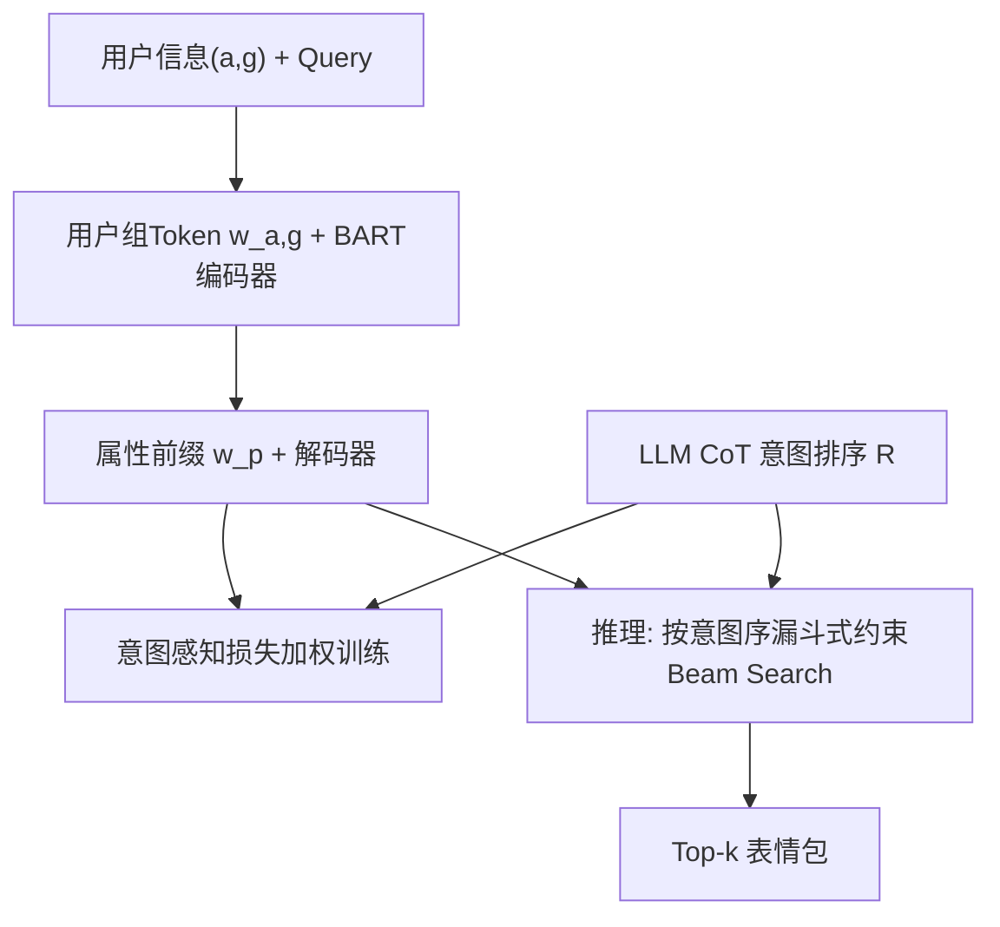
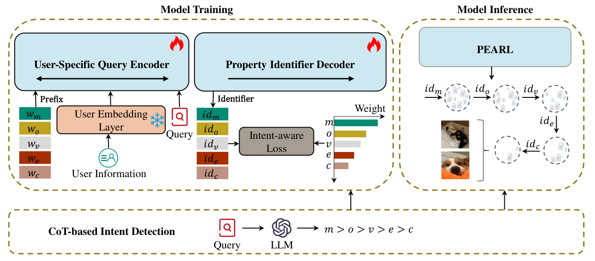

# A Generative Framework for Personalized Sticker Retrieval (面向个性化表情包检索的生成式框架)

- **会议/期刊**: Findings of EMNLP 2025
- **作者与机构**: Changjiang Zhou, Ruqing Zhang, Jiafeng Guo 等（中科院计算所 / 国科大 / 腾讯微信搜索应用部）
- **推荐链路定位**: 召回（生成式端到端检索）
- **研究方向**: 生成式推荐与离散语义 ID / 大语言模型推荐
- **论文原文**: [https://arxiv.org/abs/2509.17749v4](https://arxiv.org/abs/2509.17749v4)
- **开源代码**: 暂未开源（仅依赖公开预训练模型 [bge-large-zh-v1.5](https://huggingface.co/BAAI/bge-large-zh-v1.5) 与 [bart-large](https://huggingface.co/facebook/bart-large)）

## TL;DR (1分钟核心速览)

现有生成式检索（DSI/MINDER）只建模 query–doc 相关性，无法刻画"不同用户对同一 query 期待不同表情包"的个性化需求。PEARL 提出两点增量：(i) 以年龄+性别划分用户组，用点击/意图/兴趣三任务预训练一个用户组特殊 token 嵌入；(ii) 用 LLM 的 CoT 推理给出 query 在五类表情属性（OCR/IP/实体/风格/语义）上的意图排序，并以 $1/\log_2(\text{rank}+1)$ 衰减权重重加权多属性标识符的解码损失，推理时按意图序做漏斗式约束 beam search。在微信离线集 Full-Ranking 下 MRR@10 相对最强基线 MINDER 提升约 15%、Recall@10 提升约 18.3%，线上人工评测 CTR +7.12%、GSB +5.98%。

## Background & Motivation (背景与核心矛盾)

- **主流范式**: 生成式检索把整个语料压进一个 Seq2Seq 模型参数，query 直接自回归生成 docid；多视图 docid（MINDER）已被证明优于字符串/单语义 docid。
- **前人局限一**: 纯相关性建模忽略用户差异——同一句"Hello"，年轻用户偏好活泼动图、年长用户偏好文字型，导致"检索对了语义、错了人"。
- **前人局限二**: 单个用户对不同 query 关注的属性维度不同——"哆啦A梦睡觉"应以角色 IP 为主，"早安"应以 OCR 文本为主，而现有方法对所有属性标识符一视同仁。
- **核心洞察 (Key Insight)**: 表情包检索本质是"表达性、模糊性"检索，其满意度 = 相关性 × 用户偏好 × 意图对齐，三者缺一不可；且用户偏好可由粗粒度人口属性（年龄/性别）+ 历史点击近似刻画，无需个体级隐私数据。
- **本文切入点**: 把"用户组嵌入"注入编码器、把"意图排序"注入解码损失与解码顺序，用生成式框架一次性统一相关性与个性化。

## Method (核心方法设计)

### 1. 整体框架 (Overall Architecture)

PEARL 采用 encoder–decoder 生成架构。编码端把用户组特殊 token $w_{a,g}$拼在 query 前送入 BART 编码器得到$H_q$；解码端为五类属性各设一个前缀 token$w_p$，分别生成该属性的 PQ 标识符。训练分三阶段：先用点击日志预训练用户组嵌入（三任务联合，冻结后使用），再做索引训练（记忆全部表情的属性标识符），最后做检索训练（用户-query-表情三元组 + 意图感知加权损失）。推理时按 LLM 给出的意图序$R$ 依次在对应前缀树上做约束 beam search，逐层取交集形成漏斗式收敛。

<figure class="paper-figure" markdown="span">
  <figcaption>图1：PEARL 概览。</figcaption>
</figure>

### 2. 关键设计拆解 (Key Designs)

1. **用户组判别式表征学习（三任务联合）**：痛点是把用户信息塞进生成模型缺乏监督信号。做法是为每个 $(a,g)$组学一个特殊 token 嵌入，用三个辅助任务联合优化：点击预测（query 与表情语义相关性）、意图预测（LLM 标注的 golden intent 多标签分类）、兴趣预测（用户组对角色 IP / 实体的偏好二分类）。总损失$\mathcal{L}_{UE}=\mathcal{L}_{click}+\mathcal{L}_{intent}+\mathcal{L}_{interest}$，学完后**冻结**注入生成模型。直觉：兴趣预测任务贡献最大（消融中 MRR@10 达 0.1838），说明表情偏好主要由 IP 与实体驱动，而非纯语义匹配。

2. **意图感知损失（Intent-aware Loss）**：痛点是多属性标识符等权监督会淹没真正关键的属性维度。用 LLM 以 CoT 方式迭代选出意图序 $R$（如 `IP > style > entity > meaning > OCR`），并对检索损失按排名衰减加权：
$$\mathcal{L}_{R}=-\sum_{\tau\in\mathcal{T}}\sum_{p\in R} d_p \log P_\theta(id_p \mid w_p, w_{a,g}, q),\quad d_p=\frac{1}{\log_2(\text{rank}(p)+1)}$$
直觉：排名越靠前的属性获得越大梯度，使模型把解码容量优先分配给用户真正在意的维度。

3. **漏斗式意图引导解码与训练目标**：推理时按 $R$顺序在属性$p$的前缀树$T_p$上做约束 beam search 得候选集$S_i$，再用$S_i \leftarrow S_i \cap S_{i-1}$逐层过滤，从粗粒度收敛到细粒度。总损失$\mathcal{L}_T=\mathcal{L}_I+\mathcal{L}_R$（索引损失 + 检索损失），无负采样（生成式范式天然免负采样），PQ 设$m=8$子空间、$k=256$ 聚类中心，beam size=10、最大解码步 15。

## Experimental Setup & Evaluation Protocol (实验设置与评估协议)

- **数据集与预处理**: 从微信线上采样约 110 万表情（过滤冒犯/侵权内容），覆盖 17,906 个角色 IP、38,895 个实体、107 种视觉风格；用户按 4 年龄段 × 2 性别分 8 组，人工标注训练/测试集。

| 数据集 | #Queries | #User-Query | #Triplets | 说明 |
| :--- | :---: | :---: | :---: | :--- |
| 训练集 | 1,891 | 2,308 | 12,568 | 人工标注 Match/No Match |
| 测试集 | 258 | 347 | 14,446 | 同上，含全库候选 |

- **数据划分与防穿越 (Splitting Strategy)**: 按 query 独立划分训练/测试，测试 query 不出现在训练集中；用户组嵌入预训练使用独立的线上点击日志，与测试标注隔离。
- **排名评测协议 (Ranking Protocol)**: 无偏 `Full-Ranking`（在 110 万表情全库上排序），指标 MRR@{1,5,10,20} 与 Recall@{1,5,10,20}；线上采用 Balanced Interleaving（BI）做贴纸级 $\Delta$CTR/$\Delta$ACP，session 级做$\Delta$GSB，20 名不同年龄性别专家、1,000 条有效 query。
- **对比基线与超参设置**: 四类基线——流行度（GPop/UPop）、传统检索（BM25/DPR/ANCE）、跨模态（CN-CLIP/StickerCLIP/PerSRV）、生成式（DSI/DSI-QG/GENRE/Ultron/MINDER）；骨干 BART-large（406M），BERT 用 bge-large-zh-v1.5，LLM 用 deepseek-chat，显著性 $p\le 0.05$。

## Key Experimental Results (实验关键数据)

### 1. 主实验对比 (Main Results)

| 类别 | 模型 | MRR@1 | MRR@10 | MRR@20 | Recall@10 | Recall@20 |
| :--- | :--- | :---: | :---: | :---: | :---: | :---: |
| 流行度 | UPop | 0.0231 | 0.0315 | 0.0319 | 0.0061 | 0.0067 |
| 传统 | ANCE | 0.0823 | 0.1454 | 0.1478 | 0.0592 | 0.0793 |
| 跨模态 | PerSRV | 0.1061 | 0.1401 | 0.1496 | 0.0476 | 0.0617 |
| 生成式 | DSI | 0.0029 | 0.0079 | 0.0079 | 0.0011 | 0.0010 |
| 生成式 | GENRE | 0.0317 | 0.0539 | 0.0543 | 0.0143 | 0.0152 |
| 生成式 | MINDER | 0.1327 | 0.1804 | 0.1987 | 0.0594 | 0.0703 |
| **本文** | **PEARL** | **0.1547** | **0.2074** | **0.2143** | **0.0732** | **0.0835** |
| | Improv. vs MINDER | +16.6% | +15.0% | +7.9% | +23.2% | +18.8% |

线上对比（vs 关闭个体级个性化的微信线上系统）：$\Delta$CTR **+7.12%**，$\Delta$ACP **−0.19**（点击位置更靠前），$\Delta$GSB **+5.98%**。

### 2. 消融实验 (Ablation Study)

| 变体 | MRR@10 | Recall@10 | 说明 |
| :--- | :---: | :---: | :--- |
| PEARL 完整 | **0.2074** | **0.0732** | — |
| PEARL$_{-UE}$ | 0.1497 | 0.0463 | 去掉用户组嵌入 |
| PEARL$_{click}$ | 0.1639 | 0.0585 | 仅点击预测任务 |
| PEARL$_{intent}$ | 0.1563 | 0.0518 | 仅意图预测任务 |
| PEARL$_{interest}$ | 0.1838 | 0.0614 | 仅兴趣预测任务 |
| PEARL$_{-IAL}$ | 0.1863 | 0.0638 | 去掉意图感知损失 |
| PEARL$_{-IG}$ | 0.1782 | 0.0575 | 去掉推理意图引导 |

标识符类型对比：Atomic 0.0085 / String 0.0684 / RQ-VAE 0.1892 / **PQ 0.2074**（MRR@10）。

### 3. 关键实验发现 (Key Findings)

1. **个性化嵌入是最大增益源**：去掉用户组嵌入后 MRR@10 从 0.2074 跌至 0.1497（−27.8%），跌幅远超去掉意图损失（−10.2%）与意图引导（−14.1%），证明表情检索的瓶颈首先在"人"而非"语义"。
2. **兴趣预测任务贡献最大**：三任务中仅保留兴趣预测即达 0.1838，接近完整模型，说明用户对表情的偏好主要由角色 IP 与实体承载，而非 query 语义相关性。
3. **PQ 优于 RQ-VAE**：PQ 标识符比 RQ-VAE 高 0.0182 MRR@10，原因是表情属性层级结构弱，残差量化更适合 TIGER 式强层级商品元数据；同时量化标识符远胜字符串标识符（0.0684），因定长码本使前缀树更平衡。

## Highlights & Limitations (亮点、对比与审稿批判)

- **与代表作对比 (vs. Prior Work)**: 相比 MINDER（多视图 docid 但无个性化），PEARL 多出用户组嵌入与意图加权两条正交增益；相比 PerSRV（首个个性化表情检索，基于风格排序），PEARL 额外挖掘 query 背后的属性意图，MRR@10 高出 0.0673；相比 DSI/GENRE 等纯相关性生成式检索，PEARL 在生成范式内原生支持个性化。
- **可迁移亮点**: (i) "LLM CoT 产出属性意图序 → 排名衰减权重重加权多视图解码损失"这一套路可直接迁移到电商多属性商品、短视频多模态标签的生成式召回；(ii) 用辅助判别任务预训练特殊 token 再冻结注入生成模型，是一种低成本注入用户/场景先验的通用技巧。
- **审稿级局限批判**: (i) 个性化粒度仅到"年龄段×性别"用户组，无法刻画个体偏好，且人口属性在隐私敏感场景可用性存疑；(ii) 完全丢弃图像模态，仅用文本属性，而表情本质是视觉表达，跨模态信息缺失可能构成性能天花板；(iii) 意图序依赖 LLM 离线预计算（仅缓存 top-10,000 高频 query），长尾 query 需实时调用 LLM，经济成本与延迟在工业大规模场景下受限；(iv) 推理比 MINDER 慢 12ms（124ms vs 112ms），漏斗式多轮解码的延迟随意图数线性增长。

## Rating (四维评分)

- **方法创新性 (Novelty)**: ⭐⭐⭐⭐ （首次将生成式检索引入个性化表情包场景，"用户组嵌入 + LLM 意图序加权解码"组合新颖，但各组件单独看均属已有范式的迁移）
- **评估协议与实验扎实度 (Protocol & Experiments)**: ⭐⭐⭐⭐⭐ （110 万全库 Full-Ranking + 四类基线 + 完整消融 + 标识符分析 + 线上 BI/GSB 人工评测，离线线上双验证，显著性检验完备）
- **写作与数学规范度 (Clarity & Rigor)**: ⭐⭐⭐⭐ （框架图与公式清晰，三任务与两阶段训练划分明确；但用户兴趣预测公式与点击预测几乎重复罗列，符号冗余）
- **工业落地与复现价值 (Industrial & Practical Value)**: ⭐⭐⭐⭐ （已在微信线上验证 CTR +7.12%，内存从 3.6G 降至 1.6G；但代码未开源、依赖 LLM 意图预计算，复现与低成本部署存在门槛）

