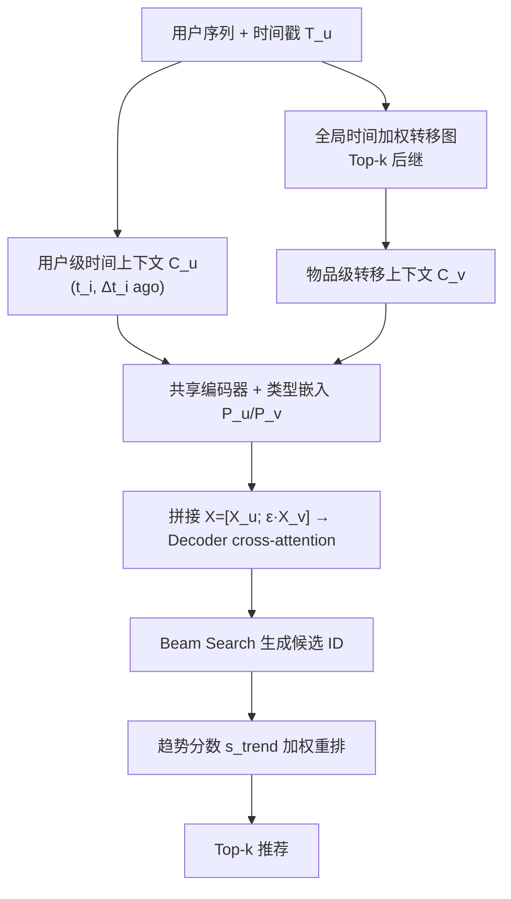
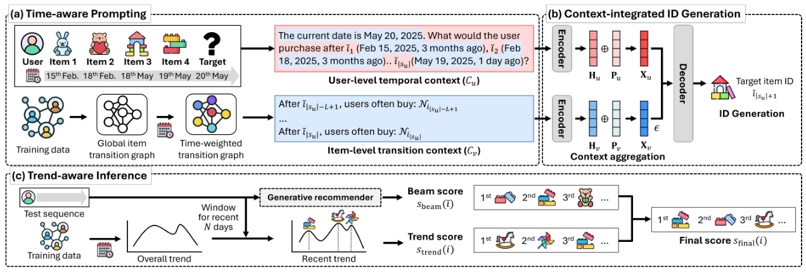

# Enhancing Time Awareness in Generative Recommendation (增强生成式推荐的时间感知能力)

- **会议/期刊**: EMNLP 2025 (Findings)
- **作者与机构**: Sunkyung Lee, Seongmin Park, Jonghyo Kim, Mincheol Yoon, Jongguk Lee* — 成均馆大学 (Sungkyunkwan University)
- **推荐链路定位**: 端到端生成式（语义 ID 自回归生成 + 推理期重排）
- **研究方向**: 生成式推荐 / 序列推荐
- **论文原文**: [https://arxiv.org/abs/2509.13957v2](https://arxiv.org/abs/2509.13957v2)
- **开源代码**: [https://github.com/skleee/GRUT](https://github.com/skleee/GRUT)

## TL;DR (1分钟核心速览)

现有生成式推荐（TIGER/LC-Rec/GRAM 等）只把物品序列当作有序 token 串，完全丢弃时间戳，导致用户偏好漂移（如从玩偶转向平板）后仍按历史高频推荐。GRUT 提出**时间感知提示**：在提示中为每个历史物品附上绝对时间戳与"距推理时刻多久"的目标相对间隔，并额外注入由全局时间加权转移图导出的 item 级转移模式；推理阶段再用**免训练趋势分数**对 beam 候选重排。在 4 个 Amazon/Yelp 数据集、`Leave-One-Out` + `Full-Ranking` 协议下，R@5 最高提升 15.4%、N@5 提升 14.3%。

## Background & Motivation (背景与核心矛盾)

- **主流范式**: 生成式推荐把 next-item 预测改写为 text-to-text 生成，用 T5 类模型自回归输出目标物品的语义 ID（RQ-VAE 码本或关键词 ID），代表工作 TIGER、LC-Rec、LETTER、IDGenRec、GRAM。
- **前人局限**: (i) 提示中只有物品顺序，**没有任何时间信号**，模型无法区分"一年前买的玩偶"与"上周买的乐高"；同一用户在任意推理时刻得到完全相同的预测。(ii) 传统时序推荐（TiSASRec、TGCL4SR、HM4SR）依赖显式时间 embedding 或对比学习，无法直接迁移到"用自然语言提示 LLM"的生成式范式。
- **核心洞察 (Key Insight)**: 作者用 NVEmbed 计算相邻物品对的语义相似度并按时间间隔分桶，发现**间隔越长、相邻物品语义相似度越低**（附录图 6），定量证实偏好漂移；同时绝对时间戳还能承载圣诞/假期等周期性偏好，是间隔信息无法替代的正交信号。
- **本文切入点**: 不做新网络结构，而是把"时间"翻译成 LLM 能读的自然语言，并在解码端用免训练趋势分数补上训练后才出现的实时热点。

## Method (核心方法设计)

### 1. 整体框架 (Overall Architecture)

输入用户序列被拆成两路文本上下文：用户级时间上下文 $C_u$（带时间戳的物品序列）与物品级转移上下文$C_v$（最近$L$个物品的全局后继模式）。两路文本经**共享编码器**独立编码，加上可学习的上下文类型嵌入后拼接为统一 key-value 矩阵，解码器通过 cross-attention 聚合两路信息并自回归生成目标物品 ID。训练用标准 teacher-forcing 交叉熵；推理时先 beam search 得到$B$ 个候选，再用离线预计算的趋势分数做一次加权重排。

<figure class="paper-figure" markdown="span">
  <figcaption>图2：GRUT的整体架构。该模型的核心创新包括（a）时间感知提示，用于捕捉用户不断变化的偏好；随后是（b）上下文集成ID生成，用于聚合上下文；并辅以（c）趋势感知推理，自适应地融入物品趋势。</figcaption>
</figure>

### 2. 关键设计拆解 (Key Designs)

1. **用户级时间上下文 $C_u$（双时间信号 verbalize）**：痛点是把时间塞进提示时"绝对时刻"与"相对间隔"互相冲突。作者让每个物品同时携带两者，并把间隔定义为**相对推理时刻**而非相邻间隔：
   $C_u$: "The current date is$t_{|s_u|+1}$. What would the user purchase after$\tilde{i}_1\,(t_1, \Delta t_1\ \text{ago}), \dots, \tilde{i}_{|s_u|}\,(t_{|s_u|}, \Delta t_{|s_u|}\ \text{ago})$?"
   其中 $\Delta t_i = t_{|s_u|+1}-t_i$。直觉：目标相对间隔直接编码"该兴趣距今多远"，天然支持长间隔下的偏好漂移；绝对时间戳补足季节性周期。消融显示二者组合比任一单独使用再涨 2.0%–11.1% R@5。

2. **物品级转移上下文 $C_v$（把图结构翻译成文本）**：单用户历史无法刻画"大家买完 A 通常买什么"。作者从全部训练序列构建全局有向转移图，边权按时间衰减：
   $w(\Delta t_{i,j})=\max\left(\exp\left(-\frac{|\Delta t_{i,j}|}{\tau}\right),\,c\right),\quad p_{i,j}=\frac{\sum_{(i,j)\in A_{i,j}} w(\Delta t_{i,j})}{\sum_{j'\in\mathcal{I}}\sum_{(i,j')\in A_{i,j'}} w(\Delta t_{i,j'})}$对序列末$L$个物品各取 Top-$k$后继，写成 "After$\tilde{i}$, users often buy:$N_i$."。关键在拼接时的缩放因子$\epsilon$：$X=[X_u;\ \epsilon\cdot X_v]$，$\epsilon$取 0.001–0.01，防止集体转移模式淹没个性化信号（$\epsilon=1$ 时 R@5 掉 8.6%）。

3. **趋势感知推理与训练目标**：训练损失为逐 token 交叉熵 $\mathcal{L}=-\sum_{t=1}^{|\tilde{i}|}\log P(\tilde{i}_t\mid C_u,C_v,\tilde{i}_{<t})$，无负采样（全库 softmax 由生成似然隐式承担）。推理时对 beam 内候选$i$计算$s_{\text{trend}}(i)=\log\left(\frac{r_i}{\max_j r_j}+1\right)$，$r_i$为最近$N$天内出现次数，最终$s_{\text{final}}(i)=s_{\text{beam}}(\tilde{i})+\lambda\cdot s_{\text{trend}}(i)$。对数压缩 + 最大值归一化避免爆款通吃；趋势分数可离线预计算，在线仅增加 1.6–2.2 ms/用户（beam search 本身 0.1–0.3 s），且该模块可直接插到 IDGenRec/LETTER/LC-Rec 上平均涨 4.0% R@5。

## Experimental Setup & Evaluation Protocol (实验设置与评估协议)

- **数据集与预处理**: 三个 Amazon 子类 + Yelp，标准 `5-core` 过滤（用户与物品交互数均 ≥5）：

| 数据集 | #Users | #Items | #Interactions | 稀疏度/密度 | 特征/场景说明 |
| :--- | :---: | :---: | :---: | :---: | :--- |
| Beauty | 22.4k | 12.1k | 0.20M | 99.93% 稀疏 | Amazon 美妆，长尾极重 |
| Toys | 19.4k | 11.9k | 0.16M | 99.93% 稀疏 | Amazon 玩具，季节性强 |
| Sports | 35.6k | 18.4k | 0.30M | 99.95% 稀疏 | Amazon 户外运动 |
| Yelp | 30.4k | 20.1k | 0.32M | 99.95% 稀疏 | 本地生活 POI |

- **数据划分与防穿越**: `Leave-One-Out`——每用户最后一项作测试、倒数第二项作验证、其余训练；作者特别指出并**移除了 IDGenRec 用户 ID 中拼接全序列导致测试项泄漏**的问题（附录 B.3.3），这是其复现结果与原论文不同的原因。
- **排名评测协议**: 无偏 `Full-Ranking`（对全部物品排序，非采样），指标 R@{5,10}、N@{5,10}；显著性用双尾 t 检验 $p<0.05$。
- **对比基线与超参设置**: 19 个基线，含 6 个传统序列模型（GRU4Rec/HGN/SASRec/BERT4Rec/FDSA/S3Rec）、4 个时序模型（TiSASRec/TiCoSeRec/HM4SR/HORAE）、9 个生成式模型（P5 三变体/TIGER/IDGenRec/ELMRec/LETTER/LC-Rec/GRAM）。骨干为 T5-small，最大序列长 20，文本长 128，Adam lr=1e-3，warm-up 0.05，超参按验证集 NDCG@10 调优。

## Key Experimental Results (实验关键数据)

### 1. 主实验对比 (Main Results)

| 模型 | Beauty R@5 | Beauty N@5 | Toys R@5 | Toys N@5 | Sports R@5 | Sports N@5 | Yelp R@5 | Yelp N@5 |
| :--- | :---: | :---: | :---: | :---: | :---: | :---: | :---: | :---: |
| SASRec | 0.0323 | 0.0200 | 0.0339 | 0.0208 | 0.0147 | 0.0089 | 0.0284 | 0.0214 |
| TiSASRec | 0.0564 | 0.0359 | 0.0665 | 0.0410 | 0.0312 | 0.0178 | 0.0427 | 0.0323 |
| HM4SR | 0.0566 | 0.0409 | 0.0647 | 0.0480 | 0.0288 | 0.0204 | 0.0273 | 0.0185 |
| HORAE | 0.0508 | 0.0310 | 0.0555 | 0.0331 | 0.0379 | 0.0235 | 0.0419 | 0.0279 |
| TIGER | 0.0352 | 0.0236 | 0.0274 | 0.0174 | 0.0176 | 0.0111 | 0.0164 | 0.0103 |
| LC-Rec | 0.0503 | 0.0352 | 0.0543 | 0.0385 | 0.0259 | 0.0175 | 0.0341 | 0.0235 |
| GRAM | 0.0641 | 0.0451 | 0.0705 | 0.0510 | 0.0375 | 0.0256 | 0.0476 | 0.0326 |
| **GRUT** | **0.0740** | **0.0511** | **0.0769** | **0.0531** | **0.0427** | **0.0293** | **0.0488** | **0.0346** |
| Improv.% | +15.4* | +13.4* | +9.1* | +4.2* | +12.7* | +14.3* | +2.6 | +6.3* |

（* 表示 $p<0.05$ 显著；Yelp 上 R@5 提升不显著，N@5 显著。）

### 2. 消融实验 (Ablation Study)

| 变体 | Beauty R@5 | Beauty N@5 | Toys R@5 | Toys N@5 |
| :--- | :---: | :---: | :---: | :---: |
| GRUT 完整 | **0.0740** | **0.0511** | **0.0769** | **0.0531** |
| w/o user-level ($C_u$) | 0.0586 | 0.0408 | 0.0583 | 0.0410 |
| w/o item-level ($C_v$) | 0.0713 | 0.0492 | 0.0755 | 0.0518 |
| w/o trend score ($\lambda=0$) | 0.0726 | 0.0506 | 0.0758 | 0.0526 |
| w/o context-type embedding $P$ | 0.0711 | 0.0500 | 0.0728 | 0.0524 |
| w/o $\epsilon$($\epsilon=1$) | 0.0681 | 0.0486 | 0.0732 | 0.0529 |
| 仅绝对时间戳 | 0.0605 | 0.0415 | 0.0625 | 0.0428 |
| 仅目标相对间隔 | 0.0686 | 0.0486 | 0.0692 | 0.0486 |

### 3. 关键实验发现 (Key Findings)

1. **时间信号是主要增益来源，且"目标相对间隔"是核心**：去掉 $C_u$后 Beauty R@5 从 0.0740 跌至 0.0586（−20.8%），远超去掉$C_v$（−3.6%）或趋势分数（−1.9%）；仅用目标相对间隔已达 0.0686，说明"距今多久"比"何时发生"更贴近偏好漂移的物理机制。
2. **长间隔场景优势被放大**：按最近交互与目标间隔分桶后，Long 组上 GRUT 相对最佳基线 HM4SR 在 R@5 上提升 32.6%–46.0%，而 Short 组差距明显收窄——直接印证"时间感知解决的是漂移而非短期共现"这一动机。
3. **趋势重排是低成本通用插件**：$\lambda$ 从 0 调到最优仅带来 1.9% R@5 提升，但把同一模块套到 IDGenRec/LETTER/LC-Rec 上平均涨 4.0% R@5、2.9% N@5，且在线开销仅 1.6–2.2 ms/用户，属于"几乎免费"的工程增益。

## Highlights & Limitations (亮点、对比与审稿批判)

- **与代表作对比 (vs. Prior Work)**: 与 GRAM（同为文本 ID + 晚期融合）相比，GRUT 的本质差异是把**时间维度**而非物品语义关系作为第二路上下文；与 HM4SR/HORAE 相比，GRUT 是**微调** LLM 而非仅抽取表征，且用自然语言而非时间 embedding 承载时间；与 TiSASRec 相比，时间不再进入注意力算子，而是进入提示词，因而与任意 ID 方案解耦（附录 C.2 显示换 IDGenRec ID 或标题 ID 仍稳定涨 27%–39%）。
- **可迁移亮点**: (i) "目标相对间隔 + 绝对时间戳"双信号 verbalize 模板可直接复用到任何 LLM4Rec 提示工程；(ii) 免训练趋势分数重排可零成本挂到任意 beam-search 生成式推荐器上。
- **审稿级局限批判**: (i) 全局转移图纳入所有共现对，未做去噪，误点击会污染 $C_v$（作者自认）；(ii) 所有用户共享同一$\epsilon$与$\lambda$，未建模用户异质性（如高频/低频买家的时间敏感度差异）；(iii) 骨干仅 T5-small、序列长 20，未验证在 7B 级 LLM 或超长序列下的可扩展性，且 Yelp 上 R@5 提升不显著，跨域泛化证据偏弱。

## Rating (四维评分)

- **方法创新性 (Novelty)**: ⭐⭐⭐⭐ （首个把时间动态引入生成式推荐，双时间信号 + 图转文本 + 免训练重排三件套组合新颖，但单点技术均为已有组件的巧妙拼装）
- **评估协议与实验扎实度 (Protocol & Experiments)**: ⭐⭐⭐⭐⭐ （Full-Ranking 无偏评测、19 个基线、4 数据集、显著性检验齐全，且主动修正了 IDGenRec 的测试集泄漏问题，复现严谨度高于同类工作）
- **写作与数学规范度 (Clarity & Rigor)**: ⭐⭐⭐⭐ （提示模板与公式定义清晰、消融层次分明；但转移图与趋势分数的理论分析偏薄，缺少复杂度与收敛性讨论）
- **工业落地与复现价值 (Industrial & Practical Value)**: ⭐⭐⭐⭐ （代码开源，趋势重排在线开销仅毫秒级且可插拔；但依赖 T5 微调与全局转移图离线构建，冷启动物品的转移边稀疏问题未讨论）

