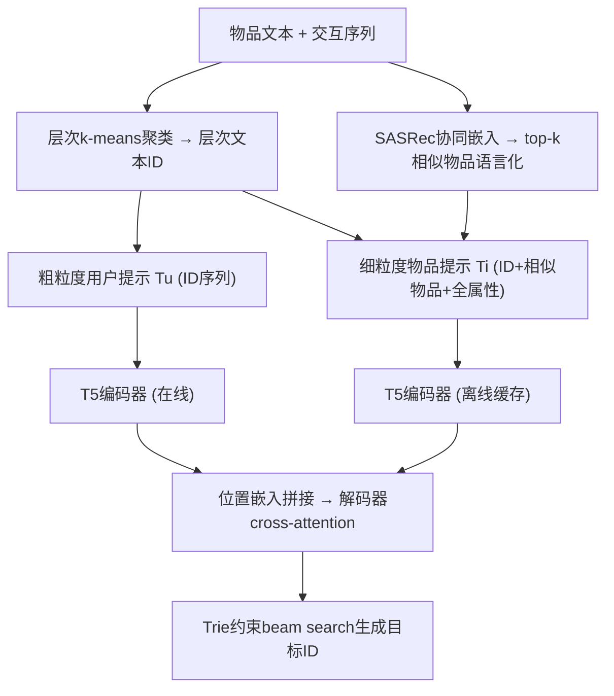
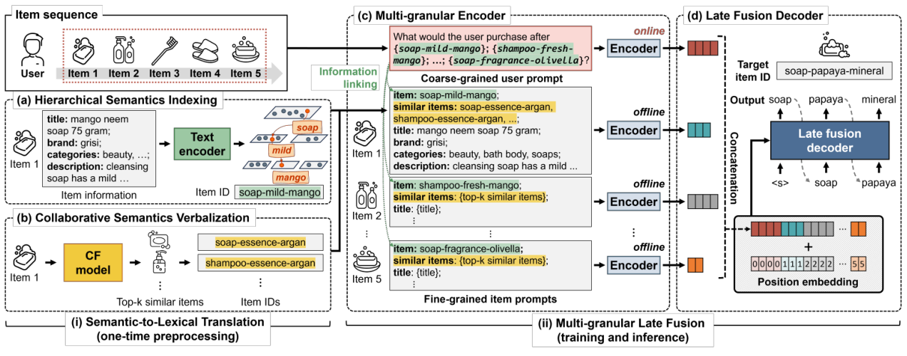

# GRAM: Generative Recommendation via Semantic-aware Multi-granular Late Fusion (语义感知多粒度后期融合的生成式推荐)

- **会议/期刊**: ACL 2025 (Main Conference)
- **作者与机构**: Sunkyung Lee, Minjin Choi, Eunseong Choi, Hye-young Kim, Jongwuk Lee (成均馆大学 / 三星研究院)
- **推荐链路定位**: 端到端生成式召回（Next-Item 生成）
- **研究方向**: 生成式推荐与离散语义 ID / 大语言模型推荐
- **论文原文**: [https://arxiv.org/abs/2506.01673v1](https://arxiv.org/abs/2506.01673v1)
- **开源代码**: [https://github.com/skleee/GRAM](https://github.com/skleee/GRAM)

## TL;DR (1分钟核心速览)

现有生成式推荐把丰富物品元数据压缩成简短 ID，既丢失细节又无法表达隐式物品关系。GRAM 提出两点增量：(i) **语义到词法翻译**——用层次 k-means 聚类 + TF-IDF 选词，把层次语义与协同语义写成 LLM 词表内的文本 ID 与"相似物品"属性；(ii) **多粒度后期融合**——用户提示（ID 序列）与物品提示（全文本）分别编码，仅在解码器 cross-attention 阶段融合，规避二次复杂度。在 Beauty/Toys/Sports/Yelp 四个基准、`Leave-One-Out` + `Full-Ranking` 协议下，相对 8 个 SOTA 生成式基线取得 R@5 提升 11.5–16.0%、N@5 提升 5.3–13.6%。

## Background & Motivation (背景与核心矛盾)

- **主流范式**: TIGER/LC-Rec/LETTER 用 RQ-VAE 量化码本构造数字 ID，IDGenRec 用 ID 生成器造文本 ID，P5 系列用顺序/聚类数字 ID；预测时 LLM 只看 ID 序列。
- **前人局限一（关系缺失）**: 数字 ID 落在 LLM 词表之外，存在语义鸿沟；预定义类目或量化码本难以区分相似物品，且自回归解码易因表层 token 相似而推荐语义不一致物品（口红→肥皂）。
- **前人局限二（信息丢失）**: 物品文本极长（Beauty 平均序列 1,440 token，仅 4.9% 短于 512），早期融合拼接全部文本带来 $O((|T_u|+|s|\cdot|T_i|)^2 d)$ 二次开销，故现有工作只能截取部分属性或抽关键词。
- **核心洞察 (Key Insight)**: 若把物品关系"翻译"进 LLM 原生词表，并把长文本的融合推迟到解码阶段，则既能保留全量语义，又能让 LLM 预训练知识真正被激活。
- **本文切入点**: 预处理阶段一次性完成语义→词法翻译，训练/推理阶段用多粒度提示 + 后期融合解耦"长文本编码"与"序列建模"。

## Method (核心方法设计)

### 1. 整体框架 (Overall Architecture)

GRAM 分三阶段闭环：(i) **离线预处理**——对物品文本嵌入做层次 k-means 得到层次文本 ID，再用现成 CF 模型（SASRec）取 top-$k$ 相似物品并以文本 ID 语言化，作为额外属性；(ii) **多粒度编码**——粗粒度用户提示（逆序 ID 序列）与细粒度物品提示（ID + 相似物品 + 标题/品牌/类目/描述）分别送入 T5 编码器，物品提示编码结果可离线缓存；(iii) **后期融合解码**——拼接所有提示表示并加位置嵌入，作为解码器 cross-attention 的 key/value，自回归生成目标文本 ID，推理时用 Trie 约束 beam search 保证生成合法 ID。

<figure class="paper-figure" markdown="span">
  <figcaption>图 4：GRAM 的整体架构。(i) 在训练前，我们通过语义到词法翻译以文本形式表示层次语义和协同语义。(ii) 用户/物品提示分别构建并编码。目标物品 ID 通过多粒度后期融合推断，直接利用丰富的文本信息。</figcaption>
</figure>

### 2. 关键设计拆解 (Key Designs)

1. **语义到词法翻译 (Semantic-to-Lexical Translation)**：痛点是把隐式关系塞进 LLM 词表而不引入 OOV。层次侧对物品嵌入递归 k-means（簇大小 $>c$且深度$<l$时继续分裂），每簇用簇内物品 TF-IDF 向量均值取最高分 token 作代表词，得到长度$\le l$的层次文本 ID；协同侧取 top-$k$相似物品并写成属性$a^{CF}=(k^{CF},v^{CF})$，$v^{CF}=[\tilde{i}^{CF}_1,\dots,\tilde{i}^{CF}_k]$。直觉：共享前缀天然编码"同概念"，且全部落在 T5 原生词表（$|V|=32{,}100$）内，避免 RQ-VAE 新 token 的语义断裂。

2. **多粒度后期融合 (Multi-granular Late Fusion)**：痛点是早期融合的二次复杂度与信息截断。用户提示 $\tilde{s}_{seq}=[\tilde{i}_{|s|};\dots;\tilde{i}_1]$（逆序防截断），物品提示$T_i=(a^{ID},a^{CF},a_1,\dots,a_m)$；各提示独立编码$H_j=\mathrm{Encoder}(P_j)$，加位置嵌入后拼成$X=[X_1;\dots;X_{|s|+1}]$，仅作解码器 cross-attention 的 KV。物品 ID$a^{ID}$充当"信息链接"桥接粗细粒度。理论上在线编码从$O((|T_u|+|s||T_i|)^2 d)$降至$O(|T_u|^2 d)$，实例中在线 token 数由 10,368 降至 128（约 81×）。

3. **训练目标、负采样与推理效率**：采用 teacher-forcing 的序列交叉熵，无负采样（生成式范式天然免负采样）：
$$\mathcal{L}=-\sum_{t=1}^{n}\log P(\tilde{i}_t\mid P,\tilde{i}_{<t})$$
推理为两阶段：离线预计算物品提示编码与 CF 知识，在线仅编码用户提示 + 约束 beam search（beam=50）。实测单序列推理 0.20s（Beauty），比 LC-Rec 快约 9×，仅比 IDGenRec 多 <50ms。

## Experimental Setup & Evaluation Protocol (实验设置与评估协议)

- **数据集与预处理**: Amazon 三子类 + Yelp，均按 `5-core` 过滤：

| 数据集 | #Users | #Items | #Interactions | 密度 | 场景说明 |
| :--- | :---: | :---: | :---: | :---: | :--- |
| Beauty | 22,363 | 12,101 | 198,502 | 0.0734% | Amazon 美妆 |
| Toys | 19,412 | 11,924 | 167,597 | 0.0724% | Amazon 玩具 |
| Sports | 35,598 | 18,357 | 296,337 | 0.0453% | Amazon 户外运动 |
| Yelp | 30,431 | 20,033 | 316,354 | 0.0519% | 本地生活评论 |

- **数据划分与防穿越**: `Leave-One-Out`（最后一件测试、倒数第二件验证、其余训练）；作者特别修正了 IDGenRec 用户 ID 泄漏与 ELMRec/P5 顺序索引泄漏两处数据穿越问题。
- **排名评测协议**: 无偏 `Full-Ranking`（全库未交互物品排序），指标 R@{5,10}、N@{5,10}，另附 cutoff=20 结果。
- **对比基线与超参**: 6 个传统序列模型（GRU4Rec/HGN/SASRec/BERT4Rec/FDSA/S3Rec）+ 8 个生成式模型（P5-SID/CID/SemID、TIGER、IDGenRec、LETTER、ELMRec、LC-Rec）；骨干 T5-small（60M），学习率 0.001、batch 128、最大文本长 128、序列长 20；$l\in\{5,7,9\}$、$c\in\{32,128,512\}$、$k\in\{5,10,20\}$调参；三次不同种子取均值，配对 t 检验$p<0.05$。

## Key Experimental Results (实验关键数据)

### 1. 主实验对比 (Main Results)

| Model | Beauty R@5 | Beauty N@5 | Toys R@5 | Toys N@5 | Sports R@5 | Sports N@5 | Yelp R@5 | Yelp N@5 |
| :--- | :---: | :---: | :---: | :---: | :---: | :---: | :---: | :---: |
| FDSA (最佳传统) | 0.0570 | 0.0412 | 0.0619 | 0.0455 | 0.0283 | 0.0201 | 0.0331 | 0.0218 |
| P5-SemID | 0.0459 | 0.0327 | 0.0264 | 0.0178 | 0.0336 | 0.0243 | 0.0212 | 0.0143 |
| TIGER | 0.0352 | 0.0236 | 0.0274 | 0.0174 | 0.0176 | 0.0143 | 0.0164 | 0.0103 |
| IDGenRec† | 0.0463 | 0.0328 | 0.0462 | 0.0323 | 0.0273 | 0.0186 | 0.0310 | 0.0219 |
| LETTER | 0.0364 | 0.0243 | 0.0309 | 0.0296 | 0.0209 | 0.0136 | 0.0298 | 0.0218 |
| ELMRec† | 0.0372 | 0.0267 | 0.0148 | 0.0119 | 0.0241 | 0.0181 | 0.0424 | 0.0301 |
| LC-Rec | 0.0503 | 0.0352 | 0.0543 | 0.0385 | 0.0259 | 0.0175 | 0.0341 | 0.0235 |
| **GRAM** | **0.0641** | **0.0451** | **0.0718** | **0.0516** | **0.0375** | **0.0256** | **0.0476** | **0.0326** |
| Improv.% | +12.4% | +9.5% | +16.0% | +13.6% | +11.5% | +5.3% | +12.3% | +8.1% |

### 2. 消融实验 (Ablation Study)

| 变体 | Beauty R@5 | Beauty N@5 | Toys R@5 | Toys N@5 |
| :--- | :---: | :---: | :---: | :---: |
| GRAM 完整 | **0.0641** | **0.0451** | **0.0718** | **0.0516** |
| w/o hierarchy | 0.0605 | 0.0438 | 0.0630 | 0.0466 |
| w/o CF ($a^{CF}$) | 0.0567 | 0.0396 | 0.0589 | 0.0406 |
| w/o user prompt ($T_u$) | 0.0634 | 0.0443 | 0.0709 | 0.0510 |
| w/o item prompt ($T_i$) | 0.0582 | 0.0404 | 0.0574 | 0.0397 |
| w/o linking ($a^{ID}$) | 0.0628 | 0.0441 | 0.0702 | 0.0507 |
| w/o position ($P$) | 0.0563 | 0.0395 | 0.0665 | 0.0465 |

### 3. 关键实验发现 (Key Findings)

1. **层次语义是最大增益源**：去掉层次聚类（改用无层次代表词）使 N@5 下降约 10.8%，而去掉协同语义下降约 27.2%（Beauty 0.0451→0.0396）；层次 ID 相比 Title/Category ID 在 N@5 上高出 31.7%/47.7%，相比 RQ-VAE ID 高 8.2%，证明"词表内 + 共享前缀"优于新造 token。
2. **物品提示贡献远大于用户提示，但二者互补**：去掉 $T_i$使 N@5 掉约 30.1%，去掉$T_u$ 仅掉约 1.2%；然而在长序列（>10）子集上用户提示带来 7.0%（Beauty）/2.9%（Toys）的 N@5 增益，说明 ID 序列负责保序、文本负责保细节。
3. **长尾与效率双赢**：在 Tail 物品上 GRAM 相对 LC-Rec 提升 R@5 达 42.6%、N@5 达 47.8%（Head 组亦有 25.3%/24.2%）；同时在线编码 token 数从 10,368 降至 128，推理 0.20s vs LC-Rec 1.83s，说明后期融合不是精度换效率的折中，而是两者兼得。

## Highlights & Limitations (亮点、对比与审稿批判)

- **与代表作对比 (vs. Prior Work)**: 相比 TIGER/LC-Rec 的 RQ-VAE 数字码本，GRAM 把 ID 完全落在 LLM 原生词表内，消除语义鸿沟且无需额外对齐微调；相比 IDGenRec 的短文本 ID，GRAM 用后期融合保留全量属性，避免 ID 压缩导致的信息损失（R@5 平均高 46.3%）；相比 ELMRec 依赖图结构高阶关系，GRAM 用现成 CF 相似物品语言化，实现更轻。
- **可迁移亮点**: (i) "把结构化关系翻译成 LLM 词表内 token"可迁移到任何需要注入图/协同信号的生成式检索；(ii) 提示级后期融合 + 离线缓存物品编码，是长文本推荐的通用降本模板。
- **审稿级局限批判**: (i) 代表词选择仅用 TF-IDF，作者自承可用 SPLADE 类神经稀疏检索替换，当前方案对词表覆盖与多义词较敏感；(ii) 骨干仅验证 T5-small/base（60M/220M），未验证大模型缩放收益，且预处理（文本编码 + 层次聚类）在 Beauty 上需 43 分钟，物品库高频更新时的一次性成本与 ID 漂移问题未被讨论。

## Rating (四维评分)

- **方法创新性 (Novelty)**: ⭐⭐⭐⭐ （语义到词法翻译 + 多粒度后期融合的组合思路清晰，把关系建模从"改损失"转为"改词表"，但各组件单独看均有 FiD/层次聚类的前身）
- **评估协议与实验扎实度 (Protocol & Experiments)**: ⭐⭐⭐⭐⭐ （四数据集 Full-Ranking、三次种子 + 配对 t 检验、14 个基线，且主动修正了 IDGenRec/ELMRec 的数据穿越，复现严谨度超出同类）
- **写作与数学规范度 (Clarity & Rigor)**: ⭐⭐⭐⭐ （公式简洁、复杂度分析有理论+实测双支撑，但层次 ID 构造算法置于附录，正文对 $c$、$l$ 的敏感性讨论略薄）
- **工业落地与复现价值 (Industrial & Practical Value)**: ⭐⭐⭐⭐ （代码开源、在线仅编码用户提示且比 LC-Rec 快 9×，但依赖离线预计算与 Trie 约束，物品冷启动/高频更新场景需额外工程设计）

