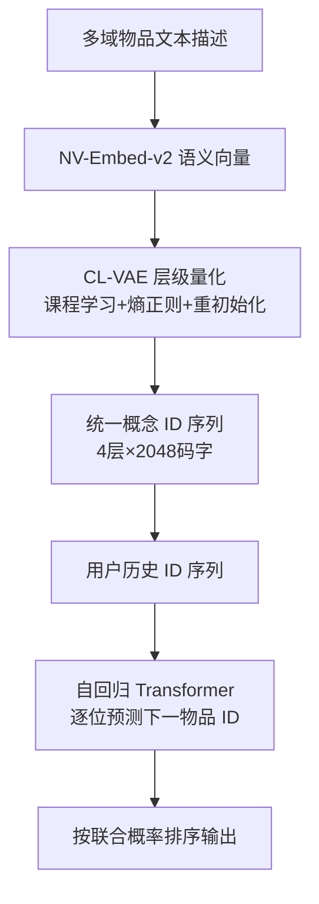
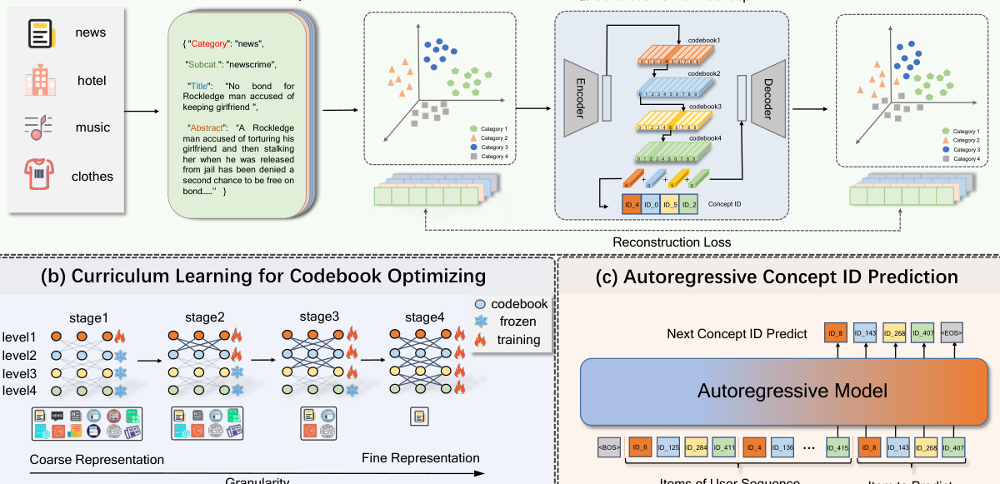

# RecBase: Generative Foundation Model Pretraining for Zero-Shot Recommendation (面向零样本推荐的生成式推荐基座模型预训练)

- **会议/期刊**: EMNLP 2025
- **作者与机构**: Sashuai Zhou, Weinan Gan, Qijiong Liu, Ke Lei, Jieming Zhu, Hai Huang, Yan Xia, Ruiming Tang, Zhenhua Dong, Zhou Zhao（浙江大学 / 华为诺亚方舟实验室 / 上海 AI Lab / 香港理工大学）
- **推荐链路定位**: 端到端生成式（生成式检索 / 零样本排序）
- **研究方向**: 生成式推荐与离散语义 ID / 冷启动与零样本推荐
- **论文原文**: [https://arxiv.org/abs/2509.03131v1](https://arxiv.org/abs/2509.03131v1)
- **开源代码**: [https://github.com/reczoo/RecBase](https://github.com/reczoo/RecBase)

## TL;DR (1分钟核心速览)

现有 LLM4Rec 把推荐数据硬塞进语言模态，语言预训练目标与"物品级共现关系"存在根本错配，导致零样本跨域泛化差。RecBase 用课程学习增强的 RQ-VAE（CL-VAE）把 15 个域、4.5M 物品统一离散为 4 层概念 ID，从零预训练 0.3B/1.5B 自回归基座，仅用真实交互序列做 next-token 预测。在 8 个未见数据集上，1.5B 版本零样本 AUC 均值 0.6063，超过 Mistral-7B（0.5941）与 GPT-3.5（0.5319），且推理延迟仅为 7B 模型的约 40%。

## Background & Motivation (背景与核心矛盾)

- **主流范式**: LLM4Rec 分三路——直接零样本打分（ChatGPT ranker）、多域多任务继续预训练（P5/GenRec）、下游指令微调对齐（TALLRec）。三者均以自然语言 token 承载物品。
- **前人局限**: ① **表征错配**：物品被展开为冗长文本描述，用户序列在语言空间中被稀释，item-item 共现信号难以表达；② **知识鸿沟**：语言预训练目标不建模物品协同关系，零样本下对未见域几乎无迁移能力；③ **对齐反噬**：用下游数据微调会破坏跨域泛化，与"基座模型"定位自相矛盾。
- **核心洞察 (Key Insight)**: 若把物品压缩为**语义离散 ID**（而非自然语言），词表可从十万级降到 2 万级，且 ID 空间本身即承载跨域语义邻近性；但标准 RQ-VAE 存在**码本坍缩**——多域物品被挤进少数码字，新域物品落到 LLM 从未见过的 token 上，零样本直接失效。
- **本文切入点**: 用课程学习逐层激活码本 + 熵正则 + 首层 KMeans 重初始化，构造"均匀铺满"的统一概念 ID 空间，再以纯推荐目标从零预训练自回归模型。

## Method (核心方法设计)

### 1. 整体框架 (Overall Architecture)

流程分两阶段：**离线分词**——物品文本经 NV-Embed-v2 编码为语义向量，CL-VAE 将其量化为 4 层、每层 2048 码字的概念 ID 元组 $(s^1_i,\dots,s^4_i)$；**在线生成**——用户历史被转成概念 ID 序列，Qwen2 架构的 decoder-only 模型自回归预测下一物品的 ID 逐位生成，按联合概率排序候选。训练全程只用真实交互序列，无人工负采样；推理时按位 beam 解码得到 top-k 物品。

<figure class="paper-figure" markdown="span">
  <figcaption>图 1：RecBase 模型概览。(a) 展示使用离散表示技术将来自多个领域的产品描述转换为统一的概念 ID 序列。(b) 描述用于优化码本学习的课程学习过程。(c) 展示自回归模型如何利用离散化概念 ID 预测序列中的下一个物品，从而有效捕捉物品关系以进行推荐。</figcaption>
</figure>

### 2. 关键设计拆解 (Key Designs)

1. **CL-VAE：课程学习驱动的抗坍缩统一分词器**：痛点在于 RQ-VAE 一次性训练全部层级，低层码本未收敛即被高层残差"抢走"梯度，导致码字利用率极低、跨域分布割裂。做法是**逐层解冻**——第 $d$层训练$n$轮至 loss 收敛后才引入第$d+1$ 层，同时对码字使用频率加熵惩罚、并在利用率过低时用 KMeans 重初始化首层码本：

$$\mathcal{L}=\mathcal{L}_R+\mathcal{L}_Q+\gamma\mathcal{L}_E,\quad \mathcal{L}_E=-\sum_{d=0}^{m-1}\sum_{j=1}^{K}p_{d,j}\log p_{d,j}$$

直觉是：先让粗粒度码本充分覆盖全域语义骨架，细粒度残差再在其上做局部修正，等价于"先学大类再学细类"，从根源上抑制少数码字垄断。图 2 的 t-SNE 显示 RQ-VAE 下各域簇彼此孤立，CL-VAE 下明显交叠。

2. **统一概念 ID 空间与跨域词表共享**：所有域共用同一套 4×2048 码本，物品 ID 即"语义坐标"，不同域中语义相近的物品天然共享前缀码字。这使模型在未见域上遇到的 ID 组合大概率由已见过的码字拼成，从而把零样本问题转化为"已知码字的重新组合"，这是相对语言 token 方案最本质的增益。

3. **训练目标、负采样与推理效率**：损失为逐位负对数似然，无负采样：

$$\mathcal{L}=-\sum_{t=1}^{n}\sum_{j=1}^{m}\log P(s_t^{j*}\mid s_t^{<j*},S_{<t})$$

词表仅 2 万（vs. LLM 的十余万），单步解码开销大幅下降；1.5B 模型在 2 万条测试样本上耗时 390s，低于 Qwen2-1.5B 的 466s 与 Mistral-7B 的 946s。

## Experimental Setup & Evaluation Protocol (实验设置与评估协议)

- **数据集与预处理**: 预训练 15 个跨域数据集（新闻 EBNeRD/PENS、短视频 PixelRec/KuaiRec、Amazon 四子类、Netflix 等），测试 8 个**完全未见**数据集。用户历史长度过滤为 $[15, 2500]$，超长截断；多模态数据集仅保留文本模态以保证公平。

| 数据集 | #Users | #Items | #Interactions | 稀疏度/密度 | 特征/场景说明 |
| :--- | :---: | :---: | :---: | :---: | :--- |
| 预训练集(15个) | 35.0M | 4.60M | — | 平均序列长 20.37 | 新闻/短视频/电商/影视多域 |
| 微调集 | 5.10M | 1.01M | — | 平均序列长 17.83 | 域内适配用 |
| 测试集(8个) | 145,975 | 623,615 | — | 平均序列长 15.01 | MIND/MovieLens/MicroLens/Goodreads/Yelp/Steam/H&M/HotelRec |

- **数据划分与防穿越 (Splitting Strategy)**: 采用**跨数据集零样本划分**——训练域与测试域完全不重叠，测试集不参与任何预训练或调参，属最严格的 Strict Zero-shot 设定。
- **排名评测协议 (Ranking Protocol)**: 任务重构为"给定历史序列判断用户是否会对候选物品感兴趣"的**二分类排序**，以 **AUC** 衡量排序质量；LLM 基线取 YES/NO token 的 softmax 概率 $p_{\text{yes}}=e^{l_{\text{yes}}}/(e^{l_{\text{yes}}}+e^{l_{\text{no}}})$ 作为兴趣分，RecBase 取概念 ID 联合概率。未采用 Full-Ranking 全库排序，是本文评估的主要局限。
- **对比基线与超参设置**: 基线含微调类（P5-223M、RecGPT-6.6B）与零样本 LLM 类（BERT-base、OPT-base/large、Qwen-2、Phi-2、Llama-2/3、Mistral-7B、DeepSeek-Qwen2-7B、GPT-3.5）。码本 4 层×2048，嵌入维度由 NV-Embed-v2 决定；Base 版 hidden 1024/24 层，Large 版 hidden 1536/28 层，词表 2 万。

## Key Experimental Results (实验关键数据)

### 1. 主实验对比 (Main Results)

零样本跨域 AUC（8 个未见数据集）：

| 模型 | 参数量 | MIND | MovieLens | MicroLens | Goodreads | Yelp | Steam | H&M | HotelRec | Overall |
| :--- | :---: | :---: | :---: | :---: | :---: | :---: | :---: | :---: | :---: | :---: |
| P5 | 223M | 0.4911 | 0.5138 | 0.5017 | 0.5027 | 0.5080 | 0.5296 | 0.4845 | 0.4905 | 0.5027 |
| RecGPT | 6.6B | 0.5078 | 0.5069 | 0.4703 | 0.5083 | 0.5140 | 0.4924 | 0.4875 | 0.4937 | 0.4976 |
| Llama-3 | 8.0B | 0.4904 | 0.6412 | 0.5577 | 0.5191 | 0.5267 | 0.7690 | 0.5454 | 0.5342 | 0.5729 |
| Mistral | 7.2B | 0.4833 | 0.6933 | 0.5590 | 0.5321 | 0.5313 | 0.8102 | 0.5762 | 0.5677 | 0.5941 |
| DeepSeek-Qwen2 | 7.6B | 0.5117 | 0.5407 | 0.5630 | 0.5165 | 0.5303 | 0.5905 | 0.5994 | 0.5648 | 0.5520 |
| GPT-3.5 | — | 0.5057 | 0.5170 | 0.5110 | 0.5122 | 0.5039 | 0.6184 | 0.5801 | 0.5076 | 0.5319 |
| RecBase_base | 313M | 0.5508 | 0.5352 | 0.5401 | 0.5029 | 0.5320 | 0.7450 | 0.5870 | 0.4874 | 0.5601 |
| **RecBase_large** | 1.3B | **0.5442** | **0.6474** | **0.5712** | **0.5329** | **0.5326** | **0.8343** | **0.6761** | 0.5124 | **0.6063** |
| Improv. vs 最强基线 | — | +6.3% | −6.6% | +1.5% | +0.2% | +0.2% | +3.0% | +12.8% | −9.7% | **+2.1%** |

### 2. 消融实验 (Ablation Study)

| 配置 | Yelp | Steam | H&M | HotelRec | Overall |
| :--- | :---: | :---: | :---: | :---: | :---: |
| RecBase_base 完整版 | **0.5320** | **0.7450** | **0.5870** | 0.4874 | **0.5879** |
| w/o format.（去结构化文本模板） | 0.5204 | 0.7187 | 0.5668 | **0.4966** | 0.5756 |
| w/o init.（去首层码本重初始化） | 0.4912 | 0.5924 | 0.5319 | 0.4909 | 0.5266 |
| w/o cur.（去课程学习逐层解冻） | 0.5073 | 0.6815 | 0.5412 | 0.4815 | 0.5529 |

### 3. 关键实验发现 (Key Findings)

1. **码本重初始化是最大单点贡献**：移除后 Overall 从 0.5879 掉到 0.5266（−10.4%），远超课程学习（−6.0%）与文本模板（−2.1%），说明零样本失效的主因确实是码本坍缩而非模型容量——这与图 5(c) 中 CL-VAE 码字使用频率分布显著更平坦相互印证。
2. **小模型在特定域反超 7B LLM，但并非全面碾压**：RecBase_base（313M）在 MIND 上 0.5508 高于所有 LLM 基线，RecBase_large 在 H&M 上比 Qwen-2 高 7.5%、在 Steam 上比 Mistral 高 3.0%；但在 MovieLens（0.6474 vs Mistral 0.6933）与 HotelRec（0.5124 vs Mistral 0.5677）上明显落后，说明纯 ID 序列建模在强内容语义域（电影元数据、酒店长评）仍不及语言先验。
3. **域内微调增益巨大且与零样本起点正相关**：Steam 微调后 AUC 从 0.7450 升至 0.9173（+23.1%），MovieLens +16.1%，Yelp +15.1%，而零样本已较高的 MicroLens 仅 +3.7%，表明预训练已吸收的域其适配空间更小，未覆盖域则高度依赖少量域内数据激活。

## Highlights & Limitations (亮点、对比与审稿批判)

- **与代表作对比 (vs. Prior Work)**: 相比 P5/RecGPT 的"语言继续预训练 + 多任务指令"，RecBase 彻底放弃语言 token 而改用概念 ID，词表缩小一个量级；相比 TIGER 等语义 ID 生成式检索，本文的关键差异是**跨 15 域共享码本 + 抗坍缩课程训练**，把语义 ID 从单域内工具升级为跨域基座；相比直接用 LLM 零样本打分，本文证明"推荐目标对齐"比"模型规模"更关键（1.3B 胜 7B）。
- **可迁移亮点**: ① 逐层解冻 + 熵正则 + KMeans 重初始化的三件套可直接移植到任何 RQ-VAE/VQ 类语义 ID 流水线，缓解码本坍缩；② "统一文本模板 + 共享编码器"的跨域特征映射范式，可复用于多业务线冷启动场景。
- **审稿级局限批判**: ① **评估协议偏弱**——采用 AUC 二分类而非 Full-Ranking 全库排序，负样本构造方式未明示，AUC 对候选池分布敏感，结论强度受限；② **多模态被主动丢弃**，短视频/服饰数据集仅用文本，与工业多模态现实脱节；③ 逐位自回归解码需 4 步生成一个 ID，长序列下延迟随 beam 宽度线性增长，文中仅报告 2 万样本总耗时，缺少 QPS 与线上压测。

## Rating (四维评分)

- **方法创新性 (Novelty)**: ⭐⭐⭐⭐ （"推荐目标从零预训练 + 抗坍缩统一概念 ID"组合新颖，CL-VAE 的课程化解冻有清晰物理直觉，但各组件均为已有技术的巧妙重组）
- **评估协议与实验扎实度 (Protocol & Experiments)**: ⭐⭐⭐ （8 个未见域零样本 + 消融 + 效率对比较完整，但 AUC 二分类替代全库排序、负样本构造未交代，削弱了排序结论的可信度）
- **写作与数学规范度 (Clarity & Rigor)**: ⭐⭐⭐⭐ （CL-VAE 损失与自回归目标公式清晰、符号统一，算法伪代码完整；码本规模/层数的选择依据有图 5 定量支撑）
- **工业落地与复现价值 (Industrial & Practical Value)**: ⭐⭐⭐⭐⭐ （代码已开源，2 万词表带来显著推理加速，1.3B 即可对标 7B，跨域零样本对冷启动业务线极具吸引力）

