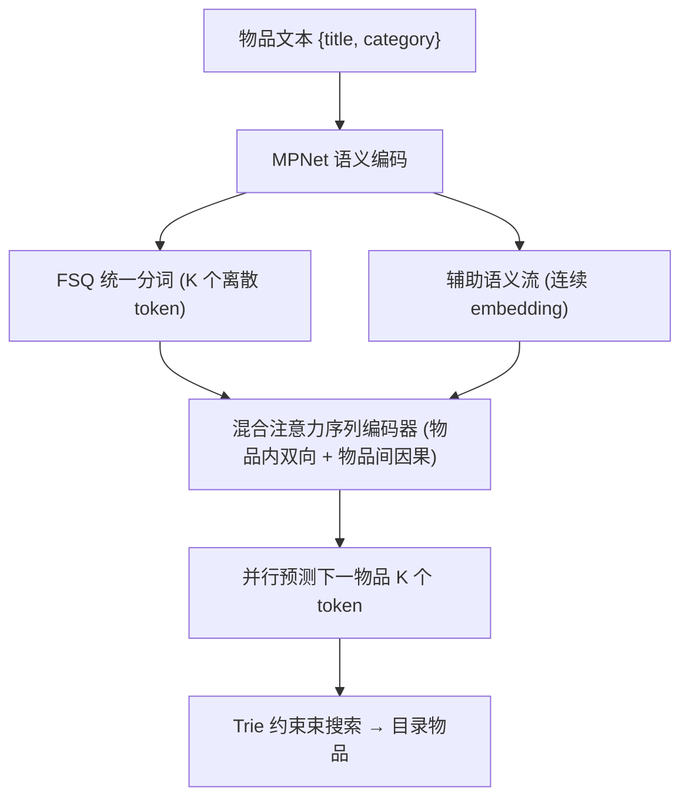
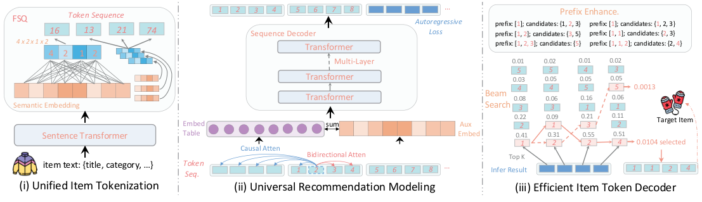

# RecGPT: A Foundation Model for Sequential Recommendation (面向序列推荐的推荐基础模型)

- **会议/期刊**: ACL/EMNLP 2025 (Preprint, Under Review)
- **作者与机构**: Yangqin Jiang, Xubin Ren, Lianghao Xia, Da Luo, Kangyi Lin, Chao Huang (香港大学 HKU & 腾讯)
- **推荐链路定位**: 端到端生成式召回/排序
- **研究方向**: 生成式推荐与离散语义ID / 冷启动与长尾推荐
- **论文原文**: [https://arxiv.org/abs/2506.06270v2](https://arxiv.org/abs/2506.06270v2)
- **开源代码**: [https://github.com/HKUDS/RecGPT](https://github.com/HKUDS/RecGPT)

## TL;DR (1分钟核心速览)

针对 ID 类序列推荐无法跨域泛化、冷启动即失效的根本痛点，本文提出纯文本驱动的推荐基础模型 RecGPT：用 MPNet 编码物品文本、FSQ 量化为域无关离散 token，配合"物品内双向 + 物品间因果"混合注意力与 Trie 约束的目录感知束搜索解码。在 6 个跨域数据集上，**零样本**（无目标域任何训练）即全面超越使用 10% 目标域数据微调的 GRU4Rec/BERT4Rec/CL4SRec/MAERec 等基线，Baby 上 Hit@5 从 0.0103 提升至 0.0283（约 +175%）。

## Background & Motivation (背景与核心矛盾)

- **主流范式**: 序列推荐以 SASRec/BERT4Rec 为代表，为每个物品学习独立 ID embedding，依赖目标域充足交互序列训练。
- **前人局限**: ①ID 表示与平台强绑定，新物品/新域必须重训，跨域知识无法迁移；②文本增强方案（GRU4RecF、FDSA、UniSRec、VQ-Rec）虽引入语义特征，但仍需目标域数据微调，且量化码本易坍缩、跨域语义空间不统一。
- **核心洞察 (Key Insight)**: 物品文本描述是天然跨域共享的"语言"，若把异构文本压进统一离散 token 空间，序列推荐即可复用 LLM 式自回归范式获得零样本泛化；但物品由多 token 构成，存在"物品内语义完整性"与"物品间时序因果性"的双层依赖，标准单向注意力无法兼顾。
- **本文切入点**: 以 FSQ 统一分词消除域壁垒 + 混合注意力解决双层依赖 + 目录感知解码解决组合爆炸，三件套拼成推荐基础模型。

## Method (核心方法设计)

### 1. 整体框架 (Overall Architecture)

输入为用户历史物品的文本描述（标题、类目等），先经 MPNet 编码为语义向量，再由 FSQ 量化为定长离散 token 序列；序列编码器采用 decoder-only Transformer，对同一物品内 token 施加双向注意力、对不同物品间施加因果注意力，并叠加辅助连续语义流补偿量化损失；训练以自回归下一 token 预测为目标；推理时一次性并行预测下一物品的全部 K 个 token，再用 Trie 前缀树约束的束搜索映射回真实目录物品。

<figure class="paper-figure" markdown="span">
  <figcaption>图2：我们提出的推荐系统基础模型RecGPT的架构，包含三个关键组件：(i) 统一物品分词，通过Sentence Transformer和FSQ量化将文本描述转换为离散token；(ii) 通用推荐建模，采用基于Transformer的序列编码器并利用双重注意力机制；(iii) 高效token解码器，采用增强的束搜索进行跨域下一物品预测。</figcaption>
</figure>

### 2. 关键设计拆解 (Key Designs)

1. **FSQ 统一物品分词（域无关离散化）**：痛点在于 VQ/RQ 类码本易坍缩且需维护大码本。本文将 $d_L$维语义向量切为$K$个子向量，每个子向量经线性降维到$d_{fsq}$维后逐维做有界取整：$\mathrm{FSQ}(\boldsymbol{e}_i^k)=\mathcal{R}[(L-1)\sigma(\mathbf{W}^{in}\boldsymbol{e}_i^k+\mathbf{b})]$，码本容量$|\mathcal{C}|=L^{d_{fsq}}$由维度组合隐式指数扩张，无需显式码本学习；取整不可导处用 STE 直通估计，重建目标用 L1 损失$\mathcal{L}_{fsq}=\sum_i\|\boldsymbol{e}_i-\mathrm{Decoder}(\cdot)\|_1$。直觉：有界标量量化天然抗坍缩，且 token 空间与域无关，新物品即插即用。

2. **混合双向-因果注意力 + 辅助语义流**：痛点在于单向注意力割裂同一物品内 token 的信息流，量化又必然损失语义细节。本文对物品内 token 放开双向注意力以形成完整物品表征，物品间严格因果以保时序；同时将原始连续语义经线性投影得 $\mathbf{E}_{aux}$，与 token embedding$\mathbf{E}_{wte}$分别 LayerNorm 后相加：$\mathbf{X}=\mathrm{LNorm}(\mathbf{E}_{aux})+\mathrm{LNorm}(\mathbf{E}_{wte})+\mathbf{E}_{wpe}$。直觉：离散流负责泛化与生成，连续流负责保真与梯度稳定，双流互补。

3. **训练目标与目录感知解码**：损失为下一 token 负对数似然 $\mathcal{L}_{ar}=-\sum_{t}\log P(Y_t\mid \mathbf{X}_{<\lfloor t/K\rfloor\times K})$，floor 项保证按物品边界对齐，且因物品内双向可一次并行预测整件物品的 K 个 token。推理用束搜索在联合分布上搜索，并以 Trie 编码全目录 token 前缀，剪掉不可能命中真实物品的分支——理论上把$L^{d_{fsq}}$ 的组合空间压缩到目录规模，兼顾实时性与合法性。训练无需负采样（生成式范式天然规避）。

## Experimental Setup & Evaluation Protocol (实验设置与评估协议)

- **数据集与预处理**: 6 个数据集，Amazon 三域（Baby/Games/Office）+ 跨平台（Yelp/Washington/Steam）+ 工业新闻数据集（163,385 用户 / 455,372 物品 / 999,140 交互）。采用标准序列推荐预处理与 train/val/test 划分（细节见原文附录 6.1）。

| 数据集 | #Users | #Items | #Interactions | 场景说明 |
| :--- | :---: | :---: | :---: | :--- |
| Baby / Games / Office | 见附录 | 见附录 | 见附录 | Amazon 电商三域，跨域预训练 |
| Yelp / Washington / Steam | 见附录 | 见附录 | 见附录 | 跨平台异构域 |
| Industrial | 163,385 | 455,372 | 999,140 | 生产新闻平台，线上验证 |

- **数据划分与防穿越 (Splitting Strategy)**: 标准序列 `比例划分`（train/val/test），零样本设定下目标域**完全不参与训练**。
- **排名评测协议 (Ranking Protocol)**: 采用 `Full-Ranking` 式全库排序（Hit@1/Hit@5、NDCG@5），报告 @3/@5 双切点；显著性 $p<0.05$ 以 * 标注。
- **对比基线与超参设置**: 传统序列模型 GRU4Rec、GRU4RecF、Caser、BERT4Rec、FDSA；自监督类 CL4SRec、DuoRec、ICLRec、MAERec；预训练类 S3-Rec、UniSRec、VQ-Rec、TIGER、RecFormer、IDGenRec。文本编码器 MPNet，FSQ 超参 $L$、$d_{fsq}$、$K$ 见附录 6.3。

## Key Experimental Results (实验关键数据)

### 1. 主实验对比 (Main Results)

零样本 RecGPT vs. 使用 10% 目标域数据的基线（节选 Hit@5 / NDCG@5）：

| 数据集 | 指标 | 最佳 ID 基线 (MAERec) | 次优 (DuoRec) | RecGPT (零样本) | Improv.% |
| :--- | :--- | :---: | :---: | :---: | :---: |
| Baby | Hit@5 | 0.0090 | 0.0103 | **0.0283** | +174.8% |
| Baby | NDCG@5 | 0.0052 | 0.0063 | **0.0279** | +342.9% |
| Games | Hit@5 | 0.0119 | 0.0117 | **0.0376** | +216.0% |
| Office | Hit@5 | 0.0047 | 0.0056 | **0.0299** | +433.9% |
| Yelp | Hit@5 | 0.0119 | 0.0065 | **0.0166** | +39.5% |
| Steam | Hit@5 | 0.1172 | 0.1351 | **0.1253** | -7.3% (vs DuoRec) |
| Washington | NDCG@5 | 0.0097 | 0.0064 | **0.0127** | +30.9% |

冷启动（序列截断至 1–3 条）设定下，Baby Hit@5 由 DuoRec 的 0.0204 提升至 **0.0172**（注：该设定下 RecGPT 在 Baby/Office 的 Hit@1 与 NDCG 全面领先，Yelp 上与强基线接近持平）。工业新闻平台零样本对比中，RecGPT 在 Hit@5 与 NDCG@5 上均优于 BERT4Rec/FDSA/CL4SRec/DuoRec/MAERec/S3-Rec 全部基线。

### 2. 消融实验 (Ablation Study)

| 变体 | Baby Hit@5 | Baby NDCG@5 | Office Hit@5 | Yelp Hit@5 |
| :--- | :---: | :---: | :---: | :---: |
| w/o FSQ（随机 token） | 0.0178 | 0.0177 | 0.0167 | 0.0139 |
| w/o Bidir（纯因果注意力） | 0.0279 | 0.0275 | 0.0288 | 0.0162 |
| w/o Aux（去辅助语义流） | 0.0191 | 0.0189 | 0.0205 | 0.0075 |
| w/o Pref（去 Trie 前缀约束） | 0.0282 | 0.0274 | 0.0281 | 0.0162 |
| **RecGPT 完整版** | **0.0283** | **0.0279** | **0.0299** | **0.0166** |

### 3. 关键实验发现 (Key Findings)

1. **FSQ 是跨域泛化的命门**：换成随机 token 后 Baby Hit@5 从 0.0283 暴跌至 0.0178（-37%），说明收益并非来自模型容量，而是语义保持的离散化本身；辅助语义流在 Yelp 上影响最剧烈（0.0166→0.0075，腰斩），印证稀疏域对量化信息损失更敏感。
2. **架构优势独立于数据规模**：控制实验中 RecGPT-10%（同等数据量）仍优于 VQ-Rec，而 VQ-Rec 用全量数据重训后反而性能下降，证明 decoder-only + 自回归目标优于编码器式量化方案，数据量不是唯一解释。
3. **数据规模呈幂律缩放且存在涌现阈值**：5%→100% 预训练数据下零样本性能单调上升，10%→25% 区间出现跃升式增益；评估损失与 token 数在 log-log 坐标下拟合幂律，可用小规模实验外推全量模型表现，为工业侧"扩数据优于扩模型"提供依据。

## Highlights & Limitations (亮点、对比与审稿批判)

- **与代表作对比 (vs. Prior Work)**: 相比 TIGER（RQ 语义 ID + 自回归，但码本需逐域训练、无跨域零样本），RecGPT 用 FSQ 免码本且域无关；相比 VQ-Rec/UniSRec（文本增强但仍需目标域微调），RecGPT 真正零样本；相比 MAERec 等自监督序列模型，其增益来自表示范式而非增广策略。
- **可迁移亮点**: ①FSQ 有界标量量化可直接替换 RQ-VAE 码本用于任意生成式推荐的语义 ID 构建，规避码本坍缩调参；②Trie 前缀约束束搜索是生成式召回落地工业的通用加速件，可迁移至任何"多 token 表物品"的解码场景。
- **审稿级局限批判**: ①零样本对比中基线仅用 10% 数据，公平性存疑，缺少"基线用全量数据"的对照；②Steam 上零样本 Hit@5 不及 DuoRec，说明强域内信号场景下纯文本表示仍有天花板；③依赖高质量物品文本，多模态（图像/音频）与数值特征未纳入，且束搜索 + Trie 的在线延迟未给出量化指标。

## Rating (四维评分)

- **方法创新性 (Novelty)**: ⭐⭐⭐⭐ （FSQ 统一分词 + 物品内双向/物品间因果混合注意力组合新颖，但各组件均有前作影子，属系统性集成创新）
- **评估协议与实验扎实度 (Protocol & Experiments)**: ⭐⭐⭐⭐ （6 数据集 + 工业验证 + 缩放律 + 控制变量实验完整，但零样本对比的基线数据配额设置偏宽松）
- **写作与数学规范度 (Clarity & Rigor)**: ⭐⭐⭐⭐ （FSQ 公式与 STE 推导清晰，双层依赖的动机论证到位，部分附录细节与符号在正文中略跳跃）
- **工业落地与复现价值 (Industrial & Practical Value)**: ⭐⭐⭐⭐⭐ （已开源，Trie 束搜索直击生成式召回延迟痛点，腾讯新闻平台真实部署，工程参考价值高）

