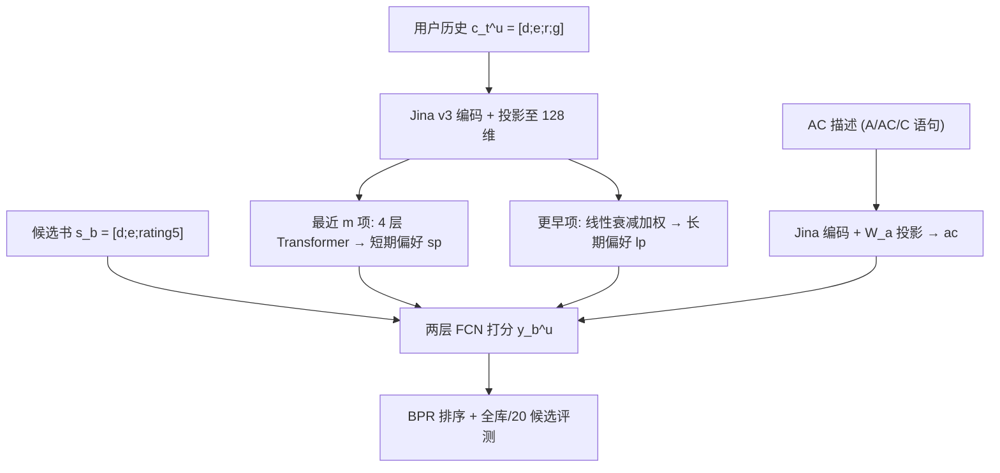

# A Text-Based Recommender System that Leverages Explicit Affective State Preferences (一种利用显式情感状态偏好的文本推荐系统)

- **会议/期刊**: EMNLP 2025
- **作者与机构**: Tonmoy Hasan, Razvan Bunescu (University of North Carolina at Charlotte)
- **推荐链路定位**: 召回（全库排序）
- **研究方向**: 大语言模型推荐 / 序列推荐
- **论文原文**: [论文原文链接](https://arxiv.org/abs/2505.20190v2)
- **开源代码**: [开源代码仓库链接](https://github.com/Ton-moy/ACRec_Taxonomy)

## TL;DR (1分钟核心速览)

现有推荐系统只建模"喜欢/不喜欢"这一种情感态度，而用户真实诉求常是"想被震撼""想心碎""想被治愈"等细粒度情感状态。本文提出 **ACRec** 任务与框架：用 GPT-4o 从 Goodreads 书评中挖掘 12,522 条情感 (A)、1,252 条情感-认知 (AC)、45,935 条认知 (C) 语句，构建 1,000 用户、143K 书籍的数据集，并设计 Transformer 融合长短期阅读偏好与 AC 描述做全库排序。在全库 143K 候选下 HR@10 达 **15.6%**，较最强基线 RecFormer (2.8%) 提升约 **5.6 倍**；20 候选 Top-1 准确率 **67.6%** vs. RecFormer 44.2%。

## Background & Motivation (背景与核心矛盾)

- **主流范式**: 序列推荐（SASRec/BERT4Rec）依赖 item ID；文本增强推荐（UniSRec/RecFormer）引入物品描述；LLM 混合模型（LLaRA/iLoRA）用标题+ID 架构。三者均只把"喜欢"当作唯一情感信号。
- **前人局限**: ① 依据 Scherer 情感类型学，态度 (attitude)、情绪 (emotion)、心境 (mood) 是三类不同情感现象，现有系统仅覆盖"态度"一维，无法表达"entranced""pleasantly surprised by the conclusion"等细粒度诉求；② 对话推荐数据集（INSPIRED/ReDIAL/Reddit-Movie）中偏好几乎全是客观特征（题材、导演、情节），情感表达极度稀缺。
- **核心洞察 (Key Insight)**: 真实书评中蕴含大量"阅读后诱发的 AC 状态"描述（表 2 示例），这些语句可被抽取、去标识化后作为"阅读前"的偏好查询，从而把推荐目标从"匹配客观特征"升级为"匹配预期诱发的心理状态"。
- **本文切入点**: 构建 AC 语句库 + 情感轮导航的选择式输入，并训练一个显式以 AC 描述为条件的 Transformer 排序模型。

## Method (核心方法设计)

### 1. 整体框架 (Overall Architecture)

用户历史中每个时间步 $t$的书籍表示为四元拼接$c_t^u=[d_t^u;e_t^u;r_t^u;g_t^u]$（原始描述、扩展描述、用户书评、评分），经 Jina v3 编码后投影至 41 维（评分 5 维），合计 128 维对齐 Transformer 隐层。最近$m$项经 4 层 Transformer 得短期偏好$sp_t^u$，更早项经线性衰减加权平均得长期偏好$lp_t^u$；候选书表示$s_b$与 AC 描述嵌入$ac$ 一并送入两层 FCN 输出打分，BPR 损失训练。

### 2. 关键设计拆解 (Key Designs)

1. **AC 语句挖掘与情感轮本体（数据侧创新）**：痛点是从书评中抽取的偏好常混入书名、人名、剧透与负面情绪，无法作为"阅读前"查询。作者用 GPT-4o 两阶段抽取：Phase 1 去标识化并三分类 (A/C/AC)，Phase 2 用判别式示例纠正 C 误判为 A 的问题，人工抽检 100 条精度达 **88%**。随后将 A+AC 语句映射到 26+1 类情感轮（在 Geneva Emotion Wheel 上增补 Contentment、Gratitude、Hatred、Hope、Relaxation、Tension 六类），支撑"选择式"输入。物理直觉：把开放式的"我想被感动"锚定到有限本体，既降低用户表达成本，又给模型提供可对齐的语义槽位。

2. **长短期偏好解耦建模**：痛点在于纯 Transformer 只建模近窗序列，丢失长期阅读品味。作者将历史切分为近 $m$项与远端$t-m$ 项，短期用 Transformer 末层隐状态，长期用线性衰减权重聚合：

$$lp_t^u=\sum_{k=1}^{t-m}\alpha_k c_k^u,\quad \alpha_k=\frac{2k}{(t-m)(t-m+1)}$$

权重和为 1 且越近越大。直觉：情感偏好是缓慢漂移的"底色"，而近期阅读是"当下心境"，二者需不同时间尺度表征后再融合。

3. **AC 条件化打分与训练目标**：打分函数将四路表征拼接后过两层 FCN：

$$y_b^u=w_3 f\big(W_2 f(W_1[lp_t^u;sp_t^u;s_b;ac])\big)$$

并可选加入 $\cos(ac,d_b)$作为显式相似度特征（验证集上有效）。训练用 BPR 损失$\mathcal{L}=-\sum_u\frac{1}{T_u}\sum_t\frac{1}{K}\sum_k\log\sigma(y_b^u-y_k^u)$，负样本为每步从用户未读书中**均匀随机采$K=10$ 本**，Adam 优化、batch size=1。推理为全库打分排序，无额外解码开销。

## Experimental Setup & Evaluation Protocol (实验设置与评估协议)

- **数据集与预处理**: 从 Goodreads 抽取 1,000 用户，按阅读量分 10 档（每档 100 人，覆盖 20–500 本）。有效时间步要求：评分 ≥4、书评 ≥20 token、原始+扩展描述 ≥250 token；跳过前 15 步作 burn-in，每用户最多取 20 个均匀分布的有效步。

| 数据集 | #Users | #Items | #Interactions | 稀疏度/密度 | 特征/场景说明 |
| :--- | :---: | :---: | :---: | :---: | :--- |
| Goodreads-AC | 1,000 | 142,892 | 249,326 (总步) / 11,588 (有效步) | 极稀疏 | 书籍；含原始描述、评论扩展描述、评分、书评 |
| AC 语句库 | — | — | 59,709 条 | — | A: 12,522 / AC: 1,252 / C: 45,935 |

- **数据划分与防穿越 (Splitting Strategy)**: 每用户**最后一个有效步作测试、倒数第二个作验证**，其余为训练（时间序切分）。注意这是**回溯式评估**：AC 描述从用户在 $t+1$所读书的书评中抽取，作为$t$ 时刻的输入查询，真实场景需用户主动表达。
- **排名评测协议 (Ranking Protocol)**: 双协议——(i) **Full-Ranking**：对全部 143K 未读书籍排序（Group 1/2 基线适用）；(ii) **20 候选排序**：1 正例 + 19 随机负例，用于与受 prompt 长度限制的 LLM 混合模型对比。
- **对比基线与超参设置**: 三组基线——ID 类 (SASRec, BERT4Rec)、文本类 (UniSRec, RecFormer)、LLM 混合类 (LLaRA, iLoRA 及其 AC 改造版 LLaRA-AC/iLoRA-AC)。Transformer 隐层 128、4 块、固定位置编码；FCN 两层（验证集最优）；Jina v3 768→41 维投影。

## Key Experimental Results (实验关键数据)

### 1. 主实验对比 (Main Results)

全库 143K 排序（A+AC+C 描述，1,000 用户）：

| System | HR@1 | HR@5 | HR@10 | HR@50 | NDCG@10 | NDCG@100 |
| :--- | :---: | :---: | :---: | :---: | :---: | :---: |
| SASRec | 0.1 | 0.7 | 1.1 | 2.4 | 0.5 | 0.9 |
| BERT4Rec | 0.1 | 0.1 | 0.2 | 0.8 | 0.1 | 0.3 |
| UniSRec | 0.0 | 0.1 | 0.3 | 1.6 | 0.1 | 0.6 |
| RecFormer | 0.2 | 1.8 | 2.8 | 5.7 | 1.4 | 2.6 |
| **ACRec** | **5.5** | **12.3** | **15.6** | **25.6** | **10.1** | **13.0** |
| Improv. vs RecFormer | 27.5× | 6.8× | **5.6×** | 4.5× | 7.2× | 5.0× |

20 候选 Top-1 准确率：

| System | A+AC+C | A+AC |
| :--- | :---: | :---: |
| SASRec | 18.6 | 20.0 |
| BERT4Rec | 15.1 | 16.2 |
| UniSRec | 11.9 | 11.7 |
| RecFormer | 44.2 | 40.0 |
| LLaRA | 20.3 | 19.4 |
| LLaRA-AC | 40.9 | 37.6 |
| iLoRA | 20.9 | 21.2 |
| iLoRA-AC | 40.3 | 42.7 |
| **ACRec** | **67.6** | **43.4** |

### 2. 消融实验 (Ablation Study)

原文未设标准组件消融表，但提供了描述类型与架构变体的对照：

| 变体 | HR@10 (全库) | Top-1 (20 候选) | 说明 |
| :--- | :---: | :---: | :--- |
| ACRec (A+AC+C) | **15.6** | **67.6** | 完整描述 |
| ACRec (A+AC) | 2.9 | 43.4 | 去掉客观认知语句 |
| ACRec w/o Cosine 特征 | 验证集下降 | — | 附录 B 报告 |
| FCN 1 层 / 3 层 | 验证集下降 | — | 2 层最优 |
| UniSRec/RecFormer + AC 拼接 | 性能变差 | — | 直接拼接无效 |

### 3. 关键实验发现 (Key Findings)

1. **客观认知语句 (C) 是性能主引擎**：仅保留 A+AC 时全库 HR@10 从 15.6% 暴跌至 2.9%（降幅 81%），说明纯情感描述过于泛化、区分度不足，必须与"内容/结构"类认知语句联合才能定位书籍。
2. **AC 信息对 LLM 混合模型同样有效**：LLaRA 加入 AC 后 Top-1 从 20.3% 翻倍至 40.9%，iLoRA 从 20.9% 升至 40.3%（A+AC 下 42.7%），证明增益来自任务信号而非 ACRec 架构本身。
3. **ID 类模型全面失效**：SASRec/BERT4Rec 全库 HR@10 仅 1.1%/0.2%，远低于文本类 RecFormer 的 2.8%，说明细粒度情感匹配必须依赖文本语义而非协同 ID 信号。

## Highlights & Limitations (亮点、对比与审稿批判)

- **与代表作对比 (vs. Prior Work)**: 相比 RecFormer（仅用物品描述做序列匹配），ACRec 额外引入"用户显式声明的未来情感诉求"这一条件变量；相比 LLaRA/iLoRA（用标题 prompt 做 ID 增强），ACRec 不依赖 LLM 推理、可全库排序且无 20 候选限制；相比情感推荐早期工作（Da'u & Salim 用评论情感做注意力），本文首次把"期望诱发的状态"而非"历史情感反应"作为查询。
- **可迁移亮点**: ① "LLM 两阶段抽取 + 人工抽检校准"的偏好语句挖掘流水线可直接迁移到电影/音乐/短视频的情感标签构建；② 长短期偏好解耦 + 线性衰减权重的轻量设计，适合作为文本序列推荐的通用底座。
- **审稿级局限批判**: ① **回溯式评估存在信息泄漏风险**——AC 描述取自 $t+1$ 书籍的真实书评，真实场景下用户未必能如此精准表达，离线指标可能高估；② 仅覆盖书籍单域、且要求用户有 ≥20 本阅读史，冷启动与短历史场景未验证；③ 全库排序下 HR@10 绝对值仅 15.6%，且 ground-truth 未必是唯一满足 AC 描述的书，指标偏保守但绝对性能仍偏低。

## Rating (四维评分)

- **方法创新性 (Novelty)**: ⭐⭐⭐⭐ （任务定义新颖，将情感类型学引入推荐查询；但模型架构本身为 Transformer+FCN 的常规组合）
- **评估协议与实验扎实度 (Protocol & Experiments)**: ⭐⭐⭐ （双协议设计合理、基线覆盖三组，但回溯式评估有泄漏隐患，缺标准组件消融表与显著性检验）
- **写作与数学规范度 (Clarity & Rigor)**: ⭐⭐⭐⭐ （符号表清晰、公式简洁、数据构建流程交代详尽，情感轮本体设计有理论依据）
- **工业落地与复现价值 (Industrial & Practical Value)**: ⭐⭐⭐ （代码与 prompt 已开源，推理为全库向量打分可工程化；但依赖 GPT-4o 构建语句库、冷启动未验证，落地需额外投入）

