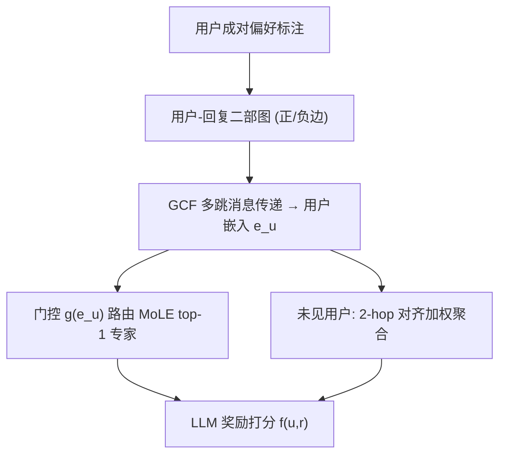
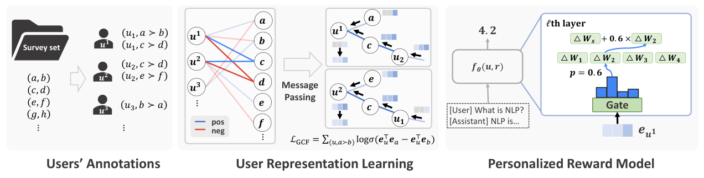

# CoPL: Collaborative Preference Learning for Personalizing LLMs (面向 LLM 个性化的协同偏好学习)

- **会议/期刊**: ACL 2025
- **作者与机构**: Youngbin Choi, Seunghyuk Cho, Minjong Lee, MoonJeong Park, Yesong Ko, Jungseul Ok, Dongwoo Kim (POSTECH)
- **推荐链路定位**: 精排（奖励建模 / 对齐阶段偏好打分）
- **研究方向**: 大语言模型推荐 / 协同过滤
- **论文原文**: [论文原文链接](https://arxiv.org/abs/2503.01658v2)
- **开源代码**: [开源代码仓库链接](https://github.com/ml-postech/CoPL)

## TL;DR (1分钟核心速览)

现有个性化奖励模型要么依赖预定义偏好簇，要么把每个用户独立建模为隐变量，在标注稀疏时用户表征无法收敛、相似用户被映射到远处。CoPL 将用户-回复成对标注构造成带正负边的二部图，用图协同过滤多跳传播对齐标注不重叠的相似用户，再以用户表征驱动 MoLE 门控路由 LoRA 专家，并给出无优化的未见用户适配。在 TL;DR/UF-P-2/UF-P-4/PersonalLLM 上，CoPL 在争议偏好对上较 VPL 提升约 6.6 个点（56.89 vs 50.26），未见用户场景亦保持同等水平。

## Background & Motivation (背景与核心矛盾)

- **主流范式**: 基于 BTL 框架的奖励模型从成对比较学习偏好；个性化方向分两支——多奖励模型按偏好类型聚合，或单一 BTL 中引入用户隐变量（I2E、VPL、PAL）。
- **前人局限**: ① 多模型聚合依赖预定义偏好类型，灵活性差；② 隐变量法把用户独立建模，不显式利用相似用户间关系，稀疏标注下随机初始化的用户编码器难以收敛到语义空间，标注集不重叠的相似用户会被拉远。
- **核心洞察 (Key Insight)**: 用户-回复对天然构成二部图，多跳消息传递可让"用户1标注 (a,b)(c,d)、用户3标注 (e,f)(g,h)"这类无直接重叠的用户经由共享回复节点间接对齐，从而在稀疏监督下获得数据效率。
- **本文切入点**: 用 GCF 学用户表征替代独立隐变量，再用该表征驱动 MoLE 做参数高效个性化微调。

## Method (核心方法设计)

### 1. 整体框架 (Overall Architecture)

CoPL 分三步：① 将全体用户的成对偏好转为用户-回复二部图（正/负两类边），用带边类型区分的消息传递学习用户与回复嵌入，以 BPR 式成对损失训练；② 取最终用户嵌入送入两层 MLP 门控，为每个用户从 1 个共享 LoRA + 8 个 LoRA 专家中路由 top-1 专家，LLM 以 BTL 最大似然训练个性化奖励打分；③ 测试时对未见用户，用其少量标注在图上计算与已见用户的 2-hop 对齐分数并加权聚合嵌入，无需任何梯度优化。

<figure class="paper-figure" markdown="span">
  <figcaption>图2：CoPL概览。为学习用户表示，GCF模型在用户-响应二部图上训练。为构建个性化奖励模型，CoPL使用学习到的表示从MoLE中选择用户特定专家，从而有效建模多样化偏好。</figcaption>
</figure>

### 2. 关键设计拆解 (Key Designs)

1. **带符号边的 GCF 用户表征**：痛点是无重叠标注用户无法对齐。本文对正、负邻居分别参数化消息，并引入用户-回复逐元素交互项：
$\boldsymbol{m}_u^{+}=\sum_{r\in\mathcal{N}_u^{+}}\alpha_{u,r}(\mathbf{W}_1\mathbf{e}_r+\mathbf{W}_2(\mathbf{e}_r\odot\mathbf{e}_u))$，负边同理用$\mathbf{W}_3,\mathbf{W}_4$，再与自连接合并$\boldsymbol{m}_u=\mathbf{W}_{self}\mathbf{e}_u+\boldsymbol{m}_u^{+}+\boldsymbol{m}_u^{-}$。逐元素积让消息依赖接收方当前状态，负边显式编码"不喜欢"，使偏好信号沿多跳传播对齐语义相似用户（图 1 显示同类用户聚类明显更紧）。

2. **用户条件 MoLE 门控**：痛点是不同用户偏好导致参数下降方向冲突（多任务冲突），全量微调又昂贵。将权重分解为 $\Delta\mathbf{W}_u=\mathbf{A}_s\mathbf{B}_s+\sum_{i=1}^{M}w_i\mathbf{A}_i\mathbf{B}_i$，门控$z=g(\mathbf{e}_u^{(L)})$经带温度$\tau$ 的 softmax 取 top-1 专家（实验表明 top-k 无显著差异）。共享专家承载共性偏好、路由专家承载群体特异偏好，实现"共享+个性化"动态平衡。

3. **无优化未见用户适配**：痛点新用户嵌入未知且不能重训。以对齐分数 $\gamma_{u,u^*}=\sum_{(a\succ b)\in\mathcal{D}_{u^*}}\log\sigma(s_{u,a}-s_{u,b})$衡量已见用户$u$的预测与$u^*$标注的一致度，softmax 归一化为权重后聚合 2-hop 正邻居嵌入$\mathbf{e}_{u^*}^{(L)}=\sum_{u\in\mathcal{N}_{u^*}^{+}(k)}w_{u,u^*}\mathbf{e}_u^{(L)}$。训练总损失为 GCF 成对 BPR 损失$\mathcal{L}_{GCF}$与奖励模型 BTL 似然$\mathcal{L}_{RM}$ 两阶段；GCF 用全量成对样本、无负采样，推理仅一次前向 + 图聚合，开销极低。

## Experimental Setup & Evaluation Protocol (实验设置与评估协议)

- **数据集与预处理**: 统一取 10,000 用户均分至预定义偏好组；`ALL` 每人固定标注数，`AVG` 每人标注数在 1–15（或 1–31）均匀采样取均值，模拟真实稀疏度。

| 数据集 | 调查集规模 | 偏好组数 | 每用户标注(均值) | 场景说明 |
| :--- | :---: | :---: | :---: | :--- |
| TL;DR | 19,824 | 2 | 8 | 短/长摘要偏好 |
| UF-P-2 | 25,993 | 2 | 8 | 仅保留争议对 |
| UF-P-4 | 25,993 | 4 | 16 | 四属性偏好，含部分共识 |
| PersonalLLM | 14,435 | ∞ | 16 | Dirichlet(α=0.1) 连续偏好 |

- **数据划分与防穿越 (Splitting Strategy)**: 调查集用于训练，测试对为调查集外未标注对；已见用户每人 10 测试对，未见用户固定 100 人（组间均分）每人 50 测试对，适配时提供 8/16 条标注。
- **排名评测协议 (Ranking Protocol)**: 成对偏好准确率（pairwise accuracy），非全库排序；报告 3 个随机种子均值 ± 标准差。
- **对比基线与超参设置**: Uniform、I2E、I2Eproxy、VPL、PAL 及组信息 Oracle (G-Oracle)；骨干 gemma-2b-it / 7b-it（附录含 27b）；CoPL 用 1 共享 + 8 专家 LoRA（rank 8），基线 LoRA rank 64，GCF 4 层、维度 512。

## Key Experimental Results (实验关键数据)

### 1. 主实验对比 (Main Results)

gemma-2b-it，已见用户准确率（%）：

| 方法 | TL;DR ALL | UF-P-2 ALL | UF-P-4 ALL | PersonalLLM ALL | PersonalLLM AVG |
| :--- | :---: | :---: | :---: | :---: | :---: |
| G-Oracle | 73.06 | 64.53 | 61.52 | N/A | N/A |
| Uniform | 49.62 | 61.82 | 56.15 | 62.91 | 62.91 |
| I2E | 49.93 | 61.48 | 57.21 | 65.74 | 65.77 |
| VPL | 49.52 | 61.11 | 56.04 | 70.84 | 67.95 |
| PAL | 50.12 | 59.95 | 56.95 | 66.25 | 66.29 |
| **CoPL** | **96.58** | **63.81** | **62.57** | **74.85** | **74.37** |
| Improv. vs 最强基线 | +23.5 | +3.1 | +5.6 | +4.0 | +6.4 |

未见用户场景 CoPL 同样领先（TL;DR 96.71、UF-P-4 61.62、PersonalLLM 75.69），与已见用户几乎持平。

### 2. 消融实验 (Ablation Study)

| 配置 | UF-P-2 ALL | UF-P-4 ALL |
| :--- | :---: | :---: |
| CoPL | **63.81** | **62.57** |
| w/o GNN embedding（可学习用户参数） | 62.09 | 56.75 |
| w/o MoLE (n=64) | 62.69 | 62.28 |
| w/o MoLE (n=16) | 62.43 | 62.13 |
| 未见适配: Naive Avg. | — | 59.91 |
| 未见适配: User Opt.（需优化） | — | 59.24 |

### 3. 关键实验发现 (Key Findings)

1. **GCF 是收益主引擎，且在组数越多时越关键**：去掉 GNN 嵌入后 UF-P-4 从 62.57 跌至 56.75（-5.8），远大于 UF-P-2 的 -1.7，说明多偏好组下稀疏监督更依赖多跳传播对齐；GNN 自身在未标注对上准确率达 84.8–90.0，验证其泛化打分能力。
2. **MoLE 提供稳定增益且更省参数**：去掉 MoLE 后 UF-P-2 降 1.1 点，而 CoPL 激活参数少于 rank-64 的 w/o MoLE 变体；图 6 显示同偏好组用户被路由到同一专家，证明门控确实学到了偏好分组。
3. **真正难点在争议对而非共识对**：UF-P-2 拆分后，各基线在争议对上仅约 49–50%（等同随机），CoPL 达 56.89，接近 G-Oracle 的 57.68；共识对上 CoPL 71.23 与 Oracle 71.86 相当，说明提升来自个性化而非拟合共性。此外伪标签扩充反而略降（62.77 vs 63.81），噪声标签有害。

## Highlights & Limitations (亮点、对比与审稿批判)

- **与代表作对比 (vs. Prior Work)**: VPL 用变分编码器从标注推断用户嵌入、PAL 用理想点距离、I2E 用可学习用户 token，三者均把用户独立建模；CoPL 首次把 GCF 引入 LLM 奖励建模，用图结构显式传播用户间关系，这是稀疏场景下大幅领先（TL;DR +46 点）的根本原因。
- **可迁移亮点**: ① "图协同过滤学 ID 表征 → 驱动 MoLE 门控"的两阶段范式可迁移到任意需要用户条件化的 LLM 下游任务；② 基于对齐分数的无优化邻居聚合，是冷启动用户适配的轻量通用技巧。
- **审稿级局限批判**: ① 严重组间不平衡时仍偏向多数群体（UF-P-2 少数组准确率下滑），未引入 focal loss 等重加权；② 依赖标注重叠构建图，重叠极少时灵活性受限；③ 门控未加负载均衡损失，部分专家闲置；④ 仅在 ≤27B 骨干与成对准确率上验证，缺少下游对齐（如 DPO/生成质量）端到端评测。

## Rating (四维评分)

- **方法创新性 (Novelty)**: ⭐⭐⭐⭐ （首次将 GCF 多跳传播与 MoLE 路由结合用于 LLM 个性化奖励建模，思路清晰但组件均为已有技术的新组合）
- **评估协议与实验扎实度 (Protocol & Experiments)**: ⭐⭐⭐⭐ （四个数据集、ALL/AVG 双稀疏设定、已见/未见用户、不平衡比例扫描与充分消融，但仅用成对准确率、缺下游生成评测）
- **写作与数学规范度 (Clarity & Rigor)**: ⭐⭐⭐⭐ （消息传递、门控与适配公式定义完整，附录补充回复侧传播与超参，符号一致）
- **工业落地与复现价值 (Industrial & Practical Value)**: ⭐⭐⭐⭐ （代码开源，MoLE 参数高效、未见用户适配零优化，工程友好；但依赖标注重叠构图，冷启动极端场景需额外设计）

