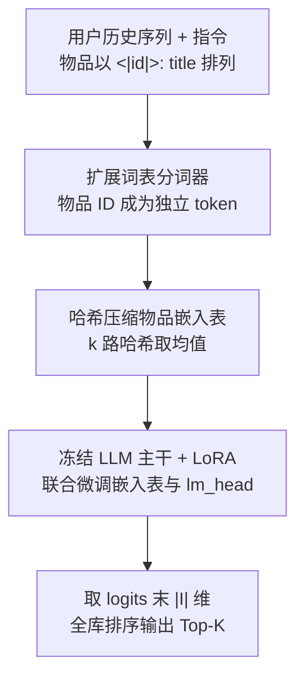
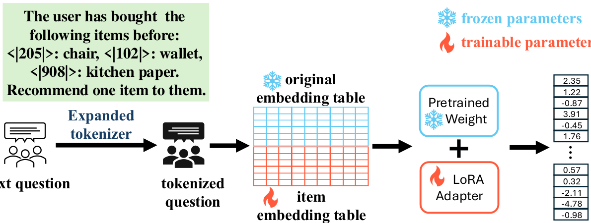

# CoVE: Compressed Vocabulary Expansion Makes Better LLM-based Recommender Systems (压缩词表扩展：让 LLM 推荐系统更强)

- **会议/期刊**: ACL 2025 Findings
- **作者与机构**: Haochen Zhang, Tianyi Zhang, Junze Yin, Oren Gal, Anshumali Shrivastava, Vladimir Braverman (Rice University / University of Haifa / Johns Hopkins University)
- **推荐链路定位**: 端到端生成式（序列推荐 Next-Item 预测）
- **研究方向**: 大语言模型推荐 / 生成式推荐与离散语义 ID
- **论文原文**: [https://arxiv.org/abs/2506.19993v1](https://arxiv.org/abs/2506.19993v1)
- **开源代码**: [https://github.com/HaochenZhang717/CoVE-official-Repo](https://github.com/HaochenZhang717/CoVE-official-Repo)

## TL;DR (1分钟核心速览)

现有 LLM 推荐要么只把 LLM 当嵌入提供器（浪费序列理解能力），要么走"微调-生成标题-向量检索"路线（多 token 生成慢、易幻觉）。CoVE 把每个物品注册为词表中的一个唯一 token，微调时联合更新物品嵌入表、LoRA 与 lm_head，推理时只取 lm_head 最后 $|\mathcal{I}|$ 维 logits 直接排序，彻底绕开文本生成；再用哈希把物品嵌入表压缩至 1/16。在 Amazon 四个数据集上 NG@5/HR@5 相对 SOTA 提升 30%–62%，推理吞吐从 0.066 提升到 6.5 samples/s（约 100×）。

## Background & Motivation (背景与核心矛盾)

- **主流范式**: 一条路线用 LLM 产出物品/用户嵌入去初始化 SASRec、BERT4Rec 等非 LLM 模型；另一条路线（BIGRec、GPT4Rec）微调 LLM 生成物品标题，再做嵌入检索对齐到真实物品空间。
- **前人局限**: 前者只借用嵌入能力，未激活 LLM 的序列建模与下一 token 预测能力；后者要求 LLM 逐 token 生成完整标题，既慢又必然面临幻觉——生成的标题可能根本不在物品库中，检索补救只是事后打补丁。
- **核心洞察 (Key Insight)**: 推荐本质是"从有限物品集中选一个"，与语言模型的 next-token 分类在形式上完全同构。若把物品空间直接并入词表，推荐就退化为一次单 token 分类，幻觉在结构上被消除。
- **本文切入点**: 词表扩展 + 嵌入表联合微调 + 哈希压缩，把"生成式推荐"改造成"单步 logits 判别"，同时解决工业级物品空间（Amazon 2023 版 4819 万物品，嵌入表约 96GB）的内存不可行问题。

## Method (核心方法设计)

### 1. 整体框架 (Overall Architecture)

输入是一条指令化 prompt：Task Instruction + 以 `<|item_id|>: "title"` 形式排列的用户历史 + Task Output（目标物品 ID）。分词器词表被扩展 $|\mathcal{I}|$个特殊 token，每个 token 在嵌入表中拥有独立行向量；这些行向量与 LoRA 适配器、lm_head 一同参与微调，主干 Transformer 权重冻结。训练目标即标准下一 token 预测，但监督信号只落在物品 ID token 上。推理时只前向一次，取 lm_head 输出向量的最后$|\mathcal{I}|$ 维作为全库打分，做 Full-Ranking 排序，无需自回归解码。

<figure class="paper-figure" markdown="span">
  <figcaption>图1：我们的CoVE框架概览。每个物品在分词器中分配唯一ID，随后映射为不同的嵌入。之后，我们的框架微调物品嵌入、transformer权重和lm_head，使LLM与序列推荐任务对齐。</figcaption>
</figure>

### 2. 关键设计拆解 (Key Designs)

1. **物品 ID 词表化（Item-as-Token）**：痛点是把推荐对齐到"生成标题"需要多 token 且易幻觉。CoVE 为每个物品 $i$在词表中分配唯一 token，使推荐目标变为单 token 分类，损失退化为标准交叉熵$\mathcal{L}=-\log p(y_t=\text{ID}(i^\ast)\mid \text{context})$。物理直觉：LLM 的 next-token 头本身就是对词表做 softmax 分类，物品集天然是"一个受限词表"，无需任何结构改造即可复用其全部序列建模能力。

2. **哈希嵌入压缩（Hashing-based Compression）**：痛点是大物品空间下嵌入表显存爆炸。设共享隐空间 $\mathcal{S}$（$|\mathcal{S}|\ll|\mathcal{I}|$），采样$k$个通用哈希函数$h_1,\dots,h_k$，物品嵌入取各哈希槽嵌入的均值：
$$\boldsymbol{e}_i=\frac{1}{k}\sum_{j=1}^{k}\boldsymbol{e}_{h_j(i)},\quad h(i)=((ai+b)\boldsymbol{o}d p)\boldsymbol{o}d|\mathcal{S}|$$
其中 $p$为大素数，$a,b$ 随机取值。仅用加法、乘法、取模即可在 GPU 上高效计算。直觉上多路哈希相当于对物品做"随机特征共享"，让低频物品借用同槽高频物品的梯度信号，兼具压缩与隐式正则效果。

3. **训练目标、负采样与推理效率**：总损失为物品 ID token 的下一 token 交叉熵，**无需任何负采样**——softmax 分母覆盖全物品空间，等价于全库对比学习。推理侧一次前向即可得到全库打分，吞吐 6.5 samples/s，对比 BIGRec 的 0.066 samples/s 约 100× 加速；代价是 lm_head 与嵌入表规模随 $|\mathcal{I}|$ 线性增长，由哈希压缩抵消。

## Experimental Setup & Evaluation Protocol (实验设置与评估协议)

- **数据集与预处理**: 四个 Amazon 公开基准，沿用 TIGER（Beauty/Toys/Sports）与 BIGRec（Video Games）的原始划分以保证可比：

| 数据集 | #Items | #Sequences | 说明 |
| :--- | :---: | :---: | :--- |
| Video Games | 17,408 | 149,796 | 对比 BIGRec，LLaMA-2-7B + 4-bit QLoRA |
| Beauty | 12,101 | 22,363 | 对比 TIGER，LLaMA-3.2-3B |
| Toys & Games | 11,924 | 19,412 | 同上 |
| Sports & Outdoors | 18,357 | 35,598 | 同上 |

- **数据划分与防穿越 (Splitting Strategy)**: 沿用 TIGER / BIGRec 的 `Leave-One-Out` 式序列切分（最后一交互为测试目标），未额外引入时间戳重切。
- **排名评测协议 (Ranking Protocol)**: 采用 `Full-Ranking` 全库排序（logits 末 $|\mathcal{I}|$维直接排序），指标为 NG@K 与 HR@K，$K\in\{5,10\}$（Video Games 额外报$K=20$）。
- **对比基线与超参设置**: 基线覆盖 GRU4Rec、BERT4Rec、Caser、SASRec、P5、HGN、S3-Rec、FDSA、TIGER、DROS、GPT4Rec、BIGRec。学习率 $10^{-4}$，batch size 32，LoRA rank 8 / alpha 16，训练至多 10 epoch，单卡 A100。

## Key Experimental Results (实验关键数据)

### 1. 主实验对比 (Main Results)

Beauty / Toys / Sports（CoVE 采用 2× 压缩率）：

| 数据集 | 指标 | SASRec | S3-Rec | FDSA | TIGER | **CoVE** | Improv. |
| :--- | :--- | :---: | :---: | :---: | :---: | :---: | :---: |
| Beauty | NG@5 | 0.0249 | 0.0244 | 0.0163 | 0.0321 | **0.0498** | +55.1% |
| Beauty | HR@10 | 0.0605 | 0.0647 | 0.0407 | 0.0648 | **0.1009** | +55.7% |
| Toys | NG@5 | 0.0306 | 0.0294 | 0.0140 | 0.0371 | **0.0509** | +37.2% |
| Toys | HR@10 | 0.0675 | 0.0700 | 0.0381 | 0.0712 | **0.0986** | +38.5% |
| Sports | NG@5 | 0.0192 | 0.0204 | 0.0156 | 0.0181 | **0.0296** | +45.1% |
| Sports | HR@10 | 0.0350 | 0.0385 | 0.0288 | 0.0400 | **0.0624** | +56.0% |

Video Games（对比 BIGRec 的微调-检索范式）：

| 模型 | NG@5 | NG@10 | NG@20 | HR@5 | HR@10 | HR@20 |
| :--- | :---: | :---: | :---: | :---: | :---: | :---: |
| SASRec | 0.0015 | 0.0024 | 0.0035 | 0.0021 | 0.0037 | 0.0057 |
| GPT4Rec-LLaMA | 0.0000 | 0.0001 | 0.0001 | 0.0000 | 0.0002 | 0.0002 |
| BIGRec | 0.0189 | 0.0216 | 0.0248 | 0.0243 | 0.0329 | 0.0457 |
| **CoVE** | **0.0221** | **0.0268** | **0.0341** | **0.0290** | **0.0437** | **0.0621** |

### 2. 消融实验 (Ablation Study)

| 设置 | Beauty NG@5 | Beauty HR@10 | Toys NG@5 | Sports HR@10 |
| :--- | :---: | :---: | :---: | :---: |
| 仅冻结嵌入表 + 含标题 prompt (I.) | 0.0057 | 0.0178 | 0.0058 | 0.0128 |
| 仅可训练嵌入表 + 去标题 prompt (E.) | 0.0450 | 0.0836 | 0.0429 | 0.0439 |
| 完整 CoVE（可训练嵌入 + 含标题） | **0.0498** | **0.1009** | **0.0509** | **0.0624** |

### 3. 关键实验发现 (Key Findings)

1. **嵌入表可训练性是命门，标题文本是增益项**：冻结物品嵌入表后 Beauty NG@5 从 0.0498 崩至 0.0057（跌幅近 9 倍），说明随机初始化的新 token 嵌入必须靠推荐信号重塑；而去掉标题仅降至 0.0450，证明 LLM 的序列理解能力可部分补偿语义缺失，但 ID-title 映射仍是高质量推荐的关键（案例研究中模型能稳定复现 ID 与标题的对应关系）。
2. **压缩率与性能呈温和单调退化，16× 仍可超越 SOTA**：Beauty 在 8× 压缩时 NG@5/HR@5 归一化值降至约 0.75，是四个数据集中最敏感的；Sports 与 Toys 在 8× 内几乎无损，16× 下除 Toys 的 HR@10 外全部指标仍优于最强基线，说明哈希共享对稀疏物品起到了隐式正则作用。
3. **相对 BIGRec 的优势随 $K$ 增大而扩大**：Video Games 上 NG@5 提升 16.9%，而 NG@20 提升 37.5%、HR@20 提升 35.9%，表明 logits 全库打分在长尾候选上比"生成-检索"两阶段更不易漏召，这与消除幻觉的机制预期一致。

## Highlights & Limitations (亮点、对比与审稿批判)

- **与代表作对比 (vs. Prior Work)**: 与 TIGER 相比，CoVE 不做 RQ-VAE 语义 ID 的层次化生成，而是直接让物品占据原生词表槽位，省去码本设计与多级解码；与 BIGRec 相比，训练阶段同样微调 LLM，但推理阶段从"生成标题 + 向量检索"变为"单次前向取 logits"，同时消除幻觉与百倍延迟；与纯嵌入初始化路线（LLM 嵌入 + SASRec）相比，CoVE 让 LLM 主干真正参与序列建模。
- **可迁移亮点**: (1) "把候选集并入词表 + 只取末段 logits"这一技巧可平移到任何以 LLM 为骨干的召回/重排场景，天然支持全库 softmax 而无需负采样；(2) 多路哈希均值嵌入是一种极轻量的参数共享方案，可直接用于其他超大词表/ID 类特征的显存优化。
- **审稿级局限批判**: (1) 哈希压缩仅与"无压缩"和基线对比，未与量化、低秩分解等更强压缩手段横向比较，压缩率选择也缺少自适应策略；(2) 评估仅限 Amazon 四个中等规模数据集（物品数 1–2 万），对论文自身强调的千万级物品场景缺乏实证，且未报告训练显存与总训练时长的定量数据；(3) 依赖物品标题文本，在纯 ID 或无文本元数据的场景下增益会显著收窄。

## Rating (四维评分)

- **方法创新性 (Novelty)**: ⭐⭐⭐⭐ （把推荐重构为单 token 分类的思路简洁且自洽，词表扩展本身非首创，但"扩展 + 哈希压缩 + logits 直排"的组合在 LLM4Rec 中定位清晰）
- **评估协议与实验扎实度 (Protocol & Experiments)**: ⭐⭐⭐⭐ （四数据集 + Full-Ranking + 12 个基线 + 完整消融与压缩率扫描，但缺少大规模物品空间与训练开销的实证）
- **写作与数学规范度 (Clarity & Rigor)**: ⭐⭐⭐⭐ （框架图与公式交代清楚，哈希函数定义完整；对压缩带来的性能损失缺乏理论刻画）
- **工业落地与复现价值 (Industrial & Practical Value)**: ⭐⭐⭐⭐⭐ （代码开源，100× 推理加速与 16× 显存压缩直击线上部署痛点，工程价值突出）

