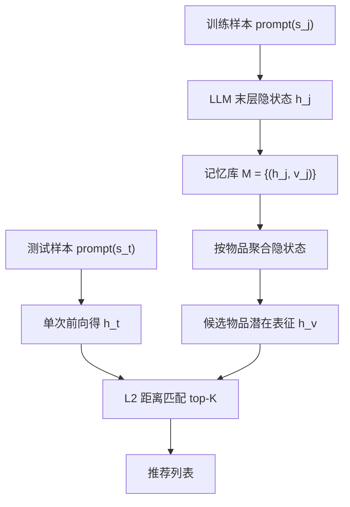
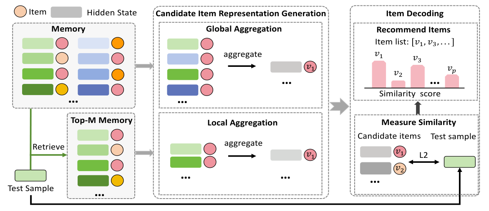

# Decoding in Latent Spaces for Efficient Inference in LLM-based Recommendation (面向 LLM 推荐高效推理的潜在空间解码)

- **会议/期刊**: EMNLP 2025
- **作者与机构**: Chengbing Wang, Yang Zhang, Zhicheng Wang, Tianhao Shi, Keqin Bao, Fuli Feng, Tat-Seng Chua（中国科学技术大学、新加坡国立大学）
- **推荐链路定位**: 端到端生成式（推理解码阶段）
- **研究方向**: 大语言模型推荐 / 生成式推荐
- **论文原文**: [https://arxiv.org/abs/2509.11524v1](https://arxiv.org/abs/2509.11524v1)
- **开源代码**: 暂未开源

## TL;DR (1分钟核心速览)

生成式 LLM4Rec 需逐 token 自回归输出物品标题，且推荐列表长度线性放大开销。本文提出 L2D：训练完成后把训练样本的末层隐状态与真实物品存入记忆库，按物品聚合出潜在空间表征；推理时仅做一次前向得到测试样本隐状态，用 L2 距离与候选表征匹配即可解码。在 Amazon CDs/Games 的 Full-Ranking 协议下，L2D 相比语言空间解码提速 10 倍以上，Recall@50 由 BIGRec 的 0.0565/0.0702 提升至 0.1569/0.1465。

## Background & Motivation (背景与核心矛盾)

- **主流范式**: 将用户历史拼成指令文本对 LLM 做 SFT，推理时自回归逐 token 生成物品标题（BIGRec/GPT4Rec/D3），或用 beam search 生成多个标题再映射回真实物品。
- **前人局限**: 其一，token 生成串行等待，且推荐需生成整张列表，成本随列表长度线性增长；grounding 映射虽能降本，但仅生成 1 个物品映射到 top-10 会使性能下降约 50%（图 3）。其二，改用 ID 分类头虽快，却偏离 next-token 预训练目标，且需额外训练、在高维空间学稀疏物品表现差。
- **核心洞察 (Key Insight)**: 经生成式微调的 LLM 在末层隐状态中其实已"想好"了目标物品，自回归解码只是把它"激活"出来；因此只要在同一潜在空间里为所有候选物品找到对应表征，匹配即可完成解码。
- **本文切入点**: 不改训练目标、不加新参数，纯用训练集已有的 (隐状态, 真实物品) 对构造物品表征，实现即插即用的潜在空间解码。

## Method (核心方法设计)

### 1. 整体框架 (Overall Architecture)

L2D 分三步：① 记忆构建——对每个训练样本 $(s_j,v_j)$取末层末位隐状态$h_j=\mathrm{LLM}_{last}(\mathrm{prompt}(s_j))$，与标签组成记忆集$\mathcal{M}=\{(h_j,v_j)\}_{j=1}^{N}$，该步可离线预计算；② 候选物品表征生成——把同一物品关联的所有隐状态聚合为该物品在潜在空间的向量；③ 物品解码——测试样本前向一次得$h_t$，与全部候选表征算 L2 距离取 top-$K$。后两步完全脱离 LLM，仅做向量级运算，故延迟极低。

<figure class="paper-figure" markdown="span">
  <figcaption>图2：我们提出的L2D的整体框架。左侧部分展示了存储（隐藏状态，真实项目）对的记忆集。中间部分展示了L2D如何通过全局聚合（平均所有关联的隐藏状态）或局部聚合（使用与测试样本最相关的前M个样本）生成候选项目表示。右侧部分描绘了通过测量测试样本的隐藏状态与候选项目表示之间的相似度来进行项目解码的阶段。</figcaption>
</figure>

### 2. 关键设计拆解 (Key Designs)

1. **全局聚合 L2D-G（物品的综合画像）**：同一物品在不同历史上下文中被"想到"的隐状态各有侧重，单一状态片面。故对物品 $v$ 关联的全部隐状态取均值：
$$\bar{h}_v=\frac{1}{|\mathcal{M}(v)|}\sum_{h_j\in\mathcal{M}(v)}h_j$$
直觉是多视角平均可抵消上下文噪声，得到稳定、通用的物品语义中心，对稀疏物品尤其稳健。

2. **局部聚合 L2D-L（测试样本定制的物品表征）**：全局均值会把与当前测试样本无关的特征面混入，造成干扰。故先按相似度 $S(h_t,h_j)=1/\lVert h_t-h_j\rVert_2$从记忆中检索 top-$M$个近邻构成$\mathcal{M}_t$，再在$\mathcal{M}_t(v)$内均值聚合得$\bar{h}_v^t$。这样物品表征随查询动态变化，聚焦于与当前用户意图最相关的特征面；当$M$ 取满时退化为 L2D-G。

3. **训练目标、负采样与推理效率**：L2D 不引入任何新损失，完全复用原生成式 SFT 的 next-token 交叉熵，属训练后即插即用模块。解码阶段无负采样、无 beam search，仅一次 LLM 前向 + 一次全库向量距离计算，复杂度 $O(Nd)$且与列表长度无关；空间上每样本存一个$d$维 float16 向量（$10^9$ 样本约 2 TB），可用蓄水池采样只保留 30% 样本而性能仍超基线（表 3）。

## Experimental Setup & Evaluation Protocol (实验设置与评估协议)

- **数据集与预处理**: Amazon 评论数据，按时间戳截断，过滤交互数 $<5$ 的用户/物品（`5-core`），用户序列截断至长度 10。

| 数据集 | #Users | #Items | #Interactions | 稀疏度/密度 | 特征/场景说明 |
| :--- | :---: | :---: | :---: | :---: | :--- |
| Amazon CDs | 见附录 A.5 | 见附录 A.5 | 中等规模 | 较稠密 | 音乐 CD，物品交互相对集中 |
| Amazon Games | 见附录 A.5 | 见附录 A.5 | 中等规模 | 较稀疏 | 电子游戏，长尾更明显 |

- **数据划分与防穿越 (Splitting Strategy)**: 交互按时间排序后按 `8:1:1` 比例划分训练/验证/测试，严格时序切分避免未来信息泄漏。
- **排名评测协议 (Ranking Protocol)**: 无偏 `Full-Ranking`（全库未交互物品排序），指标 Recall@K 与 NDCG@K，$K\in\{20,50,100\}$。
- **对比基线与超参设置**: 传统 SASRec/GRU4Rec；LLM 嵌入式 AlphaRec；LLM 生成式 GPT4Rec/BIGRec/D3（beam=1 作公平对比，其余 beam 见效率曲线）。骨干为 Llama 3.2-1B，隐状态维度 1024。

## Key Experimental Results (实验关键数据)

### 1. 主实验对比 (Main Results)

| 模型 (beam=1) | CDs R@20 | CDs R@50 | CDs N@50 | Games R@20 | Games R@50 | Games N@50 |
| :--- | :---: | :---: | :---: | :---: | :---: | :---: |
| SASRec | 0.1015 | 0.1271 | 0.0653 | 0.0684 | 0.1117 | 0.0417 |
| GRU4Rec | 0.0707 | 0.1027 | 0.0439 | 0.0664 | 0.1099 | 0.0387 |
| AlphaRec | 0.0651 | 0.0976 | 0.0364 | 0.0619 | 0.1005 | 0.0371 |
| GPT4Rec | 0.0513 | 0.0562 | 0.0443 | 0.0508 | 0.0782 | 0.0347 |
| BIGRec | 0.0506 | 0.0565 | 0.0446 | 0.0476 | 0.0702 | 0.0328 |
| D3 | 0.0507 | 0.0560 | 0.0447 | 0.0478 | 0.0711 | 0.0330 |
| **L2D-G** | 0.1144 | 0.1562 | **0.0792** | 0.0646 | 0.1167 | 0.0397 |
| **L2D-L** | **0.1158** | **0.1569** | 0.0745 | **0.0879** | **0.1465** | **0.0511** |
| Improv. (vs 最强基线) | +14.1% | +23.4% | +21.3% | +28.5% | +31.2% | +22.5% |

### 2. 消融与变体实验 (Ablation & Variants)

| 变体 | CDs R@50 | CDs N@50 | Games R@50 | Games N@50 | 说明 |
| :--- | :---: | :---: | :---: | :---: | :--- |
| L2D-G | 0.1562 | 0.0792 | 0.1167 | 0.0397 | 全局均值聚合 |
| L2D-L | **0.1569** | 0.0745 | **0.1465** | **0.0511** | 局部 top-M 聚合 |
| ID 分类头 | 0.1490 | 0.0714 | 0.1557 | 0.0505 | 偏离生成目标，需额外训练 |
| L2D-G (仅存 30%) | 0.1391 | 0.0696 | 0.1314 | 0.0450 | 记忆压缩后仍超基线 |
| L2D-L (仅存 30%) | 0.1344 | 0.0649 | 0.1214 | 0.0407 | 同上 |

### 3. 关键实验发现 (Key Findings)

1. **效率-效果双赢**：图 3 中 L2D 位于最左上角，比此前最高效的 AlphaRec 再降本至少 5 倍且性能更高；生成式基线靠增大 beam 可线性涨点，但需近百倍成本才能追平，实际不可行。
2. **稀疏/稠密场景分工明确**：稠密场景下 L2D-L 因每物品隐状态充足、可剔除无关特征面而最优；稀疏场景下 top-M 近邻本身不可靠，L2D-G 的全局平均更稳（图 4）。超参 $M$ 在 Games 上呈先升后降，说明该数据集更依赖细粒度特征面。
3. **优于 ID 分类头且更抗稀疏**：整体上 CDs 平均相对提升 11.2%；稀疏子集上优势更悬殊（CDs R@50 0.0889 vs 0.0671，Games R@50 0.0874 vs 0.0446），印证保留生成式训练范式比改分类头更能利用预训练知识。

## Highlights & Limitations (亮点、对比与审稿批判)

- **与代表作对比 (vs. Prior Work)**: 与 BIGRec/D3 等生成式方法相比，本文不改训练目标、不加参数，仅替换解码方式，属即插即用；与 AlphaRec/RecFormer 等"潜在空间匹配"方法相比，后者修改输出层且匹配效果绑定训练过程，无法插入已有生成式推荐器，且训练目标偏离 next-token 预测。
- **可迁移亮点**: ① "末层隐状态 + 标签聚合"可作为任意生成式推荐器的通用加速后处理；② 局部 top-M 检索式聚合本质是查询自适应的物品表征，可迁移到冷启动较少但长尾明显的场景做动态去噪。
- **审稿级局限批判**: ① 记忆库需离线预构建并占用可观存储（$10^9$ 样本约 2 TB），且论文未处理记忆的增量更新，交互持续累积时表征会陈旧；② 完全零交互物品仍无法覆盖，且仅在 1B 小模型与两个 Amazon 域上验证，更大骨干与工业级候选规模下的延迟/收益尚未证实。

## Rating (四维评分)

- **方法创新性 (Novelty)**: ⭐⭐⭐⭐ （"隐状态即思想、匹配即解码"的视角简洁有力，但聚合与 L2 匹配本身较朴素，理论刻画偏直觉）
- **评估协议与实验扎实度 (Protocol & Experiments)**: ⭐⭐⭐⭐ （Full-Ranking + 时序切分规范，含稀疏/稠密分桶、$M$ 敏感性与存储压缩实验，但仅两个数据集、缺显著性检验）
- **写作与数学规范度 (Clarity & Rigor)**: ⭐⭐⭐⭐ （公式极简清晰、三种聚合策略对比到位，复杂度与空间分析完整，但缺少对表征质量的进一步理论分析）
- **工业落地与复现价值 (Industrial & Practical Value)**: ⭐⭐⭐⭐ （即插即用、10 倍以上提速、30% 记忆即可超基线，落地价值高；扣分在于未开源与记忆更新机制缺失）

