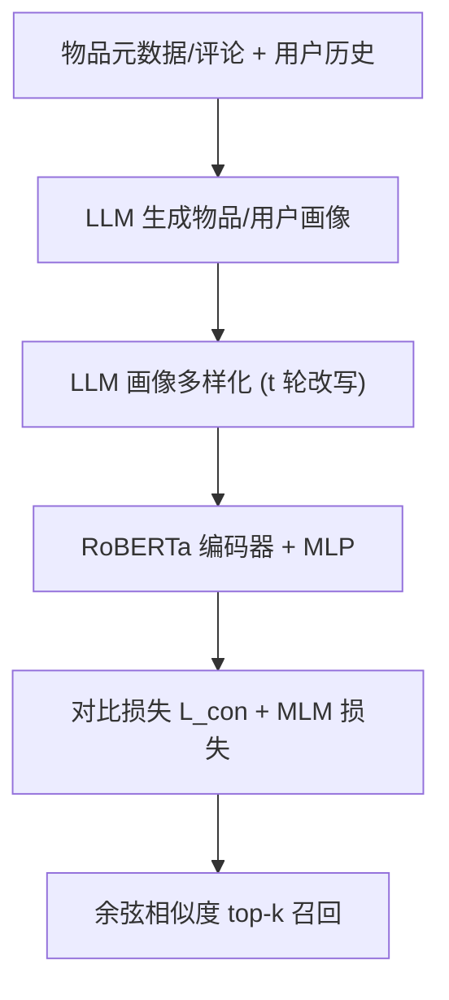
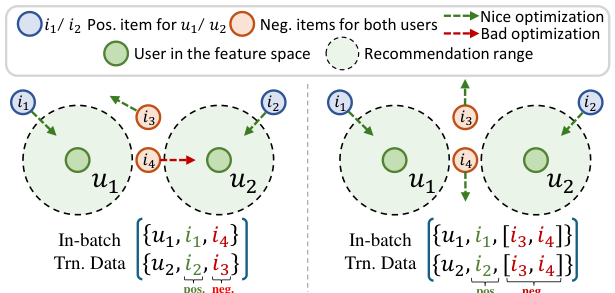

# EasyRec: Simple yet Effective Language Models for Recommendation (简单而有效的推荐语言模型)

- **会议/期刊**: EMNLP 2025 (Main)
- **作者与机构**: Xubin Ren, Chao Huang (The University of Hong Kong)
- **推荐链路定位**: 召回（文本编码器 / 零样本冷启动召回）
- **研究方向**: 大语言模型推荐 / 冷启动与零样本推荐
- **论文原文**: [https://arxiv.org/abs/2408.08821v4](https://arxiv.org/abs/2408.08821v4)
- **开源代码**: [https://github.com/HKUDS/EasyRec](https://github.com/HKUDS/EasyRec)

## TL;DR (1分钟核心速览)

现有 CF 模型依赖唯一 ID，跨域/零样本场景下用户物品无重叠即失效；直接用通用 LM 编码文本又缺乏推荐语义与高阶协同信号。EasyRec 先用 LLM 生成含协同信息的用户/物品画像，再用**监督对比学习 + MLM** 微调 RoBERTa 编码器，把文本语义空间与全局协同信号对齐。在 Sports/Steam/Yelp 三个未见数据集上以 Full-Ranking 评估，Recall@20 相对最强基线提升 16%–32%，且推理仅约 0.01 秒/次。

## Background & Motivation (背景与核心矛盾)

- **主流范式**: GNN-based CF（NGCF/LightGCN）与自监督增强（SGL/NCL/AutoCF）通过 ID 嵌入 + 图消息传递建模高阶协同关系，是当前精度主流。
- **前人局限**: ① 一切依赖唯一 ID，训练与部署的用户/物品 token 无重叠时完全失效，跨域方法又假设用户集合重叠，灵活性差；② LLM 直接生成式推荐（LLaRA/CoLLM）每次预测约需 1 秒，无法支撑大规模召回；RLMRec 等文本增强仍绑定 ID，泛化受限。
- **核心洞察 (Key Insight)**: 若把"用户/物品"表达为**富含协同信息的自然语言画像**，则推荐可退化为文本语义空间中的余弦匹配，天然具备零样本迁移能力；但通用 LM 的语义空间并非为推荐优化，需用协同信号做对齐微调。
- **本文切入点**: 以 LLM 画像为输入、以对比学习为对齐手段，训练一个 82M–355M 的轻量推荐专用文本编码器，兼顾泛化与效率。

## Method (核心方法设计)

### 1. 整体框架 (Overall Architecture)

流程分三段：**(a) 画像构建**——物品画像由标题、类目、描述（无描述时改用用户评论）经 LLM 生成；用户画像则由其交互过的物品画像、标题与评论经 LLM 归纳（采用 CoT + Self-Consistency 提升可靠性），全程不依赖人口统计学隐私信息。**(b) 协同语言模型微调**——以 RoBERTa 为骨干，取 `[CLS]` 经 MLP 得嵌入，用批内对比损失把交互对拉近、非交互对推远，并辅以 MLM 稳定训练。**(c) 画像多样化**——用 LLM 对同一画像做 $t$ 轮同义改写扩充训练语料。推理时仅需编码画像并做余弦 top-k 检索。

<figure class="paper-figure" markdown="span">
  <figcaption>图3：对协同语言模型进行对比调优使其能够学习丰富的表示。它将基于文本的语义空间与全局协同信号对齐。</figcaption>
</figure>

### 2. 关键设计拆解 (Key Designs)

1. **协同画像构建（Collaborative Profiling）**：痛点是无 ID 时文本无法承载协同关系。物品画像 $P_i=\mathrm{LLM}(M_i,h_i,c_i,\{r_{u,i}\})$，用户画像$P_u=\mathrm{LLM}(M_u,\{h_i,P_i,r_{u,i}\mid i\in\mathcal{N}_u\})$，采用 item-to-user 的级联生成范式，使画像天然编码"谁买了什么、评价如何"的二阶协同语义；同时画像可编辑，用户兴趣漂移时只需改写文本即可快速适配，无需重训。
2. **对比式协同语言模型微调**：BPR 每个样本仅一个负例，无法刻画全局结构。EasyRec 改用批内多负例监督对比损失：
$$\mathcal{L}_{con}=-\sum\log\frac{\exp(s_{u,i^+}/\tau)}{\sum_{j\in\mathcal{N}^-}\exp(s_{u,j}/\tau)},\quad s_{u,j}=\cos(\boldsymbol{e}_u,\boldsymbol{e}_j)$$
其中 $\mathcal{N}^-$为批内负例集合，$\tau=0.05$。多负例使嵌入空间获得全局性的"推-拉"调整，把文本语义空间与协同邻域结构对齐，这是零样本泛化的关键。
3. **训练目标与推理效率**：总损失 $\mathcal{L}=\mathcal{L}_{con}+\lambda\mathcal{L}_{mlm}$，$\lambda=0.1$，MLM 掩码率 0.15，学习率$5\times10^{-5}$，训练 25 epoch；负采样为 **In-batch 负采样（免显式采样器）**。推理为编码器单次前向 + 余弦检索，约 0.01 秒/次，比 LLM 生成式推荐快两个数量级。

## Experimental Setup & Evaluation Protocol (实验设置与评估协议)

- **数据集与预处理**: Amazon 六类（Arts/Games/Movies/Home/Electronics/Tools）作训练集，Sports、Steam、Yelp 作零样本测试集；Amazon 数据先过滤评分 $\geq 3$ 并做 `10-core` 过滤。

| 数据集 | #Users | #Items | #Interactions | 平均交互数 | 角色 |
| :--- | :---: | :---: | :---: | :---: | :--- |
| Train (6 类合计) | 124,732 | 67,455 | 802,869 | 6.44 | 训练 |
| Sports | 21,476 | 12,741 | 132,400 | 6.17 | 零样本测试 |
| Steam | 23,310 | 5,237 | 316,190 | 13.56 | 零样本测试（跨平台） |
| Yelp | 11,091 | 11,010 | 166,620 | 15.02 | 零样本测试（跨平台） |

- **数据划分与防穿越 (Splitting Strategy)**: Amazon 类目按 `8:1:1` 比例划分，Steam/Yelp 沿用 RLMRec 的 `3:1:1` 划分；画像仅由**训练集交互**生成，验证/测试交互严格隔离，杜绝标签泄漏。
- **排名评测协议 (Ranking Protocol)**: 采用无偏 `Full-Ranking`（all-rank，对全部未交互物品排序），指标 Recall@{10,20} 与 NDCG@{10,20}；多样化画像场景下对 $t$ 组画像对分别计算后取均值。
- **对比基线与超参设置**: 基线含通用 LM（BERT/RoBERTa/BART）、稠密检索 LM（SimCSE/GTR/BGE）、推荐专用 LM（BLaIR）及 OpenAI v3 Small/Large；EasyRec 分 Small/Base/Large（82M/125M/355M），显著性检验 $p<0.05$。

## Key Experimental Results (实验关键数据)

### 1. 主实验对比 (Main Results)

零样本文本推荐（Full-Ranking，节选 Recall 与 NDCG@20）：

| 方法 | Sports R@10 | Sports R@20 | Steam R@10 | Steam R@20 | Yelp R@10 | Yelp N@20 |
| :--- | :---: | :---: | :---: | :---: | :---: | :---: |
| OpenAI v3-Large | 0.0300 | 0.0436 | 0.0070 | 0.0137 | 0.0029 | 0.0032 |
| BGE-Large | 0.0324 | 0.0449 | 0.0089 | 0.0153 | 0.0025 | 0.0029 |
| GTR-Large | 0.0329 | 0.0446 | 0.0095 | 0.0168 | 0.0021 | 0.0025 |
| BLaIR-Large | 0.0227 | 0.0322 | 0.0057 | 0.0108 | 0.0027 | 0.0027 |
| EasyRec-Base | 0.0360 | 0.0518 | 0.0114 | 0.0203 | 0.0034 | 0.0037 |
| **EasyRec-Large** | **0.0396** | **0.0557** | **0.0129** | **0.0225** | **0.0034** | **0.0037** |
| Improv.% (vs 最强基线) | ↑20.36% | ↑24.05% | ↑35.79% | ↑32.35% | ↑17.24% | ↑15.63% |

文本增强 CF（Steam，5 次均值，LightGCN 骨干）：

| 文本编码器 | R@10 | R@20 | N@10 | N@20 |
| :--- | :---: | :---: | :---: | :---: |
| 纯 ID LightGCN | 0.0851 | 0.1349 | 0.0686 | 0.0854 |
| + BLaIR | 0.0897 | 0.1418 | 0.0724 | 0.0901 |
| + BGE | 0.0891 | 0.1407 | 0.0718 | 0.0893 |
| **+ EasyRec** | **0.0908** | **0.1430** | **0.0732** | **0.0908** |

### 2. 消融实验 (Ablation Study)

| 配置 | Sports R@10 | Sports N@10 | Yelp R@10 | Yelp N@10 |
| :--- | :---: | :---: | :---: | :---: |
| EasyRec-Large (BPR 损失) | 0.0381 | 0.0226 | 0.0028 | 0.0021 |
| EasyRec-Large (对比损失) | **0.0396** | **0.0236** | **0.0034** | **0.0026** |
| w/o 画像多样化 (Steam R@20) | 0.0170 (Small) | — | — | — |
| w/ 多样化 $t=3$ (Steam R@20) | 0.0175+ (Small) | — | — | — |

### 3. 关键实验发现 (Key Findings)

1. **对比损失显著优于 BPR**：在 Sports 上 R@10 从 0.0381 升至 0.0396、Yelp 上从 0.0028 升至 0.0034（相对 +21%），证明批内多负例对全局协同结构的刻画是性能增益主因，而非单纯骨干容量。
2. **规模律成立且双向有效**：模型从 82M→355M 时三数据集指标单调上升（Steam R@20 从 0.0174→0.0225）；画像多样化 $t$ 从 0 增至 3 亦持续增益，说明"模型容量 × 语料规模"共同驱动，且多样化还能提升列表内多样性（ILD@10 由 0.7336→0.7487）。
3. **文本范式可反超 ID 范式**：EasyRec 接入 AlphaRec 文本框架后 Steam R@10 达 0.0863，高于 ID-based LightGCN 的 0.0851；同时相对 LLMRank（GPT-4o-mini 逐条排序）R@10 为 0.8078 vs 0.7822，推理时间从约 1 小时降至 3–4 分钟。

## Highlights & Limitations (亮点、对比与审稿批判)

- **与代表作对比 (vs. Prior Work)**: 与 BLaIR 相比，EasyRec 不仅用元数据还用**含协同信号的 LLM 画像**，且以多负例对比对齐而非仅反馈配对；与 RLMRec 相比，EasyRec 是**可独立零样本部署的编码器**而非 ID 模型的辅助增强；与 LLaRA/CoLLM 相比，以 0.01 秒级推理换取可规模化召回。
- **可迁移亮点**: ① "item-to-user 级联画像生成 + 仅用训练集交互"的防泄漏范式可直接复用到任何文本化召回管线；② 画像可编辑即可实现兴趣漂移的免训练快速适配（案例中仅改画像文本，推荐从篮球装备切换为游泳装备）。
- **审稿级局限批判**: ① 仅用文本模态，缺失图像/视频信号，对视觉驱动品类（服饰、短视频）泛化存疑；② 画像生成与多样化依赖 GPT-3.5 外部 API（约 322M token、约 200 美元），成本与可复现性受第三方模型版本漂移影响；③ 零样本评估仅三个数据集，且 Yelp 上 EasyRec-Large 与 Base 持平，规模律在该域并不严格成立。

## Rating (四维评分)

- **方法创新性 (Novelty)**: ⭐⭐⭐⭐ （画像即协同载体 + 对比对齐的组合简洁有效，但各组件均为已有技术的巧妙拼接，理论新意有限）
- **评估协议与实验扎实度 (Protocol & Experiments)**: ⭐⭐⭐⭐ （Full-Ranking 无偏评估、跨平台零样本设置严谨、含规模律与效率对比，但测试域仅三个、缺线上验证）
- **写作与数学规范度 (Clarity & Rigor)**: ⭐⭐⭐⭐ （框架图与公式清晰，损失与超参交代完整，但部分符号如 $\mathcal{N}^-$ 的批内构造细节需查附录）
- **工业落地与复现价值 (Industrial & Practical Value)**: ⭐⭐⭐⭐⭐ （代码开源、82M 轻量级、0.01 秒推理、可插拔接入现有 CF，工程落地价值突出）

