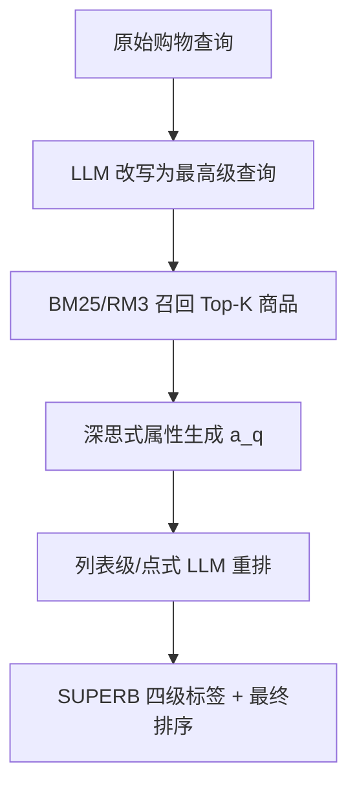

# Generative Product Recommendations for Implicit Superlative Queries (面向隐式最高级查询的生成式商品推荐)

- **会议/期刊**: ACL 2025
- **作者与机构**: Kaustubh D. Dhole, Nikhita Vedula, Saar Kuzi, Giuseppe Castellucci, Eugene Agichtein, Shervin Malmasi（Emory University / Amazon）
- **推荐链路定位**: 重排（LLM 列表级 Re-ranking）
- **研究方向**: 大语言模型推荐 / 列表级重排
- **论文原文**: [https://arxiv.org/abs/2504.18748v1](https://arxiv.org/abs/2504.18748v1)
- **开源代码**: [https://github.com/emory-irlab/SUPERB](https://github.com/emory-irlab/SUPERB)

## TL;DR (1分钟核心速览)

本文聚焦电商中"隐式最高级查询"（如 "best shoes for trail running"）——用户未显式给出属性、却要求系统推理出"最好"的商品。作者提出四级相关性标注体系 SUPERB（Overall Best / Almost Best / Relevant But Not Best / Not Relevant），并用 LLM 以 pointwise、pairwise、listwise 与深思式（deliberated）四种方式生成标注与重排。在 2,230 条查询、29,218 条三元组上，列表级重排相对 BM25 在 nDCG@10 上从 0.213 提升至 0.259（约 +21.6%），P@5 从 0.206 提升至 0.262（+27.2%），且显著优于点式重排。

## Background & Motivation (背景与核心矛盾)

- **主流范式**: 电商检索/排序依赖 BM25、RM3 等词法检索与 ESCI（Exact/Substitute/Complement/Irrelevant）等客观相关性标签，面向"高客观性"查询设计。
- **前人局限**: (1) 隐式最高级查询不显式提及属性，需常识与世界知识推理（如"3 岁男孩的玩具"需推断安全性、年龄适配、主题偏好）；(2) 现有 ESCI 标签无法刻画"最好"的主观质量维度，即使商品"高度相关"也未必是"最优"。
- **核心洞察 (Key Insight)**: LLM 在大规模语料上习得了跨领域常识与"全球偏好"建模能力，可充当隐式属性的生成器与多目标比较器；且提供其他商品作为上下文（listwise）能帮助模型校准"最好"的判断。
- **本文切入点**: 用 LLM 先"深思"生成理想属性使其显式化，再据此做四级分类与列表级重排，并以人工评估验证标注质量。

## Method (核心方法设计)

### 1. 整体框架 (Overall Architecture)

流程为：以 Amazon Shopping Queries 数据集为种子，用 Claude-Sonnet few-shot 将原始查询改写为最高级查询（35,651 条）；筛选至少含 5 个 Exact 商品的查询，用 Claude-Haiku 以四种提示范式生成 SUPERB 四级标签与解释，构成 29,218 条三元组；评测阶段以 BM25/RM3 召回 Top-K，再用列表级或深思式点式重排输出最终排序。

### 2. 关键设计拆解 (Key Designs)

1. **SUPERB 四级相关性体系**：痛点在于 ESCI 无法区分"相关"与"最优"。作者定义 3=Overall Best、2=Almost Best、1=Relevant But Not Best、0=Not Relevant，细粒度标签比二值判断更能刻画质量梯度，也便于人工核验。标注分布为 8,564 / 10,100 / 8,342 / 2,212，集中于中间两级，符合"候选均来自 Exact 集合"的先验。

2. **深思式属性生成（Deliberated Prompting）**：痛点在于卖家描述常夸大、模型易被文案带偏。作者先让模型生成理想属性集 $a_q$，再以$(q, a_q, p_1)$ 为输入做点式分类：
$$q \to M \to a_q,\quad (q,a_q,p_1)\to M \to b_1 + c_1 + E$$
其中 $c_1\in[1,9]$ 为置信度，用于标签同分时的排序消歧。属性显式化使模型依据常识而非卖家措辞判断，人工一致率从 75.23% 升至 78.90%。

3. **列表级重排与滑动窗口**：痛点在于长描述与多商品时点式推理调用过多、且 LLM 难以一次输出上百个 ID。列表级提示 $(q,p_1,\dots,p_N)\to M\to r_1\dots r_N$ 一次处理多商品，并借上下文商品校准"最好"；对 Top-100/200 长上下文则采用 RankGPT 式滑动窗口（窗口 20、步长 10）。训练侧无参数更新，纯零样本提示；推理开销主要来自列表级单次长上下文调用。

## Experimental Setup & Evaluation Protocol (实验设置与评估协议)

- **数据集与预处理**: 由 Amazon Shopping Queries 派生，仅保留至少 5 个 Exact 商品的查询：

| 数据集 | #Queries | #Items(三元组) | 标签分布 | 特征/场景说明 |
| :--- | :---: | :---: | :---: | :--- |
| SUPERB | 2,230 | 29,218 | 3:8,564 / 2:10,100 / 1:8,342 / 0:2,212 | 商品描述截断至 512 token，低延迟设定 |

- **数据划分与防穿越 (Splitting Strategy)**: 未做训练/测试划分（零样本提示评测），标注与评测在同一查询集合上进行，属"标注即评测"设定。
- **排名评测协议 (Ranking Protocol)**: 采用 `Full-Ranking` 式全候选排序（对召回 Top-K 内全部商品打分排序），报告 P@5/10/20 与 nDCG@5/10/20；显著性用配对 t 检验 + Holm-Bonferroni 校正（$p<0.05$）。
- **对比基线与超参设置**: BM25、RM3、BM25/RM3 + 点式重排、BM25/RM3 + 列表级重排、BM25 + 滑动窗口；LLM 为 Claude-Haiku，工具链 PyTerrier + PyTerrier-GenRank。

## Key Experimental Results (实验关键数据)

### 1. 主实验对比 (Main Results)

| 检索管线 | P@5 | P@10 | nDCG@5 | nDCG@10 | nDCG@20 |
| :--- | :---: | :---: | :---: | :---: | :---: |
| BM25 | .206 | .163 | .219 | .213 | .235 |
| RM3 | .214 | .180 | .219 | .219 | .243 |
| BM25 + Pointwise 重排 | .226 | .163 | .205 | .198 | - |
| RM3 + Pointwise 重排 | .208 | .180 | .199 | .210 | - |
| **BM25 + Listwise 重排** | **.262** | **.192** | **.278** | **.259** | **.264** |
| RM3 + Listwise 重排 | .248 | **.201** | .245 | .241 | .254 |

长上下文设定（Top-100/200 + 滑动窗口）：

| 管线 | P@10 | P@50 | nDCG@10 | nDCG@50 |
| :--- | :---: | :---: | :---: | :---: |
| BM25-Top100 | .154 | .079 | .205 | .279 |
| BM25-Top100 + Window(5,2) | .185 | .084 | .241 | .309 |
| BM25-Top200 + Window(20,10) | **.262** | **.088** | **.259** | **.328** |

### 2. 消融实验 (Ablation Study)

| 配置 | 关键指标 | 说明 |
| :--- | :---: | :--- |
| Pointwise 标注（人工一致率） | 66.36% | 单商品上下文 |
| Pairwise 标注 | 44.86% | 仅一个对照商品，易被带偏 |
| Listwise 标注 | 60.75% | 多商品上下文 |
| Pointwise 无深思 | 75.23% | 第二阶段基线 |
| **Pointwise + 深思** | **78.90%** | 属性显式化增益 |
| Listwise（BM25 初始序） | nDCG@10=.259 | 有初始序 |
| Listwise（随机打乱序） | .141–.147 | 对初始序高度敏感 |

### 3. 关键实验发现 (Key Findings)

1. **列表级重排是唯一稳定显著优于 BM25 的方案**：nDCG@10 从 .213 升至 .259（+21.6%），而点式重排反而低于 BM25（.198），说明"提供其他商品作上下文"是隐式最高级判断的关键，单商品孤立打分无法校准"最好"。
2. **列表级重排高度依赖一阶段初始序**：打乱 Top-20 顺序后 nDCG@10 从 .259 骤降至 .141–.147，且 BM25 初始分越高的查询获益越大（附录图 4），表明 LLM 是"精修器"而非"从零排序器"。
3. **深思式属性生成对标注质量有稳定增益**：人工一致率 75.23%→78.90%，且属性式查询改写使 BM25 的 MAP 从 .152 升至 .156、R@50 从 .358 升至 .382，说明显式属性既利于 LLM 判断也利于词法召回。

## Highlights & Limitations (亮点、对比与审稿批判)

- **与代表作对比 (vs. Prior Work)**: 相较 Kumar et al. (2024) 仅处理"显式维度"的客观最高级排序，本文首次系统定义并标注"隐式最高级"；相较 RankGPT 式通用列表重排，本文引入领域四级标签与深思式属性生成，使重排目标对齐"最优"而非"相关"。
- **可迁移亮点**: (1) "先生成理想属性再分类"的深思式提示可低成本迁移到任何主观质量排序任务；(2) 置信度 $c_1$ 作为标签同分消歧键，是黑盒 LLM 排序中实用的 tie-break 技巧。
- **审稿级局限批判**: (1) 标注与评测同源、无独立训练/测试划分，且标签由 LLM 生成、仅 107–109 条查询做人工抽检，评估效度存疑；(2) 列表级重排对初始序极度敏感且长上下文推理开销大，论文未报告延迟数据；此外 LLM 倾向"平均化"偏好，对高度个性化或小众品味的最高级查询可能系统性失准。

## Rating (四维评分)

- **方法创新性 (Novelty)**: ⭐⭐⭐ （首次形式化隐式最高级查询并给出四级标注体系，但方法本身是提示工程组合，缺少模型层面的机制创新）
- **评估协议与实验扎实度 (Protocol & Experiments)**: ⭐⭐⭐ （有显著性检验与多管线对比，但无独立测试集、人工评估规模偏小、缺少延迟与线上验证）
- **写作与数学规范度 (Clarity & Rigor)**: ⭐⭐⭐⭐ （问题定义与四级标签阐述清晰，公式简洁，提示模板完整附录可复现）
- **工业落地与复现价值 (Industrial & Practical Value)**: ⭐⭐⭐⭐ （代码与数据集开源，管线基于 PyTerrier 易复现；但列表级长上下文推理成本与初始序敏感性是上线前必须解决的工程问题）

