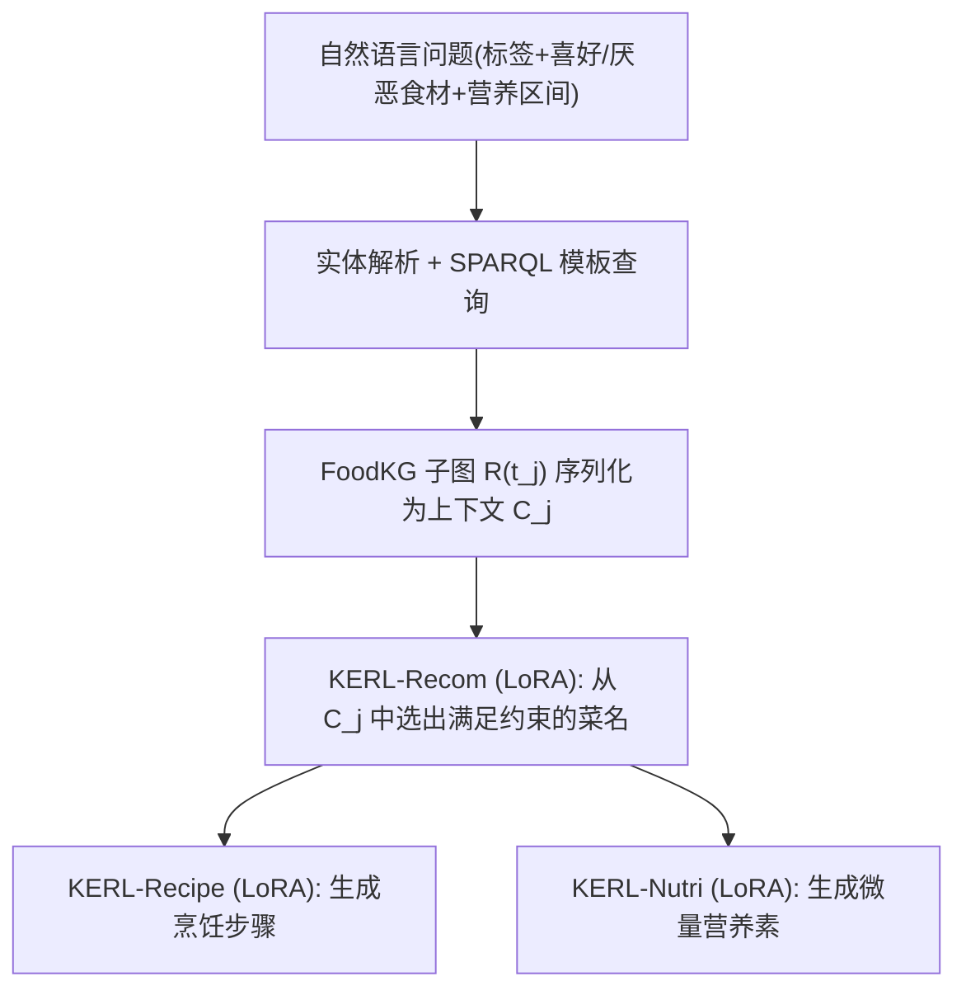
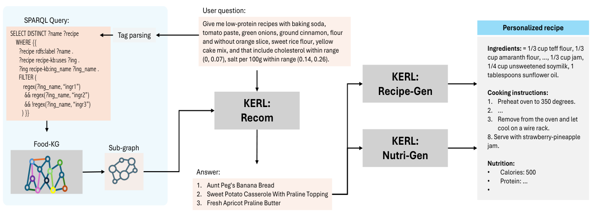

# KERL: Knowledge-Enhanced Personalized Recipe Recommendation using Large Language Models (知识增强的 LLM 个性化食谱推荐)

- **会议/期刊**: ACL 2025
- **作者与机构**: Fnu Mohbat, Mohammed J. Zaki (Rensselaer Polytechnic Institute)
- **推荐链路定位**: 端到端生成式（KG 检索 + LLM 生成）
- **研究方向**: 大语言模型推荐 / 图神经网络与知识图谱推荐
- **论文原文**: [https://arxiv.org/abs/2505.14629v1](https://arxiv.org/abs/2505.14629v1)
- **开源代码**: [https://github.com/mohbattharani/KERL](https://github.com/mohbattharani/KERL)

## TL;DR (1分钟核心速览)

本文针对"食物推荐需同时满足食材偏好、营养约束并输出可执行食谱"这一复合需求，提出 KERL：从 FoodKG 解析实体并生成 SPARQL 查询检索子图，将子图序列化后与自然语言问题一并喂给 Phi-3-mini，用三个独立 LoRA 适配器分别完成食谱推荐、步骤生成与微量营养素估计。在自建的 77,900 条约束问答基准上，KERL-Recom 的 F1 达 **0.973**，较 Phi-3-mini-128K 提升 **56 个点**、较 Llama-2-7B 提升 **26 个点**；在 pFoodReq 上 F1 较 pFoodReq 提升 **21.7 个点**。

## Background & Motivation (背景与核心矛盾)

- **主流范式**: 食物推荐早期把食谱标题/食材/图像映射到统一嵌入空间做检索（Recipe1M 系），后续转向用 GNN 在食物 KG 上学习用户-食谱交互，近期则用 LLM 直接做食谱生成或热量估计。
- **前人局限**: 其一，KG 方法多为嵌入相似度匹配，难以处理"含 A 不含 B 且胆固醇在 (0,0.07) 区间"这类**多约束合取+否定**的复杂查询；其二，LLM 方法各自只覆盖单一环节（要么只推荐、要么只生成食谱、要么只估热量），缺乏统一系统，且纯 LLM 易幻觉、知识过时。
- **核心洞察 (Key Insight)**: 约束满足本质是**符号可判定的子图筛选问题**，而食谱文本生成是**语言生成问题**——二者应解耦：前者交给 KG + SPARQL 精确过滤，后者交给 LLM 生成，LLM 只需在候选子图内做"选择"而非"回忆"。
- **本文切入点**: 用 KG 子图作为 RAG 上下文把候选集显式喂给 LLM，并以多 LoRA 在单一基座上承载三个异构子任务。

## Method (核心方法设计)

### 1. 整体框架 (Overall Architecture)

输入是一条含标签、喜好/厌恶食材与营养区间约束的自然语言问题。系统先做**标签解析**（如 low-protein、vegan），据此生成模板化 SPARQL 查询，从 FoodKG（100 万食谱、6700 万三元组）中检索出该标签下的食谱子图 $R(t_j)$，每个子图含菜名、食材列表与营养值；子图被序列化为文本序列作为上下文$C_j$，与原始问题拼接后送入 Phi-3-mini 的 KERL-Recom 适配器，输出满足全部约束的菜名列表；随后 KERL-Recipe 依据菜名+食材生成烹饪步骤，KERL-Nutri 依据菜名+食材+步骤生成微量营养素。三个适配器共享同一基座，推理时按需激活。

<figure class="paper-figure" markdown="span">
  <figcaption>图 1：KERL 概览：给定自然语言问题（含约束），系统解析实体并生成 SPARQL 查询以从 KG 中检索子图。将问题与该子图作为上下文输入推荐模型（KERL-Recom），生成满足约束的食谱名称列表。随后 KERL-Recipe 和 KERL-Nutri 模型生成烹饪步骤和微量营养素。</figcaption>
</figure>

### 2. 关键设计拆解 (Key Designs)

1. **约束感知的子图上下文构造与正负均衡采样**：痛点在于负例食谱数远多于正例（$|R^-(t_j)| \gg |R^+(t_j)|$，正例均值仅 10.67 而上下文均值达 3167），若整库喂入必然超长且模型会学到"全选"捷径。做法是对每个标签$t_j$构造训练上下文$C_j$，从正例集$R^+(t_j)$与负例集$R^-(t_j)$各采样至多$K/2$条，使模型在"宽分布上下文"中学会逐条比对约束；正例子集即监督答案$Y$。直觉上这等价于把推荐任务转成**上下文内的多标签判别**，负例的显式存在迫使模型真正读取营养数值与食材名而非依赖标签先验。

2. **多 LoRA 单基座的任务解耦**：三个子任务输入输出形态差异极大（列表选择 vs. 长文本步骤 vs. 数值估计），全量微调三份模型代价高且易相互干扰。本文在 Phi-3-mini 上为每个任务训练独立 LoRA（$r=64$、$\alpha=16$、dropout$=0.5$），基座参数冻结，推理时仅切换适配器。这样既保留了跨任务共享的语言先验，又避免了任务间梯度冲突，且单卡即可容纳多适配器。

3. **训练目标与推理分块**：采用标准自回归交叉熵 $\mathcal{L}_{\text{CE}}=\text{CE}(p(Y),p(\tilde{Y}))$，其中$p(Y)$为 ground-truth 食谱 token 的 one-hot 分布、$p(\tilde{Y})$为模型预测分布；无额外负采样损失，负例通过上下文构造隐式提供。推理时因$R(t_j)$可能达 4445 条、超出序列长度，采用**分块迭代**：对$R(t_j)$ 切分子集多次调用 LLM，再合并各次响应得到最终答案，从而支持可变规模候选集。

## Experimental Setup & Evaluation Protocol (实验设置与评估协议)

- **数据集与预处理**: 基于 FoodKG（Recipe1M 的 100 万食谱、490 个标签）构建三个基准：

| 数据集 | #Questions (Train/Test) | 上下文 $R(t_j)$规模 (min/max/avg) | 正例$R^+(t_j)$ (min/max/avg) | 说明 |
| :--- | :---: | :---: | :---: | :--- |
| KGQA Benchmark | 62,320 / 7,790 | 7 / 4,445 / 3,167 | 1 / 1,776 / 10.67 | 本文新建，含食材偏好+营养约束 |
| pFoodReq | 4,613 / 2,305 | 2 / 2,486 / 408.4 | 1 / 296 / 2.94 | 复用外部基准做跨集验证 |
| Nutrition Benchmark | ~481,000 / 19,000 | — | — | 取自 Recipe1M 官方划分 |
| Recipe Generation | 720,639 / 50,000 (test50k) | — | — | 沿用 LLaVA-Chef 的 test50k |

- **数据划分与防穿越 (Splitting Strategy)**: KGQA 基准按 **80%/10%/10% 比例划分** train/val/test；营养与食谱生成沿用 Recipe1M 官方 train/test 划分，无时间戳切分（该场景无时序交互）。
- **排名评测协议 (Ranking Protocol)**: 非传统 Top-N 排序，而是**生成式集合匹配**——将模型输出的菜名列表与 ground-truth 正例集 $R^+(t_j)$ 比对，计算 mAP / Precision / Recall / F1；食谱生成用 BLEU-1~4、SacreBLEU、METEOR、ROUGE、CIDEr 与 Perplexity；营养估计用逐营养素 MAE。
- **对比基线与超参设置**: 基线含 internLM2、Mistral、Phi-2、Llama-2-7B、Llama-3.1、Phi-3-mini-4K/128K，以及 pFoodReq 系的 P-MatchNN / pFoodReq；食谱生成对比 LLaMA、LLaVA、LLaVA-Chef、Phi-3。LoRA 统一 $r=64,\alpha=16$，学习率$2\times10^{-5}$+ cosine 调度，训练 2 epoch，推理 temperature$=0.2$、beam$=1$、max new tokens$=1024$，4×RTX A6000。

## Key Experimental Results (实验关键数据)

### 1. 主实验对比 (Main Results)

**KGQA 基准（Table 5）与 pFoodReq（Table 7）**：

| Model | mAP | P | R | F1 |
| :--- | :---: | :---: | :---: | :---: |
| Mistral | 0.214 | 0.536 | 0.558 | 0.547 |
| Llama-2-7B | 0.557 | 0.825 | 0.627 | 0.713 |
| Llama-3.1 | 0.146 | 0.280 | 0.406 | 0.332 |
| Phi-3-mini-128K | 0.275 | 0.778 | 0.278 | 0.410 |
| **KERL-Recom** | **0.960** | **0.978** | **0.969** | **0.973** |
| *Improv. vs 最强基线* | +40.3 | +15.3 | +34.2 | +26.0 |
| pFoodReq (嵌入法) | 0.627 | — | 0.618 | 0.637 |
| **KERL-Recom (pFoodReq 集)** | **0.769** | **0.825** | **0.885** | **0.854** |

**食谱生成（Table 8，节选）**：KERL-Recipe 在 $X_t+X_{ing}$ 输入下 BLEU-4 达 **0.123**、CIDEr **0.347**、ROUGE-L **0.241**，全面超过全量微调的 LLaVA-Chef（BLEU-4 0.090、CIDEr 0.242），且仅训练 LoRA 参数。

**营养估计（Table 9，MAE 越低越好）**：KERL-Nutri 在完整输入下 Calories MAE **221.38**、Protein **7.29**、Sodium **0.37**，显著优于 LLaVA-Chef 的 323.6 / 12.68 / 192.55——后者在 Sodium 上误差高出两个数量级。

### 2. 消融实验 (Ablation Study)

原文未设标准"移除模块"式消融，但通过**输入模态消融**与**基座对比**提供了等价证据：

| 配置 | 关键指标 | 说明 |
| :--- | :---: | :--- |
| KERL-Recipe w/ $X_t$ only | BLEU-4 0.053 / CIDEr 0.100 | 仅菜名，信息不足 |
| KERL-Recipe w/ $X_{ing}$ only | BLEU-4 0.120 / CIDEr 0.323 | 食材是主导信号 |
| KERL-Recipe w/ $X_t+X_{ing}$ | **BLEU-4 0.123 / CIDEr 0.347** | 双输入最优 |
| KERL-Nutri w/ $X_t$ only | Calories MAE 258.28 | 仅菜名 |
| KERL-Nutri w/ $X_{ing}$ only | Calories MAE 226.65 | 食材含真实营养 |
| KERL-Nutri w/ 全输入 | **Calories MAE 221.38** | 完整食谱最优 |
| Phi-3 基座 (无 LoRA) | KGQA F1 0.410 | 无 KG 上下文+无微调 |
| KERL-Recom (LoRA+KG) | **KGQA F1 0.973** | 两者叠加增益最大 |

### 3. 关键实验发现 (Key Findings)

1. **KG 上下文是主要增益来源，而非模型规模**：Phi-3-mini-128K 仅 0.410 F1，而 7B 的 Llama-2 达 0.713，说明长上下文能力比参数量更关键；但两者都远不及 KERL-Recom 的 0.973，证明"把候选子图显式喂入"比"让模型自己回忆"有效得多。
2. **食材模态对生成与估计均为主导信号**：KERL-Recipe 从仅菜名到加入食材，BLEU-4 从 0.053 跃至 0.120（+126%）；KERL-Nutri 仅用食材的 Calories MAE（226.65）已优于仅用菜名（258.28），符合"营养来自食材"的物理直觉。
3. **标签频次决定长尾表现**：Table 6 显示 dairy-free 因训练样本稀缺，F1 仅 0.667，而 nut-free、low-protein 等高频标签 F1 均超 0.95——说明约束满足能力仍受标签覆盖度制约，冷门饮食约束是薄弱环节。

## Highlights & Limitations (亮点、对比与审稿批判)

- **与代表作对比 (vs. Prior Work)**: 相较 pFoodReq（嵌入相似度匹配，F1 0.637），KERL 用生成式选择在 pFoodReq 集上提升 21.7 点，本质区别是**符号约束由 SPARQL 精确执行、LLM 只做候选内判别**；相较 LLaVA-Chef（全量微调、仅食谱生成），KERL 用 LoRA 在更少参数下取得更优生成指标，并额外覆盖推荐与营养两个环节。
- **可迁移亮点**: ①"SPARQL 硬过滤 + LLM 软选择"的解耦范式可直接迁移到电商/本地生活的多约束筛选场景；②多 LoRA 单基座承载推荐/生成/数值估计三类异构任务，是低成本统一系统的实用模板。
- **审稿级局限批判**: ①**强依赖 KG 覆盖**——若 FoodKG 中无满足全部约束的食谱，系统直接返回空，且错误上下文会传导为错误推荐，缺乏兜底与置信度校准；②**营养估计在极端值上失准**（作者自述高/低热量食谱误差大），且未建立"用户健康状况→膳食禁忌"的推理链（如无法为糖尿病患者准确推荐）；③推理需对 $R(t_j)$ 分块多次调用 LLM，候选集达数千条时延迟与成本未做量化分析。

## Rating (四维评分)

- **方法创新性 (Novelty)**: ⭐⭐⭐ （KG-SPARQL 硬约束 + LLM 软选择的解耦思路清晰实用，但多 LoRA 与 RAG-over-KG 均为成熟组件的工程化组合，理论新意有限）
- **评估协议与实验扎实度 (Protocol & Experiments)**: ⭐⭐⭐⭐ （自建 77,900 条基准规模超 pFoodReq 一个数量级，三任务均有完整基线对比与逐标签分析；但缺标准模块消融与显著性检验）
- **写作与数学规范度 (Clarity & Rigor)**: ⭐⭐⭐⭐ （系统流程与数据构造描述清楚、示例充分；但公式极少，约束满足的形式化定义偏弱，营养约束生成依赖 $\mu\pm2\sigma$ 的启发式）
- **工业落地与复现价值 (Industrial & Practical Value)**: ⭐⭐⭐⭐ （代码与基准全开源，LoRA 单卡可部署、适配器热切换成本低；但分块推理的延迟与 KG 维护成本需在线上场景额外评估）

