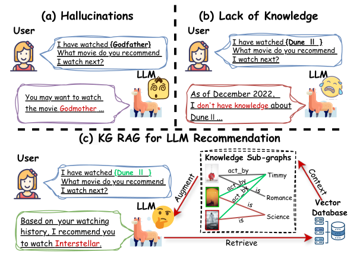
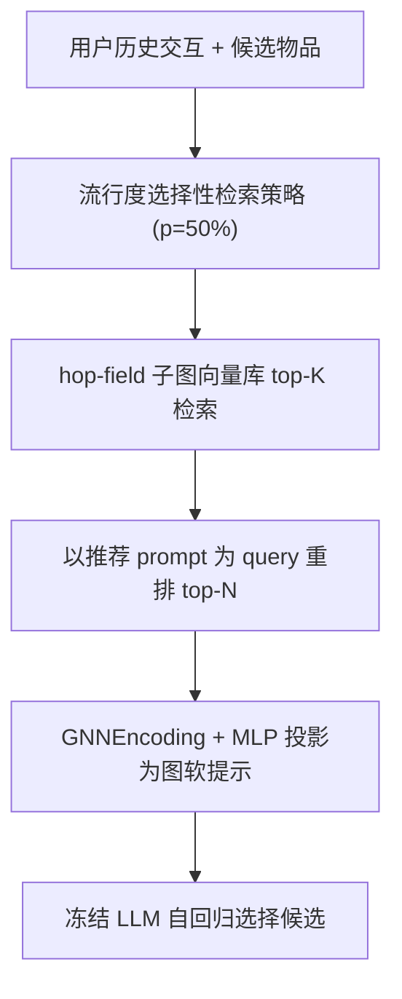
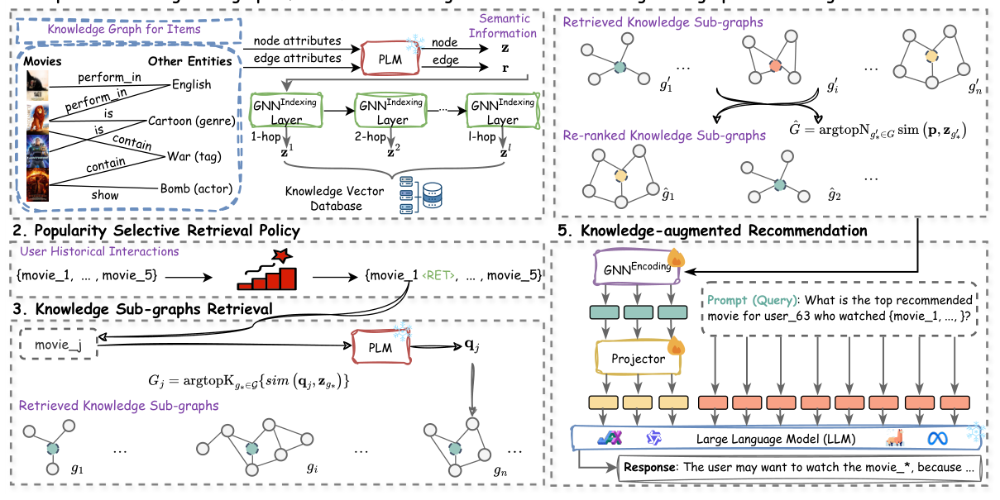

# Knowledge Graph Retrieval-Augmented Generation for LLM-based Recommendation (面向LLM推荐的知识图谱检索增强生成)

- **会议/期刊**: ACL 2025 (Main)
- **作者与机构**: Shijie Wang, Wenqi Fan (PolyU); Yue Feng (Birmingham); Shanru Lin (CityU HK); Xinyu Ma, Shuaiqiang Wang, Dawei Yin (Baidu)
- **推荐链路定位**: 端到端生成式（LLM 列表选择式推荐）
- **研究方向**: 大语言模型推荐 / 图神经网络与知识图谱推荐
- **论文原文**: [https://arxiv.org/abs/2501.02226v2](https://arxiv.org/abs/2501.02226v2)
- **开源代码**: 暂未开源

## TL;DR (1分钟核心速览)

LLM 推荐器受困于幻觉与领域/时效知识缺失，而朴素文本 RAG 引入噪声且丢失实体间结构关系。本文提出 K-RagRec：用 GNN 对 KG 做跳场（hop-field）子图语义索引，按流行度选择性决定哪些物品需要检索，检索后以推荐 prompt 重排，再用第二个 GNN + MLP 投影器把子图编码为**图软提示**注入冻结 LLM。在 MovieLens-1M/20M、Amazon Book 的 Leave-One-Out + 20 候选采样协议下，LLama-2-7b 骨干 ACC 相对次优基线提升 58.6%/75.4%/55.8%，且单次推理仅 1.06s（比无 RAG 慢 0.14s）。

## Background & Motivation (背景与核心矛盾)

- **主流范式**: 以 P5、TALLRec、TokenRec 为代表的 LLM 推荐，靠指令微调或全参微调把推荐语料灌入模型；RAG 路线则检索文档/三元组文本拼进 prompt。
- **前人局限**: ① 微调成本高且知识更新滞后，LLM 会推荐不存在的电影（"Godmother"）或对 2022 年后新片一无所知；② 朴素 RAG 检索段落文本噪声大，且把 KG 三元组序列化成文本，**丢弃了高阶邻域结构**，LLM 无法做结构化推理。
- **核心洞察 (Key Insight)**: KG 是结构化、事实性、可编辑的知识源；若能把"子图"而非"文本片段"作为检索单元，并以**图软提示**（而非长文本）注入 LLM，可同时解决幻觉、时效与上下文膨胀三个问题。
- **本文切入点**: 把 RAG 的检索粒度从 node/triple 提升到多跳子图，并用 GNN 编码替代文本序列化，实现"结构保真 + 免微调"。

<figure class="paper-figure" markdown="span">
  <figcaption>图 1：基于 LLM 的推荐系统中幻觉与缺乏领域特定知识的问题示例，以及知识图谱检索增强生成（KG RAG）如何解决这些问题。</figcaption>
</figure>

## Method (核心方法设计)

### 1. 整体框架 (Overall Architecture)

输入为用户历史交互物品序列与候选集，模型先离线对 KG 中每个实体构建 1~l 跳的 hop-field 子图并用 GNNIndexing 逐层编码，写入知识向量库；在线阶段先用流行度阈值 $p$判定候选物品是否需要检索（冷门物品才检索），对需检索物品以标题/描述为 query 取 top-$K$子图，再用整条推荐 prompt 做二次重排取 top-$N$；最后 GNNEncoding + MLP 投影器把子图压成软提示 token，前置拼接进冻结 LLM 的输入嵌入，自回归输出候选选项。仅训练两个 GNN 与投影器，LLM 参数$\delta$ 冻结。

<figure class="paper-figure" markdown="span">
  <figcaption>图 2：K-RagRec 的总体框架。它包含五个关键组件：用于语义索引的跳场知识子图、流行度选择性检索策略、知识子图检索、知识子图重排序和知识增强推荐。</figcaption>
</figure>

### 2. 关键设计拆解 (Key Designs)

1. **Hop-Field 子图语义索引（粗+细粒度检索单元）**：前人只取一阶邻居或单三元组，无法刻画高阶邻域效应。本文用 PLM 编码节点/关系文本得 $z_{n_o}, r_{e_o}\in\mathbb{R}^d$，再用 GNNIndexing 逐层聚合，**每一层的表示都作为一个子图表示入库**：
$$z^{(l)}_{n_o}=\mathrm{GNN}_{\phi_1}\big(\{z^{(l-1)}_{n_m}, r^{(l-1)}_{e_{\langle o,m\rangle}}: n_m\in\mathcal{N}(n_o)\}\big)$$
直觉：第 $l$层表示天然对应"以$n_o$为中心的$l$ 跳子图"，从而一次索引同时支持粗（大邻域）与细（局部）检索，避免 G-Retriever 只用最后一层的粗粒度缺陷。

2. **流行度选择性检索 + Prompt 级重排（效率与信噪比双控）**：推荐场景物品交互服从幂律，热门物品 LLM 已"记得"，检索它们纯属浪费。策略为：物品流行度 $<p$才检索，否则跳过；检索后用完整推荐 prompt 表示$p$ 对候选子图重排：
$$\hat{\mathcal{G}}=\mathrm{argtop}N_{g'^*\in\mathcal{G}}\ \mathrm{sim}(p, z_{g'^*})$$
直觉：把检索预算集中投给知识稀缺的冷启动/长尾物品，同时用"用户历史+任务描述"作为 query 保证子图与当前推荐意图对齐，避免长历史用户的信息过载。

3. **图软提示注入与训练目标**：文本化三元组既冗长又丢结构，本文用第二个 GNNEncoding 编码重排后子图，经 MLP 投影到 LLM 词嵌入空间：
$$\hat{h}_{\hat{\mathcal{G}}}=\mathrm{MLP}_\theta([h_{\hat{g}_1};\dots;h_{\hat{g}_N}])$$
作为 soft prompt 前置拼接，生成概率为 $p_{\delta,\theta,\phi_1,\phi_2}(Y\mid\hat{\mathcal{G}},x_q)=\prod_{k}p(y_k\mid y_{<k},\hat{h}_{\hat{\mathcal{G}}},x_q)$。损失为交叉熵$\mathcal{L}(Y,A)$，**仅更新$\phi_1,\phi_2,\theta$**，无负采样（候选集内 1 正 19 负由 LLM 直接打分排序），推理开销近似于无 RAG。

## Experimental Setup & Evaluation Protocol (实验设置与评估协议)

- **数据集与预处理**: 三个真实数据集，外部 KG 采用 Freebase 并过滤出与三数据集相关的三元组重构：

| 数据集 | #Users | #Items | #Interactions | 稀疏度/密度 | 特征/场景说明 |
| :--- | :---: | :---: | :---: | :---: | :--- |
| MovieLens-1M | ~6.0K | ~3.9K | ~1M | 密度约 4.3% | 电影评分 + 标题 |
| MovieLens-20M | ~138K | ~27K | >20M | 密度约 0.54% | 大规模电影评分 |
| Amazon Book | 大规模 | 大规模 | >10M | 极稀疏 | 图书评分 + 标题 |

- **数据划分与防穿越 (Splitting Strategy)**: `Leave-One-Out`——每用户最后一件交互为目标物品，其前 10 件为历史序列。
- **排名评测协议 (Ranking Protocol)**: `Sampled Ranking`，候选池 $M=20$（1 正 + 19 随机负），附录另报$M=10$；指标为 ACC 与 Recall@3/@5（对可训练模型取各候选概率排序）。
- **对比基线与超参设置**: 基线含推理式 KG-Text、KAPING，prompt-tuning 式 PT w/ KG-Text、GraphToken w/ RAG、G-retriever，以及 LoRA w/ KG-Text；骨干为 LLama-2-7b / LLama-3-8b / QWEN2-7b；SentenceBert 编码，Graph Transformer 3~4 层、维度 1024、4 头，$p=50\%$、$K=3$、$N=5$，LoRA$r=8$。

## Key Experimental Results (实验关键数据)

### 1. 主实验对比 (Main Results)

LLama-2-7b 骨干（Frozen LLM w/ Prompt Tuning 组）：

| 方法 | ML-1M ACC | ML-1M R@5 | ML-20M ACC | ML-20M R@5 | Book ACC | Book R@5 |
| :--- | :---: | :---: | :---: | :---: | :---: | :---: |
| KG-Text | 0.076 | - | 0.052 | - | 0.058 | - |
| KAPING | 0.079 | - | 0.069 | - | 0.063 | - |
| PT w/ KG-Text | 0.078 | 0.308 | 0.051 | 0.250 | 0.074 | 0.245 |
| GraphToken w/ RAG | 0.268 | 0.466 | 0.186 | 0.576 | 0.326 | 0.624 |
| G-retriever | 0.274 | 0.650 | 0.342 | 0.739 | 0.275 | 0.612 |
| **K-RagRec** | **0.435** | **0.831** | **0.600** | **0.913** | **0.508** | **0.780** |
| Improv. vs 次优 | +58.6% | +27.8% | +75.4% | +23.5% | +55.8% | +25.0% |
| LoRA w/ KG-Text | 0.402 | 0.833 | 0.609 | 0.905 | 0.446 | 0.758 |
| LoRA w/ K-RagRec | **0.466** | **0.863** | **0.637** | **0.927** | **0.516** | **0.799** |

LLama-3-8b 与 QWEN2-7b 上 K-RagRec 相对次优基线 ACC 提升 32.9%/26.3%/20.0% 与 36.8%/50.6%/37.5%，趋势一致。

### 2. 消融实验 (Ablation Study)

MovieLens-1M / Amazon Book，LLama-2-7b，ACC 指标（图 3 读数）：

| 变体 | ML-1M ACC | Book ACC | 说明 |
| :--- | :---: | :---: | :--- |
| K-RagRec 完整 | 0.435 | 0.508 | 全模块 |
| w/o Indexing | 0.41 左右 | 0.47 左右 | 退化为 PLM 语义检索 + 二阶子图 |
| w/o Popularity | 0.42 左右 | 0.49 左右 | 全量检索，效率与信噪比下降 |
| w/o Re-ranking | 0.40 左右 | 0.46 左右 | 子图直接入 prompt，信息过载 |
| w/o Encoding | 0.27 左右 | 0.27 左右 | 三元组文本化，ACC 降 37%/45.9% |

### 3. 关键实验发现 (Key Findings)

1. **结构编码是最大增益源**：去掉 GNNEncoding 改回三元组文本，ML-1M 与 Book 的 ACC 分别下降 37% 与 45.9%，说明"图软提示"而非"检索本身"才是性能跃迁主因——这与 G-retriever 仅 0.274 ACC 形成对照。
2. **效率与效果可兼得**：K-RagRec 单次推理 1.06s，仅比无 RAG 的 0.92s 慢 0.14s，却远快于 KAPING (6.47s) 与 G-retriever (5.86s)；流行度阈值 $p$从 0 增至 1 时推理时间近似线性上升而 ACC 先升后降，$p=50\%$ 为帕累托点。
3. **幻觉与冷启动双改善**：LLama-2 直接推理虚构电影推荐率 39.1%，K-RagRec 降至 2.7%（降幅 93.1%）；冷启动子集上 ACC 0.406，远超 G-retriever 的 0.185；跨域 zero-shot（ML-1M 训练→ML-20M/Book 测试）仍比 prompt-tuning 基线高 21.6%/8.7%。

## Highlights & Limitations (亮点、对比与审稿批判)

- **与代表作对比 (vs. Prior Work)**: 相比 G-retriever 与 GraphToken，本文检索单元从"节点/末层表示"升级为"逐层 hop-field 子图"，且以图软提示替代文本序列化；相比 KG-Text/KAPING 的推理式拼接，本文用可训练 GNN 对齐 LLM 语义空间，ACC 从 0.08 量级跃至 0.44 量级。
- **可迁移亮点**: ① "逐层 GNN 表示即多粒度检索键"可迁移到任何 GraphRAG 场景；② 用流行度做检索门控，是推荐场景下低成本的选择性 RAG 范式，可直接复用于电商/短视频召回侧。
- **审稿级局限批判**: ① 评测仅为 $M=20$/$M=10$的**采样排序**，未做全库 Full-Ranking，绝对 ACC 数值偏低且易受负样本分布影响；② 流行度阈值$p$ 为固定超参且依赖数据集分布，冷启动物品被强制检索会推高延迟，作者亦承认需探索 RL 动态策略；③ 仅在 7B/8B 模型与 Freebase 单一 KG 上验证，规模化与 KG 换源鲁棒性未知。

## Rating (四维评分)

- **方法创新性 (Novelty)**: ⭐⭐⭐⭐ （hop-field 多粒度子图索引 + 图软提示注入的组合在 LLM4Rec 中属首次系统化，但各组件本身多为已有技术的巧妙重组）
- **评估协议与实验扎实度 (Protocol & Experiments)**: ⭐⭐⭐ （三数据集 × 三骨干 + 消融/效率/冷启动/幻觉/zero-shot 覆盖全面，但仅采样排序、无全库评测与显著性检验）
- **写作与数学规范度 (Clarity & Rigor)**: ⭐⭐⭐⭐ （五组件流程与公式定义清晰、图示直观，复杂度与超参敏感性分析到位，缺形式化理论保证）
- **工业落地与复现价值 (Industrial & Practical Value)**: ⭐⭐⭐⭐ （冻结 LLM + 仅训轻量 GNN，推理仅增 0.14s，工程价值高；但代码未开源、依赖 Freebase 离线索引构建）

