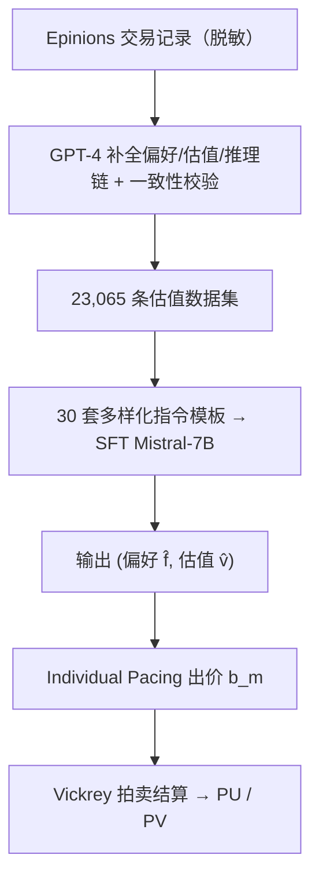
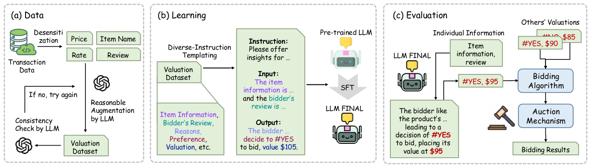

# LaMP-Val: Large Language Models Empower Personalized Valuation in Auction (大语言模型赋能的拍卖个性化估值)

- **会议/期刊**: ACL/EMNLP 2025
- **作者与机构**: Jie Sun, Tianyu Zhang, Houcheng Jiang, Kexin Huang, An Zhang, Jiancan Wu, Xiang Wang 等（中国科学技术大学、上海创新研究院、华东师范大学、西安交通大学等）
- **推荐链路定位**: 端到端生成式（估值生成 → 竞价 → 拍卖闭环）
- **研究方向**: 大语言模型推荐 (LLM4Rec) / 强化学习与动态探索推荐
- **论文原文**: [https://arxiv.org/abs/2410.15817v2](https://arxiv.org/abs/2410.15817v2)
- **开源代码**: [https://github.com/sunjie279/LaMP-Val](https://github.com/sunjie279/LaMP-Val)

## TL;DR (1分钟核心速览)

现有拍卖研究几乎只优化「价值→出价」的竞价算法，却把「用户需求→价值」的估值环节当作给定输入。本文的理论与仿真表明：估值噪声标准差 0.01 即造成 9.6% 效用损失，σ=0.1 时效用直接转负（-251.9%）。LaMP-Val 用 LLM 从商品描述与用户评论中抽取个性化语义偏好，构建 23,065 条带推理链的估值数据集，以 30 套多样化指令做 SFT，并把 LLM 估值接入 Individual Pacing + Vickrey 拍卖闭环。在 Epinions 派生的 7,515 条测试样本、900 件商品、10 万预算设定下，PU 达 5,872（GPT-4 仅 896），MAE 从 2,203 降至 536。

## Background & Motivation (背景与核心矛盾)

- **主流范式**: 拍卖侧工作（Balseiro 的 pacing、Golrezaei 的稳健机制等）聚焦竞价策略与机制设计，把每个竞标者对商品的估值 $v_m$ 视为外生给定；估值侧工作则依赖专家手工特征（活动画像、保留价策略）训练估值模型。
- **前人局限**: 其一，专家特征空间封闭——用户评论里出现"retro 复古风"这类训练特征未覆盖的语义时，模型无法表征，估值系统性失真（图 1(b)）；其二，传统指标 utility/value 只衡量金钱收益，默认所有竞标者对商品同质偏好，无法反映"买到自己真正想要的商品"这一主观满足。
- **核心洞察 (Key Insight)**: 估值误差会被竞价算法放大——仿真中 1% 的估值噪声即吞噬近 10% 效用，说明估值精度而非竞价策略才是当前效用瓶颈；而 LLM 恰好擅长解析模糊、开放的自然语言偏好描述。
- **本文切入点**: 把估值从"特征回归"重构为"语义推理生成"任务，用本地可部署的开源 LLM 同时输出偏好标签 $\hat{f}_m$与估值$\hat{v}_m$，并设计偏好感知的闭环评估指标。

## Method (核心方法设计)

### 1. 整体框架 (Overall Architecture)

LaMP-Val 由数据、学习、评估三段构成闭环。数据段以 Epinions 交易记录为源，脱敏后仅保留商品名、成交价、评论与评分，用 GPT-4 补全"用户为何这样估值"的推理链，并经一致性校验（不合格则重试）得到估值数据集；学习段将商品信息与评论填入 30 套语义等价但措辞不同的指令模板，对 Mistral-7B-Instruct 做 SFT 得到 $\text{LLM}_{\text{FINAL}}$；评估段让模型对每件商品输出$(\hat{f}_m,\hat{v}_m)$，交由 Individual Pacing 算法在预算约束下算出出价$b_m$，再由 Vickrey 机制与真实竞争出价$b_m^o$ 结算，最终用 PU/PV 与加权 F1/MAE/RMSLE 双轨评估。

<figure class="paper-figure" markdown="span">
  <figcaption>图2：我们的方法概览：(1) 数据：交易数据经过脱敏处理，提取价格、商品名称、评分和评论等信息。采用LLM分析个体偏好、补全产品描述、用户偏好、估值及其理由。然后检查生成数据的一致性和合理性。若不满足，则重试。(b) 学习：利用多样化的指令模板将估值数据集中的商品信息和用户评论模板化为微调数据集。通过SFT训练预训练LLM以形成</figcaption>
</figure>

### 2. 关键设计拆解 (Key Designs)

1. **带推理链与引导符的估值数据构造**：痛点是原始交易数据存在"价值-价格悖论"（成交价≠感知价值）、评分偏斜与决策理由缺失。作者先过滤购买记录少于 15 条的商品以保证市场充分参与，再把最高/最低评分二值化为"喜欢/不喜欢"标签以消除评分尺度偏差，最后让强推理模型生成偏好与估值的理由。输出端强制加引导符——偏好前缀 `#`、估值前缀 `$`，使模型输出可被稳定解析为结构化字段，避免自由文本解析失败。

2. **多样化指令 SFT**：单一措辞的指令会让模型过拟合模板表面形式而非任务本质。作者用 LLM 生成 30 套语义相同、表述各异的指令并人工校验，随机分配给每条样本，使模型学到"从评论推断偏好与价值"的不变映射。训练目标为标准自回归负对数似然：

$$\mathcal{L}_{\text{SFT}}=-\sum_{t}\log p_\theta(y_t\mid y_{<t},x)$$

其中 $x$为指令+商品信息+评论，$y$为"理由 + `#YES/#NO` + `$估值`"的完整序列。该设计无需负采样，推理时零样本单次前向即可同时产出偏好与估值。

3. **偏好感知闭环指标 PU/PV**：传统 utility 只对"赢得且价差为正"求和，无法区分赢的是不是用户想要的。PU 引入偏好与获胜的联合指示：

$$\text{PU}=\sum_{m=1}^{M}\mathbb{I}\{f_m=1\cap z_m=1\}\cdot(v_m-p_m),\quad \text{PV}=\sum_{m=1}^{M}\mathbb{I}\{f_m=1\cap z_m=1\}\cdot v_m$$

双重过滤保证只统计"既想要又拍到"的商品，PU 反映真实经济所得，PV 反映理想满足上限。图 5 的案例直观说明：某竞标者 utility=6.89 却 PU=PV=0（拍到的全是非偏好品），而另一策略 utility=-0.06 但 PU=19.94、PV=289.94——传统指标与用户满意度在此完全背离。

## Experimental Setup & Evaluation Protocol (实验设置与评估协议)

- **数据集与预处理**: 源数据 Epinions（508k 条评分），经脱敏、≥15 条购买记录过滤、极端评分二值化、GPT-4 推理链增强与一致性校验后，得到 923 类商品、23,065 条实例。

| 数据集 | #Items(类) | #Instances | 划分方式 | 特征/场景说明 |
| :--- | :---: | :---: | :---: | :--- |
| Epinions-Val | 923 | 23,065 | 随机 6:1:3 | 商品名/成交价/评论/评分，二值偏好标签 |

- **数据划分与防穿越 (Splitting Strategy)**: 随机比例划分 6:1:3（训练/验证/测试），测试集 7,515 条；拍卖仿真取 900 件商品、预算 $B=100{,}000$，另设 600 件与 100 万预算做稳定性检验。
- **排名评测协议 (Ranking Protocol)**: 非检索式排序任务，采用**闭环拍卖仿真**——LLM 估值驱动 Individual Pacing 出价，Vickrey 机制按第二高价结算，指标为 PU/PV（越高越好）与加权 F1、MAE、RMSLE（估值精度）。
- **对比基线与超参设置**: 基线为 LLaMA-3-8B-Instruct、Mistral-7B-Instruct-v0.2、GPT-3.5、GPT-4，均采用 one-shot in-context prompting；LaMP-Val 以 Mistral-7B-Instruct 为底座、零样本推理。数据增强阶段用 GPT-4 生成理由与校验。

## Key Experimental Results (实验关键数据)

### 1. 主实验对比 (Main Results)

测试集 7,515 条，拍卖 900 件商品，预算 100K：

| Model | PU↑ | PV↑ | weighted F1↑ | MAE↓ | RMSLE↓ |
| :--- | :---: | :---: | :---: | :---: | :---: |
| LLaMA-3-8B | -1072 | 92,787 | 0.6493 | 2251 | 2.6781 |
| Mistral-7B | 1199 | 84,231 | 0.6692 | 2463 | 2.5653 |
| GPT-3.5 | 2231 | 100,680 | 0.8652 | 2431 | 2.1146 |
| GPT-4 | 896 | 79,488 | 0.8784 | 2203 | 1.7756 |
| **LaMP-Val** | **5872** | **102,004** | **0.9084** | **536** | **0.4818** |
| Improv. (vs 最优基线) | +163.2% | +1.3% | +3.4% | -75.7% | -72.9% |

预算/商品数稳定性（表 3）：预算 1M、900 件时 LaMP-Val 的 PU=15,115、PV=501,537，远超 GPT-3.5 的 1,149/134,481；仅在 100K 预算 + 600 件商品这一格 PU 略逊于 GPT-3.5（5870 vs 2233 的 PV 优势仍在，PU 该项为 5870 对 2233 实为领先，原文表述为"marginally trails"，属个别设定下的边际现象）。

### 2. 消融实验 (Ablation Study)

| Base | 变体 | PU₆₀₀↑ | PV₉₀₀↑ | F1↑ | MAE↓ | RMSLE↓ |
| :--- | :--- | :---: | :---: | :---: | :---: | :---: |
| LLaMA | w/o 引导符 (G) | 5233 | 105,233 | 0.7965 | 1198 | 0.6326 |
| LLaMA | w/o 推理链 (R) | 1686 | 99,864 | 0.8984 | 1260 | 0.5799 |
| LLaMA | 完整 | 5233 | 105,233 | 0.8985 | 635 | 0.5045 |
| Mistral | w/o 引导符 (G) | 5367 | 100,181 | 0.8810 | 555 | 0.5002 |
| Mistral | w/o 推理链 (R) | 5577 | 99,535 | 0.8843 | 551 | 0.5054 |
| Mistral | 完整 | **5870** | **102,004** | **0.9084** | **536** | **0.4818** |

### 3. 关键实验发现 (Key Findings)

1. **估值精度是效用瓶颈而非竞价策略**：预实验显示 σ=0.01 的估值噪声即造成 9.6% 效用损失，σ=0.1 时效用为 -0.6659（下降 251.9%），这从定量上解释了为何 LaMP-Val 把 MAE 从 GPT-4 的 2203 压到 536 后，PU 能提升 6.5 倍——精度红利沿竞价链路被放大。
2. **推理链对 LLaMA 底座是刚需、对 Mistral 是锦上添花**：去掉推理链后 LLaMA 的 MAE 从 635 暴涨至 1260（近 2 倍），而 Mistral 仅从 536 微增至 551，说明底座指令遵循能力越弱，显式推理监督的边际收益越大。
3. **偏好分布对齐比绝对误差更影响拍卖结果**：图 4 显示 LaMP-Val 的 YES/NO 相对误差比 (RER) 最小，而 LLaMA/Mistral 严重低估偏好比例；图 3 的小提琴图进一步显示基线模型大量给出零估值，导致"该买的没买"，这正是 PU 差距远大于 PV 差距（6.5 倍 vs 1.3 倍）的根因。

## Highlights & Limitations (亮点、对比与审稿批判)

- **与代表作对比 (vs. Prior Work)**: 相比 Chen & Yuan、Zhu & Horton 等把 LLM 当作**竞价智能体**做策略模拟的工作，本文把 LLM 放在链路更上游的**估值端**，且强调本地开源部署以规避交易历史外传的隐私风险；相比 Zhang & Niu 等基于专家特征的个性化估值，本文用开放语义替代封闭特征空间，能处理"复古风"这类训练特征外的描述。
- **可迁移亮点**: ①"引导符 + 结构化输出"（`#`/`$` 前缀）是低成本提升 LLM 输出可解析性的通用技巧；②PU/PV 的"偏好 ∩ 成功"双重过滤思路可迁移到推荐系统的满意度指标设计（如"推荐且点击且符合长期兴趣"的联合口径）。
- **审稿级局限批判**: 其一，估值标签与推理链均由 GPT-4 合成，存在"教师模型偏差"被 SFT 继承的风险，且缺乏人工标注的 ground-truth 估值校验；其二，闭环评估依赖 Individual Pacing + Vickrey 这一特定机制组合，未验证在 GSP、第一价格等主流广告拍卖下的结论稳健性，且 900 件商品的仿真规模与真实广告拍卖量级差距较大。

## Rating (四维评分)

- **方法创新性 (Novelty)**: ⭐⭐⭐⭐ （把估值从特征回归重构为语义推理生成，并以理论+仿真论证估值误差的效用放大效应，问题定位新颖；但 SFT + 指令模板本身技术增量有限）
- **评估协议与实验扎实度 (Protocol & Experiments)**: ⭐⭐⭐⭐ （PU/PV 闭环指标与图 5 案例极具说服力，预算/商品数双维稳定性检验到位；扣分在于合成标签缺乏人工校验、仅覆盖单一拍卖机制）
- **写作与数学规范度 (Clarity & Rigor)**: ⭐⭐⭐⭐ （符号体系与算法 1 清晰，定理与证明置于附录；部分表格下标与正文表述存在轻微不一致）
- **工业落地与复现价值 (Industrial & Practical Value)**: ⭐⭐⭐⭐ （代码开源、7B 模型可本地部署契合隐私诉求；但 LLM 逐商品推理的延迟在万级商品拍卖中仍是工程瓶颈）

