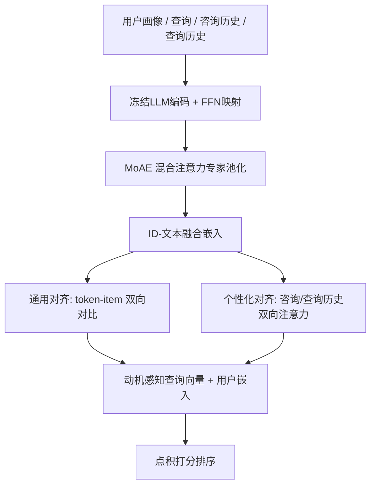
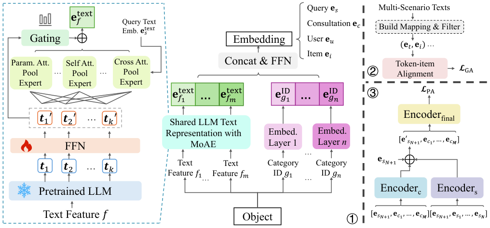

# MAPS: Motivation-Aware Personalized Search via LLM-Driven Consultation Alignment (动机感知的 LLM 咨询对齐个性化搜索)

- **会议/期刊**: ACL 2025 (Main)
- **作者与机构**: Weicong Qin, Yi Xu, Weijie Yu, Chenglei Shen, Ming He, Jianping Fan, Xiao Zhang, Jun Xu（中国人民大学高瓴人工智能学院、对外经济贸易大学、联想研究院 AI Lab）
- **推荐链路定位**: 精排（同时给出召回/检索侧 MRR 结果）
- **研究方向**: 大语言模型推荐 (LLM4Rec) / 序列与会话推荐
- **论文原文**: [https://arxiv.org/abs/2503.01711v4](https://arxiv.org/abs/2503.01711v4)
- **开源代码**: [https://github.com/E-qin/MAPS](https://github.com/E-qin/MAPS)

## TL;DR (1分钟核心速览)

现有电商个性化搜索默认"查询词已完整表达用户真实需求"，但真实平台数据显示用户在搜索前常先与 AI 咨询助手多轮对话，咨询中隐含的**搜索动机**才是关键增强信号。MAPS 用冻结 LLM 编码查询与咨询文本，以混合注意力专家池化 (MoAE) 自适应聚合 token，再通过"通用对齐（token–item 双向对比）+ 个性化对齐（咨询/查询历史双向注意力融合）"双路对齐动机与偏好。在 Commercial 真实数据与 GPT-4o 合成咨询的 Amazon 数据上，排序 HR@10 相对最强基线提升约 20% / 35%，检索 MRR@10 提升超 15%。

## Background & Motivation (背景与核心矛盾)

- **主流范式**: 个性化搜索以用户历史搜索/点击序列建模兴趣（AEM/QEM/TEM/CoPPS），或融合搜索与推荐双行为（SESRec/UnifiedSSR/UniSAR），核心是"查询–商品"直接匹配。
- **前人局限**: ① 假设查询词清晰完整，但用户常只输入型号关键词（如 "X-600"），真实动机（预算、用途、专业）无法从查询文本推断；② 现有方法对文本仅做 token embedding 平均池化，缺乏世界知识与关键语义聚焦能力，且 ID 类目特征与自然语言咨询之间存在**类目–文本鸿沟**。
- **核心洞察 (Key Insight)**: 真实平台统计显示，搜索会话前存在相关咨询的比例在 3–14 天窗口内达 30.2%–58.4%（宽松/中等/严格三档规则），即咨询是**可获取的动机显式载体**；但咨询文本冗长、含个人情境噪声，且并非所有历史咨询都与当前查询相关。
- **本文切入点**: 把"咨询动机"作为一等公民引入个性化搜索，用 LLM 统一语义空间 + 双路对齐（通用 token–item 对齐、个性化动机–偏好对齐）同时解决"动机–查询对齐、动机–类目对齐、历史噪声过滤"三大挑战。

## Method (核心方法设计)

### 1. 整体框架 (Overall Architecture)

输入为用户画像（类目 ID + 文本特征）、当前查询 $s_{N+1}$、咨询历史$H^C=\{c_1,\dots,c_M\}$、查询历史$H^S$与候选商品集。三阶段闭环：① 冻结 LLM 编码所有文本，经 FFN 映射到统一维度$d_t$，再由 MoAE 池化得到文本向量，与类目 ID 向量拼接融合为用户/商品/查询/咨询嵌入；② 通用对齐：用规则从查询、咨询、评论、标题、广告等多场景文本中挖掘 token–item 共现映射，做双向对比学习，把 LLM 世界知识"落地"到平台垂直语义；③ 个性化对齐：以当前查询为锚，分别对咨询历史与查询历史做双向注意力编码，学习权重聚合为动机感知查询向量，再与商品历史、用户嵌入融合后点积打分。训练用负采样 softmax + 对比损失联合优化。

<figure class="paper-figure" markdown="span">
  <figcaption>图3：MAPS概览。①表示基于LLM的ID-文本表示融合。②表示通用对齐。③表示个性化对齐。</figcaption>
</figure>

### 2. 关键设计拆解 (Key Designs)

1. **MoAE 混合注意力专家池化（替代平均池化）**：痛点是对不同文本（短查询 vs 长咨询）关键 token 分布差异极大，平均池化稀释语义。设计三类专家——参数化注意力池化（可学习 query $q$）、自注意力池化（token 自交互）、以当前查询为 query 的搜索中心交叉注意力池化（该专家对查询文本自身不激活），每类$N_E$个成员，门控网络按 top-$K$激活后加权求和：$e_{\text{text}}=\sum_{j=1}^{K}\text{gate}_j\,e^{\text{pool}}_j$。直觉是让模型按文本类型自适应选择"看哪些词"，交叉专家则显式把用户/商品/咨询文本拉向当前搜索意图。
2. **通用对齐的双向对比损失（桥接类目–文本鸿沟）**：痛点如 "Cool" 在平台是商品属性词，LLM 却理解为形容词，造成语义漂移。先用频次阈值过滤构造映射 $\mathcal{A}^S_v=\{w\in\mathcal{A}_v\mid \text{freq}_S(w)>t\}$，再对 token–item 对做双向 InfoNCE：$\mathcal{L}_{GA}=-\lambda_1\sum_{(t,v)}\log\frac{\exp(\text{sim}(e_t,e_v)/\tau_1)}{\sum_{t^-}\exp(\text{sim}(e_{t^-},e_v)/\tau_1)}-\lambda_2\sum_{(t,v)}\log\frac{\exp(\text{sim}(e_t,e_v)/\tau_2)}{\sum_{v^-}\exp(\text{sim}(e_t,e_{v^-})/\tau_2)}$。双向设计保证 token 空间与 item 空间互相校准，而非单向投影。
3. **个性化对齐与训练目标**：以 $e_{s_{N+1}}$为锚分别编码咨询历史与查询历史，取首向量得$e^C_{s_{N+1}}$、$e^S_{s_{N+1}}$，可学习权重聚合$e'_{s_{N+1}}=\alpha_1 e^C_{s_{N+1}}+\alpha_2 e^S_{s_{N+1}}+\alpha_3 e_{s_{N+1}}$，再经最终 Transformer 融合商品历史并加用户嵌入得$e''_{s_{N+1}}$。总损失$\mathcal{L}_{\text{overall}}=\mathcal{L}_{PA}+\lambda_3\mathcal{L}_{GA}+\lambda_4\|\Theta\|_2$，其中$\mathcal{L}_{PA}$ 为负采样 softmax（每正样本配随机负样本）。推理时仅需一次 LLM 前向（可离线缓存文本嵌入）+ 轻量 Transformer，打分即点积。

## Experimental Setup & Evaluation Protocol (实验设置与评估协议)

- **数据集与预处理**（均按 `5-core` 过滤，括号内为咨询交互数）：

| 数据集 | #Users | #Items | #Interactions | 稀疏度/密度 | 特征/场景说明 |
| :--- | :---: | :---: | :---: | :---: | :--- |
| Commercial | 2,096 | 2,691 | 24,662 (18,774) | 99.56% (99.66%) | 真实电商平台 31 天交互，含 AI 咨询 |
| Amazon | 967 | 35,772 | 7,263 (40,567) | 99.98% (99.88%) | PersonalWAB 版本，GPT-4o 合成咨询文本 |

- **数据划分与防穿越 (Splitting Strategy)**: Commercial 取前 29 天训练、后两天分别验证/测试（全局时间戳切分，防序列泄漏）；Amazon 沿用 UniSAR 的划分方式。
- **排名评测协议 (Ranking Protocol)**: 排序任务采用 `Sampled Ranking`——每个 ground-truth 配 99 个随机负样本，报告 HR@{5,10,20,50} 与 NDCG@{5,10,20,50}；检索任务采用 `Full-Ranking`（全库候选），报告 MRR@{10,20,50}。
- **对比基线与超参设置**: 排序基线含 ZAM/HEM/AEM/QEM/TEM/CoPPS 及多场景 SESRec/UnifiedSSR/UniSAR；检索基线含 BM25/BGE-M3/CHIQ。默认 LLM 为 Qwen2.5-7B，序列长度 30，映射阈值 $t=2$（Amazon 最优$t=3$），激活函数 tanh；显著性用配对 t 检验$p<0.05$。

## Key Experimental Results (实验关键数据)

### 1. 主实验对比 (Main Results)

Commercial 排序（Sampled 1:99）：

| Model | HR@10 | HR@20 | NDCG@10 | NDCG@20 |
| :--- | :---: | :---: | :---: | :---: |
| AEM | 0.5376 | 0.6733 | 0.3135 | 0.3478 |
| QEM | 0.5473 | 0.6733 | 0.3144 | 0.3463 |
| TEM | 0.5685 | 0.7078 | 0.3402 | 0.3756 |
| CoPPS | 0.5637 | 0.7171 | 0.3445 | 0.3805 |
| UniSAR | 0.5838 | 0.7294 | 0.3577 | 0.3894 |
| **MAPS** | **0.7071** | **0.8330** | **0.4359** | **0.4680** |
| Improv.% (vs 最强基线) | +21.1% | +14.2% | +21.9% | +20.2% |

Amazon 排序：MAPS HR@10 = **0.7735** vs CoPPS 0.4854（+59.4%），NDCG@10 = **0.4676** vs 0.3298（+41.8%）。检索（Commercial，Full-Ranking）：MAPS MRR@10 = **0.3805**，优于 CHIQ 0.3192（+19.2%）与 BGE-M3 0.2976（+27.9%）。

### 2. 消融实验 (Ablation Study)

| 变体 | HR@10 | HR@20 | N@10 | N@20 |
| :--- | :---: | :---: | :---: | :---: |
| MAPS | **0.7071** | **0.8330** | **0.4359** | **0.4680** |
| w/o LLM | 0.6527 | 0.7839 | 0.3968 | 0.4309 |
| w/o MoAE | 0.6781 | 0.7844 | 0.4096 | 0.4494 |
| w/o general align | 0.6198 | 0.7424 | 0.3669 | 0.4006 |
| w/o filter$_S(\cdot)$ | 0.6201 | 0.7426 | 0.3597 | 0.3951 |
| w/o personal align | 0.6334 | 0.7518 | 0.3732 | 0.4105 |
| w/o $e^S_{s_{N+1}}$ | 0.6565 | 0.7730 | 0.3863 | 0.4246 |
| w/o $e^C_{s_{N+1}}$ | 0.6448 | 0.7615 | 0.3803 | 0.4170 |

表征融合对比：仅 ID 0.6870 / 仅 LLM 0.6794 / 平均池化 0.6950 / 默认融合 0.7071（HR@10）。

### 3. 关键实验发现 (Key Findings)

1. **通用对齐是最大单点贡献**：移除后 HR@10 从 0.7071 跌至 0.6198（-12.3%），甚至比移除个性化对齐（0.6334）更伤，说明 LLM 世界知识与平台垂直语义的错位（如 "Cool" 被误读为形容词）是首要瓶颈，而非动机建模本身。
2. **咨询动机与查询历史互补且不可替代**：单独移除咨询动机 $e^C$掉 6.2 个点、移除查询历史$e^S$ 掉 5.1 个点，二者叠加的个性化对齐移除掉 7.4 个点，证明咨询提供的是查询历史无法覆盖的"前置需求"信息。
3. **规模与噪声呈倒 U 型**：序列长度 30 最优（40 反而降至 0.4303 NDCG@10），LLM 从 0.5B 到 7B 单调提升（0.3892→0.4359），Transformer 层数 1→4 层持续增益（0.4359→0.4561），说明更强世界知识有益但更长历史引入噪声；ReLU 因"死亡神经元"导致 HR@10 崩至 0.4390，激活函数选择敏感。

## Highlights & Limitations (亮点、对比与审稿批判)

- **与代表作对比 (vs. Prior Work)**: 相比 TEM/CoPPS 仅用查询–商品匹配与用户嵌入，MAPS 首次把"售前咨询"作为动机显式载体；相比 UniSAR 的双行为 Transformer 交叉注意力，MAPS 增加了 token 级通用对齐来消解 LLM 与垂直场景的语义冲突；相比 CHIQ 的会话检索，MAPS 引入用户个性化与 ID 特征融合。
- **可迁移亮点**: ① "频次阈值过滤 + 双向 InfoNCE"的 token–item 对齐范式可低成本迁移到任何 LLM 嵌入落地垂直域的冷启动场景；② MoAE 的"搜索中心交叉专家"设计可复用到查询改写、会话推荐中的意图聚焦。
- **审稿级局限批判**: ① Amazon 的咨询文本由 GPT-4o 合成，动机分布与真实用户存在 sim-to-real 差距，Commercial 仅 2,096 用户、规模偏小；② 排序评测采用 1:99 采样而非全库排序，且未报告 LLM 在线推理延迟与嵌入缓存策略，实时部署成本存疑；③ 未建模咨询随时间的动态演化，长期偏好漂移未处理。

## Rating (四维评分)

- **方法创新性 (Novelty)**: ⭐⭐⭐⭐ （首次显式建模售前咨询动机，MoAE + 双向通用对齐组合有新意，但各组件均为已有技术的针对性拼装）
- **评估协议与实验扎实度 (Protocol & Experiments)**: ⭐⭐⭐⭐ （真实+合成双数据集、排序/检索/多场景三线对比、消融与规模分析完整，扣分在采样排序与合成数据）
- **写作与数学规范度 (Clarity & Rigor)**: ⭐⭐⭐⭐ （三阶段结构与公式清晰，但 MoAE 门控细节与专家数量等超参描述偏简）
- **工业落地与复现价值 (Industrial & Practical Value)**: ⭐⭐⭐⭐ （代码开源、LLM 冻结可离线缓存嵌入，但实时性与大规模用户验证仍待补）

