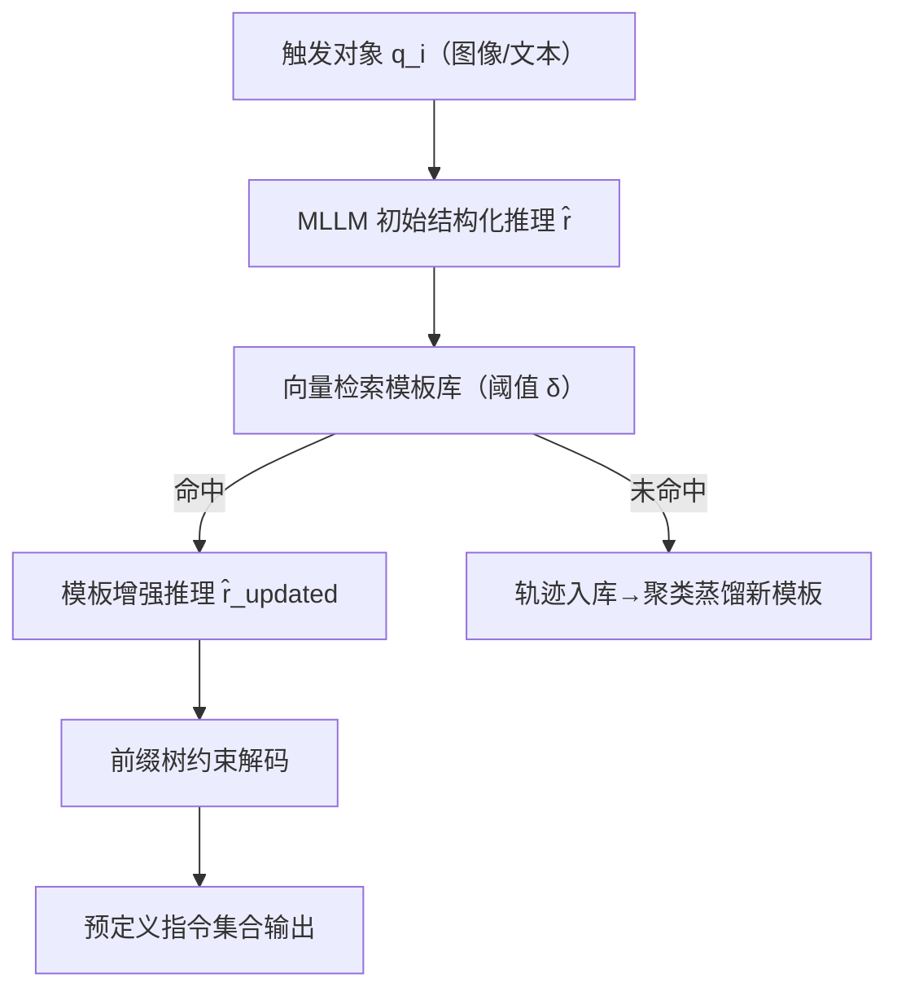
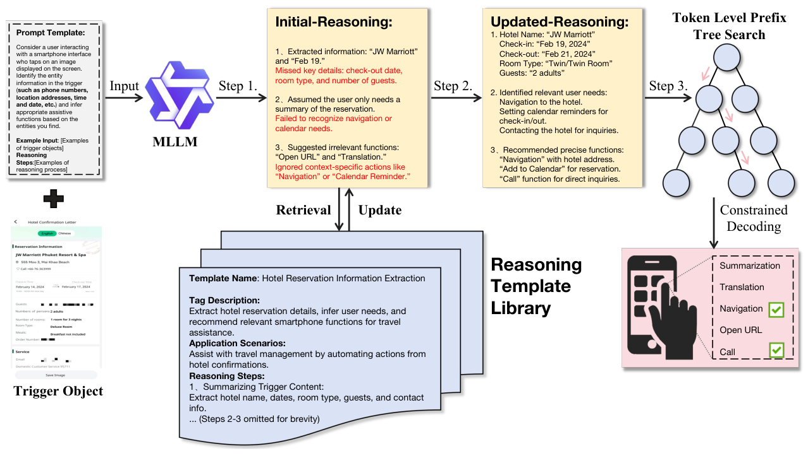

# MIRA: Empowering One-Touch AI Services on Smartphones with MLLM-based Instruction Recommendation (基于多模态大模型指令推荐的智能手机一键式 AI 服务)

- **会议/期刊**: ACL 2025 (Industry Track)
- **作者与机构**: Zhipeng Bian, Jieming Zhu, Xuyang Xie, Quanyu Dai, Zhou Zhao, Zhenhua Dong（深圳大学 / 华为诺亚方舟实验室 / 浙江大学）
- **推荐链路定位**: 端到端生成式（触发对象 $\to$ 指令列表）
- **研究方向**: 大语言模型推荐 / 多模态推荐
- **论文原文**: [https://arxiv.org/abs/2509.13773v1](https://arxiv.org/abs/2509.13773v1)
- **开源代码**: 暂未开源（仅公开模板检索所用 embedding 模型 [jina-embeddings-v3](https://huggingface.co/jinaai/jina-embeddings-v3)）

## TL;DR (1分钟核心速览)

针对智能手机上"用户需手写多步 prompt 才能调用 AI 服务"的痛点，本文提出 MIRA：用户长按图片/文本触发对象，由 MLLM 直接推荐预定义 AI 指令。核心是三段式改造——结构化 CoT 推理轨迹 SFT、推理模板库向量检索增强、前缀树约束解码。在 4,952/956 条真实标注样本上，Qwen2.5VL-7B 版 MIRA 取得 F1=0.9121、HR@3=0.9629，较 Vanilla-SFT 的 0.5704 提升约 60%，且平均输出仅 116 token（GPT-4V 为 817）。

## Background & Motivation (背景与核心矛盾)

- **主流范式**: 手机 AI 服务入口仍是 Siri 式对话助手，用户需以文本/语音描述完整多步任务（OCR→抽取→建日程→设提醒），或由厂商预置固定快捷方式。
- **前人局限**: 其一，通用 MLLM 零样本虽能识图，却难以把"图里有什么"对齐到"该调哪个 AI 服务"，指令空间是封闭枚举而非开放文本；其二，SFT 后的推理链缺乏显式监督，随机性与幻觉导致实体漏抽、推荐无关功能。
- **核心洞察 (Key Insight)**: 该任务本质是**封闭候选集上的多标签检索**，而非自由生成——一旦把解码空间约束到预定义指令前缀树，幻觉可从解码层面被结构性消除；同时同类触发对象（如酒店确认单）的推理路径高度可复用，可蒸馏为模板。
- **本文切入点**: 用"结构化推理 + 模板检索更新 + 前缀树约束解码"三件套，把开放 MLLM 改造成可控的指令推荐器。

## Method (核心方法设计)

### 1. 整体框架 (Overall Architecture)

输入为触发对象 $q_i$（截图/文本片段）与提示模板$p_i$。第一阶段用带标准答案的 teacher-forcing 让强 MLLM 生成三段式推理轨迹（实体抽取→上下文意图分析→指令生成），构成推理数据集并对目标 MLLM 做 SFT，模型学会在 `<REASONING>` 标记内自主推理。第二阶段在推理时先由模型产出初始推理$\hat{r}$，用 jina-embeddings-v3 编码后与约 80 条模板做向量检索，命中则用模板推理步骤重写推理；未命中则记录轨迹、聚类蒸馏为新模板（相似度低于$\delta$ 才入库）。第三阶段在 `</REASONING>` 之后切换到前缀树约束解码，仅在合法指令 token 上采样，输出候选指令集合。

<figure class="paper-figure" markdown="span">
  <figcaption>图2：MIRA概览。提示模板和触发对象通过初始推理提取结构化信息，通过模板检索与更新细化推理步骤，并在推理时应用约束解码以推荐预定义指令。</figcaption>
</figure>

### 2. 关键设计拆解 (Key Designs)

1. **结构化推理轨迹蒸馏（Structured Reasoning）**：痛点是无监督 CoT 推理链不可控。做法是把金标答案 $a_i$一并喂给强 MLLM 反向生成推理$r_i=\mathrm{MLLM}(p_i^{e},q_i,a_i)$，再令目标模型在无 in-context 样例下学习$\hat{r}_i,\hat{a}_i=\mathrm{MLLM}(p_i,q_i)$。直觉：以答案锚定推理路径，把"事后解释"变成"可复现的解题模板"，同时用特殊 token 切分推理段与答案段，便于后续约束解码接管。

2. **模板增强推理（Template-Augmented Reasoning）**：痛点是 SFT 后推理仍会漏抽实体（如退房日期、房型）。做法是维护模板库 $\{DT_i\}$，按$j=\arg\max_i \mathrm{Sim}(f(\hat{r}),f(DT_i))$且要求相似度$\ge\delta$检索最匹配模板，再以$\hat{r}_{\text{updated}}\leftarrow\mathrm{MLLM}(T_j,q_i)$重写推理；新模板仅当$\max_i \mathrm{Sim}(f(DT_{\text{new}}),f(DT_i))<\delta$ 时入库以防冗余。直觉：模板是"人类解题套路"的先验注入，把长尾场景的推理方差压下来，且完全免训练、可在线演化。

3. **前缀树约束解码与训练目标**：痛点是指令空间封闭但模型会自由发挥。做法是用 MLLM 自身 tokenizer 对全部合法指令建 trie，解码时按当前节点合法 token 集合掩码 logits，单 token 解码复杂度 $O(L)$。训练侧仅用标准自回归交叉熵（含推理段与答案段），**无需负采样**；推理侧额外开销仅为一次 embedding 检索 + trie 掩码，模板库更新时重建 trie。

## Experimental Setup & Evaluation Protocol (实验设置与评估协议)

- **数据集与预处理**: 自建真实标注集，来自 1,000 名智能手机用户，每条样本至少 3 人标注，标注一致性 $\kappa=0.85$；模板库由 Qwen2.5VL-Max 蒸馏约 80 条。

| 数据集 | #Users | #Items(指令候选) | #Interactions | 稀疏度/密度 | 特征/场景说明 |
| :--- | :---: | :---: | :---: | :---: | :--- |
| 训练集 | 1,000 | 预定义指令库 | 4,952 | — | 图文触发对象 + 多标签指令 |
| 测试集 | 同上 | 同上 | 956 | — | 同分布真实场景 |

- **数据划分与防穿越 (Splitting Strategy)**: 固定训练/测试比例划分（4,952 / 956），未采用时间戳切分；模板库仅由训练集蒸馏，测试集不参与模板构建。
- **排名评测协议 (Ranking Protocol)**: 多标签集合匹配，报告 Recall / Precision / F1 与 HR@1 / HR@3；未采用全库 Full-Ranking，候选空间即预定义指令库（受约束解码天然限定）。
- **对比基线与超参设置**: 基线为 Zero-shot（in-context learning）与 Vanilla-SFT；骨干为 InternVL2.5-2B/8B、Qwen2.5VL-2B/7B；检索阈值 $\delta$ 默认 0.6（敏感性分析覆盖 0.4/0.5/0.6/0.8）；双卡 32GB 训练。

## Key Experimental Results (实验关键数据)

### 1. 主实验对比 (Main Results)

| Model | Method | Recall | Precision | F1 | HR@1 | HR@3 |
| :--- | :--- | :---: | :---: | :---: | :---: | :---: |
| InternVL2.5-2B | Zero-shot | 0.2904 | 0.3042 | 0.2971 | 0.3829 | 0.4012 |
| InternVL2.5-2B | Vanilla-SFT | 0.4115 | 0.4201 | 0.4158 | 0.4942 | 0.5052 |
| InternVL2.5-2B | **MIRA** | **0.7164** | **0.7382** | **0.7271** | **0.8051** | **0.8351** |
| Qwen2.5VL-2B | Vanilla-SFT | 0.4964 | 0.4882 | 0.4923 | 0.5051 | 0.5321 |
| Qwen2.5VL-2B | **MIRA** | **0.7489** | **0.7397** | **0.7443** | **0.8151** | **0.8451** |
| InternVL2.5-8B | Vanilla-SFT | 0.5254 | 0.5827 | 0.5526 | 0.5963 | 0.6128 |
| InternVL2.5-8B | **MIRA** | **0.9283** | **0.9154** | **0.9218** | **0.9354** | **0.9516** |
| Qwen2.5VL-7B | Vanilla-SFT | 0.5678 | 0.5731 | 0.5704 | 0.6012 | 0.6841 |
| Qwen2.5VL-7B | **MIRA** | **0.9286** | **0.9239** | **0.9121** | **0.9542** | **0.9629** |

工业指标对比（同模板、zero-shot CoT 设置）：MIRA(7B) F1=**0.9121**、平均 116 token、11.2s；GPT-4V F1=0.879、817 token、11.3s；Qwen2.5VL-Max F1=0.861、807 token、10.7s。

### 2. 消融实验 (Ablation Study)

| 配置 | InternVL2.5-2B | Qwen2.5VL-2B | InternVL2.5-8B | Qwen2.5VL-7B |
| :--- | :---: | :---: | :---: | :---: |
| 仅初始推理 (w/o 模板) | 0.6041 | 0.6428 | 0.7451 | 0.7348 |
| + 模板增强 (MIRA) | **0.7271** | **0.7443** | **0.9218** | **0.9121** |
| 相对提升 | ↑20.4% | ↑15.8% | ↑23.7% | ↑24.1% |

阈值敏感性（F1）：$\delta=0.4/0.5/0.6/0.8$下 Qwen2.5VL-7B 分别为 0.8945 / 0.9012 / **0.9121** / 0.8958，$\delta=0.6$ 全模型一致最优。

### 3. 关键实验发现 (Key Findings)

1. **模板增强的增益随模型容量放大而非收敛**：2B 模型仅提升 15.8%–20.4%，8B/7B 模型提升 23.7%–24.1%，说明大模型本身推理能力越强，模板注入越能把"会推理"转化为"推理对"，二者互补而非替代。
2. **约束解码是精度与效率的双重杠杆**：MIRA 以 116 token 完成输出，仅为 GPT-4V（817）的 1/7，却取得更高 F1（0.9121 vs 0.879），证明把开放生成压到封闭候选空间既消除幻觉又省算力，7B 模型即可对标 >500B API 模型。
3. **阈值 $\delta$呈倒 U 型**：$\delta=0.4$检索到过泛模板（0.8945），$\delta=0.8$ 命中率过低失去支撑（0.8958），0.6 处最优，说明模板增强的收益来自"覆盖度与精确度的平衡"，而非模板数量本身。

## Highlights & Limitations (亮点、对比与审稿批判)

- **与代表作对比 (vs. Prior Work)**: 与 LLaVA-CoT / LlamaV-o1 等视觉推理工作相比，本文不追求通用推理 benchmark，而是把推理链服务于**封闭指令检索**，并用 trie 约束替代冗长树搜索；与 MLLM-MSR、VIP5 等多模态推荐相比，本文不建模用户行为序列，而是以单次触发对象为条件做零历史推荐，任务定义本身是新的。
- **可迁移亮点**: ①"金标答案反推推理链 + 特殊 token 切段"可低成本迁移到任何 LLM 结构化抽取/推荐任务；②前缀树约束解码对任何封闭标签空间的生成式推荐（如语义 ID 召回、类目预测）都是即插即用的幻觉抑制手段。
- **审稿级局限批判**: ①模板库依赖闭源 Qwen2.5VL-Max 蒸馏，且仅约 80 条，长尾/未见任务覆盖不足，失败案例分析中"模板错配"已是三大错误之一；②评估仅单数据集、比例划分、无时间切分与跨设备泛化验证，且未与序列式 LLM4Rec 基线对比（作者以任务不同为由规避），外部效度偏弱；③端侧部署的隐私与延迟（11.2s）在真实手机场景仍偏重。

## Rating (四维评分)

- **方法创新性 (Novelty)**: ⭐⭐⭐⭐ （把结构化 CoT、模板检索、trie 约束解码组合成封闭指令推荐流水线，单点不算全新但组合与任务定义有工业新意）
- **评估协议与实验扎实度 (Protocol & Experiments)**: ⭐⭐⭐ （4 个骨干 × 3 种方法 + 阈值敏感性 + 用户研究较完整，但单数据集、无时间切分、缺序列推荐基线）
- **写作与数学规范度 (Clarity & Rigor)**: ⭐⭐⭐⭐ （三阶段流程与公式 1–5 清晰，模板元数据结构交代到位；公式较简，缺复杂度与失败率的定量分析）
- **工业落地与复现价值 (Industrial & Practical Value)**: ⭐⭐⭐⭐ （7B 模型对标 >500B API、token 省 7 倍，工程价值明确；但代码与数据未开源，模板库构建依赖闭源模型，复现门槛偏高）

