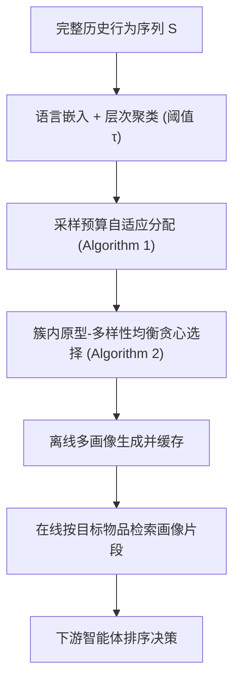
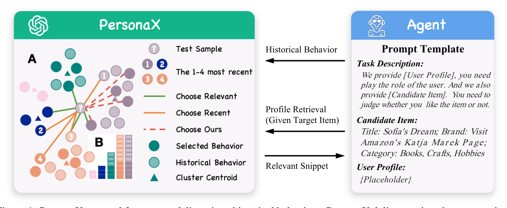

# PersonaX: A Recommendation Agent Oriented User Modeling Framework for Long Behavior Sequence (面向长行为序列的推荐智能体用户建模框架)

- **会议/期刊**: ACL Findings 2025
- **作者与机构**: Yunxiao Shi, Wujiang Xu, Zeqi Zhang, Xing Zi, Qiang Wu, Min Xu（悉尼科技大学 & 罗格斯大学）
- **推荐链路定位**: 召回前置的用户画像构建（离线画像 + 在线检索，服务下游智能体排序决策）
- **研究方向**: 大语言模型推荐 / 对话与智能体推荐
- **论文原文**: [https://arxiv.org/abs/2503.02398v2](https://arxiv.org/abs/2503.02398v2)
- **开源代码**: [https://github.com/Ancientshi/PersonaX](https://github.com/Ancientshi/PersonaX)

## TL;DR (1分钟核心速览)

针对 LLM 用户建模（LLM-UM）在长行为序列上的三大痛点——上下文长度受限与 lost-in-the-middle、采样截断导致兴趣信息丢失、画像生成与在线推理强耦合带来高延迟——PersonaX 提出"聚类分片 + 预算自适应分配 + 原型-多样性均衡簇内选择"的核心集构建策略，离线生成多片段画像并缓存，在线仅做画像检索。在 Amazon CDs50/CDs200/Books480 的 Leave-One-Out + 1:9 采样排序协议下，仅用 30–50% 行为数据即让 AgentCF 提升 3–11%、Agent4Rec 提升 10–50%，在线推理延迟降低 91–95%。

## Background & Motivation (背景与核心矛盾)

- **主流范式**: 推荐智能体（AgentCF、Agent4Rec、RecAgent）把 LLM 生成的文本画像塞进 prompt，画像由 Summarization（摘要蒸馏）或 Reflection（迭代反思）从历史行为序列中提炼。
- **前人局限一**: `Full` 全量输入受 LLM 上下文长度与"lost-in-the-middle"制约，中段关键偏好被淹没；`Reflection` 在长序列上反复推理，算力与延迟不可承受。
- **前人局限二**: `Recent` 采样只看最近行为、`Relevance` 采样只取与目标物品相关的片段，二者都依赖在线才可得的时间戳/目标物品信号，**既丢兴趣又必须在线建模**，形成"信息损失 + 延迟"双重代价。
- **核心洞察 (Key Insight)**: 用户兴趣在行为空间中呈多簇分布，少量高保真"核心样本"即可覆盖全谱兴趣；LLM 具备强 few-shot 泛化力，只需极短 SBS（常 < 5 条）即可刻画一个兴趣侧面。
- **本文切入点**: 把画像生成彻底搬到离线，用"聚类 + 预算分配 + 原型/多样性均衡贪心"构造多段紧凑 SBS，生成多画像缓存，在线按目标物品检索最相关片段。

## Method (核心方法设计)

### 1. 整体框架 (Overall Architecture)

输入用户完整历史行为序列 $S=\{(I_i,L_i)\}_{i=1}^{n}$，先用语言嵌入模型（BGE / EasyRec）编码物品，层次聚类切成若干语义簇；再按簇规模自适应分配采样预算$k$；每簇内以贪心最大化"原型性 + 多样性"混合增益选出子序列 SBS；对每段 SBS 离线执行 Summarization/Reflection 生成细粒度画像$p_i=\mathcal{P}(c_i^*)$ 并缓存；在线阶段仅根据候选物品检索最相关画像片段注入 prompt，交由下游智能体（AgentCF / Agent4Rec）决策。

<figure class="paper-figure" markdown="span">
  <figcaption>图1：PersonaX 作为基于历史行为进行用户建模的工具。PersonaX 将检索到的人物画像片段传递给下游智能体用于决策。左侧部分中，Persona.A 展示了行为分布、聚类结果以及被选中/未被选中的样本。Persona.B 展示了在 50% 选择比例下采样预算分配结果的分布。</figcaption>
</figure>

### 2. 关键设计拆解 (Key Designs)

1. **层次聚类 + 预算自适应分配（解决"长序列不可用"）**：以欧氏距离 $d(e_i,e_j)=\|e_i-e_j\|_2$与阈值$\tau$约束簇内最大距离、簇间最小距离，得到$m$个兴趣簇。分配算法按簇规模升序，先给小簇足额配额$a_i=\min(s_i,q)$（$q=B/r$ 为剩余均值），再轮转分配余量。直觉：小簇往往对应长尾兴趣，优先保足额可防止大簇（主流兴趣）吞掉全部预算，从而保住兴趣多样性。

2. **簇内原型-多样性均衡贪心（解决"采样即丢信息"）**：纯质心选择（Centroid）导致画像同质化，纯边界选择（Boundary）又稀释典型特征。本文把选择建模为离散优化：
$$\max_{c_i^*}\ \Big(w_p\sum_{I_j\in c_i^*}\frac{1}{1+d(e_j,\mu_i)}+w_d\frac{2}{a_i}\sum_{\substack{I_a,I_b\in c_i^*\\a\neq b}}d(e_a,e_b)\Big)$$
其中 $\mu_i$为簇质心，$w_p=\alpha^{-10}$、$w_d=1-w_p$。贪心每步选边际增益最大者，首项保证代表性、次项以$2/a_i$放大多样性权重（预算越大越强调覆盖）。$\alpha\to1.001$退化为质心选择，$\alpha\to1.4$ 逼近边界选择，实测取 1.06–1.08。

3. **训练目标、负采样与推理效率**：本框架无梯度训练，损失即上述集合函数（具单调性、有限终止与数据相关的 94.79% 近似保证）。离线复杂度 $O(CT+nd+\text{Cluster}+A.1+A.2)$，在线仅$N_I\cdot O(T+d)$——画像缓存后每$D=10$ 次推理刷新一次，避免逐次重建画像。

## Experimental Setup & Evaluation Protocol (实验设置与评估协议)

- **数据集与预处理**: Amazon Review 三个子集，按长序列构造（非 5-core 截断）：

| 数据集 | #Users | #Items | #Interactions | 稀疏度 | 平均序列长 |
| :--- | :---: | :---: | :---: | :---: | :--- |
| CDs50 | 100 | 4,899 | 5,000 | 98.97% | 50.00 |
| CDs200 | 1,000 | 101,902 | 200,336 | 99.80% | 200.34 |
| Books480 | 1,000 | 222,539 | 481,455 | 99.78% | 481.46 |

- **数据划分与防穿越**: `Leave-One-Out`——除最近一次交互外全部作为历史，最近一次交互作测试正样本。
- **排名评测协议**: `Sampled Ranking`，随机采 9 个负样本与 1 个正样本组成 10 候选集，指标为 HR@{1,5}、NDCG@5、MRR@10。
- **对比基线与超参**: 6 种采样策略（Full / Random / Recent / Relevance / Centroid / Boundary）× 2 种画像方法（Reflection / Summarization）；PersonaX 超参 $\tau\in\{0.5,0.7\}$、$\alpha\in\{1.01,1.04,1.08,1.1\}$，选择比例$\{10,30,50,70,90,100\}\%$；因 GPT-4o-mini API 成本，每数据集仅跑一次（与同类智能体推荐研究惯例一致）。

## Key Experimental Results (实验关键数据)

### 1. 主实验对比 (Main Results)

| 方法 | CDs50 HR@1 | CDs50 NDCG@5 | CDs50 MRR@10 | CDs200 HR@1 | CDs200 NDCG@5 | CDs200 MRR@10 | Books480 HR@1 | Books480 NDCG@5 | Books480 MRR@10 |
| :--- | :---: | :---: | :---: | :---: | :---: | :---: | :---: | :---: | :---: |
| Full | 19.00 | 42.56 | 39.38 | 36.00 | 51.75 | 50.78 | 19.00 | 34.59 | 35.76 |
| Random | 31.00 | 49.18 | 47.74 | 36.00 | 51.26 | 50.24 | 33.00 | 53.59 | 50.50 |
| Recent | 34.00 | 50.69 | 49.31 | 39.00 | 53.89 | 53.34 | 35.00 | 55.23 | 52.76 |
| Relevance | 40.00 | 54.97 | 54.47 | 51.00 | 61.73 | 61.98 | 61.00 | 71.50 | 71.86 |
| Centroid | 43.00 | 55.21 | 55.91 | 42.00 | 57.07 | 56.53 | 60.00 | 71.61 | 70.67 |
| Boundary | 42.00 | 55.85 | 55.73 | 48.00 | 57.13 | 58.71 | 58.00 | 70.38 | 69.55 |
| **PersonaX** | **45.00** | **57.34** | **58.38** | **55.00** | **64.56** | **65.06** | **65.00** | **74.26** | **73.22** |
| Improv. vs 最强基线 | +4.7% | +2.7% | +4.4% | +7.8% | +4.6% | +5.0% | +6.6% | +3.7% | +1.9% |

### 2. 消融实验 (Ablation Study)

| 配置 | CDs50 MRR@10 | CDs200 MRR@10 | Books480 MRR@10 | 说明 |
| :--- | :---: | :---: | :---: | :--- |
| w/o 聚类（Random 采样） | 47.74 | 50.24 | 50.50 | 去掉兴趣分簇，退化为随机 |
| w/o 预算分配（Centroid） | 55.91 | 56.53 | 70.67 | 仅取质心，画像同质化 |
| w/o 原型项（Boundary, $\alpha=1.4$） | 55.73 | 58.71 | 69.55 | 过度强调多样性 |
| 完整 PersonaX（$\alpha\approx1.06$–$1.08$） | **58.38** | **65.06** | **73.22** | 原型-多样性均衡 |

### 3. 关键实验发现 (Key Findings)

1. **"少即是多"在 LLM-UM 中成立**：CDs50 在 30% 选择比（平均 SBS 仅 1.83 段）达 MRR 58.38，高于 100% 全量的 54.67；CDs200/Books480 在 50% 比例最优（65.06 / 73.22），继续加量反而下降——冗余行为引入噪声。
2. **长序列场景收益最大**：Books480 上 Full 的 HR@1 仅 19.00，PersonaX 达 65.00，说明现有智能体在长序列上几乎失效，而核心集选择恰好补上这一空白；同时 Relevance 在 Books480 已很强（MRR 71.86），PersonaX 仍稳定领先。
3. **延迟与精度双赢**：以 Agent4Rec 为骨干，PersonaX 相比 Relevance 变体在线耗时降低 95%、相比 Recent 变体降低 91%，且超参鲁棒（$\tau\in[0.5,0.7]$、$\alpha\in[1.04,1.08]$ 内最差 MRR 71.6 仍逼近 Relevance 最优 71.86）。

## Highlights & Limitations (亮点、对比与审稿批判)

- **与代表作对比**: 相比 AgentCF 的 `Recent+Reflection` 与 Agent4Rec 的 `Full+Summarization`，PersonaX 首次把"画像生成"与"在线推理"解耦；相比 Relevance 采样，它不依赖目标物品即可离线完成，且用多簇多画像保留全谱兴趣而非单一相关片段。
- **可迁移亮点**: ①"聚类 + 预算自适应 + 原型/多样性贪心"的核心集构造可直接迁移到 RAG 记忆压缩、长序列 CTR 的 SIM 类检索前置筛选；②离线画像缓存 + 在线检索的范式可推广到任意 LLM-Agent 个性化场景。
- **审稿级局限批判**: ①实验仅在 Amazon 三子集、每数据集单次运行（API 成本所限），缺乏方差与显著性检验，且候选集仅 1:9 采样排序，未做 Full-Ranking；②画像缓存刷新周期 $D=10$为人为设定，流式数据下画像时效性衰减未量化；③聚类阈值$\tau$与$\alpha$ 需按数据集经验调参，跨域迁移的自动化配置缺失。

## Rating (四维评分)

- **方法创新性 (Novelty)**: ⭐⭐⭐⭐ （将核心集选择理论引入 LLM 用户建模，原型-多样性混合目标有子模近似保证，思路清晰但组件均为已有技术的巧妙组合）
- **评估协议与实验扎实度 (Protocol & Experiments)**: ⭐⭐⭐ （三数据集 + 六基线 + 双骨干较完整，但单次运行、1:9 采样排序、无显著性检验削弱说服力）
- **写作与数学规范度 (Clarity & Rigor)**: ⭐⭐⭐⭐ （算法伪代码、复杂度表与收敛性分析齐备，公式符号统一，动机-方法-实验链条顺畅）
- **工业落地与复现价值 (Industrial & Practical Value)**: ⭐⭐⭐⭐⭐ （代码开源，离线建模 + 在线检索直接对应工业画像系统，91–95% 延迟下降具备真实部署价值）

