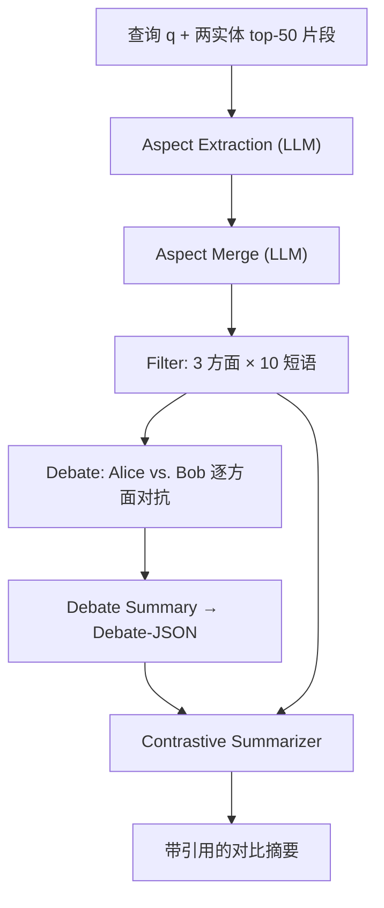
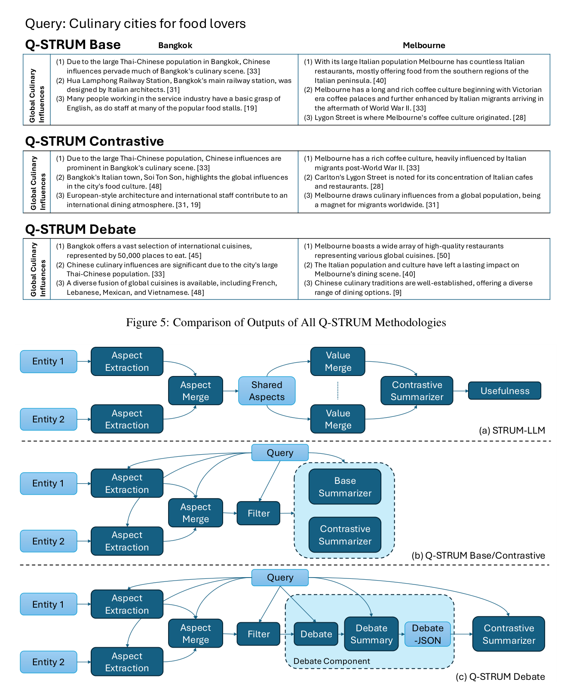

# Q-STRUM Debate: Query-Driven Contrastive Summarization for Recommendation Comparison (查询驱动的辩论式对比摘要)

- **会议/期刊**: ACL 2025
- **作者与机构**: George-Kirollos Saad, Scott Sanner (University of Toronto)
- **推荐链路定位**: 重排/解释生成（推荐结果的可解释对比呈现层）
- **研究方向**: 大语言模型推荐 / 对话与智能体推荐
- **论文原文**: [https://arxiv.org/abs/2502.12921v2](https://arxiv.org/abs/2502.12921v2)
- **开源代码**: [https://github.com/D3Mlab/q-strum-debate](https://github.com/D3Mlab/q-strum-debate)

## TL;DR (1分钟核心速览)

针对"用户面对未知候选物品难以理解为何某物品更契合其查询"这一痛点，本文在 STRUM-LLM 流水线上提出 Q-STRUM Debate：将查询贯穿抽取—合并—过滤全流程，并在最终摘要前插入"Alice vs. Bob"双人格辩论与 Debate-JSON 结构化蒸馏两阶段。在 Hotels/Restaurants/TravelDest 三数据集上，以 GPT-4o/Claude-3.5-Sonnet/DeepSeek-v3 三裁判做双向成对 Win Rate 评测，对比性与多样性胜率在主观评论域普遍达 80%+（最高 89%），显著优于 STRUM-LLM 基线。

## Background & Motivation (背景与核心矛盾)

- **主流范式**: QCS（Query-driven Contrastive Summarization）旨在用语言化物品描述生成"为何 A 优于 B"的对比摘要；SOTA 为 STRUM-LLM，以 LLM 分阶段完成 Aspect Extraction → Aspect Merge → Value Merge → Contrastive Summarizer → Usefulness 过滤。
- **前人局限**: ① STRUM-LLM 原设计并非查询驱动，查询未贯穿各阶段，摘要与用户意图脱节；② 单次单体提示（monolithic prompt）产出的摘要对比性弱、要点重复，用户仍需自行甄别差异。
- **核心洞察 (Key Insight)**: 辩论式结构化分歧（discourse theory、ELM 与 Grice 准则）能迫使模型显式给出正反两面与互补论点，从而天然提升对比度与覆盖面。
- **本文切入点**: 把"辩论"作为摘要前的中间表征，用双人格对抗生成 + JSON 蒸馏，将辩论噪声压缩为可引用的对比要点。

## Method (核心方法设计)

### 1. 整体框架 (Overall Architecture)

输入为查询 $q$、两候选实体及其 top-50 检索片段（TravelDest 用 TAS-B 稠密检索，Restaurants/Hotels 用 text-embedding-3-small 余弦相似度）。流水线四阶段均以查询为锚：Aspect Extraction 抽取 5 个方面各 ≥10 条带引用短语 → Aspect Merge 对齐两实体方面名 → **Filter（本文新增）** 精选 3 个最相关方面、每方面恰好 10 条短语，从而删除原 Value Merge 与 Usefulness 两级 → Summarizer。Debate 变体在 Filter 与 Summarizer 之间插入 Debate 与 Debate Summary 两级，输出 Debate-JSON 再喂入 Contrastive Summarizer。

<figure class="paper-figure" markdown="span">
  <figcaption>图 6：STRUM-LLM 与 Q-STRUM 架构对比</figcaption>
</figure>

### 2. 关键设计拆解 (Key Designs)

1. **查询锚定的 Filter 阶段（降噪与长度控制）**：原 STRUM-LLM 的 Value Merge/Usefulness 依赖多数意见投票，既冗余又易丢失查询相关细节。本文改为一次性硬约束选择：对每个实体保留 3 个方面、每方面恰好 10 条短语，且两实体方面名必须一致。这一"等量对齐"约束使下游对比在相同维度上展开，物理直觉是消除方面集合不匹配导致的伪对比。

2. **辩论式提示（Debate Prompting）**：单体提示只做"挑出最对比的值"，缺乏论证结构。本文对每个方面调用一次辩论提示，令 Alice 支持实体 1、Bob 支持实体 2，各自强调己方优点与对方缺点，并强制引用原句编号。随后 Debate Summary 阶段将辩论压缩为结构化 JSON（禁止出现 Alice/Bob、每方面每实体 ≥5 条带引用要点）。核心收益在于：对抗生成扩大了论点搜索空间，JSON 蒸馏则抑制了辩论中的修辞噪声，使最终摘要既对比鲜明又可溯源。

3. **训练目标、负采样与推理效率**：本文为纯提示工程方法，无参数训练、无负采样，全部组件基于 GPT-4o 推理。代价是每对实体需额外 2 轮 LLM 调用（辩论 + 辩论摘要），实验共消耗约 11M GPT-4o token 与 3M Claude token，推理开销显著高于单提示基线。

## Experimental Setup & Evaluation Protocol (实验设置与评估协议)

- **数据集与预处理**:

| 数据集 | #Queries | #Entities | 平均片段数/实体 | 平均片段长度(字符) | 来源与性质 |
| :--- | :---: | :---: | :---: | :---: | :--- |
| TravelDest | 50 | 774 | 163.31 | 264.53 | WikiVoyage，客观事实型 |
| Restaurants | 26 | 43 | 94.51 | 441.96 | TripAdvisor，主观评论型 |
| Hotels | 24 | 29 | 75.76 | 798.61 | TripAdvisor，主观评论型 |

- **数据划分与防穿越 (Splitting Strategy)**: 无训练/测试划分（零训练方法）；每查询按 top-50 片段余弦相似度均值排序取前二实体构成对比对，属固定候选构造而非监督划分。
- **排名评测协议 (Ranking Protocol)**: 非传统 Full-Ranking，而是**成对 LLM Win Rate**：GPT-4o 与 Claude-3.5-Sonnet（附录含 DeepSeek-v3）作裁判，双向（A vs. B 与 B vs. A）消除顺序偏置，按 $\text{WinRate}_A = \frac{\#\text{A wins} + 0.5\times\#\text{ties}}{\text{Total}} \times 100\%$ 计算，报告 95% 置信区间；四准则为 Contrast / Relevancy / Diversity / Usefulness。
- **对比基线与超参设置**: 基线为 Q-STRUM Base（单体摘要）与 Q-STRUM Contrastive（显式要求"识别最对比的值"），均用 GPT-4o；辩论语气设 standard / aggressive / nice 三档消融。

## Key Experimental Results (实验关键数据)

### 1. 主实验对比 (Main Results)

GPT-4o 裁判下 Q-STRUM Debate 的成对胜率（95% CI）：

| 数据集 | 对比基线 | Contrast | Relevance | Diversity | Usefulness |
| :--- | :--- | :---: | :---: | :---: | :---: |
| Restaurants | vs. Contrastive | **0.85** | **0.57** | **0.83** | **0.83** |
| Restaurants | vs. Base | **0.87** | **0.57** | **0.84** | **0.89** |
| Hotels | vs. Contrastive | **0.82** | **0.62** | **0.80** | **0.78** |
| Hotels | vs. Base | **0.82** | **0.59** | **0.86** | **0.84** |
| TravelDest | vs. Contrastive | 0.64 | 0.50 | 0.54 | 0.61 |
| TravelDest | vs. Base | **0.78** | **0.56** | **0.69** | **0.72** |

Claude-3.5-Sonnet 裁判趋势一致（Restaurants vs. Base：Contrast 0.87、Usefulness 0.85；Hotels vs. Base：Diversity 0.81），DeepSeek-v3 结果同向（Restaurants vs. Base：Contrast 0.82、Diversity 0.73）。

### 2. 消融实验 (Ablation Study)

辩论语气消融（GPT-4o 裁判，Standard vs. 变体胜率，>0.5 表示 Standard 更优）：

| 数据集 | 准则 | vs. Aggressive | vs. Nice |
| :--- | :--- | :---: | :---: |
| Restaurants | Contrast | 0.57 | 0.56 |
| Restaurants | Usefulness | 0.58 | 0.58 |
| Hotels | Contrast | 0.48 | 0.57 |
| Hotels | Diversity | 0.41 | 0.55 |
| TravelDest | Contrast | 0.53 | 0.47 |

### 3. 关键实验发现 (Key Findings)

1. **主观评论域收益最大、客观事实域收益收窄**：Restaurants/Hotels 上对比与多样性胜率普遍 ≥80%（最高 0.89），而 TravelDest 对 Contrastive 基线仅 0.64/0.54，说明辩论机制依赖"存在可争辩的观点分歧"，事实型描述缺乏对立面可供对抗生成。
2. **Relevance 是唯一系统性偏弱的准则**：所有设置下 Relevance 胜率仅 0.50–0.62，且 TravelDest 对 Contrastive 恰为 0.50（CI [0.46,0.54] 跨 50%），表明辩论带来的论点扩张以牺牲部分查询贴合度为代价，是该方法的主要短板。
3. **语气调节几乎无效**：Standard 对 Aggressive/Nice 的胜率大多落在 0.41–0.58 且 CI 频繁跨 0.5，作者归因于语气只改变措辞风格而不改变被对比的核心事实内容，说明辩论的增益来自结构而非情绪强度。

## Highlights & Limitations (亮点、对比与审稿批判)

- **与代表作对比 (vs. Prior Work)**: 相较 STRUM（蕴含模型 + 层次聚类，非查询驱动）与 STRUM-LLM（LLM 分阶段但单体摘要、保留冗余的 Value Merge/Usefulness），本文的本质差异是**把"辩论"作为摘要前的中间表征**并新增查询锚定的 Filter 硬约束；与 Q-STRUM Contrastive 相比，增益来自多轮对抗而非提示措辞。
- **可迁移亮点**: ① "等量方面对齐 + 固定条数"的 Filter 约束可直接迁移到任何多物品对比解释生成，消除维度不匹配；② Debate-JSON 蒸馏范式可复用于 LLM-as-Judge 前的论据结构化，提升可溯源性与评测稳定性。
- **审稿级局限批判**: ① 仅支持成对比较，真实决策常涉及 3+ 候选，扩展需 $O(n^2)$ 辩论调用，token 成本与延迟难以工业化；② 评测完全依赖 LLM 裁判，缺乏人类标注验证，且 Relevance 指标长期贴地暗示裁判对"相关性"判别可能不敏感；③ 数据集规模极小（24–50 查询），统计功效有限。

## Rating (四维评分)

- **方法创新性 (Novelty)**: ⭐⭐⭐ （辩论提示本身非首创，创新在于与 QCS 流水线的结构化嫁接及 Filter 对齐约束，理论支撑偏论述性而非形式化）
- **评估协议与实验扎实度 (Protocol & Experiments)**: ⭐⭐⭐ （三裁判 + 双向成对 + 置信区间较规范，但无人工评测、数据规模小、Relevance 指标存疑）
- **写作与数学规范度 (Clarity & Rigor)**: ⭐⭐⭐⭐ （流水线与提示模板交代完整、图示清晰，但全文无形式化建模，方法章节偏工程描述）
- **工业落地与复现价值 (Industrial & Practical Value)**: ⭐⭐⭐ （代码与数据全开源、提示可即插即用，但每对实体多轮 LLM 调用带来的成本与延迟是线上部署的主要障碍）

