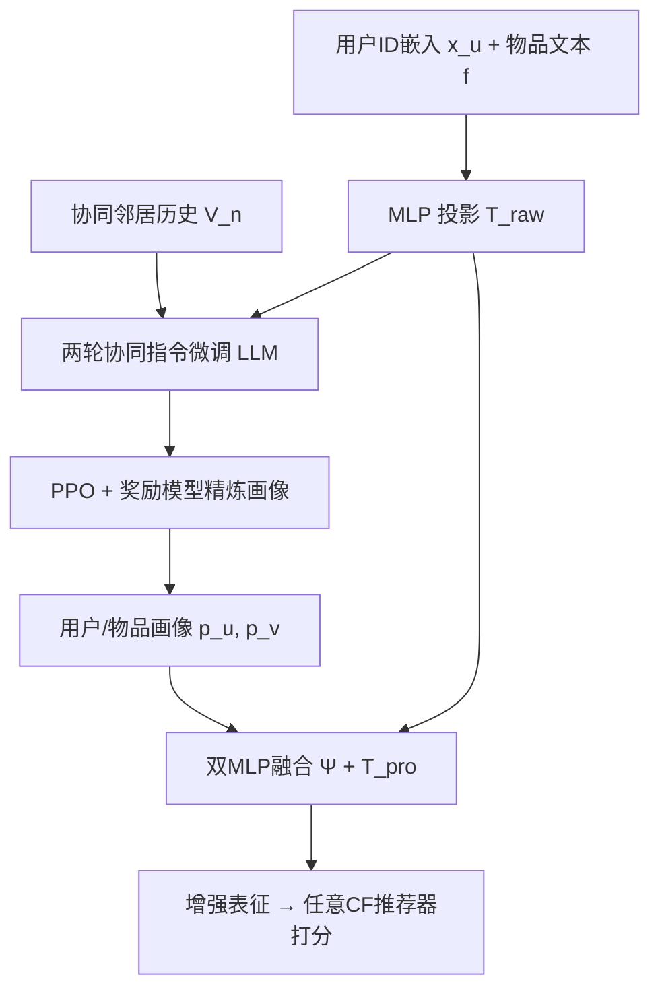
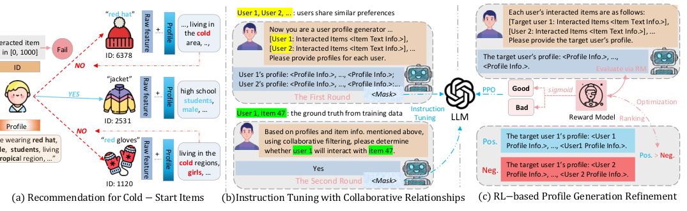

# RecLM: Recommendation Instruction Tuning (推荐指令微调)

- **会议/期刊**: ACL 2025 (Main)
- **作者与机构**: Yangqin Jiang, Yuhao Yang, Lianghao Xia, Da Luo, Kangyi Lin, Chao Huang（香港大学 & 腾讯）
- **推荐链路定位**: 召回（作为画像/表征增强器，离线生成、在线复用）
- **研究方向**: 大语言模型推荐 / 冷启动与长尾推荐
- **论文原文**: [https://arxiv.org/abs/2412.19302v3](https://arxiv.org/abs/2412.19302v3)
- **开源代码**: [https://github.com/HKUDS/RecLM](https://github.com/HKUDS/RecLM)

## TL;DR (1分钟核心速览)

ID 范式推荐器在零样本冷启动下因缺乏交互而无法生成有效表征。RecLM 提出模型无关的推荐指令微调范式：用两轮协同对话（先基于协同邻居生成画像、再做交互预测）把高阶协同关系注入 Llama2-7B，再用 PPO+奖励模型精炼画像以抑制协同过平滑。在 MIND/Netflix/工业数据上以 Full-Ranking 评估，作为即插即用增强器接入 LightGCN/SGL/SimGCL 等，零样本场景 Recall@20 最高提升 204.76%，全量场景亦有 100%+ 增益。

## Background & Motivation (背景与核心矛盾)

- **主流范式**: 以 LightGCN、SGL、SimGCL 为代表的 ID 嵌入协同过滤，通过用户-物品二部图传播高阶协同信号，在数据稠密场景已达 SOTA。
- **前人局限**: 其一，纯 ID 嵌入对零样本新物品完全失效——无交互即无梯度，表征无法生成；其二，转向文本侧特征虽可缓解冷启动，但真实侧信息普遍存在**不完整**（隐私缺失）与**低质**（误导标签、无关描述）两大问题。
- **核心洞察 (Key Insight)**: LLM 具备强语义泛化与推理能力，但**天然不懂协同行为模式**；而协同过滤懂行为却不懂语义。二者互补的关键在于：能否让 LLM 在生成画像时"看见"协同邻居的高阶关系，而非仅看目标用户自身历史。
- **本文切入点**: 设计两轮协同指令微调，把协同邻居历史作为输入上下文、把交互预测作为显式监督信号，再用 RL 修正协同信息引入的噪声与过平滑。

## Method (核心方法设计)

### 1. 整体框架 (Overall Architecture)

RecLM 是模型无关的画像增强层。输入侧，物品原始文本 $f$经 MLP$T_{raw}$投影为$\hat{f}_v$替代 ID 嵌入；用户侧保留 ID 嵌入$x_u$。LLM 侧以 Llama2-7B 为底座，先用 ChatGPT-3.5 蒸馏构造指令数据，经两轮协同对话微调后，用 PPO 精炼画像生成策略。推理时离线批量生成用户/物品画像$p_u,p_v$，经双 MLP 融合$\Psi(\cdot)$与投影$T_{pro}$得到增强表征$\hat{f}^{aug}$，直接喂给下游任意 CF 推荐器训练与打分。

<figure class="paper-figure" markdown="span">
  <figcaption>图1：所提出的RecLM的整体框架。</figcaption>
</figure>

### 2. 关键设计拆解 (Key Designs)

1. **两轮协同对话指令微调（Two-turn Collaborative Instruction Tuning）**：痛点是无画像 ground-truth、无法直接监督。第一轮输入目标用户及其协同邻居（LightGCN 嵌入相似度选取）的交互物品文本，输出多用户画像 $R_{fir}$；第二轮把任务重构为交互预测，输入$(u_t, v^\pm)$输出 Yes/No。正样本取$u_t$历史中同时出现在邻居历史$V_n$的物品（并从第一轮输入中移除以防泄漏），负样本取邻居历史中$u_t$ 未交互的物品，正负各 50%。关键在于：交互预测的显式标签为画像生成提供了间接但可靠的监督，迫使 LLM 学到"什么样的画像能预测对交互"。
2. **掩码式多轮损失（Masking-based Tuning）**：传统单轮微调只对 $R_{sec}$（Yes/No）计损失，浪费了信息量最大的$R_{fir}$画像文本。本文将两轮对话拼接，仅对$R$段计损失、屏蔽$Q$段，使$R_{fir}$与$R_{sec}$ 共同参与参数更新，最大化多轮数据利用率。
3. **RL 画像精炼（PPO + Reward Model）**：协同信息注入带来两个副作用——推理（单画像）与微调（多画像）的 prompt 不一致，以及协同邻居过多导致个体特征被稀释（类比图上的过平滑）。奖励模型以 pairwise 排序损失训练：$\mathcal{L}_{rm}=-\mathbb{E}[\log\sigma(r_\theta(Q,R^+)-r_\theta(Q,R^-))]$，负样本由多样化模板生成与相似用户画像替换两种策略构造；PPO 目标加入 KL 惩罚防 reward hacking：$R(R_i|Q_i)=\hat{r}(R_i|Q_i)-\beta D_{KL}(M_\theta\|M_0)$。物理直觉是：奖励模型奖励"既保留个体历史偏好、又吸收邻居有用隐含标签"的画像。

**训练目标与推理效率**：总损失为指令微调的掩码语言建模损失 + RL 阶段的 PPO 裁剪损失 + 奖励模型排序损失（分阶段训练）。无需负采样训练推荐器本身（沿用各 backbone 原生损失）。推理侧画像离线批量生成、按天/周更新，在线仅做 MLP 前向，额外开销极小。

## Experimental Setup & Evaluation Protocol (实验设置与评估协议)

- **数据集与预处理**:

| 数据集 | 规模/稀疏度 | 特征/场景说明 |
| :--- | :---: | :--- |
| MIND | 新闻点击，高稀疏 | 新闻标题/类别文本，冷启动新闻多 |
| Netflix | 电影评分，较稠密 | 电影文本描述 |
| Industrial | 大规模工业数据，极高稀疏 | 真实业务场景，匿名 |

- **数据划分与防穿越**: 采用全量/零样本两种设定；零样本设定下测试物品在训练中无任何交互，属严格冷启动划分。
- **排名评测协议**: 无偏 `Full-Ranking`（测试正样本与全部未交互物品共同排序），指标 Recall@{20,40}、NDCG@{20,40}，按用户平均。
- **对比基线与超参**: backbone 覆盖 BiasMF、NCF、LightGCN、SGL、SimGCL 五类；每类对比 Base（仅用原始文本特征+ID 嵌入的冷启动范式）与 Augment（接入 RecLM）。显著性 $p<0.05$。

## Key Experimental Results (实验关键数据)

### 1. 主实验对比 (Main Results)

零样本设定（最具代表性，R@20 / N@20）：

| Backbone | MIND Base | MIND +RecLM | Improv. | Netflix Base | Netflix +RecLM | Improv. |
| :--- | :---: | :---: | :---: | :---: | :---: | :---: |
| BiasMF | 0.0096 | **0.0246** | +156.25% | 0.0311 | **0.1381** | +344.05% |
| NCF | 0.0301 | **0.0424** | +40.86% | 0.0480 | **0.1700** | +254.17% |
| LightGCN | 0.0138 | **0.0196** | +42.03% | 0.0974 | **0.1371** | +40.76% |
| SGL | 0.0162 | **0.0254** | +56.79% | 0.0385 | **0.1126** | +92.47% |
| SimGCL | 0.0164 | **0.0312** | +90.24% | 0.0793 | **0.1508** | +90.16% |

全量设定下 LightGCN 在 MIND 上 R@20 从 0.0389 升至 **0.0788**（+102.57%），SGL 在 Netflix 上 N@20 从 0.0855 升至 **0.1958**（+129.01%）；工业数据上 SimGCL 的 R@20 提升达 **+204.76%**。

### 2. 消融实验 (Ablation Study)

| 变体 | MIND (LightGCN) R@20 | MIND (SGL) R@20 | Netflix (LightGCN) R@20 | Netflix (SGL) R@20 |
| :--- | :---: | :---: | :---: | :---: |
| Base | 0.0389 | 0.0345 | 0.0467 | 0.0277 |
| GPT_KD（仅蒸馏不微调） | 较低 | 较低 | 较低 | 较低 |
| Naive（两轮但仅 $R_{sec}$ 计损） | 略高于 GPT_KD | 略高 | 略高 | 略高 |
| Mask（两轮全响应计损） | 显著提升 | 显著提升 | 显著提升 | 显著提升 |
| **RecLM（+RL）** | **0.0788** | **0.0732** | **0.0652** | **0.0788** |

画像增强消融（表2）：去掉用户侧增强（w/o User Aug.）后 LightGCN 在 MIND 上 R@20 跌至 0.0302（低于 Base 0.0389）；去掉物品侧增强（w/o Item Aug.）为 0.0719，仍低于完整 RecLM 的 0.0788。

### 3. 关键实验发现 (Key Findings)

1. **协同监督是画像质量的分水岭**：GPT_KD（仅用 ChatGPT 蒸馏、不微调）与 Naive（两轮但只对 Yes/No 计损）提升有限，而 Mask 变体大幅跃升，说明"让 LLM 从协同邻居上下文里学"比"让 LLM 背推荐知识"更有效；RL 再在其上进一步拉开差距。
2. **用户侧增强不可替代、物品侧增强依赖用户侧配合**：w/o User Aug. 使性能跌破 Base（0.0302 < 0.0389），而单独保留物品增强（w/o User Aug. 但含 Item Aug.）也仅 0.0719，证明仅靠 ID 用户嵌入无法承接增强后的物品语义，双侧必须协同。
3. **RL 精准修复协同过平滑**：案例研究（图4）显示，无 RL 时目标用户画像被邻居污染出 "Foodie""Horoscope" 等无关词；有 RL 后保留自身 "Sports fan" 身份并仅吸收邻居的 "pop culture" 等有用隐含标签，验证了奖励模型对个性化-协同权衡的调节作用。

## Highlights & Limitations (亮点、对比与审稿批判)

- **与代表作对比 (vs. Prior Work)**: 相比 LLMRec（直接调 API 生成画像、不微调、不利用协同关系），RecLM 通过指令微调显式注入协同信号，在两个公开数据集上全面领先；相比 P5/TALLRec 等把 LLM 当推荐器直接推理的路线，RecLM 不承担在线 LLM 推理成本，仅作离线画像增强器，可扩展性更强；相比 RLMRec 的文本嵌入对齐，本文额外引入 RL 精炼解决噪声与过平滑。
- **可迁移亮点**: (1) "交互预测作为画像生成的间接监督"这一两轮对话范式可迁移到任何缺乏画像标签的 LLM 数据构造任务；(2) 用相似用户画像替换构造 RL 负样本的策略，是低成本构造高质量偏好对的通用技巧。
- **审稿级局限批判**: (1) 画像依赖 LightGCN 嵌入选邻居，在极稀疏场景下邻居本身不可靠，存在误差传播风险，论文未做邻居质量敏感性分析；(2) 奖励模型的正样本来自 ChatGPT、负样本靠模板与替换构造，奖励信号本身带偏，PPO 的 KL 系数 $\beta$ 与训练稳定性缺乏充分消融；(3) 零样本评估仅覆盖物品冷启动，用户冷启动与跨域迁移未验证。

## Rating (四维评分)

- **方法创新性 (Novelty)**: ⭐⭐⭐⭐ （两轮协同指令微调把交互预测转为画像监督，配合 RL 抑制协同过平滑，思路清晰且有行为层面的物理解释）
- **评估协议与实验扎实度 (Protocol & Experiments)**: ⭐⭐⭐⭐ （三数据集、五 backbone、全量+零样本双设定、Full-Ranking 无偏评估、显著性检验齐全，但缺邻居质量与 RL 超参敏感性分析）
- **写作与数学规范度 (Clarity & Rigor)**: ⭐⭐⭐⭐ （框架图与公式定义清楚，RL 部分推导完整，但部分符号在正文与附录间略有重复定义）
- **工业落地与复现价值 (Industrial & Practical Value)**: ⭐⭐⭐⭐⭐ （代码开源、模型无关即插即用、画像离线生成在线零 LLM 开销，含真实工业数据验证，落地价值高）

