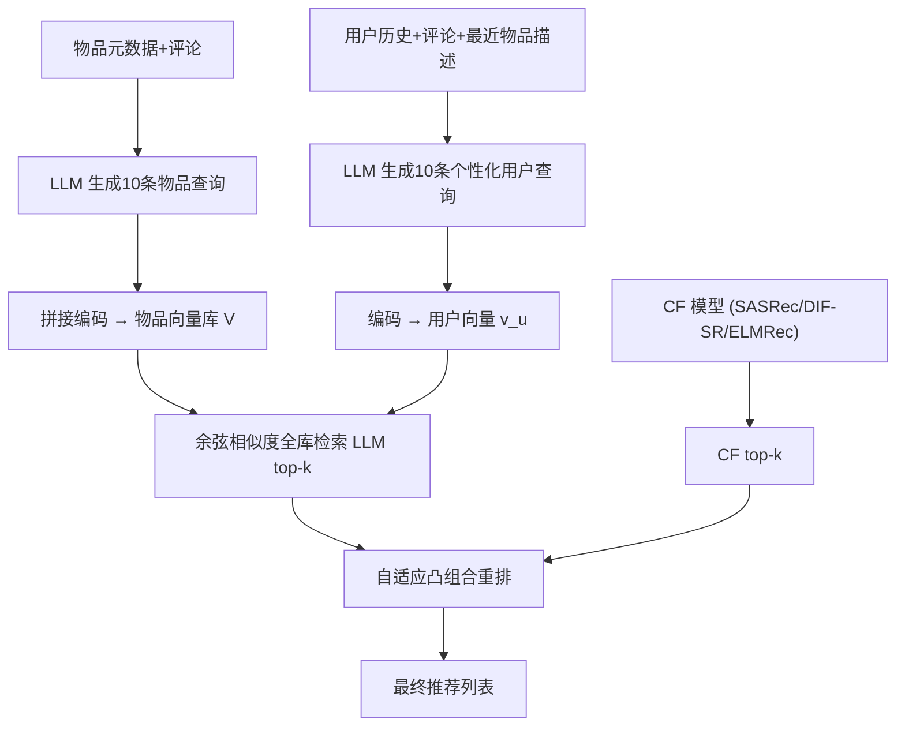
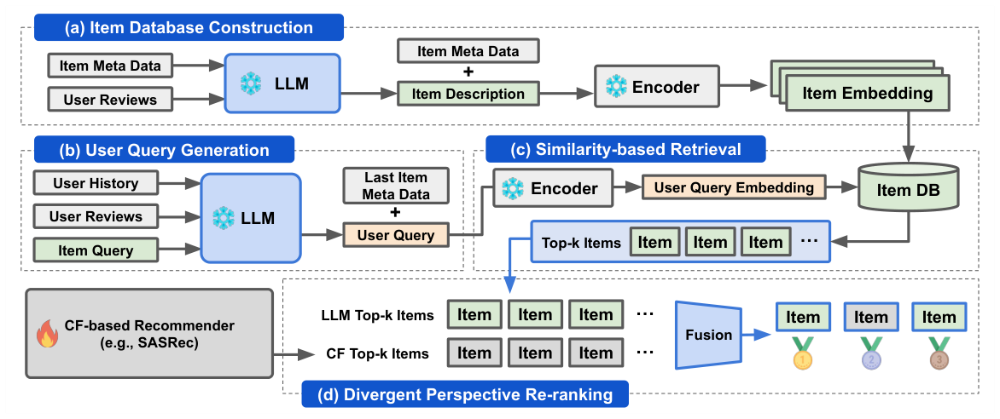

# Rethinking LLM-Based Recommendations: A Personalized Query-Driven Parallel Integration (重思基于 LLM 的推荐：个性化查询驱动的并行集成)

- **会议/期刊**: ACL 2025
- **作者与机构**: Donghee Han, Hwanjun Song, Mun Yong Yi (KAIST)
- **推荐链路定位**: 召回（全库语义检索）+ 重排（双视角融合）
- **研究方向**: 大语言模型推荐 / 协同过滤
- **论文原文**: [https://arxiv.org/abs/2504.11889v2](https://arxiv.org/abs/2504.11889v2)
- **开源代码**: [https://github.com/venzino-han/QueRec2025](https://github.com/venzino-han/QueRec2025)

## TL;DR (1分钟核心速览)

现有 LLM 推荐要么微调 LLM 做生成式预测（引入训练偏差、多样性下降），要么把 LLM 当作 CF 候选集的串行重排器（受限于候选选择器、信息瓶颈）。本文提出 QUEREC：让 LLM 零样本生成"特征增强物品描述"与"个性化用户查询"，与 CF 模型**并行**在全库上各自检索 top-k，再用基于命中交集比的自适应凸组合重排。在 Amazon 三数据集 Full-Ranking 协议下，相对 SASRec/DIF-SR/ELMRec 平均提升约 31%，最高 57%，同时显著提升多样性与新颖性。

## Background & Motivation (背景与核心矛盾)

- **主流范式**: 两条路线——(1) 微调 LLM 做 next-item 生成（GPT4Rec、BIGRec、TALLRec）；(2) 用 CF 模型选候选、LLM 在 prompt 内重排（LLMRank、A-LLMRec）。
- **前人局限**: 微调路线把数据集偏差注入 LLM，推荐多样性塌缩；串行重排路线受制于 CF 候选选择器，LLM 只能看到高度同质的 top-k，且 prompt 内候选引发位置偏差（lost in the middle），候选池超万级时推理延迟线性膨胀。
- **核心洞察 (Key Insight)**: CF 与 LLM 处理的是**本质不同**的信息（协同共现 vs. 世界知识与语义属性），串行架构强制二者对齐反而制造"错位瓶颈"；只有让 LLM 直接触达全库，才能释放其互补视角。
- **本文切入点**: 解耦二者——LLM 与 CF 各自独立全库检索，仅在最终打分层面做双视角融合。

## Method (核心方法设计)

### 1. 整体框架 (Overall Architecture)

QUEREC 分四步闭环：(a) 用 LLM 基于物品元数据与用户评论，为每个物品扩展出 10 条多角度查询，与原元数据拼接后经文本编码器（angle-optimized embedding，免训练）编码入向量库；(b) 用 LLM 基于用户历史、评论与最近交互物品描述，生成 10 条个性化查询并聚合为单一用户表征；(c) 用户向量与全库物品向量做余弦相似度检索得 LLM top-k；(d) 与 CF 模型（SASRec/DIF-SR/ELMRec）的 top-k 做自适应凸组合重排。全流程**零微调**，物品库可增量更新。

<figure class="paper-figure" markdown="span">
  <figcaption>图2：QUEREC概述。</figcaption>
</figure>

### 2. 关键设计拆解 (Key Designs)

1. **特征增强物品描述扩展 (Item Description Expansion)**：仅用标题做检索表达力不足 $\to$用 LLM 依元数据$m_i$与评论$r_i$生成 10 条覆盖不同卖点的查询$q_i$，与原元数据拼接$d_i = m_i \oplus q_i$后编码入向量库$\mathcal{V}=\{\mathrm{Enc}(d_i)\}$。直觉：把"物品是什么"扩展为"用户会怎么描述它"，使语义空间覆盖多类偏好。

2. **个性化用户查询生成 (Personalized User Query Generation)**：用户意图隐式不可观测 $\to$用 LLM 依历史$h_u$、评论$r_u$与最近物品描述$d_l$生成 10 条查询并**聚合为单一表征**$d_u = m_l \oplus q_u$，其中$q_u=\mathrm{LLM}(p_u,h_u,r_u,d_l)$。直觉：多查询聚合避免单条查询的片面性，最近物品注入捕捉时序漂移。

3. **分歧视角自适应重排 (Divergent Perspective Reranking)**：两模型分数量纲不可比且交集度差异大 $\to$先按用户做 min-max 归一化$\tilde{s}^X_{u,i}$，再凸组合$s^*_{u,i}=\lambda\tilde{s}^{\mathrm{LLM}}_{u,i}+(1-\lambda)\tilde{s}^{\mathrm{CF}}_{u,i}$；初始权重由验证集 Hit@10 决定$\lambda_{\text{init}}=H^{\mathrm{LLM}}_{10}/(H^{\mathrm{LLM}}_{10}+H^{\mathrm{CF}}_{10})$，再用命中交集 Jaccard 比$\omega$向 0.5 收缩：$\lambda=\omega\lambda_{\text{init}}+(1-\omega)\cdot 0.5$。直觉：交集低说明两视角正交，应均衡；交集高说明可信任强者。

4. **训练目标与推理开销**：全程**免训练**（无损失函数、无负采样），仅用预训练编码器与 LLaMA3.2 3B 推理。实测 100 用户平均查询生成 69.7s、稠密检索 2.8s，单用户约 0.72s；关键优势是延迟与物品池规模**无关**（对比 prompt 内重排的线性增长）。

## Experimental Setup & Evaluation Protocol (实验设置与评估协议)

- **数据集与预处理**: Amazon 三域 + Yelp（正文仅报前三域），含用户 ID、物品 ID、评分、评论、时间戳：

| 数据集 | #Users | #Items | #Reviews | 密度 |
| :--- | :---: | :---: | :---: | :---: |
| Sports | 35,598 | 18,357 | 296,337 | 0.0453% |
| Beauty | 22,363 | 12,101 | 198,502 | 0.0734% |
| Toys | 19,412 | 11,924 | 167,597 | 0.0724% |
| Yelp | 30,431 | 20,033 | 316,354 | 0.0519% |

- **数据划分与防穿越**: 序列推荐标准划分（按时间戳留最后交互为测试目标，正文未显式声明 LOO，附录沿用前人设定）。
- **排名评测协议**: 无偏 **Full-Ranking**（全物品池排序，非采样），指标 HR@5/10 与 NDCG@5/10。
- **对比基线与超参**: CF 类（Caser、GRU4Rec、HGN、SASRec、BERT4Rec、FDSA、S3-Rec、DIF-SR）、T5 类（P5、TIGER、POD、RDRec、ELMRec）、LLM 重排类（LLMRank 三种 prompt、TALLRec、A-LLMRec）、检索类（GPT4Rec、BIGRec）。LLM 用 LLaMA3.2 3B，微调基线 LoRA 2 epoch、lr 5e-5、batch 4。

## Key Experimental Results (实验关键数据)

### 1. 主实验对比 (Main Results)

与 CF 模型并行集成（表 1 节选，H@10 / N@10）：

| 模型 | Sports H@10 | Sports N@10 | Beauty H@10 | Beauty N@10 | Toys H@10 | Toys N@10 |
| :--- | :---: | :---: | :---: | :---: | :---: | :---: |
| SASRec | 0.0499 | 0.0234 | 0.0872 | 0.0423 | 0.0915 | 0.0447 |
| + LLMRank ICL | 0.0341 | 0.0144 | 0.0555 | 0.0233 | 0.0636 | 0.0277 |
| + TALLRec (w FT) | 0.0054 | 0.0033 | 0.0085 | 0.0041 | 0.0125 | 0.0078 |
| + A-LLMRec | 0.0435 | 0.0174 | 0.0311 | 0.0109 | 0.0911 | 0.0380 |
| **QUEREC(+SASRec)** | **0.0571** | **0.0307** | **0.1022** | **0.0574** | **0.1189** | **0.0701** |
| Improv. | +14.4% | +31.2% | +17.2% | +35.7% | +30.0% | +56.8% |
| ELMRec | 0.0569 | 0.0437 | 0.0729 | 0.0540 | 0.0749 | 0.0623 |
| **QUEREC(+ELMRec)** | **0.0746** | **0.0506** | **0.1060** | **0.0704** | **0.1350** | **0.0860** |
| Improv. | +31.1% | +15.8% | +45.4% | +30.4% | +80.2% | +38.0% |

独立对比（表 2）：QUEREC 单独使用即达 Sports H@10=0.0746、Beauty=0.1060、Toys=0.1350，全面超过最强 T5 基线 ELMRec（0.0569/0.0729/0.0749）与检索类 GPT4Rec（近乎 0）、BIGRec（0.0115/0.0355/0.0471）。

### 2. 消融实验 (Ablation Study)

| 变体 | Sports H@10 | Beauty H@10 | Toys H@10 |
| :--- | :---: | :---: | :---: |
| QUEREC 完整 | **0.0746** | **0.1060** | **0.1350** |
| w/o CF-based model | 0.0403 | 0.0675 | 0.0937 |
| w/o recent item info | 0.0407 | 0.0622 | 0.0908 |
| w/o item description | 0.0369 | 0.0625 | 0.0888 |
| w/o user query | 0.0166 | 0.0325 | 0.0412 |

### 3. 关键实验发现 (Key Findings)

1. **用户查询是命脉**：移除个性化用户查询后 Toys H@10 从 0.1350 崩至 0.0412（-69%），远超移除 CF 模型（-31%）与物品描述（-34%），说明 LLM 侧语义检索的增益主要来自"把隐式意图显式化"而非物品侧增强。
2. **串行重排普遍负增益，且加模型不救**：LLMRank 三种 prompt 在 SASRec 上全部低于原模型（如 Toys H@10 0.0915→0.0636）；换 LLaMA3.3 70B 后仍多数下降（表 6），证明瓶颈在架构而非模型容量。
3. **免训练带来多样性红利**：推荐频次分布（图 3）显示 CF/T5 基线高度偏斜，QUEREC 分布平坦；偏度分析（图 11）表明训练集偏度高于测试集，而传统模型输出偏度更甚，QUEREC 有效抑制流行度放大；新颖性（图 5）多数数据集领先。

## Highlights & Limitations (亮点、对比与审稿批判)

- **与代表作对比 (vs. Prior Work)**: 对比 BIGRec/GPT4Rec——它们微调 LLM 生成"标题式查询"，表达力被训练集偏差锁死；QUEREC 零样本生成富语义查询，且物品库可增量更新。对比 LLMRank/A-LLMRec——它们串行依赖 CF 候选，QUEREC 让 LLM 直连全库，规避位置偏差与候选同质化。
- **可迁移亮点**: (1) "LLM 生成多查询 + 聚合为单向量"的免训练语义召回范式，可直接用于冷启动物品冷启与新品上架；(2) 基于命中交集 Jaccard 比的自适应融合权重，可迁移到任意双路召回融合场景，无需联合训练。
- **审稿级局限批判**: (1) 依赖 LLM 领域知识，跨域（如 Yelp 本地生活）生成查询质量可能退化，且 0.72s/用户延迟对高 QPS 在线召回仍偏高；(2) 融合权重 $\lambda$ 依赖验证集 Hit@10 与交集统计，属数据集级超参而非用户级自适应，且 ELMRec 上 RRF 反超（表 7），说明融合策略对异构排序模式不稳健；公平性/惊喜度未显式建模。

## Rating (四维评分)

- **方法创新性 (Novelty)**: ⭐⭐⭐⭐ （"并行解耦 + 零样本查询生成"思路清晰且反直觉地挑战串行重排主流，但组件本身多为已有技术的巧妙重组）
- **评估协议与实验扎实度 (Protocol & Experiments)**: ⭐⭐⭐⭐ （Full-Ranking 无偏协议 + 四类基线 + 多 LLM 泛化 + 消融/多样性/新颖性/延迟分析齐全，惟划分细节与显著性检验披露不足）
- **写作与数学规范度 (Clarity & Rigor)**: ⭐⭐⭐⭐ （公式简洁、动机图与查询案例直观，但自适应 $\lambda$ 的理论依据偏经验，缺复杂度形式化分析）
- **工业落地与复现价值 (Industrial & Practical Value)**: ⭐⭐⭐⭐⭐ （完全免训练、代码开源、延迟与物品池规模解耦，对动态大商品池电商场景落地价值高）

