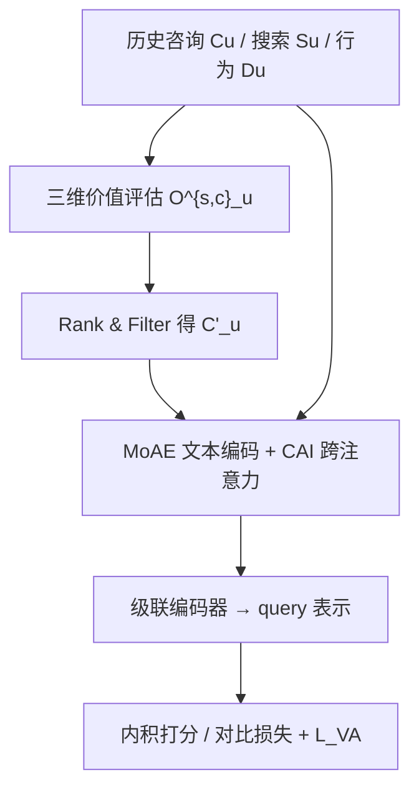
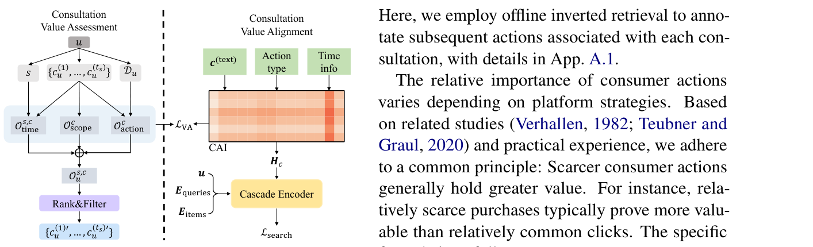

# Similarity = Value? Consultation Value Assessment and Alignment for Personalized Search (相似度即价值？面向个性化搜索的咨询价值评估与对齐)

- **会议/期刊**: ACL 2025
- **作者与机构**: Weicong Qin, Yi Xu, Weijie Yu, Teng Shi, Chenglei Shen, Ming He, Jianping Fan, Xiao Zhang, Jun Xu（中国人民大学高瓴人工智能学院、对外经济贸易大学、联想研究院 AI Lab）
- **推荐链路定位**: 精排（兼评召回检索）
- **研究方向**: 大语言模型推荐 / 多任务学习与列表级重排
- **论文原文**: [https://arxiv.org/abs/2506.14437v1](https://arxiv.org/abs/2506.14437v1)
- **开源代码**: [https://anonymous.4open.science/r/VAPS-to-go](https://anonymous.4open.science/r/VAPS-to-go)

## TL;DR (1分钟核心速览)

电商 AI 助手咨询日志被用于个性化搜索时，现有方法（如 MAPS）因缺乏"价值"标签而只能用语义相似度对齐历史咨询与当前 query，但作者发现高相似咨询反而可能损害排序。本文提出三维咨询价值评估框架（场景范围、后验行为、时间衰减）与价值感知模型 VAPS，通过咨询-行为交互（CAI）模块与显式对齐损失将价值信号注入模型。在 Amazon 与 Commercial 数据集上，VAPS 在 99 负采样排序协议下 NDCG@10 相对 MAPS 提升约 10.5%（Amazon）与 1.5%（Commercial），全库检索 MRR@10 提升约 9.8%。

## Background & Motivation (背景与核心矛盾)

- **主流范式**: 以 MAPS 为代表的咨询增强个性化搜索，将历史咨询文本与当前 query 做语义对齐，从中挖掘搜索动机；多场景方法（UniSAR/SESRec）则融合搜索与推荐行为序列。
- **前人局限**: 其一，语义相似度与真实搜索收益仅弱相关——图 1 显示高相似咨询可能拉低 NDCG@20，低相似咨询反而有益；其二，现有方法完全忽略咨询是否被后续用户行为"验证"，也无法剔除越域（如政治话题）与过期（如 2023 促销码）咨询。
- **核心洞察 (Key Insight)**: 借鉴消费者旅程理论，咨询价值应由用户演化中的目标与行为共同界定：越域咨询是噪声、过期咨询失效、无后续行为验证的兴趣只是"随口一问"。
- **本文切入点**: 既然价值无显式标签且是相对量（同一咨询对不同搜索价值不同），就在数据侧用经验函数量化价值、在模型侧用对齐损失让模型学会该价值。

## Method (核心方法设计)

### 1. 整体框架 (Overall Architecture)

VAPS 分两阶段闭环：数据侧对每个搜索会话 $s$之前的历史咨询$c$计算聚合价值$O^{s,c}_u$，据此排序并截断至模型最大长度$L_{seq}$得到过滤后咨询序列$C'_u$；模型侧先用 MoAE 文本编码器得到咨询/query/item 文本嵌入，再经 CAI 模块以咨询为 query、用户行为为 key/value 做跨注意力注入后验支撑，最后送入级联双向注意力编码器得到最终 query 表示，与候选物品做内积打分。训练时联合优化搜索对比损失与价值对齐损失。

<figure class="paper-figure" markdown="span">
  <figcaption>图3：VAPS概览。</figcaption>
</figure>

### 2. 关键设计拆解 (Key Designs)

1. **三维咨询价值评估（数据侧经验函数）**：针对价值无标签且相对的问题，用三个可解释函数加权求和：时间衰减 $O^{s,c}_{time}=\alpha^{t_s-t_c}$（$\alpha=0.99$，30 天外趋零，并将时间间隔离散为$b$个桶缓解稀疏）；场景范围$O^{c}_{scope}=f_{scope}(|I_c|)$借倒排索引统计咨询词命中的物品数，低于阈值$\lambda_{thresh}$线性缩放、否则置 1，用于剔除越域咨询；后验行为$O^{c}_{action}=\sum_a \gamma_a RT^a_c$，其中$\gamma_a=\frac{1/|T_a|}{\sum_j 1/|T_j|}$体现"越稀缺的行为越有价值"（buy > click > search）。聚合式为$O^{s,c}_u=(1-\lambda_1)O^{s,c}_{time}+\lambda_1(\lambda_2O^{c}_{scope}+(1-\lambda_2)O^{c}_{action})$，加权和而非乘积可避免过度惩罚并缓解延迟反馈。
2. **咨询-行为交互 CAI（模型侧价值注入）**：仅靠文本相似无法感知咨询是否被行为认可，故以咨询为 query、行为为 key/value 做跨注意力，并为行为嵌入叠加行为类型嵌入与离散时间桶嵌入以对齐数据侧的时间/类型语义：$h_{c_i}=c^{(text)}_i+\lambda_3\mathrm{Attn}(e^{(attn\text{-}q)}_i,E^{(attn\text{-}k)},E^{(attn\text{-}v)})$。残差系数$\lambda_3$ 保留原始文本语义，使模型学到"该咨询被哪些后续行为支撑、支撑多强"。
3. **训练目标、负采样与推理效率**：总损失 $\mathcal{L}_{final}=\mathcal{L}_{search}+\lambda_3\mathcal{L}_{VA}+\lambda_4\|\Theta\|_2$，其中$\mathcal{L}_{VA}$用 softmax 对比学习监督 CAI 注意力分数：$\mathcal{L}_{VA}=-\sum_{(c,a)}\log\frac{\exp(\mathrm{sim}(c,a)/\tau_1)}{\sum_{a^-}\exp(\mathrm{sim}(c,a^-)/\tau_1)}$，负例取自用户自身其他行为$D_u\setminus a$（in-user 负采样）。排序训练沿用 1 正 99 负采样。整体复杂度$O(N'^2d)$（$N'=\max(M,N,K)$），与 UniSAR/MAPS 同阶。

## Experimental Setup & Evaluation Protocol (实验设置与评估协议)

- **数据集与预处理**: Amazon 沿用 MAPS 版本与处理流程；Commercial 为某电商平台真实数据，取最后两天作验证/测试。

| 数据集 | #Users | #Items | #Interactions (搜索/咨询) | 稀疏度/密度 | 特征/场景说明 |
| :--- | :---: | :---: | :---: | :---: | :--- |
| Commercial | 2,096 | 2,691 | 24,662 / 18,774 | 极稀疏 | 真实电商，非日用品为主 |
| Amazon | 967 | 35,772 | 7,263 / 40,567 | 极稀疏 | 评论数据经 PersonalWAB/MAPS 增强 |

- **数据划分与防穿越 (Splitting Strategy)**: Commercial 采用**全局时间戳切分**（最后两天为验证/测试）；Amazon 严格沿用 MAPS 的划分方式。
- **排名评测协议 (Ranking Protocol)**: 排序任务为 **Sampled Ranking**，每个 ground-truth 配 99 个负例，报告 HR/NDCG@{5,10,20,50}；检索任务为 **Full-Ranking 全库候选**，报告 MRR@{10,20,50}。
- **对比基线与超参设置**: 排序基线含 ZAM/HEM/AEM/QEM/TEM/CoPPS/MAPS；检索额外对比 BM25、BGE-M3、CHIQ；多场景对比 SESRec/UnifiedSSR/UniSAR。默认 $\lambda_1=0.5$、$\lambda_2=0.3$，显著性用配对 t 检验（$p<0.05$）。

## Key Experimental Results (实验关键数据)

### 1. 主实验对比 (Main Results)

排序（Amazon，99 负采样）：

| Model | HR@10 | HR@20 | NDCG@10 | NDCG@20 |
| :--- | :---: | :---: | :---: | :---: |
| TEM | 0.4813 | 0.7201 | 0.3123 | 0.3416 |
| CoPPS | 0.4862 | 0.7289 | 0.3299 | 0.3435 |
| MAPS | 0.7835 | 0.8990 | 0.4717 | 0.5001 |
| **VAPS** | **0.8019** | **0.9101** | **0.5213** | **0.5556** |
| Improv. vs MAPS | +2.3% | +1.2% | **+10.5%** | **+11.1%** |

Commercial 排序：VAPS HR@5 0.5565 / NDCG@10 0.4424，相对 MAPS（0.5276 / 0.4360）提升约 +5.5% / +1.5%；多场景对比中 VAPS NDCG@20 0.4726 优于 UniSAR 0.3894（+21.4%）。检索（Amazon 全库）：VAPS MRR@10 0.4749，相对 MAPS 0.4324 提升 +9.8%，相对 CHIQ 0.3691 提升 +28.7%。

### 2. 消融实验 (Ablation Study)

| 变体 | HR@10 | NDCG@10 | NDCG@20 |
| :--- | :---: | :---: | :---: |
| VAPS | **0.8019** | **0.5213** | **0.5556** |
| w/o $O_{time}$ | 0.7784 | 0.4783 | 0.5106 |
| w/o $O_{scope}$ | 0.7853 | 0.4897 | 0.5202 |
| w/o $O_{action}$ | 0.7792 | 0.4795 | 0.5135 |
| w/o $\mathcal{L}_{VA}$ | 0.7909 | 0.5062 | 0.5419 |
| w/o CAI | 0.7867 | 0.4928 | 0.5258 |

### 3. 关键实验发现 (Key Findings)

1. **时间衰减是价值评估的第一支柱**：移除 $O_{time}$使 NDCG@10 从 0.5213 跌至 0.4783（-8.3%），跌幅最大；移除$O_{action}$ 次之（-8.0%），说明"新鲜度"与"行为验证"缺一不可，纯语义匹配会召回过期或未被认可的内容。
2. **模型侧对齐不可由数据侧过滤替代**：去掉 $\mathcal{L}_{VA}$ 或 CAI 分别损失 2.9% 与 5.5% NDCG@10，证明仅靠 Rank&Filter 的硬截断不足以让模型理解咨询-行为关联，软对齐损失提供额外增益。
3. **行为稀缺性假设被分布验证**：图 4b 显示 click 价值分布平坦、search 集中于 0 附近、buy 分布最尖锐，与 $\gamma_a$的逆频率设计一致；超参分析中$\lambda_2=0.3$ 最优，表明后验行为价值权重（0.7）应显著高于场景范围价值（0.3），倒排索引式的范围判定偏严格。

## Highlights & Limitations (亮点、对比与审稿批判)

- **与代表作对比 (vs. Prior Work)**: 相较 MAPS 仅做咨询-query 语义对齐，VAPS 首次引入"价值"维度并用行为后验监督注意力；相较 UniSAR 等搜索-推荐多场景模型，VAPS 额外利用 AI 助手咨询这一新信号源；相较 CHIQ 等会话检索方法，VAPS 具备用户级个性化而非仅会话上下文。
- **可迁移亮点**: ①"稀缺行为逆频率加权"可直接迁移到多行为推荐（点击/收藏/加购/购买）的价值融合；②用倒排索引命中数做越域过滤是零成本、可解释的轻量技巧，适合工业冷启动。
- **审稿级局限批判**: ①价值函数含 $\alpha,\lambda_{thresh},\lambda_1,\lambda_2$ 多个手工超参，跨业务迁移需重调，作者亦承认缺乏自动调参；②Commercial 增益仅约 2%，且数据规模小（2k 用户）、依赖咨询日志质量，冷启动用户无咨询时框架退化；③全库检索仅在 Amazon 单数据集验证，工业级延迟未实测。

## Rating (四维评分)

- **方法创新性 (Novelty)**: ⭐⭐⭐⭐ （首次将"咨询价值"形式化为三维经验函数并配对齐损失，问题定义新颖，但技术组件多为已有模块的组合）
- **评估协议与实验扎实度 (Protocol & Experiments)**: ⭐⭐⭐⭐ （排序+全库检索双任务、真实与公开双数据集、7 组 RQ 覆盖消融/分布/案例/超参/复杂度，但 Commercial 规模偏小）
- **写作与数学规范度 (Clarity & Rigor)**: ⭐⭐⭐⭐ （三维价值函数定义清晰、公式与直觉对应良好，聚合式权重含义明确，但部分符号如 $RT^a_c$ 需查附录）
- **工业落地与复现价值 (Industrial & Practical Value)**: ⭐⭐⭐⭐ （复杂度与 SOTA 同阶、倒排索引过滤零额外开销、已开源匿名仓库，但多超参与冷启动问题限制直接部署）

