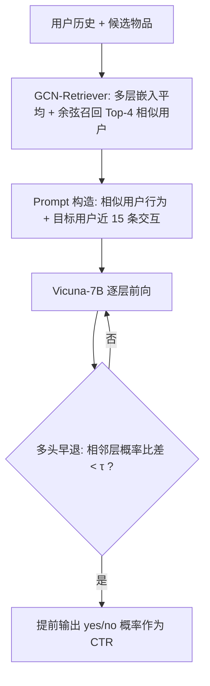

# The Efficiency vs. Accuracy Trade-off: Optimizing RAG-Enhanced LLM Recommender Systems Using Multi-Head Early Exit (效率与精度的权衡：用多头早退优化 RAG 增强的 LLM 推荐系统)

- **会议/期刊**: ACL/EMNLP 2025
- **作者与机构**: Huixue Zhou, Hengrui Gu, Zaifu Zhan, Xi Liu, Kaixiong Zhou, Mingfu Liang, Yongkang Xiao 等（Meta Platforms / University of Minnesota / NCSU / UNC at Chapel Hill）
- **推荐链路定位**: 精排（CTR 预估）
- **研究方向**: 大语言模型推荐 (LLM4Rec) / CTR 预估与特征交叉
- **论文原文**: [https://arxiv.org/abs/2501.02173v2](https://arxiv.org/abs/2501.02173v2)
- **开源代码**: 暂未开源

## TL;DR (1分钟核心速览)

LLM 做 CTR 预估时，RAG 模块带来两大瓶颈：检索阶段 LLM embedder 编码慢、长上下文 prefill 使推理开销随长度二次增长。本文提出 OptiRAG-Rec：用轻量 GCN-Retriever 在用户-物品二部图上做多跳相似用户检索，替代昂贵的 LLM 检索器；并在 LLM 中间层挂载多个语言头，以「相邻层 yes/no 概率比稳定性」为准则动态早退。在 5 个 Amazon/Yelp/BookCrossing 数据集上，AUC 相对传统基线最高提升 19.59 点，同时 RPS 维持在 3.8–5.5 区间，实现精度与吞吐的双赢。

## Background & Motivation (背景与核心矛盾)

- **主流范式**: 将用户历史与候选物品拼成自然语言 prompt，用 LLM 输出 "yes/no" 两 token 的 logit 归一化概率作为 CTR 打分；RAG 通过检索相似用户行为扩充上下文以增强偏好建模。
- **前人局限**: ① 检索效率——RAG 的编码-检索-prefill 多阶段串行执行，LLM embedder 的 Transformer 计算随上下文长度二次增长，且受限于 15 条最近交互的窗口截断，长程偏好丢失；② 推理开销——上下文变长后 LLM 前向计算量激增，实时响应被严重拖累。
- **核心洞察 (Key Insight)**: 作者观察到 LLM 在逐层前向中会逐步精化隐状态，对「简单样本」中间层的 yes/no 预测已足够稳定，继续算完剩余层属于"过度思考"；而图结构上的多跳邻居信息比 LLM 窗口内的浅层相似度覆盖更广。
- **本文切入点**: 用 GCN 图检索替代 LLM 检索解决瓶颈①，用多头早退动态终止推理解决瓶颈②，二者互补而非简单叠加。

## Method (核心方法设计)

### 1. 整体框架 (Overall Architecture)

输入为查询用户的历史交互序列与候选物品。第一阶段 GCN-Retriever 在用户-物品二部图上做 $K$层消息传递，对各层用户嵌入取平均后归一化，用余弦相似度召回 Top-4 相似用户；第二阶段将相似用户行为与目标用户最近 15 条交互拼成指令化 prompt，送入 Vicuna-7B；第三阶段在预设层$\{5,10,15,20,25,30\}$ 挂载语言头，实时解码中间隐状态的 yes/no 概率比，满足稳定性阈值即提前退出并输出预测。

### 2. 关键设计拆解 (Key Designs)

1. **GCN-Retriever（图检索替代 LLM 检索）**：痛点在于 LLM 检索器受上下文窗口限制只能看 15 条交互、且编码开销大。本文在二部图上做 $K$层聚合$e_u^{(k+1)}=\mathrm{AGG}(e_u^{(k)},\{e_i^{(k)}:i\in\mathcal{N}_u\})$，并对各层嵌入取均值$e_u=\frac{1}{K}\sum_{k=1}^{K}e_u^{(k)}$ 后 L2 归一化。均值聚合同时保留低阶直接邻居与高阶社区信号，比只用最后一层更鲁棒（表 3 验证），且图操作为线性复杂度，检索延迟大幅下降。

2. **多头早退与概率比稳定性准则**：中间层隐状态与末层存在分布偏移，直接早退会掉点。本文在每个退出层复制 LM Head 并仅微调这些头（主干冻结），以 yes/no 概率比 $r=p_{\text{pos}}/p_{\text{neg}}$的层间变化衡量稳定性：设$D_\ell=|r_\ell-r_{\ell-1}|$、窗口均值$\bar{D}_\ell^m=\frac{1}{m}\sum_{i=\ell}^{m+\ell-1}D_i$，当$|D_\ell-\bar{D}_{\ell-1}^m|<\tau$ 时判定预测已收敛并退出。用比值而非绝对概率，可抵消 LLM 整体置信度漂移，使判据对样本难度自适应。

3. **训练目标、负采样与推理效率**：主干先做全量指令微调，随后冻结参数、仅以 $\mathcal{L}_{\text{exit}}^{(\ell)}=-\log p^{(\ell)}(y|x)$逐头训练，并采用深度衰减学习率$\lambda_n=\lambda_0 e^{-\beta d_\ell}$（浅层大步、深层细调）。CTR 为二分类，无负采样环节，仅取 yes/no 两 token 的 logit 归一化。推理时早退可跳过后续层，默认窗口$m=3$、阈值$\tau=0.01$。

## Experimental Setup & Evaluation Protocol (实验设置与评估协议)

- **数据集与预处理**: 按时间组织交互，过滤交互数少于 3 的用户，评分以 3 为阈值二值化，保留目标物品前最多 15 条交互：

| 数据集 | #Users | #Items | #Samples | 特征/场景说明 |
| :--- | :---: | :---: | :---: | :--- |
| BookCrossing | 278,858 | 271,375 | 17,714 | 图书评分 + 文本描述 |
| Beauty | 324,037 | 32,892 | 6,525 | Amazon 美妆评论 |
| Video Games | 37,890 | 17,381 | 221,465 | Amazon 游戏 |
| Movies and TV | 297,529 | 203,766 | 3,410,019 | Amazon 影视 |
| Yelp | 228,195 | 146,927 | 2,956,589 | 本地商户评论签到 |

- **数据划分与防穿越 (Splitting Strategy)**: 按用户交互时间排序后做 `8:1:1` 比例划分，测试集为时间上最靠后的样本，天然防穿越。
- **排名评测协议 (Ranking Protocol)**: 本质为 CTR 二分类，采用 `AUC` 与 `Log Loss` 评估，非全库排序；效率侧以归一化检索时间与单卡 A100 的 `RPS` 衡量。
- **对比基线与超参设置**: 特征交叉类 DeepFM/AutoInt/DCNv2/WuKong/GDCN/EulerNet，行为序列类 GRU4Rec/DIN，LLM 类 TALLRec，效率类 SparseGPT/TinyLLaMA，检索类 FM-retriever/LLM-retriever。主干 Vicuna-7B，few-shot 仅用 <10% 训练数据微调 LLM，GCN 为 3 层、维度 64，检索示例数 4。

## Key Experimental Results (实验关键数据)

### 1. 主实验对比 (Main Results)

| Model | BookCrossing AUC | Beauty AUC | Video Games AUC | Movies&TV AUC | Yelp AUC |
| :--- | :---: | :---: | :---: | :---: | :---: |
| DeepFM | 71.15 | 66.67 | 57.68 | 80.33 | 83.15 |
| DCNv2 | 58.52 | 69.37 | 67.89 | 79.53 | 83.21 |
| EulerNet | 57.86 | 67.78 | 64.14 | 79.19 | 82.97 |
| DIN | 71.17 | 69.93 | 62.96 | 74.88 | 71.59 |
| TALLRec (LLM) | 70.74 | 90.37 | 75.41 | 71.14 | 77.38 |
| GCN-retriever | 72.83 | 94.72 | 78.03 | 90.34 | 81.50 |
| **OptiRAG-Rec** | **82.11** | **96.37** | **97.86** | **98.46** | **95.28** |
| Improv.% (vs 最佳传统) | +15.4% | +37.8% | +44.1% | +22.6% | +14.5% |

### 2. 消融实验 (Ablation Study)

| 变体 | BookCrossing AUC / RPS | Beauty AUC / RPS | Video Games AUC / RPS |
| :--- | :---: | :---: | :---: |
| 无检索无早退 (基线) | 70.74 / 15.77 | 90.37 / 15.10 | 75.42 / 8.88 |
| 仅检索 | 78.03 / 3.83 | 94.72 / 4.78 | 78.03 / 3.83 |
| 仅早退 | 75.98 / 11.31 | 92.56 / 20.32 | 96.37 / 7.92 |
| 单头早退 | 81.14 / 7.19 | 94.50 / 4.68 | 96.13 / 4.81 |
| **完整模型** | **82.11 / 5.51** | **96.37 / 4.96** | **97.86 / 4.93** |

### 3. 关键实验发现 (Key Findings)

1. **检索与早退存在超加性协同**：Video Games 上仅检索 RPS 为 3.83，叠加早退后升至 4.93（+28.9%），且 AUC 从 78.03 升至 97.86——检索提升输入质量使模型更早达到置信稳定，早退反过来抵消了长 prompt 的 prefill 开销。
2. **图结构本身而非表征学习带来增益**：GCN-retriever 相对 FM-retriever 的 AUC 增益达 2.68–17.17 点（如 Movies&TV 90.34 vs 73.17），说明多跳拓扑捕获的间接用户关系是主要贡献源。
3. **动态早退优于静态压缩**：SparseGPT 吞吐更高（Beauty 7.99 RPS）但 BookCrossing AUC 掉 15.27 点；TinyLLaMA 吞吐达 17.60 RPS 却损失 30–45% 精度，而 OptiRAG-Rec 在 3.84–5.51 RPS 下精度反升 9.28 点均值，验证按样本难度动态分配算力的优越性。

## Highlights & Limitations (亮点、对比与审稿批判)

- **与代表作对比 (vs. Prior Work)**: 相比 TALLRec 仅用目标用户历史，本文引入相似用户行为作为 RAG 上下文；相比 RELLA 等用 LLM 做检索器，本文改用 GCN 图检索以突破窗口截断；相比 Medusa/Kangaroo 等投机解码，本文的早退不改变输出分布、无需草稿模型，且专为二分类 CTR 设计了概率比判据。
- **可迁移亮点**: ①「概率比层间稳定性」判据可迁移到任意二分类/少类别 LLM 判别任务（如相关性判定、安全审核）；② 冻结主干仅微调多头 + 深度衰减学习率的低成本适配范式，适合工业侧快速接入。
- **审稿级局限批判**: ① 效率对比口径偏弱——RPS 仅 3.8–5.5，远低于传统 CTR 模型的毫秒级响应，距真实线上精排要求仍有数量级差距，且未报告 P99 延迟；② 依赖丰富文本元数据，冷启动用户因图邻居稀疏而失效，且缺乏实时图更新机制，域外泛化未验证。

## Rating (四维评分)

- **方法创新性 (Novelty)**: ⭐⭐⭐ （GCN 检索与多头早退均为已有组件的针对性组合，创新主要在 CTR 场景的概率比早退判据，理论深度有限）
- **评估协议与实验扎实度 (Protocol & Experiments)**: ⭐⭐⭐ （5 数据集 + 消融 + 效率对比较完整，但仅 AUC/LogLoss 无排序指标，缺显著性检验与线上验证）
- **写作与数学规范度 (Clarity & Rigor)**: ⭐⭐⭐ （框架图与算法伪代码清晰，但正文与附录表格数值存在不一致，部分符号定义略松）
- **工业落地与复现价值 (Industrial & Practical Value)**: ⭐⭐⭐ （思路对工业 RAG 推荐有直接参考价值，但未开源、7B 模型吞吐仍难满足实时精排，落地需进一步蒸馏）

