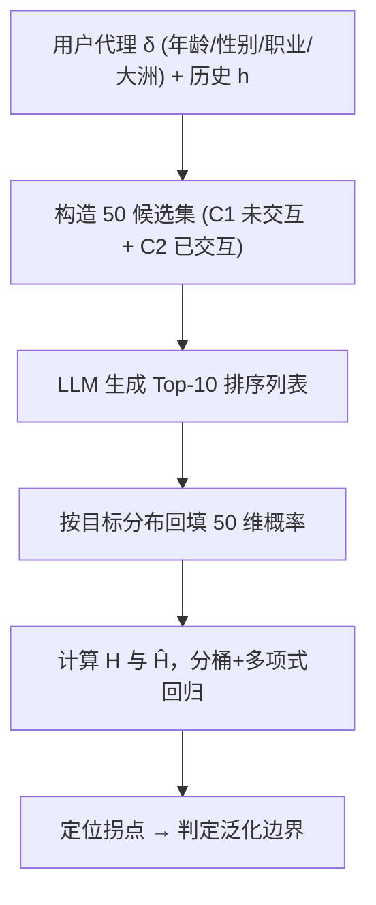

# User Behavior Prediction as a Generic, Robust, Scalable, and Low-Cost Evaluation Strategy for Estimating Generalization in LLMs (以用户行为预测作为估计 LLM 泛化能力的通用、鲁棒、可扩展且低成本评测策略)

- **会议/期刊**: ACL 2025
- **作者与机构**: Sougata Saha, Monojit Choudhury (Mohamed bin Zayed University of Artificial Intelligence, MBZUAI)
- **推荐链路定位**: 端到端生成式（LLM 直接生成 Top-10 排序列表）
- **研究方向**: 大语言模型推荐 (LLM4Rec) / 评测基准与泛化度量
- **论文原文**: [https://arxiv.org/abs/2507.05266v1](https://arxiv.org/abs/2507.05266v1)
- **开源代码**: 暂未开源

## TL;DR (1分钟核心速览)

针对 LLM 评测中日益严重的数据污染（训练集已吞下测试集）问题，本文主张放弃知识检索/推理类任务，转而用**用户行为预测（个性化推荐）**作为泛化能力的试金石：因为用户偏好随时间漂移、无法被死记硬背。作者提出基于**目标熵 $H$与模型交叉熵$\hat{H}$ 的拐点（inflection point）框架**，在 MovieLens 与 Last.fm 上以 50 候选、Top-10 排序协议测试 GPT-4o、GPT-4o-mini、Llama-3.1-8B。结果显示 GPT-4o 拐点最低（泛化最好），Llama 接近随机基线，且所有模型在"仅历史"（最强泛化测试）下均显著劣化，说明个性化泛化仍有巨大空白。

## Background & Motivation (背景与核心矛盾)

- **主流范式**: 当前 LLM 评测以 MMLU、GSM8K、GLUE 等任务为中心（task-centric）基准为主，衡量知识检索与推理能力。
- **前人局限**: ① 训练语料将在 2026–2032 年被耗尽，测试集"未见"几乎无法保证，任务污染（task contamination）使分数虚高；② 任务中心基准测的是"通用能力"，而 LLM 本质是在海量人类行为数据上做下一词预测，二者目标错配，无法区分"记忆"与"泛化"。
- **核心洞察 (Key Insight)**: 几乎所有在线数据都是"用户在特定上下文中的行为"，因此 LLM 的内在任务其实是**从上下文预测用户行为**；而用户偏好随时间动态演化，模型无法靠记忆用户历史来作弊——这天然构成抗污染的泛化测试。
- **本文切入点**: 将个性化从"被优化的目标"翻转为"度量泛化的工具"，用信息论中的熵差刻画模型在多大用户粒度上还能保持预测能力。

## Method (核心方法设计)

### 1. 整体框架 (Overall Architecture)

形式化地，数据点定义为三元组（上下文 $c_t$、用户代理$\delta_j$、行为$b_t$），其中$\delta_j$是年龄/性别/职业/大洲等人口统计代理（demographic proxy），代表一个用户群。模型被要求在给定代理与历史$h$的条件下，从 50 个候选中排出 Top-10。评测不看向传统 NDCG，而是对每个代理计算**目标分布熵$H(B_T|\delta_j)$** 与**模型交叉熵$\hat{H}(B_T|\delta_j)$**，将$(H,\hat{H})$散点做分桶平滑与四次多项式回归，观察曲线偏离$X=Y$ 对角线的**拐点位置**：拐点越低（在越小熵、越细粒度用户群上仍贴合对角线），泛化越强。三种代理设置对应泛化难度连续谱：仅人口统计（最弱）→ 人口统计+历史（平均）→ 仅历史（最强）。

### 2. 关键设计拆解 (Key Designs)

1. **熵-交叉熵拐点泛化度量（核心理论贡献）**：传统 accuracy 无法区分记忆与泛化。本文定义泛化能力与期望熵差成反比：
$$\text{Gen}(\theta) \propto -\mathbb{E}_{\delta_j}\left[\hat{H}(B_T|\delta_j) - H(B_T|\delta_j)\right]$$
其中 $\hat{H}(B_T|\delta_j)=-\sum_{b_i}p(b_i|\delta_j)\log p(b_i|\delta_j,\theta)$。理想泛化时散点落在$X=Y$线上；实际中当目标熵$H$降低（用户群变小、预测更需个性化）时$\hat{H}$ 反而上升，曲线出现拐点。**直觉**：拐点即模型"从群体泛化退化为无法个性化"的临界粒度，拐点越低说明模型能撑到越细的用户粒度。

2. **三级代理难度谱（Weakest / Average / Strongest Case）**：依据行为与用户的条件独立性划分任务复杂度：$B_T \perp\!\!\!\perp U|c_t$为最弱（MMLU 类通用任务），$B_T \perp\!\!\!\perp U|c_t,\delta_j$为平均（文化类基准），$B_T \not\perp\!\!\!\perp U|c_t,\delta_j$ 为最强（个体推荐）。本文用 Setup C（仅人口统计）、Setup A（人口统计+历史）、Setup B（仅历史）分别对应三档，从而把"泛化"变成可分级测量的连续量。

3. **候选采样与乐观评估协议**：Algorithm 1 对每个历史长度 $h\in\{0,1,3,5,10,20\}$采样$h$个物品，取交互过其中 ≥60% 的用户群$u_h$（少于 3 人则中断）；候选集$C_1$为$K/2$个群体从未交互物品、$C_2$为剩余已交互物品，共$K=50$。由于只让模型输出 Top-10，评测时将目标概率降序的前 10 名赋给模型预测项、其余 40 项按目标概率降序回填——这是**乐观估计**（对模型有利），因此真实泛化差距只会更大。温度设为 0，无训练、无负采样，纯 zero-shot prompting。

## Experimental Setup & Evaluation Protocol (实验设置与评估协议)

- **数据集与预处理**:

| 数据集 | #Users | #Items | #Interactions | 过滤/场景说明 |
| :--- | :---: | :---: | :---: | :--- |
| MovieLens-1M | 6,040 | ~3,900 | ~1M | 剔除职业为 others，保留 ≥30 人的（年龄×性别×职业）组合 |
| Last.fm | ~1,000 | — | — | 按国家映射大洲，仅保留欧/北美/南美/英国且 ≥5,000 交互用户 |

- **数据划分与防穿越**: 非传统训练/测试划分，而是**按代理+历史长度构造约 5,000 条 prompt/域**的评测集；历史长度 $h$ 从 0 到 20 递增，天然规避固定测试集污染。
- **排名评测协议**: 非 Full-Ranking，而是 **50 候选 Sampled Ranking + Top-10 生成**，并以目标分布回填得到乐观交叉熵估计；核心指标为熵-交叉熵曲线的**拐点位置**与代理/历史分桶分布。
- **对比基线与超参**: 基线为 Random（50 选 10 随机）；模型为 GPT-4o、GPT-4o-mini、Llama-3.1-8B-Instruct；温度 0；GPT 实验总花费约 USD 192，Llama 在 2×48GB RTX 6000 Ada 上约 18 小时。

## Key Experimental Results (实验关键数据)

### 1. 主实验对比 (Main Results)

原文以回归曲线拐点与分布图呈现（无传统 NDCG 表），下表汇总各设置在电影/音乐域的定性排序与关键观察：

| 模型 | 电影 Setup A | 电影 Setup B | 电影 Setup C | 音乐整体 | 相对 Random |
| :--- | :---: | :---: | :---: | :---: | :---: |
| **GPT-4o** | **拐点最低** | 优于 mini | **最贴 X=Y** | **最优** | 显著优于 |
| GPT-4o-mini | 次优 | 次优 | 次优 | 次优 | 优于 |
| Llama-3.1-8B | 较差 | 较差 | 较差 | 接近 Random | 略优 |
| Random | 拐点最高 | — | — | 最差 | — |

### 2. 消融实验 (Ablation Study)

以"代理/历史配置"作为消融维度（移除某类上下文）：

| 配置 | 电影表现 | 音乐表现 | 说明 |
| :--- | :---: | :---: | :--- |
| Setup A (人口统计+历史) | 拐点最低 | 优于 B | 文化信息+历史协同最有效 |
| Setup B (仅历史) | 劣于 A | 劣于 A | 最强泛化测试，模型明显吃力 |
| Setup C (仅人口统计) | 拐点最低但任务最弱 | GPT-4o 拐点低 | 宽代理易泛化，细代理失效 |
| Proxy=All + 长历史 | 交叉熵上升 | 交叉熵上升 | 代理组合增多反而劣化 |

### 3. 关键实验发现 (Key Findings)

1. **模型能泛化到"群体"却无法泛化到"个体"**：随目标熵 $H$下降（用户群缩小），所有 LLM 的交叉熵$\hat{H}$ 均上升并偏离对角线，说明模型只在粗粒度代理上有效，一旦需要个体级个性化即失效——这正是"最强泛化"未被满足的直接证据。
2. **历史越长反而越差**：在 Setup B 与 Proxy=All 下，历史从 0 增至 20 时交叉熵持续上升，暴露 LLM 无法有效利用长上下文做个性化（与已知的 context 利用不足现象一致），而非"信息越多越好"。
3. **音乐比电影更难，且代理选择不当**：音乐域所有模型拐点显著高于电影，Llama 几乎贴 Random；作者归因于音乐交互更密集（听歌频次远高于看电影）且所用人口统计代理对音乐偏好解释力不足，提示代理设计本身是框架的关键超参。

## Highlights & Limitations (亮点、对比与审稿批判)

- **与代表作对比 (vs. Prior Work)**: 与 Lin et al. (2023)、Wu et al. (2024) 等"LLM 用于推荐"的工作目标相反——本文不追求提升推荐精度，而是把推荐当作**泛化度量工具**；与 MMLU/GSM8K 等任务中心基准相比，本文用动态、无法记忆的用户偏好规避污染；与 Turing 模仿游戏相比，本文要求模型模仿**特定用户**而非任意人类，难度更高。
- **可迁移亮点**: ① "熵-交叉熵拐点"可作为任何生成式推荐模型（TIGER、LLM4Rec）的细粒度泛化诊断工具，替代单一 accuracy；② 用人口统计代理构造分级难度测试集的做法，可低成本迁移到冷启动/跨域泛化评测。
- **审稿级局限批判**: ① 仅两个域、三种模型、英文 prompt，且 GPT 闭源导致复现需付费，框架的跨语言/跨行为类型鲁棒性未验证；② 评测采用目标分布回填的**乐观估计**，且假设用户行为可随机建模、可从大样本估计真实分布，若行为非随机或数据规模不足，熵估计噪声会系统性高估/低估泛化；③ 50 候选的小规模排序与真实工业全库召回场景差距较大。

## Rating (四维评分)

- **方法创新性 (Novelty)**: ⭐⭐⭐⭐ （将个性化翻转为泛化度量、用熵拐点刻画泛化边界的视角新颖，理论框架清晰但偏概念性）
- **评估协议与实验扎实度 (Protocol & Experiments)**: ⭐⭐⭐ （三级代理难度谱设计巧妙，但仅两数据集三模型、乐观回填估计、缺显著性检验）
- **写作与数学规范度 (Clarity & Rigor)**: ⭐⭐⭐⭐ （熵框架公式简洁、Turing/Wittgenstein 哲学动机铺陈充分，但部分论证偏思辨、缺严格推导）
- **工业落地与复现价值 (Industrial & Practical Value)**: ⭐⭐⭐ （低成本复用现有推荐数据集是亮点，但闭源模型付费复现、50 候选小规模限制了直接工程部署）

