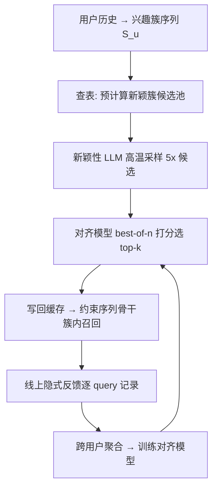
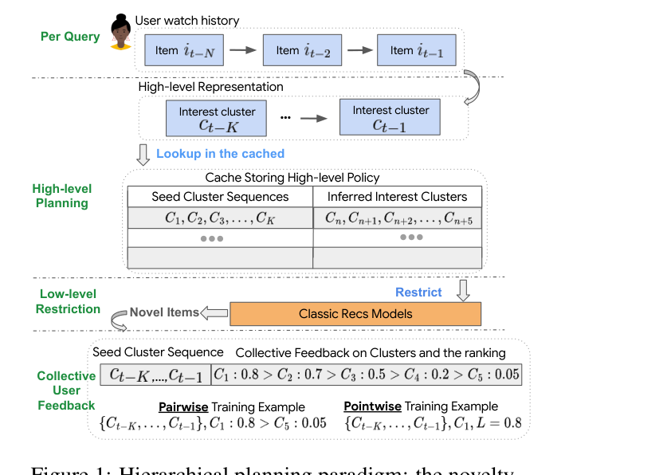

# User Feedback Alignment for LLM-powered Exploration in Large-scale Recommendation Systems (大规模推荐系统中 LLM 探索的用户反馈对齐)

- **会议/期刊**: ACL 2025 (Industry Track, Oral)
- **作者与机构**: Jianling Wang, Yifan Liu 等 (Google DeepMind / YouTube / Google Labs)
- **推荐链路定位**: 召回（兴趣簇级高层规划 + 底层序列模型受限召回）
- **研究方向**: 大语言模型推荐 / 强化学习与动态探索推荐
- **论文原文**: [https://arxiv.org/abs/2504.05522v4](https://arxiv.org/abs/2504.05522v4)
- **开源代码**: 暂未开源

## TL;DR (1分钟核心速览)

针对分层规划式 LLM 探索推荐中"新颖性 LLM 预测的兴趣簇与用户真实偏好脱节"这一痛点，本文把**新颖性生成**与**用户对齐**解耦为两个独立 LLM：新颖性模型高温重复采样 $n$倍候选簇，再由一个用**集体隐式反馈**（跨用户聚合的点赞率/完播率）训练的对齐模型做 best-of-$n$ 选择。在十亿级短视频平台的线上 A/B 中，正反馈率与完播率显著提升，同时新颖曝光比仍为全系统最高，实现了"高新颖 + 高满意"的罕见组合。

## Background & Motivation (背景与核心矛盾)

- **主流范式**: 分层规划范式（Wang et al., 2024c）用轻量微调的 LLM 在**兴趣簇级**预测用户下一个新颖兴趣簇，再约束传统 Transformer 序列模型只在该簇内做 item 级召回，兼顾 LLM 世界知识与工业级 QPS。
- **前人局限**: ① 仅用 <8k 交互样本微调，覆盖不了庞大用户群，且 LLM 推理时约 40% 概率重复训练数据，扩大训练集会强化系统反馈回路、损害新颖性；② 直接套用经典 RLHF 会**灾难性坍缩**——5k 步后格式正确率从 99%+ 跌至 2%，并出现 reward hacking（高频预测 "cat"、"BTS" 等高分词）。
- **核心洞察 (Key Insight)**: 新颖性与相关性是**相互竞争**的目标，让单个 LLM 同时学两者易致灾难遗忘；而用户对 LLM 自身推荐的反馈（点击、停留、重复观看）独立于系统行为，可作为**去回路**的对齐信号。
- **本文切入点**: 拆成"生成"与"评判"两个专职 LLM，用集体反馈训练评判者，再以推理时扩展放大生成者的候选池。

## Method (核心方法设计)

### 1. 整体框架 (Overall Architecture)

线上服务时，用户近期观看历史被映射为长度 $K=2$的兴趣簇序列$S_u=\{C_1,\dots,C_K\}$，通过查表命中**离线预计算**的新颖兴趣转移（覆盖所有$k$簇组合，规避在线 LLM 推理成本）；新颖性 LLM 对每个序列离线高温采样$5\times$候选簇，对齐模型逐条打分并取 top-$k$ 写回缓存；底层序列推荐骨干仅在被选中的簇内检索 item。用户对这些新颖推荐的隐式反馈被逐 query 记录、跨用户聚合，回流训练对齐模型，形成闭环。

<figure class="paper-figure" markdown="span">
  <figcaption>图1：分层规划范式：新颖性LLM对新兴趣转移进行高层规划，用于约束经典推荐模型的预测，并将用户对这些新颖推荐的反馈汇总以训练单独的对齐LLM。</figcaption>
</figure>

### 2. 关键设计拆解 (Key Designs)

1. **集体用户反馈对齐（Collective Feedback Alignment）**：单用户隐式信号稀疏且噪声大，无法构成可靠监督。本文对每个转移对 $(\{C_1,\dots,C_K\}, C_n)$聚合全体用户的反馈得分$L_{(1,k),n}$（如点赞率、分享率），经**归一化 → 低频过滤 → 定间隔取整**三步后作为软标签，用交叉熵训练一个末层为线性投影的 LLM 打分器：
   $\mathcal{L}_{\text{align}}=-\sum_{(\cdot,C_n)} L_{(1,k),n}\log \hat{r}(C_n\mid C_1,\dots,C_K)$
   直觉：聚合把"个体噪声"平均成"群体偏好先验"，且该信号来自 LLM 推荐本身而非系统旧策略，天然绕开反馈回路。
2. **推理时扩展 + Best-of-N 选择（Inference-Time Scaling）**：单次贪心解码易落入低置信、与历史无逻辑关联的簇。本文以高温度独立采样 $5\times$候选，由对齐模型排序取 top-$k$（$k$ 为线上实际服务簇数）。由于采样、打分、选择**全部离线批量完成**，线上服务簇数不变，**零额外延迟**，扩展成本被离线批推理摊薄；同时重复采样提升推理质量而不牺牲新颖性。
3. **训练目标、标签形式与推理效率**：对齐模型同时试验 pointwise（回归聚合得分）与 pairwise（同序列内 $C_n$两两对比，$K$-choose-2 扩样本、免归一化与阈值）两种标签。线上最终选 pointwise：其打分经先验归一化更**校准**，且训练速度快 2 倍；pairwise 只学相对序，对新簇打分失准。

## Experimental Setup & Evaluation Protocol (实验设置与评估协议)

- **数据集与场景**: 商业短视频平台十亿级用户线上流量；兴趣簇由 item 元数据与内容 embedding 聚类生成。离线评估用兴趣簇转移的 holdout 集（含真实反馈得分排序）。新颖性/对齐模型均基于 Gemini 微调。

| 场景 | 规模 | 序列长度 | 训练样本 | 说明 |
| :--- | :---: | :---: | :---: | :--- |
| 线上 A/B | 十亿级用户 | $K=2$ | 对齐模型 5w/10w 步两臂 | 短视频推荐，簇级规划 |
| 离线 holdout | 簇转移对 | $K=2$ | <8k（新颖性模型） | 反馈得分排序评估 |

- **数据划分与防穿越**: 线上采用**时间分段 A/B 实验**（实验期 vs 对照期），离线用 holdout 簇序列；对齐模型训练数据来自线上实时反馈日志，与离线评估集分离。
- **排名评测协议**: 离线为**簇级排序评估**（非 item 全库排序），指标 F1@K 与 NDCG@K（$K$=线上服务簇数）；线上为**全流量无偏 A/B**，指标含正反馈率、完播率、新颖曝光比、UEUC。
- **对比基线与超参**: 探索型基线——层次 Contextual Bandit（树状 LinUCB）、Neural Linear Bandit DNN；利用型基线——双塔模型、Transformer 序列模型；以及无对齐的新颖性 LLM 基线。对齐模型训练 5w 步（F1 收敛点）为优臂，10w 步为过拟合对照臂。

## Key Experimental Results (实验关键数据)

### 1. 主实验对比 (Main Results)

线上 A/B 以层次 Contextual Bandit 为基准（图 4(a)，数值为相对提升方向）：

| 模型 | 新颖曝光比 | 正反馈率 | 类型 |
| :--- | :---: | :---: | :--- |
| 双塔 / Transformer 序列 | 低 | 中 | 利用型 |
| Neural Linear Bandit | 中 | 中 | 探索型 |
| 层次 Contextual Bandit (base) | 基准 | 基准 | 探索型 |
| 新颖性 LLM（无对齐） | **最高档** | 偏低 | 探索型 |
| **本文（对齐 + Best-of-N）** | **全系统最高** | **显著优于全部基线，甚至超过利用型** | 探索型 |

离线对齐模型（图 3）：F1 相对随机提升约 **+0.20 ppb**、NDCG 提升约 **+0.09 ppb**，全程稳定优于随机基线。

### 2. 消融实验 (Ablation Study)

| 配置 | 正反馈率 | 完播率 | UEUC（兴趣广度） | 备注 |
| :--- | :---: | :---: | :---: | :--- |
| 新颖性 LLM（无对齐） | 基准 | 基准 | 基准 | 对照 |
| + 对齐（pointwise 标签） | **最优** | **最优** | **最优** | 线上部署 |
| + 对齐（pairwise 标签） | 略低 | 略低 | 略高 | 训练慢 2×，打分未校准 |
| 对齐模型训练 10w 步（过拟合） | 低于 5w 步臂 | — | — | 记忆精确排序有害 |

### 3. 关键实验发现 (Key Findings)

1. **新颖与满意可同时提升**：对齐后正反馈率上升仅以"轻微"新颖性为代价，但新颖曝光比仍居全系统之首，且质量反超利用型模型——把系统推到了操作曲线更优的位置，打破了二者此消彼长的常规认知。
2. **对齐模型存在明确过拟合拐点**：5w 步（F1 收敛）臂的正反馈增益显著大于 10w 步臂；NDCG 鼓励复现精确排序，而 top-$n$选择只需识别 top-$K$ 相关簇，故应以 F1@K 而非 NDCG 做 checkpoint 选择。
3. **pointwise 优于 pairwise**：按反馈先验归一化的 pointwise 标签带来更校准的打分，线上三项指标全面领先，且训练快 2 倍；UEUC 对高活跃用户更高，说明对齐模型更贴合贡献多数反馈的核心用户偏好。

## Highlights & Limitations (亮点、对比与审稿批判)

- **与代表作对比 (vs. Prior Work)**: 相比分层规划基线（Wang et al., 2024c），本文不改生成器而**外挂一个反馈训练的选择器**，避免扩训练集强化回路；相比经典 RLHF，规避了格式坍缩与 reward hacking；相比 PIE 等 bandit 探索，突破了系统内部知识边界，借 LLM 世界知识生成真正"簇外"候选。
- **可迁移亮点**: ① "生成器高温多采样 + 轻量判别器 best-of-$n$"的离线解耦范式，可零延迟迁移到任何有离线批推理预算的召回/规划环节；② 把稀疏隐式信号跨用户聚合为软标签，是工业界低成本构造 LLM 对齐监督的通用技巧。
- **审稿级局限批判**: ① 全部结论来自单一平台线上 A/B，缺少公开数据集与离线可复现基准，学术可比性弱；② 预计算所有 $k$簇组合的转移表在$K$增大时组合爆炸（文中仅$K=2$），稀疏表实现的扩展性与冷启动簇覆盖未量化；③ 对齐模型偏向高活跃核心用户，长尾用户的新颖推荐质量可能被系统性低估。

## Rating (四维评分)

- **方法创新性 (Novelty)**: ⭐⭐⭐⭐ （解耦双 LLM + 集体反馈 + 推理时扩展的组合在工业探索场景中新颖且自洽，但单点技术均为已知组件的巧妙拼装）
- **评估协议与实验扎实度 (Protocol & Experiments)**: ⭐⭐⭐⭐ （十亿级线上 A/B 极具说服力，含过拟合臂与标签形式对照；扣分在缺公开数据集与离线复现）
- **写作与数学规范度 (Clarity & Rigor)**: ⭐⭐⭐⭐ （系统叙述清晰、失败经验坦诚，但公式化程度低、缺复杂度与延迟的定量分析）
- **工业落地与复现价值 (Industrial & Practical Value)**: ⭐⭐⭐⭐⭐ （已全量部署、零线上延迟、离线摊薄成本，工程范式可直接复用；仅代码未开源略减分）

